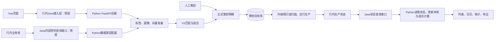

# 多账号智能策划

本项目作为整体业务页面嵌入客户系统，包含 **AI策划配置、人工策划、策划结果** 三个入口。宿主系统负责登录和操作人身份；本项目负责策划、结果查询及与内容生产的衔接。

[文档索引](docs/README.md) · [当前实现与交接状态](docs/CURRENT_STATE.md) · [架构改造备忘V0.2](docs/行内整合架构改造备忘_V0.2.md) · [持久化执行与统一查询](docs/README.md#execution-query-release) · [前端业务组件](docs/README.md#frontend-business-components)

行内目标为Vue → 行内已有Java工程 → Python FastAPI。Java的转发、身份权限、调度和资料SQL直接写入行内工程；本仓库不建设Java模块，只提供[方法、字段及接入参考](docs/integration/java-host/README.md)。Vue与Python独立开发运行，保留策划业务和算法；Python只维护策划库，内容侧经授权只读策划结果并生产。工程归属见[V0.2备忘](docs/行内整合架构改造备忘_V0.2.md)，统一唤醒及后台执行仍待改造。

## 整体流程



行内业务库保存账号、选题、营销内容和互动事实，由Java查询。策划侧通过稳定ID关联自有数据，在独立策划库保存配置、派生数据、任务、正式结果和必要快照，不直接访问业务库。内容侧的只读账号、扫描、领取、生产及重试由行内实现；Python不提供内容领取与回传入口，只通过Java读取状态并在本库更新投影、使用事实和计数。

当前普通选题主链已在开发数据源、真实模型和 MySQL 下验收；Python侧Java读取适配通过本地模拟查询验证，Java只作为交接参考材料。真实Java转发、宿主身份权限、实际SQL及内容Agent尚未接通。历史同库验收仅用于验证策划业务。

## 技术与运行结构

- 前端：Vue 3、TypeScript、Vite、Vue Router、Pinia。
- 后端：Python、FastAPI、PyMySQL。
- 数据库：目标为行内业务库与策划库隔离；Python的MySQL连接仅指向策划库，基础资料通过Java接口读取。
- 后台当前实现：统一 Worker 轮询周策划、热点 T-1、自动流程和人工任务。行内目标为宿主统一唤醒、FastAPI内受控执行及持久化恢复，尚未完成，不能把当前Worker直接作为行内调度接入。
- 模型：共用一个文本模型入口和一个向量模型入口。当前适配火山方舟豆包，业务配置使用 `MODEL_NAME`、`EMBEDDING_MODEL_NAME` 和 `ARK_API_KEY`。

项目采用模块化单体，业务归为配置管理、数据准备、策划执行、内容生产衔接、结果查询五部分。已提取 `api/`、`services/`、`core/`、`adapters/`、`jobs/`，HTTP 与准备流程复用已迁移的应用服务，V1/V2 共用候选规则。人工非营销任务已改为持久化领取，结果列表、详情及导出已统一查询范围；其余 SQL、模型适配和页面组件继续按用例收拢。

## 当前代码入口

| 职责 | 当前入口 |
| --- | --- |
| 前端路由与三个页面 | `frontend/src/router.ts`、`frontend/src/views/` |
| ASGI 入口、HTTP 装配与页面接口 | `backend/app/main.py`、`bootstrap.py`、`api/` |
| 标签、向量、准备、配置、人工策划和结果用例 | `backend/app/services/` |
| 公共算法与序列化规则 | `backend/app/core/` |
| 结果 SQL 投影与行内资料批量读取 | `backend/app/adapters/` |
| 行内查询契约、Java HTTP资料与状态适配 | `backend/app/bank_bridge/` |
| 行内Java方法及字段参考模板，不参与应用构建 | `docs/integration/java-host/templates/` |
| 行内Java驻场实现步骤与边界说明 | `docs/integration/java-host/README.md` |
| 行内生产状态读取与策划库状态投影 | `backend/app/services/content_status.py` |
| 普通选题变化发现与模型准备 | `source_discovery.py`、`planning_input_runner.py` |
| 后台统一入口、周触发与流程推进 | `jobs/worker.py`、`ordinary_scheduler.py`、`planning_workflow_worker.py` |
| 人工任务提交、领取、恢复与重试 | `services/manual_planning.py`、`services/manual_tasks.py` |
| 统一结果范围、列表、详情与CSV | `services/result_scope.py`、`result_lists.py`、`plan_queries.py`、`result_export.py` |
| 输入冻结、匹配任务与正式提交 | `ai_preparation.py`、`matching_tasks.py`、`planning_result_commit.py` |
| V2 算法 | `matching_executor_v2.py`、`matching_algorithm_v2.py`、`matching_portfolio_v2.py` |
| 生产状态投影与成功计数 | `services/content_status.py`；内容侧自行扫描并生产 |
| 配置读取与目录 | `system_config.py`、`system_config_catalog.py` |

表中的 Python 文件均位于 `backend/app/`。`main.py` 与 `integration.py` 已缩为兼容入口，不再承载业务 SQL。人工任务列表使用服务端分页；三种策划详情按账号或周分页读取，概览和分类分布按全部筛选结果统计。

## 初始化与配置

数据库连接从根目录 `.env` 读取，仅包含 `MYSQL_HOST`、`MYSQL_PORT`、`MYSQL_USER`、`MYSQL_PASSWORD`、`MYSQL_DATABASE`；兼容历史 `docs/.env`。端口、模型、鉴权及自动策划绑定配置保存在 MySQL `godp_system_config`。

在 `backend/` 下使用已安装依赖的 Python 环境：

```bash
python -m pip install -r requirements.txt
python -m app.init_db
```

已有库升级本轮生产扫描扩展字段：

```bash
python -m app.init_shared_workflow_db
```

所有策划自有表使用 `godp_` 前缀，表与字段均需中文说明及规定的审计字段，不使用外键、存储过程、数据库函数或视图。

`bank_bridge/factory.py` 按MySQL配置装配本地开发夹具或Java HTTP数据源，拒绝 `bank_sql` 与 `local_sql`。夹具不随Git或驻场包交付。行内源表SQL由Java执行，Python不持有业务库凭据；具体URL、鉴权与字段映射待驻场补齐。

周自动策划由 `AUTO_PLANNING_POLICY_ID` 绑定已批准的 V2 策略，`AUTO_PLANNING_ACCOUNT_IDS` 指定试运行账号范围；当前周主链使用 `ordinary_only`。配置语义及当前Java读取边界见[当前实现状态](docs/CURRENT_STATE.md)；历史同库闭环只作业务验证参考。

## 启动与检查

本地开发启动后端和前端（各在独立终端）：

```bash
# backend/
uvicorn app.main:app --host 0.0.0.0 --port 6930

# frontend/
npm install
npm run dev
```

访问 `http://localhost:930`。本地独立开发由Vite代理Python；行内模式只代理 `JAVA_GATEWAY_URL`，未配置时明确失败。还需在 `backend/` 下运行 `python -m app.jobs.worker`。Java不启动，也不属于本地运行依赖；待驻场补接入转发、资料查询及认证权限。

服务器启动、停止和状态检查使用根目录的 `start.sh`、`stop.sh`、`status.sh`；监听地址和端口使用 MySQL 中的配置，完整部署说明从文档索引查阅。

在 `backend/` 下运行单元测试：

```bash
python -m unittest discover -s tests
```

在 `frontend/` 下验证业务规则、类型与构建：

```bash
npm test
npm run build
```

前端业务组件按 `components/config/`、`components/manual/`、`components/planning/` 分组。人工账号、选题选择状态分别由 `useManualAccountSelection`、`useManualTopicSelection` 管理；页面负责步骤衔接、提交和路由，账号/周期/批次共用日历、统计和计划详情抽屉。具体职责见[前端业务组件](docs/README.md#frontend-business-components)。

真实模型验收需要显式运行 `python -m app.run_shared_workflow_acceptance` 并传入未占用的周一周期及已批准策略 ID。该命令会写入测试数据并调用模型，参数和限制见同库闭环说明。

## 开发边界

- 人工非营销：投放日期、账号和选题确认后形成策划明细。
- 人工营销：一个选题与生成内容总数量形成需求，账号分配和审核结果由下游衔接；已有过审营销库存直接引用。
- 账号、周期、批次是查看结果的三种范围，分别显示约定的详情名称，复用结果查询和详情组件。
- 前端页面接口、行内能力包装与后台任务入口职责分别明确，核心业务规则只有一个维护位置。
- 旧同步、主动投递和旧内容生产接口已停用，部分代码与 14 张旧表仍待清理。旧表物理删除受数据库 DROP 权限限制，状态与备份说明见文档索引。
- `seed_demo`、`seed_large_demo`、`seed_prototype` 等历史种子仍有旧表依赖；`run_ordinary_workflow_demo` 已关闭并指向新的验收命令。历史实现隔离于 `legacy/`，不进入驻场包。

业务与界面资料以 [最新文档索引](docs/README.md) 为入口，历史 PRD 和旧接口定义保留追溯。

