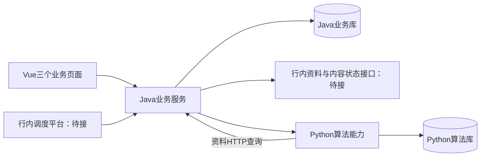

# 多账号智能策划

本项目作为整体业务页面嵌入客户系统，包含 **AI策划配置、人工策划、策划结果** 三个入口。宿主系统负责登录和操作人身份；本项目负责策划、结果查询及与内容生产的衔接。

[文档索引](docs/README.md) · [三工程迁入执行清单](docs/行内三工程迁入执行清单_V0.1.md) · [当前实现与交接状态](docs/CURRENT_STATE.md) · [三工程契约与迁移](docs/contracts/README.md)

前端已适配Node16.13.0及客户指定Vue2依赖；宿主迁入步骤见[前端接入说明](frontend/VUE2_INTEGRATION.md)，最新清理、修复与验收见[前端复核记录](docs/前端复核与修复_2026-11-04.md)。

2026-11-05已统一两侧39张正式表的六公共字段。已有数据库需先按[表结构升级说明](docs/表结构公共字段规范与升级_2026-11-05.md)停服、备份并升级，再启动新版后端；新库使用完整DDL。开发库已完成升级及数据核对。

行外回归统一运行`python -m testing`；固定合成数据、算法基线、离线对比报告和分工程命令见[测试工具说明](testing/README.md)。默认不连接现有业务库或调用真实模型。

部署模式统一使用`PLANNING_ENV=outside/inside`，保存在MySQL系统配置。切换与宿主装配说明见[双环境切换](docs/双环境切换_V0.1.md)；inside缺少宿主配置时明确报错，不降级到行外模拟。

本仓库现分为三个可独立构建的子项目，未来分别整合进客户现有三个工程：

| 子项目 | 当前职责与独立说明 |
| --- | --- |
| [frontend](frontend/README.md) | Vue三个页面、组件及请求封装，默认只访问Java |
| [java-backend](java-backend/README.md) | Java 8业务模块；配置发布、人工/自动任务、正式结果、热点/营销衔接与SQL分页报表 |
| [python-backend](python-backend/README.md) | FastAPI算法服务；算法配置、画像、向量、匹配、冻结输入与计算提案 |

行外结构改造在`feature/planning-v2`推进：已建立S0协议/SQL基线，并将Java拆为api、entity、client、services、server五模块。阶段结果、校准项及后续任务见[执行记录V0.1](docs/行外独立改造执行记录_V0.1_2026-11-07.md)。本轮没有执行实际数据库迁移或重启运行中的服务。

后续实体、事务、请求入口、宿主端口及调度改造见[执行记录V0.2](docs/行外独立改造执行记录_V0.2_2026-11-07.md)。整体回归可使用`python -m testing --browser --packaging`；保留旧返回字段和查询兼容协议，未做真实行内SDK、SQL、权限或模型验收。

最新状态见[双库业务迁移与验收](docs/双库业务迁移与验收_2026-11-03.md)。当前已切换 Vue → Java业务服务 → Python算法能力，历史结果已迁入业务库，普通自动策划通过真实双库验收。内容方事实来源、行内身份与宿主调度仍需现场适配，行外空实现不代表这些系统已接通。

## 整体流程



人工任务、账号占用、正式结果、业务配置和内容状态投影写入Java业务库；Python保存算法资产及计算任务，两库物理隔离。旧Python业务数据保留追溯，当前页面已改为业务库查询。行内账号、选题、营销内容和互动事实由Java资料端口接入；本地适配器仅用于行外开发。内容生产归客户内容系统。

综合配置页面已通过持久化发布命令衔接两侧配置，Java业务版本进入Python冻结输入；普通自动策划已通过真实双库正式落库与确认恢复验收。热点T-1、营销引用及日期编排已迁入Java并完成业务测试；真实内容方、身份权限、资料接口和宿主调度仍待行内适配。具体证据与限制见[最新验收记录](docs/双库业务迁移与验收_2026-11-03.md)。

## 技术与运行结构

- 前端：Node 16.13.0/npm 8，Vue 2.6.14、Vuex 3.6.0、Axios 1.8.2、Element UI 2.15.13、Vue Router 3、TypeScript；行外使用Vite构建，驻场复用宿主构建。
- Java业务子项目：Java 8、公开Spring Boot 2.7.18兼容开发壳，MyBatis持久化普通人工业务，XLSX导出使用Apache POI；未引入内部依赖。
- 后端：Python 3.10.11、FastAPI、PyMySQL；使用独立环境安装`python-backend/requirements.txt`。
- 数据库：Java业务库与Python算法库隔离；本地可见历史已迁入Java，原Python历史保留；迁入行内时分别发布两库脚本。
- 后台执行：已整合进FastAPI生命周期，收到人工提交或Java唤醒后执行，Python不启动定时轮询。Java本地开发壳模拟调度；行内由客户调度平台调用同一唤醒客户端。业务队列、租约和断点继续持久化，见[后台执行说明](docs/BACKGROUND_EXECUTION.md)。
- 模型：共用一个文本模型入口和一个向量模型入口。当前适配火山方舟豆包，业务配置使用 `MODEL_NAME`、`EMBEDDING_MODEL_NAME` 和 `ARK_API_KEY`。

项目采用模块化单体，业务归为配置管理、数据准备、策划执行、内容生产衔接、结果查询五部分。已提取 `api/`、`services/`、`core/`、`adapters/`、`jobs/`，HTTP 与准备流程复用已迁移的应用服务，选题匹配统一为 V19：账号映射、五路召回、模型精判及组合分配。人工非营销任务已改为持久化领取，结果列表、详情及导出已统一查询范围；其余 SQL、模型适配和页面组件继续按用例收拢。

## 当前代码入口

| 职责 | 当前入口 |
| --- | --- |
| 前端路由与三个页面 | `frontend/src/router.ts`、`frontend/src/views/` |
| ASGI 入口、HTTP 装配与页面接口 | `python-backend/app/main.py`、`bootstrap.py`、`api/` |
| 标签、向量、输入准备与保留的旧业务用例 | `python-backend/app/services/` |
| 公共算法与序列化规则 | `python-backend/app/core/` |
| 结果 SQL 投影与行内资料批量读取 | `python-backend/app/adapters/` |
| 行内查询契约、Java HTTP资料与状态适配 | `python-backend/app/bank_bridge/` |
| Java普通人工业务、MyBatis持久化 | `java-backend/godp-planning-services/src/main/java/com/pab/aitmp/aiis/godp/planning/services/manual/`、`java-backend/godp-planning-services/src/main/resources/mapper/` |
| 本地装配及旧业务兼容适配 | `java-backend/godp-planning-server/src/main/java/com/pab/aitmp/aiis/godp/planning/server/dev/`、`planning/adapter/local/`、`planning/adapter/legacy/`；驻场不迁入 |
| 旧行内Java方法及字段参考模板，不参与应用构建 | `docs/integration/java-host/templates/` |
| 行内Java驻场实现步骤与边界说明 | `docs/integration/java-host/README.md` |
| 内容状态读取与业务库状态投影 | Java `manual/ManualContentStatusService`、`MarketingTaskService`；宿主提供内容事实 |
| 普通选题变化发现与模型准备 | `source_discovery.py`、`planning_input_runner.py` |
| 后台执行器、内部唤醒与单次业务处理 | `jobs/runtime.py`、`jobs/handlers.py`、`api/background_execution.py` |
| 人工业务任务提交、领取、恢复与重试 | Java `manual/ManualPlanningService`；Python `manual_compute.py`只负责已冻结输入的计算 |
| 正式结果范围、列表、详情与报表 | Java `query/SqlPlanningReadQueries`、`manual/ManualExportService`；Python旧查询只供历史兼容 |
| 输入冻结、匹配任务与正式提交 | `ai_preparation.py`、`matching_tasks.py`、`planning_result_commit.py` |
| V19 算法 | `matching_quality_executor.py`、`matching_quality.py`、`matching_allocation.py`、`matching_portfolio.py` |
| 选题生产使用次数 | Java `manual/TopicUsageService`；Python `bank_bridge/official_usage.py`经HTTP读取 |
| 配置读取与目录 | `system_config.py`、`system_config_catalog.py` |

表中未标注工程的Python文件位于`python-backend/app/`，Java业务包位于`java-backend/`。`main.py`与`integration.py`为兼容入口。人工任务列表使用服务端分页；三种策划详情按账号或周分页读取，概览和分类分布按全部筛选结果统计。

## 初始化与配置

数据库连接从根目录 `.env` 读取，仅包含 `MYSQL_HOST`、`MYSQL_PORT`、`MYSQL_USER`、`MYSQL_PASSWORD`、`MYSQL_DATABASE`；兼容历史 `docs/.env`。端口、模型、鉴权及自动策划绑定配置保存在 MySQL `godp_system_config`。

在 `python-backend/` 下使用已安装依赖的 Python 环境：

```bash
python -m pip install -r requirements.txt
python -m app.init_db
```

已有库升级本轮生产扫描扩展字段：

```bash
python -m app.init_shared_workflow_db
```

所有策划自有表使用`godp_`前缀，表与字段均需中文说明及规定的审计字段，不使用外键、存储过程或自定义数据库函数。Java业务库当前有查询视图，需随迁移脚本发布并在行内确认兼容性，不能按“完全没有视图”交接。

明确配置`PLANNING_ENV`后，`bank_bridge/factory.py`在outside和inside均使用Java HTTP，拒绝 `bank_sql` 与 `local_sql`。outside由Java读取模拟文件，inside由Java查询行内表/服务；日常开发和完整验收共享该链路。夹具不随Git或驻场包交付。Python不持有业务库凭据；行内URL、鉴权与字段映射待驻场补齐。见[统一资料链路](docs/统一资料链路_2026-11-03.md)。

周自动策划由 `AUTO_PLANNING_POLICY_ID` 绑定已批准的 V19 正式策略，`AUTO_PLANNING_ACCOUNT_IDS` 指定试运行账号范围；当前周主链使用 `ordinary_only`。配置语义及当前Java读取边界见[当前实现状态](docs/CURRENT_STATE.md)；历史同库闭环只作业务验证参考。

## 启动与检查

本地开发分别启动三个子项目（各在独立终端）：

```bash
# python-backend/
python -m app.java_development --output ../run/java-backend.properties
uvicorn app.main:app --host 0.0.0.0 --port 6930

# java-backend/，需安装JDK8及Maven
mvn package -DskipTests
java -jar godp-planning-server/target/planning-business.jar --spring.config.additional-location=file:../run/java-backend.properties

# frontend/
npm install
npm run dev
```

访问`http://localhost:930`。只需要三个服务，不再单独启动Worker。本地和行内模式都经Java；本地默认Java端口6931，行内必须配置`JAVA_GATEWAY_URL`。完整本地联调须按Java子项目README生成库内内部令牌配置；Java未配置该令牌时本地脉冲会明确报告未就绪。

服务器启动、停止和状态检查使用根目录的 `start.sh`、`stop.sh`、`status.sh`；监听地址和端口使用 MySQL 中的配置，完整部署说明从文档索引查阅。

在仓库根目录运行隔离的Python单元测试：

```bash
python -m testing --suite python
```

在 `frontend/` 下验证业务规则、类型与构建：

```bash
npm test
npm run build
```

前端业务组件按 `components/config/`、`components/manual/`、`components/planning/` 分组。人工账号、选题选择状态分别由 `useManualAccountSelection`、`useManualTopicSelection` 管理；页面负责步骤衔接、提交和路由，账号/周期/批次共用日历、统计和计划详情抽屉。具体职责见[前端业务组件](docs/README.md#frontend-business-components)。

日常资料链路可用`python -m testing.source_verify`只读核查。真实双库模型验收使用`python -m testing.live --execute`，执行前须暂停日常调度并排空无关任务，会写开发库并调用模型；详见[完整流程](docs/全流程测试与行内接入对照_V1.0_2026-11-03.md)。旧同库验收命令保留历史用途，不作为当前三工程正式闭环入口。

## 开发边界

- 人工非营销：投放日期、账号和选题确认后形成策划明细。
- 人工营销：一个选题与生成内容总数量形成需求，账号分配和审核结果由下游衔接；已有过审营销库存直接引用。
- 账号、周期、批次是查看结果的三种范围，分别显示约定的详情名称，复用结果查询和详情组件。
- 前端页面接口、行内能力包装与后台任务入口职责分别明确，核心业务规则只有一个维护位置。
- 旧同步、主动投递和旧内容生产接口已停用，部分代码与 14 张旧表仍待清理。旧表物理删除受数据库 DROP 权限限制，状态与备份说明见文档索引。
- `seed_demo`、`seed_large_demo`、`seed_prototype` 等历史种子仍有旧表依赖；`run_ordinary_workflow_demo` 已关闭并指向新的验收命令。历史实现隔离于 `legacy/`，不进入驻场包。

业务与界面资料以 [最新文档索引](docs/README.md) 为入口，历史 PRD 和旧接口定义保留追溯。

