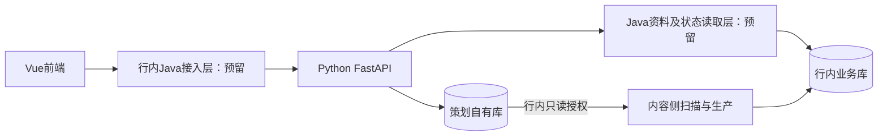

# 前后端分离与行内Java预留边界

**2026-11-02工程边界确认：** Java实现直接写入行内已有工程，本仓库不再保留Java模块。方法、字段和空方法仅以[交接文档与.java.example模板](integration/java-host/README.md)提供。工程归属见[V0.2备忘](行内整合架构改造备忘_V0.2.md)；统一唤醒与后台执行器尚未完成。前端行内代理保留建议路径，不代表Java已经接通。

Vue与Python继续分别开发、构建和部署。

## 目标结构

Java的两类职责可以放在同一个行内工程，用不同接口区分。它们不替代Python策划后端，也不相互转发形成循环。

| 模块 | 保留的内容 | 行内补充内容 |
| --- | --- | --- |
| Vue | 三个页面、组件、状态管理、统一API客户端、独立构建产物 | 嵌入宿主页面，接Java路由与登录上下文 |
| Python | FastAPI页面接口、策划规则、算法、标签、画像、向量、任务Worker、结果与导出、自有数据库 | 实际Java地址、鉴权和字段适配 |
| Java接入层 | `PlanningGateway`请求/响应对象、转发方法及空实现 | 认证、权限、可信操作人、内网HTTP转发、JSON及CSV响应透传 |
| Java读取层 | `BankDataReader`六个方法、查询与返回对象、空实现 | 在行内根据表结构补SQL、字段映射、分页和生产状态查询 |
| 内容侧 | 从策划表获取待生产需求的边界 | 自行扫描、领取、生产、重试，在行内维护状态供查询 |

## 代码预留

Java方法与对象仅为 `docs/integration/java-host/templates/` 下的文档模板，不参与本项目构建；进入行内工程后按实际包名和框架调整：

- `PlanningGateway.java.example`：页面转发方法参考。
- `PendingPlanningGateway.java.example`：待行内补充的空方法参考。
- `BankDataReader.java.example`：资料与状态读取方法参考。
- `PendingBankDataReader.java.example`：查询空方法参考。
- `BankContracts.java.example`：分页及对象字段参考，含中文注释。
- `docs/integration/java-host/contracts.json`：字段、必填项、枚举和约束参考。

空方法明确抛出“待实现”，不返回成功、空列表或虚构业务数据。没有Java主程序、监听端口、自动启动脚本或本地固定登录身份；运行Vue/Python不需要JDK。

Java读取层预留以下能力，不在本次重新编排历史IF/OP编号：

| 方法 | 查询对象 | 返回对象 |
| --- | --- | --- |
| accounts | 分页、账号ID、更新时间范围 | 账号基础信息、人设、兴趣、性别、互动明细 |
| topics | 分页、选题ID、来源、类型、更新时间及有效时点 | 普通/热点选题详情 |
| marketingContents | 账号ID、分页 | 审核通过的营销内容，先过审者优先 |
| effectiveMarketing | 账号ID、投放日期 | 当日已有的有效营销投放 |
| productionResults | 策划明细ID列表 | 当前版本、内容状态、内容ID、状态更新时间等 |
| marketingResults | 人工营销需求编号列表 | 内容状态、完成数、失败数、已分配账号数 |

基础数据的表、字段和枚举由行内确认，Python不查询行内业务库。普通/热点使用选题ID，已过审营销内容使用内容ID；策划明细及版本供内容侧关联状态，外部结果查询继续使用账号ID、选题ID等业务标识。

Python通过 `bank_bridge/ports.py` 定义方法，`factory.py` 统一装配。本地使用显式开发数据源；未来Java实现后，再接入已有通用HTTP适配器。适配器中的相对路径和令牌头是占位约定，不代表行内已确认地址或鉴权方案。

## 本地开发与行内部署

本地前端、Python API和Worker分别运行。前端单独执行 `npm run dev`、`npm run build`、`npm run preview` 不调用Python、不读取数据库，不依赖后端目录。Vite只负责开发/预览代理，页面代码统一使用相对 `/api` 路径，不写死Python服务地址。

统一启动时，`start.sh` 从MySQL读取配置，只将端口、监听地址、接入模式及Java地址传给前端进程，不传服务密钥。独立前端使用本地默认端口930/6930；这些是开发默认值，不新增配置文件。当前MySQL配置：

| 配置 | 本地 | 行内 |
| --- | --- | --- |
| JAVA_ACCESS_MODE | local_development | bank |
| JAVA_GATEWAY_URL | 留空 | Java接入层实际地址 |
| BANK_SOURCE_MODE | local_fixture | java_http |
| JAVA_API_BASE_URL | 留空 | Java资料及状态查询前缀 |
| JAVA_API_TOKEN | 无需填写 | 按最终鉴权协议设置 |
| INTEGRATION_TOKEN | 沿用内部接口配置 | Java访问Python的服务鉴权 |

所有非MySQL配置继续放 `godp_system_config`。本地代理连接Python仅用于独立开发；行内模式只连接Java，Java未配置时明确失败，不回落直连Python。正式静态部署由行内网关/Nginx将 `/api` 路由至Java。

## 驻场整合顺序

1. **整合前端**：部署Vue构建产物，接入宿主导航及Java页面API路径。
2. **整合接入层**：在行内Java工程实现 `PlanningGateway`，补现有登录、权限、可信操作人和HTTP转发；Python业务接口保持复用。
3. **整合读取层**：行内提供表结构，在Java实现 `BankDataReader`，填充约定DTO；校验更新时间范围、稳定分页、枚举和时区。
4. **整合内容衔接**：内容侧按只读授权扫描策划结果并执行生产，提供可查询状态；Python只更新本库状态投影和成功使用次数。
5. **联调一个账号、一个周期**：验证策划、状态读取、重试、重复结果不重计、导出和页面展示，再扩大规模。

主要整合工作集中在前端嵌入、Java接入、Java资料查询三处；内容侧扫描与状态关联仍需联调。替换选题与内容侧领取的并发协调也需双方确认，不能用轮询替代跨系统原子互斥。

## 历史阶段验收与交接（2026-10-31）

以下为当时的契约验证记录；当前Java材料已迁入文档目录，不再在后端验证中调用JDK，也不构成本项目的Java模块。

- Python通过277项测试；前端通过15项测试、类型检查及构建。
- Java只验证DTO与接口可编译、7个预留入口明确报告未实现，没有启动Java服务或连接行内数据库。
- 将前端复制到不含后端目录的临时工程，使用无效Python及数据库配置，独立构建和开发服务器启动均通过。
- 本地三个页面通过19项浏览器回归，前后端分别运行，项目启动脚本不含Java启动步骤。
- 驻场包包含Vue源码与静态产物、Python代码、Java契约与空实现、字段Schema和本说明；不含私有映射、密钥、开发夹具或运行日志。Python离线依赖仍需按行内环境准备。

本版没有实现或验收行内Java转发、真实资料SQL、SSO及真实内容生产，相关工作由驻场接入完成。
