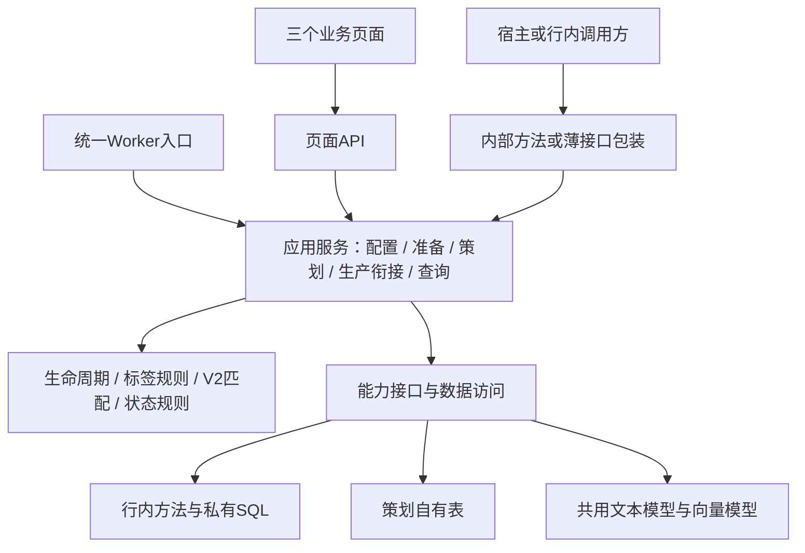

# 项目文档目录

- [Python3.10.11驻场适配（2026-11-04）](Python310驻场适配_2026-11-04.md)：客户运行版本、干净环境依赖补齐、固定数据跨版本修复及完整回归。

- [前端复核与修复（2026-11-04）](前端复核与修复_2026-11-04.md)：导出统一宿主Axios、中文编码修复、30个组件引用核查、29项测试及20个浏览器场景。

- [Node16.13.0前端适配（2026-11-04）](前端Node16适配_2026-11-04.md)：npm8/lock v2、版本约束、Windows项目入口、实际安装构建和17个浏览器状态验证。

- [Vue2驻场前端适配（2026-11-04）](前端Vue2驻场适配_2026-11-04.md) · [宿主迁入步骤](../frontend/VUE2_INTEGRATION.md)：指定四项依赖、Vuex/Axios接入、Vue2组件兼容及三页面验收。

- [首轮算法执行优化（2026-11-03）](算法执行优化记录_2026-11-03.md)：前置检查、连接池、缓存批读、2路打标与模型访问阻断；实测、完整对照受阻原因及复跑方法。

- [真实模型主流程耗时分析与优化方案（2026-11-03）](真实模型主流程耗时分析与优化方案_2026-11-03.md)：正例113.58秒，逐步计时、模型/建连/缓存分析、失败负例及优化优先级。

- [Python驻场接入与预检](../python-backend/ONSITE.md)：模型网关配置、25张算法表独立发布、只读配置/结构预检、有限Java与模型样本测试及交接包更新。

- [三工程驻场功能流程适配清单 V1.0（2026-11-03）](三工程驻场功能流程适配清单_V1.0_2026-11-03.md) · [Excel跟踪表](三工程驻场功能流程适配清单_V1.0_2026-11-03.xlsx) · [CSV源数据](三工程驻场功能流程适配清单_V1.0_2026-11-03.csv)：52项功能/流程，逐项列明交互、数据来源与去向、可复用部分、驻场工作量及验收；附7项资料能力、9类调度、数据归属、待确认项和实施顺序。

- [请求上下文、响应适配与资料分页](../java-backend/host-integration/REQUEST_CONTEXT_RESPONSES_PAGING.md)：可信UM/机构范围/追踪号、可选宿主返回格式、内部协议与下载隔离，以及统一分页和批量账号读取。

- [BankSourceFacts查询契约](../java-backend/host-integration/BANK_SOURCE_CONTRACT.md) · [字段映射表](../java-backend/host-integration/BANK_SOURCE_FIELD_MAPPING.csv) · [装配示例](../java-backend/host-integration/BankSourceBindings.java.example)：7项行内资料能力、分页/时间/状态约定、SQL或现有Service接法；真实表结构及状态编码留待驻场填写。

- [资料适配只读验收](../testing/README.md#资料适配只读验收) · [现场映射规则示例](../java-backend/host-integration/BankSourceSiteMapping.java.example)：字段/编码集中配置、互动明细批量组装、行内/行外同一有限样本验收入口，减少驻场重复实现。

- [Java宿主接入准备（2026-11-03）](Java宿主接入准备_2026-11-03.md) · [宿主装配模板](../java-backend/host-integration/README.md)：统一Python客户端、正式健康与标签入口、六类宿主绑定、任务推进和关闭行外组件的三页面验收。

- [页面数据链路与驻场接入核查（2026-11-03）](页面数据链路与驻场接入核查_2026-11-03.md)：配置历史空白修复，人工非营销/营销、任务列表和账号/时间结果查询的来源、落点、涉及表、驻场替换点及待收口口径。

- [营销、热点与模拟内容衔接验收（2026-11-03）](营销热点与模拟内容衔接验收_2026-11-03.md)：真实V19混合闭环、营销/热点业务分支、失败重试和使用次数，以及真实内容系统待接边界。

- [2026-11-03发布与交接记录](发布记录_2026-11-03.md)：本次变更范围、统一回归与只读证据、更新注意及尚待事项。

- [统一资料链路（2026-11-03）](统一资料链路_2026-11-03.md)：日常开发与完整验收共用Java资料入口、Python算法投影、行内替换边界和只读验证入口。

- [全流程测试与行内接入对照 V1.0（2026-11-03）](全流程测试与行内接入对照_V1.0_2026-11-03.md)：按步骤列明来源、落点、测试标准及驻场替换点；日常与验收共用Java HTTP，记录真实缺口与后续顺序。

- [测试账号资料补齐（2026-11-03）](测试账号资料补齐_2026-11-03.md)：90个账号资料、公共快照展示映射、当前资料查询及嵌套字段SQL筛选。

- [普通自动策划全链路验收（2026-11-03）](普通自动策划全链路验收_2026-11-03.md)：Java资料HTTP、真实V19与双库、模拟内容、计数、页面与导出对账，含失败发现和恢复记录。

- [V19算法统一说明（2026-11-03）](V19算法统一说明_2026-11-03.md)：唯一算法入口、旧版本停用、策略迁移和V19回归基线；旧算法设计及验收文档仅供历史追溯。

- [双环境切换 V0.1](双环境切换_V0.1.md)：outside行外模拟接入、inside行内宿主接入；统一选择、旧开关兼容、预检和宿主装配边界。

- [行外测试路线与算法回归 V0.1](行外测试路线与算法回归_V0.1.md) · [统一测试工具](../testing/README.md)：固定合成数据、三工程统一回归、实际V19代码回放和逐账号对比报告；与真实模型评测、驻场验收分开。

- [双库业务迁移与验收（2026-11-03）](双库业务迁移与验收_2026-11-03.md)：当前配置冻结、真实双库验收、热点/营销迁移、历史结果SQL分页及剩余行内适配点；优先于下面各 V0.1 阶段记录。

- [服务内后台执行](BACKGROUND_EXECUTION.md)：只启动三个服务；Java触发、Python受控执行、原持久化队列恢复，不再单独启动Worker。

- [三工程契约与迁移说明](contracts/README.md)：Vue／Java／Python独立子项目、当前兼容链路、目标业务归属及逐项迁移检查；替代旧V0.2的工程归属约定。

- [行内三工程迁入执行清单 V0.1](行内三工程迁入执行清单_V0.1.md)：按Vue、Java、Python列出可迁入代码、必须替换的接入点、迁移顺序和复杂度；以当前实现为准。

- [Java宿主替换点](JAVA_HOST_REPLACEMENT_POINTS.md) · [普通人工业务迁移说明](JAVA_MANUAL_MIGRATION.md)：MyBatis Mapper、五类宿主端口、历史过渡接口和业务表发布方式。

- [AI策划配置三工程改造 V0.1](AI策划配置三工程改造_V0.1.md)：四项业务配置的Java版本化落库、算法配置归属、综合页面切换顺序与两库一致性约束。

- [策划结果三工程改造 V0.1](策划结果三工程改造_V0.1.md)：正式结果的Java业务归属、多槽位表结构、批次定向查询、旧历史过渡与后续分页迁移。

- [人工营销策划业务迁移 V0.1](人工营销策划业务迁移_V0.1.md)：营销任务的Java创建、幂等、列表详情、内容侧状态端口、历史任务过渡及发布顺序。

- [三工程业务服务改造清单 V0.1](业务服务改造清单_V0.1.md)：逐项标注普通人工、营销、自动周策划、热点、配置、内容状态和结果报表的归属与剩余改造。
- [页面资料查询迁入 Java V0.1](页面资料查询Java迁移_V0.1.md)：账号列表、选题列表和选题详情的 Java 页面接口及驻场资料读取替换点。
- [自动周策划触发迁入 Java V0.1](自动周策划触发迁入Java_V0.1.md)：业务配置判定、周期幂等任务、算法启动端口和剩余正式结果迁移边界。
- [自动策划算法提案交接 V0.1](自动策划算法提案交接_V0.1.md)：Java 读取只读算法提案的契约、配置一致性校验及正式落库前的剩余步骤。
- [自动策划 Java 正式提交与确认 V0.1](自动策划Java正式提交与确认_V0.1.md)：业务事务、不可变提案和确认重试设计；后续发布结果以2026-11-03双库验收记录为准。
- [行内三工程业务迁入边界 V0.2](行内三工程业务迁入边界_V0.2.md)：按业务服务列出可复用代码、驻场替换点和仍需开发的部分。

- [三工程公共依赖与版本对齐清单（2026-11-02）](三工程公共依赖与版本对齐清单_2026-11-02.md)：客户工程／前端／Python清单核对，Java8公共依赖建议及行内组件适配边界。

- [V19适配质量链路](V19适配质量链路说明.md) · [五账号对照验收](V19五账号对照验收_2026-11-02.md)：账号映射、主关联标签、五路召回、模型精判与同输入V2对照；仅验证提案，含实际缺口。

- [账号画像映射规则 V1.0](账号画像映射规则说明_V1.0.md)：策划自有映射表、50条初始草稿规则、分类继承与末级覆盖、UNKNOWN及解析调用说明。

- [任务范围输入准备与V2匹配验收（2026-11-02）](任务范围输入准备与V2匹配验收_2026-11-02.md)：范围固定、分批断点、版本等待原因，以及5账号真实匹配结果与质量问题。

- [当前实现与交接状态（2026-11-03）](CURRENT_STATE.md)：最新双库迁移状态、验收入口及仍待行内适配的内容；历史基线单独标注。
- [行内Java工程接入交接说明（2026-11-02）](integration/java-host/README.md)：早期仅提供方法和字段模板的历史方案；当前已有独立Java业务子项目，迁入请优先使用上面的执行清单。
- [行内整合架构改造备忘 V0.2（2026-11-02）](行内整合架构改造备忘_V0.2.md)：在V0.1基础上明确工程归属和交付组织，V0.1保留。
- [行内整合架构改造备忘 V0.1（2026-11-02）](行内整合架构改造备忘_V0.1.md)：当前目标架构讨论基线。统一Java转发与宿主唤醒，FastAPI内受控后台执行，记录数据边界、改造顺序、现状差异及待确认项；后续版本在此基础上修订，不代表已经完成或通过行内验收。
- [Java接入与双库隔离：历史契约预留方案](#java-python-isolation)：仅提供Java方法模板时期的历史参考；当前已经建设Java业务子项目，使用三工程契约和驻场替换点清单。
- [架构基线、模块职责与渐进重构路线](#architecture-baseline)：当前代码核查、目标分层、前后端复用边界与重构验收。

## 最新交接与前端变更

- [最新页面功能PRD V2.1 Word（2026-10-30）](多账号智能策划_PRD_V2.1_页面同步评审稿_2026-10-30.docx) · [PDF](多账号智能策划_PRD_V2.1_页面同步评审稿_2026-10-30.pdf)：最新归档页面评审资料；行内工程归属和接入目标以架构备忘V0.2及交接说明为准，不混同业务PRD与行内实施规范。
- [功能、数据与行内适配完整对应表（2026-10-31）](账号策划系统_功能数据与行内适配对应表_V1.0_2026-10-31.md) · [Excel](账号策划系统_功能数据与行内适配对应表_V1.0_2026-10-31.xlsx)：87项功能、12个模块，逐项列出数据归属、双方职责、触发方式、适配内容、验收条件及当前状态；拟新增能力与已实现能力分别标注。
- [旧表清理 SQL](../python-backend/migrations/20261030_drop_retired_source_tables.sql)：14 张旧基础副本、同步及主动投递表已完成备份和代码依赖调整；当前数据库账号缺少 DROP 权限，物理删除尚未执行成功。
- [驻场对接方法、SQL 模板与交接包](#驻场对接开发第一版2026-10-30)：固定业务实体、统一方法、模拟数据及行内 SQL 实现；驻场填写与自检说明见文末。
- [全局 PRD V1.3 营销衔接修订稿（2026-10-28）](多账号智能策划_PRD_V1.3_营销衔接修订稿_2026-10-28.md) · [Word](多账号智能策划_PRD_V1.3_营销衔接修订稿_2026-10-28.docx) · [PDF](多账号智能策划_PRD_V1.3_营销衔接修订稿_2026-10-28.pdf)：同账号目标日已有有效营销投放时直接引用，不另填新内容；已同步流程图、同库衔接与验收。
- [历史全局 PRD V1.2 全量整合评审稿（2026-10-28）](多账号智能策划_PRD_V1.2_全量整合评审稿_2026-10-28.md) · [PDF](多账号智能策划_PRD_V1.2_全量整合评审稿_2026-10-28.pdf)：保留业务追溯；本目录未归档对应Word，不提供失效下载链接。包含32张截图、18张流程／泳道图。
- [三页面图文 PRD V1.1（2026-10-28）](多账号智能策划_三页面PRD_V1.1_图文评审稿_2026-10-28.md) · [Word](多账号智能策划_三页面PRD_V1.1_图文评审稿_2026-10-28.docx) · [PDF](多账号智能策划_三页面PRD_V1.1_图文评审稿_2026-10-28.pdf)：32 张当前界面高清截图、逐图讲解、完整需求规则及待确认项，便于上会讲解。
- [三页面 PRD V1.0 需求澄清稿（2026-10-28）](多账号智能策划_三页面PRD_V1.0_需求澄清稿_2026-10-28.md) · [Word](多账号智能策划_三页面PRD_V1.0_需求澄清稿_2026-10-28.docx) · [PDF](多账号智能策划_三页面PRD_V1.0_需求澄清稿_2026-10-28.pdf)：面向需求澄清会的字段、流程、交互、状态与异常规则，含 14 项待确认问题和 20 项核心验收场景。
- [前端页面全量逻辑核查（2026-10-28）](前端页面全量逻辑核查_2026-10-28.md)：路由、列表字段和排序、按钮、分页、弹层、提示、状态、取数及运行核查。
- [前端问题与验收清单（2026-10-28）](前端问题与验收清单_2026-10-28.md)：24项问题、复现证据、处理优先级及逐页验收项；尚未修改业务代码。
- [近期修改汇总与升级步骤（2026-10-28）](近期修改汇总_2026-10-28.md)：当前营销三步流程、总分配数量、任务分页、统计、失败导出和迁移说明。
- [数营平台 UI 规范与现有页面差异清单](数营平台UI规范与现有页面差异清单.md)
- [同库对接能力定义 Word](多账号智能策划_同库对接能力定义.docx)：近期客户沟通资料，与最新营销流程的对应关系待继续评审。
- [同库对接能力定义 V1.16（评审稿）](多账号智能策划_同库对接能力定义_V1.16_评审稿.md) · [Word](多账号智能策划_同库对接能力定义_V1.16_评审稿.docx)：OP 按行内已有账号 ID、选题 ID 查询策划详情、使用次数、标签及打标测试结果。
- [行内待确认字段与状态清单（2026-10-24）](行内待确认字段与状态清单_2026-10-24.md)
- [全功能字段与状态清单（2026-10-24 内部核查资料）](全功能字段与状态清单_2026-10-24.md)
- [人工策划营销 / 非营销双流程（已同步 2026-10-28）](人工策划双流程_2026-10-23.md)
- [会话交接与当前实现入口（2026-10-22）](会话交接_2026-10-22.md)
- [前端调整恢复清单及最终确认口径（2026-10-22）](前端调整恢复清单_2026-10-22.md)
- [单账号普通选题正式闭环](ORDINARY_WORKFLOW.md)
- 当前一级页面为AI策划配置、人工策划、策划结果；策划结果分账号列表和时间列表。页面资料以最新归档PRD V2.1和当前实现核对，工程归属以三工程契约为准；旧架构备忘、恢复清单及PRD保留追溯。

## 开发与产品

- [历史PRD V1.3 全局业务正文](多账号智能策划_PRD_V1.3_营销衔接修订稿_2026-10-28.md)：历史业务基线；最新页面稿见V2.1，待确认项不代表已验收。
- [PRD V1.2 全局整合业务正文](多账号智能策划_PRD_V1.2_全量整合评审稿_2026-10-28.md)：前次全量整合稿，保留追溯。
- [PRD V1.2 整合与排版核对记录](PRD_V1.2_整合与排版核对记录.md)
- [PRD V1.1 历史业务正文](多账号智能策划_PRD_V1.1_近期口径同步稿.md)
- [PRD V1.1 Word文档](多账号智能策划_PRD_V1.1_近期口径同步稿.docx)
- [PRD V1.1 PDF预览](多账号智能策划_PRD_V1.1_近期口径同步稿.pdf)
- [PRD V1.1 逐页排版核对记录](PRD_V1.1_排版核对记录.md)
- [PRD V1.1 开发对照](PRD_V1.1_开发对照.md)
- [PRD V1.1 修订记录](PRD_V1.1_修订记录.md)
- [PRD V1.0 近期变更影响评审（2026-10-13）](PRD_V1.0_近期变更影响评审_2026-10-13.md)
- [周度规则策划首版](ORDINARY_PLANNING.md)
- [普通选题标签识别任务](TOPIC_LABEL_JOBS.md)
- [普通选题画像与向量准备](TOPIC_PROFILE_VECTOR.md)
- [批次账号画像与向量准备](ACCOUNT_PROFILE_VECTOR.md)
- [正式 AI 匹配输入准备检查](MATCHING_PREPARATION.md)
- [正式 AI 策划输入准备流程](AI_PREPARATION.md)
- [算法策略版本与匹配执行任务](MATCHING_EXECUTION.md)
- [兜底池、历史与正式使用计数输入快照](MATCHING_SUPPLEMENTAL_INPUTS.md)
- [算法与策略说明 V1.0 草稿（待评审）](ALGORITHM_STRATEGY_V1.0.md)
- [IF-01 / IF-02 本地对接契约](IF01_IF02_本地对接契约.md)
- [IF-05 / IF-06 本地对接契约](IF05_IF06_本地对接契约.md)
- [IF-08 / IF-09 本地对接契约](IF08_IF09_本地对接契约.md)
- [同库对接能力定义（V1.16 评审稿）](多账号智能策划_同库对接能力定义_V1.16_评审稿.md) · [Word](多账号智能策划_同库对接能力定义_V1.16_评审稿.docx)
- [同库对接能力定义（历史 V1.15 评审稿）](多账号智能策划_同库对接能力定义_V1.15_评审稿.md)
- [多账号智能策划运营接口定义（历史 V1.14 流程评审稿）](多账号智能策划_运营接口定义_本次开发_V1.14_流程评审稿.md)
- [多账号智能策划运营接口定义（历史 V1.13 流程评审稿 Word）](多账号智能策划_运营接口定义_本次开发_V1.13_流程评审稿.docx)
- [多账号智能策划运营接口定义（历史 V1.8 流程评审稿）](多账号智能策划_运营接口定义_本次开发_V1.8_流程评审稿.md)
- [多账号智能策划运营接口定义（历史 V1.8 流程评审稿 Word）](多账号智能策划_运营接口定义_本次开发_V1.8_流程评审稿.docx)
- [多账号智能策划运营接口定义（历史 V1.6）](多账号智能策划_运营接口定义_本次开发_V1.6.md)
- [多账号智能策划运营接口定义（历史 V1.6 Word）](多账号智能策划_运营接口定义_本次开发_V1.6.docx)
- [多账号智能策划运营接口定义（V1.7 流程评审稿）](多账号智能策划_运营接口定义_本次开发_V1.7_流程评审稿.md)
- [多账号智能策划运营接口定义（V1.7 流程评审稿 Word）](多账号智能策划_运营接口定义_本次开发_V1.7_流程评审稿.docx)
- [多账号智能策划运营接口定义（历史 V1.4）](多账号智能策划_运营接口定义_本次开发_V1.4.md)
- [多账号智能策划运营接口定义（本次开发 V1.5）](多账号智能策划_运营接口定义_本次开发_V1.5.md)
- [多账号智能策划运营接口定义（本次开发 V1.5 Word）](多账号智能策划_运营接口定义_本次开发_V1.5.docx)
- [多账号智能策划运营接口定义（本次开发 Word）](多账号智能策划_运营接口定义_本次开发_V1.4.docx)
- [IF-03 营销选题同步本地契约](IF03_营销选题同步契约.md)
- [IF-04 热点选题同步本地契约](IF04_热点选题同步契约.md)
- [后台产品 UI 设计规范](UI设计规范_后台产品通用版_V1.0.md)
- [UI 视觉规范 V1.0：三张图稿解读与落地](UI视觉规范_V1.0_图稿解读与落地.md)
- [选题标签体系升级完整方案 V1.0（评审稿）](选题标签体系升级完整方案_V1.0_评审稿.md)
- [选题标签体系升级完整方案 V1.0（评审稿 Word）](选题标签体系升级完整方案_V1.0_评审稿.docx)
- [接口预留清单](接口预留清单_V0.1.md)
- [数据库规范说明](数据库规范说明.txt)
- [使用的框架说明](使用的框架说明.txt)
- [行内项目依赖项](行内项目依赖项.txt)

## 部署与运维

- [服务器部署说明](DEPLOYMENT.md)
- 登录、账号与角色由宿主系统提供，项目直接嵌入业务页面。
- [Nginx 配置示例](../deploy/nginx.conf.example)
- [启动脚本](../start.sh)
- [停止脚本](../stop.sh)
- [状态检查脚本](../status.sh)

## 参考原型与评审资料

- [PRD V2.1 历史页面评审实现记录](PRD_V2.1_开发对照.md)
- [PRD V1.3 历史评审记录](PRD_V1.3_开发对照.md)
- [PRD V1.0 历史开发对照](PRD_V1.0_开发对照.md)
- `多账号智能策划_运营前端原型_V2.17_4Tab.html`：四个运营Tab的历史视觉参考，业务口径以V1.1为准
- `多账号智能策划_PRD_V1.0.docx`：2026-09-30正式原稿，保留用于追溯
- `多账号智能策划_PRD_V2.17_接口业务口径全量收口稿.docx`：历史接口评审参考
- `多账号智能策划_运营前端原型_V1.0.html`：早期运营端交互参考

## 敏感文件

以下文件只保留在本地，不应提交到 GitHub：

- 项目根目录 `.env`
- `docs/.env`
- `frontend/.env.local`
- `logs/` 和 `run/`

## 驻场对接开发第一版（历史方案，已停止生产装配）

本节及后续同库扫描、Python领取/回传说明保留为历史验收记录。`bank_sql` 已被当前装配器拒绝，内容领取/回传HTTP入口已返回410；驻场请按文末Java方案执行，不再填写Python行内SQL。

这版提供固定业务实体、统一访问方法、本地兼容数据、离线模拟数据及行内 SQL 适配模板。目标是在行外完成业务开发，在行内填写 SQL、枚举映射及生产方法。尚未取得行内表结构，不表示行内 SQL、生产或完整 V2 执行链已经联调通过。

### 代码入口与装配

| 文件 | 用途 |
| --- | --- |
| [contracts.py](../python-backend/app/bank_bridge/contracts.py) | 账号、互动明细、选题、营销内容、分页、生产需求、生产结果及 OP 输入输出实体；中文别名供业务核对 |
| [ports.py](../python-backend/app/bank_bridge/ports.py) | 数据查询与生产能力的方法边界 |
| [factory.py](../python-backend/app/bank_bridge/factory.py) | 唯一装配入口；本地默认 `local_fixture`，也支持显式 `fixture` 自检及 `bank_sql` |
| [site_sql_template.py](../python-backend/app/bank_bridge/site_sql_template.py) | 驻场填写 SQL 及字段、枚举映射的模板 |
| [bank_sql.py](../python-backend/app/bank_bridge/bank_sql.py) | 参数绑定、分页校验、批量关联互动明细及返回实体校验 |
| [memory.py](../python-backend/app/bank_bridge/memory.py) | 不依赖数据库或模型的模拟查询及生产受理实现 |
| [operations.py](../python-backend/app/bank_bridge/operations.py) | 策划侧 OP 查询与打标效果测试方法 |
| [api.py](../python-backend/app/bank_bridge/api.py) | 同一批方法的 HTTP 包装；内嵌同进程时直接调用方法 |

账号列表、选题列表、选题详情、人工选题校验、替换候选、普通策划输入、AI 匹配输入、向量读写校验及结果列表均通过统一数据入口读取原始资料。本地开发已将当前有效测试资料导出至 Git 忽略的 `run/bank-source-fixture.json`；正式行内部署使用 `bank_sql` 预留方法，不再依赖旧基础副本表。

源数据与策划侧扩展分离。行内 SQL 只返回业务实体，标签、画像、向量继续由策划侧扩展表维护；算法使用的账号快照仍保留，避免历史结果随源数据变动。真实表结构不需要发到外网。本版没有新增数据表，也没有新增 `.env` 参数或系统配置表参数；装配方式是代码依赖注入。

### 对接方法与 API

统一前缀为 `/api/integrations/bank`，下列 API 均为 POST，使用现有 `x-integration-token` 机器鉴权。它们包装同库方法，不要求同一后端进程绕 HTTP 调用自身。

| 能力 | 同库方法 | HTTP 相对路径 |
| --- | --- | --- |
| IF-01 | `source.accounts(AccountQuery)` | `/if01/accounts/query` |
| IF-02 | `source.topics(TopicQuery)` | `/if02/topics/query` |
| IF-03 | `source.marketing_contents(MarketingQuery)` | `/if03/marketing-contents/query` |
| IF-04 有效投放 | `source.effective_marketing(EffectivePlacementQuery)` | `/if04/effective-marketing/query` |
| IF-04 人工营销需求 | 内容侧扫描 `godp_manual_marketing_task` | 不提供主动生产提交入口 |
| IF-04 生产结果 | `production.production_results(ProductionQuery)` | `/if04/production-results/query` |
| OP-01 | `operations.account_planning(cursor, query)` | `/op01/account-planning/query` |
| OP-02 | `operations.topic_usage(cursor, query)` | `/op02/topic-usage/query` |
| OP-03 | `operations.topic_labels(cursor, query)` | `/op03/topic-labels/query` |
| OP-04 | `operations.test_labels(cursor, query)` | `/op04/topic-labels/test` |

仍为 4 项 IF 与 4 项 OP；IF-04 拆成多个方法，不增加业务接口编号。方法的参数及返回实体由 `contracts.py` 定义，可通过自检导出 JSON Schema。内部全量读取允许不传更新时间，按更新时段查询时采用开始包含、结束不包含；投放日期查询两端包含。分页默认 100 条、上限 500 条，是本版技术默认值，驻场核对容量后再统一调整。

OP-01 读取正式明细，返回批次、日期、星期、选题及当前内容状态；未分配账号的人工营销需求不归入某个账号的结果。OP-02 查询已有使用事实/累计数，不因查询增加次数，正式完成时点仍以内容流程确认结果为准。OP-03 按标签所用历史字典版本恢复稳定节点和完整路径，缺失快照时明确报错，不用当前字典伪造历史路径。OP-04 调用现有模型打标能力，但不写正式标签、不创建策划或使用事实；自检不执行真实模型调用。

### 驻场主要填写位置

在行内复制 `site_sql_template.py` 为同目录的 `site_sql_private.py`。该文件已加入 Git 忽略，并被交接包工具显式排除。

| 填写项 | 内容 |
| --- | --- |
| `ACCOUNT_COUNT / ACCOUNT_ROWS` | 相同资格、ID、更新时间条件的账号总数与分页账号；先按账号分页，不能把一对多关联结果直接分页 |
| `ACCOUNT_POSTS` | 一次读取当前页账号近三个月的互动明细，不逐账号发起查询 |
| `TOPIC_COUNT / TOPIC_ROWS` | 同一范围内的选题总数与分页数据，支持普通/热点来源、营销/非营销类型及可用性 |
| `MARKETING_COUNT / MARKETING_ROWS` | 指定账号已过审、未排期库存；审核通过时间升序、内容 ID 稳定排序 |
| `EFFECTIVE_MARKETING_ROWS` | 目标账号、目标日期已经存在的有效营销投放 |
| `map_*` | 行内列名、枚举、时间与业务实体的转换；组织最细映射至二级分行 |
| 人工营销需求读取 | 从策划侧任务表读取选题及生成内容总量；账号、日期初始为空，由内容侧扫描处理 |
| `production_results` | 将实际生成、质检、审核记录映射为生产结果，保留策划明细及版本关联 |

SQL 参数通过绑定传入，ID 列表使用模板中的 `{{account_ids}}`、`{{topic_ids}}` 展开为绑定占位符。SQL 及映射方法不自行提交事务；由宿主调用方提交。查询成功的空列表、未填写方法、查询异常与字段校验失败分别处理；未填写方法不会回退测试数据。

实体中的行内业务字段以中文别名供核对，Python 属性只是策划侧接收对象，不代表要求行内修改实际表列名。`None` 与真实 0 分开；算法输入缺失粉丝量时不按 0 伪造生命周期。账号 ID、选题 ID 跨来源的唯一范围仍需行内确认。

### 自检与交接包

以下命令均在 `python-backend` 目录运行：

```bash
# 完全离线的模拟查询、分页、账号画像输入及生产受理自检：不写数据库，不调用模型
python -m app.bank_bridge.selfcheck

# 导出业务实体结构及自检报告，供行内直接按对象填充
python -m app.bank_bridge.selfcheck --schemas-out ../run/onsite-contracts.json --report-out ../run/onsite-selfcheck.json

# 仅在行内完成私有 SQL 后运行；使用现有 MySQL 连接，只读验证
python -m app.bank_bridge.selfcheck --provider bank_sql

# 打包可合并源码、已编译前端、契约及安装脚本；不包含密钥、日志、真实数据、私有 SQL
python -m app.bank_bridge.package --output ../run/strat-matrix-onsite-v1.zip

# 已按行内操作系统及 Python 版本准备好 wheels 后，合入同一个包
python -m app.bank_bridge.package --output ../run/strat-matrix-onsite-v1.zip --wheel-dir /path/to/wheels
```

未提供 wheels 时，交接包 manifest 明确标记 `offline_dependencies=not_prepared`，不会冒充可直接离线安装的完整环境。包内安装脚本仅使用 `--no-index` 安装已有 wheels。数据为空时，自检会说明未覆盖 IF-03/IF-04；不得把空库自检当成生产衔接已通过。

### 尚需迁移及现场验收

这版完成的是可调用的驻场适配基础，不直接切换现有服务到未知行内表。以下流程仍需继续接入或现场确认：

- 结果列表、标签领取与结果写入、向量校验、匹配源数据复核、普通兜底和热点候选读取已切换预留方法。普通选题变化发现、任务入队和模型准备已接入流程 Worker；实际 SQL 的分页和一致性仍需驻场验收。
- 自动营销不会再读取旧营销选题表；仍需按 IF-03/IF-04 实现过审库存与已有有效投放的业务衔接。
- 内容侧扫描 `godp_planning_item`/`godp_slot_state` 及 `godp_manual_marketing_task`，自行关联原始资料。主动投递与跨系统同步入口已停用。普通/热点的领取、结果应用和成功计数方法已实现；实际内容Agent、营销审核与排期写回仍需与行内共同联调。
- 生产、质检、审核完成条件、排期写回、库存不足与有效营销的定义，按最新 PRD 待确认项收口。
- 宿主操作人身份、实际 SQL 维护方、分页上限、同轮查询一致性及目标运行环境，驻场逐项确认。

切换步骤：先填写私有 SQL → 运行只读自检 → 在测试环境修改 `factory.py` 装配或由宿主注入 → 验证页面和单账号单周期流程 → 完成上述未迁移路径后再开启正式调度。

### 旧表清理状态

删除清单集中于 [retired_tables.py](../python-backend/app/retired_tables.py)，可恢复备份位于本机 `run/backups/retired-tables-20261030-final/`，包含原建表语句、全部原始记录及校验摘要。备份与测试夹具不进入 Git 或驻场交接包。

当前 MySQL 账号返回 `DROP command denied`，14 张表仍存在；并非已完成物理删除。可由管理员执行 [限定数据库与表名的删除脚本](../python-backend/migrations/20261030_drop_retired_source_tables.sql)，或者授予相应 DROP 权限后继续运行：

```bash
cd python-backend
python -m app.retire_legacy_tables --backup-dir ../run/backups/retired-tables-20261030-final --apply
```

工具在删除前校验当前数据库、备份文件摘要及逐表记录摘要；若源数据发生变化会中止，需重新备份。建表 SQL 已移除旧表定义，`python -m app.init_db` 只初始化策划自有表。仍运行旧代码的服务器也需要同步本轮代码，避免继续访问已退役表。

<a id="shared-workflow"></a>

### 同库普通选题执行闭环（2026-10-30）

主链为：行内查询方法 → 普通选题变化发现 → 标签/向量准备 → V2匹配与正式提交 → 内容侧扫描 → 结果回写 → 前端与使用次数。

升级现有库先执行 `cd python-backend && python -m app.init_shared_workflow_db`。该命令只为 `godp_slot_state` 增加生产任务编码、领取到期时间、领取次数、失败原因、结果时间和索引，并补充当前配置目录；不会删除源数据、迁移旧密钥或新建投递队列。新字段均带中文说明，重复运行安全。

- `source_discovery.discover_topics()` 通过当前数据查询方法读取普通非营销选题，比较标题、大纲、分类、关联关系等计算输入指纹。新增或变化时重新准备标签并使旧向量失效；仅热度、更新时间变化不会重复打标。保留历史标签与冻结计算快照。
- `planning_workflow_worker` 统一推进发现、模型准备、匹配、正式提交及生产结果归集。没有待执行Pipeline时仍处理选题准备任务。默认不再另外启动独立标签/向量Worker，避免重复模型调用。
- 周调度入口为 `ordinary_scheduler.start_v2_pipeline()`，只创建普通选题范围的持久化V2流程，不再调用旧规则策划。MySQL的 `AUTO_PLANNING_POLICY_ID` 绑定已经批准的V2策略，默认0表示未绑定；`AUTO_PLANNING_ACCOUNT_IDS` 为账号ID的JSON数组，试运行建议只配置一个测试账号，空数组表示全部可参与账号。策略缺失、模型不一致或范围非法时明确拒绝，不自动批准策略。
- 同一周期已有正式策划时复用，不覆盖历史结果；已有流程继续由Worker推进。营销库存、热点T-1的完整业务衔接按各自验收范围推进，当前周主链明确使用 `ordinary_only`。

内容侧优先在合并代码后直接调用方法：

```python
from app.shared_production import claim_tasks, finish_task

claimed = claim_tasks(batch_id=127, limit=20)
for task in claimed['tasks']:
    # 通过 task 中的策划、账号、选题和内容类型字段调用行内内容Agent。
    # 完成后写回；失败时 status='生产失败'，可填写 error。
    finish_task(task['production_task_id'], status='已完成', content_id='行内内容ID')
```

`finish_task` 必填只有任务编码和结果状态，内容ID、失败原因可选。成功时同一事务更新策划内容状态、操作记录、使用事实和累计次数；重复成功不重复计数。过期任务重新领取后旧任务编码失效，已经生产中的选题继续沿用现有不可替换规则。空热点槽和已经过审的营销内容不进入该生产扫描方法。

另保留带内部鉴权的 `/api/internal/content-scanner/claim` 和 `/result` 包装，用于联调；并不要求行内新增HTTP同步链。内容侧如果维护自己的结果表，也可实现私有 `production_results` 查询，Worker通过 `shared_production.reconcile_results()` 按明细版本和结果时间归集；未填写方法时返回未装配状态，不伪造生产完成。

显式验收命令（真实模型、真实MySQL，内容侧为本地模拟，不能代表真实内容Agent已接通）：

```bash
cd python-backend
python -m app.run_shared_workflow_acceptance --cycle-start 2026-11-23 --policy-id 5
```

该工具只向开发夹具增加一条命名的测试选题，使用指定测试账号，禁止访问已退役的14张表，并验证V2正式提交、内容领取、重复领取、结果回写、重复计数及前端读取。成功后报告写入 `run/shared-workflow-report.json`。再次验收请选用新的未占用周一周期；正式库不运行开发夹具种子。

<a id="architecture-baseline"></a>

## 当前架构与下一轮收敛方案（2026-10-30）

本节保留架构复核基线及上一轮验收记录。复核之后落地的任务执行与结果查询改造，以末尾“持久化任务执行与统一结果查询”记录为准；其余问题继续按用例处理。

### 1. 总体架构：一个模块化单体、五个业务模块

保留 Vue 3 + TypeScript、FastAPI/Python 和 MySQL。前端保留 AI策划配置、人工策划、策划结果三个入口；后端按业务用例组织。API 与统一Worker使用同一套代码，分别运行，复用持久化任务和服务。



图中的应用服务层是目标边界；目前准备和多数页面用例已经迁入，人工营销、内容衔接及部分执行编排仍在根目录模块中。共库与共进程是不同条件：同一Python进程可以调用方法，跨语言或跨进程仍由薄接口承接，核心业务规则共用。

| 业务模块 | 负责 | 实现边界 |
| --- | --- | --- |
| 配置管理 | 策划内容配置、生命周期与经营目标、标签体系、历史版本 | 保存和恢复都经过同一校验；读取草稿与生效版本分开 |
| 数据准备 | 变化识别、标签、账号/选题画像、向量、冻结匹配输入 | 使用行内事实和策划派生表；准备状态、内容指纹和模型空间可追溯 |
| 策划执行 | 自动与人工策划、营销/热点分支、V2匹配、正式提交 | 算法只返回提案；统一提交用例创建正式批次、明细与初始内容状态 |
| 内容生产衔接 | 领取、生产状态回写、结果归集、使用事实与计数 | 内容侧负责调用Agent；策划侧统一维护本侧状态与统计事务 |
| 结果查询 | 账号/时间列表、三种详情、统计、导出、对行内提供结果 | 共用范围和筛选定义，按用途投影；查询不推进生产或修改正式结果 |

营销与热点在策划模块内保留独立流程。人工营销的“选题＋数量需求”、已有过审营销成品、普通/热点待生产明细是不同对象，不能为了统一结构而提前填入虚构账号、投放日或选题ID。

### 2. 数据归属与核心对象

共用数据库，通过稳定账号ID、选题ID、营销内容ID关联；行内原表由行内维护。策划侧只维护自身扩展、快照和结果。

| 数据 | 维护方与用途 |
| --- | --- |
| 账号、人设、互动、普通/热点选题、过审营销内容、有效投放事实 | 行内维护；预留方法＋驻场SQL查询，策划侧不再复制一套同步基础表 |
| 当前标签、画像、向量、来源指纹与处理状态 | 策划侧派生数据；可根据来源变化和版本重新生成 |
| 任务、Pipeline、步骤、领取租约、执行尝试 | 策划侧执行数据；记录排队、执行、失败与恢复，不等同于正式策划结果 |
| 策略、配置版本、输入冻结快照 | 策划侧追溯数据；保留解释和重现计算所需的输入 |
| 批次、账号日期明细、已选题快照 | 策划侧正式结果；三种详情查看同一份事实 |
| 当前内容状态、生产任务标识、生产结果与操作记录 | 策划侧维护本侧衔接事实，内容侧提供实际生产结果 |
| 正式使用事实、累计使用数 | 成功结果产生使用事实；累计数与事实在同一事务更新，重复回传不重复增加 |

建议统一术语：任务是执行请求；周期是查询时间范围；批次是一次正式结果集合；明细是一个账号的一条计划；生产尝试是明细当前版本的一次内容执行。人工营销未分配账号时仍是需求，尚不能按账号周期明细处理。

普通/热点以选题ID标识；过审营销成品以内容ID标识。选题类型（营销/非营销）、选题来源（普通/热点）、选题二级分类（12类）、策划方式（自动/人工）分别表达不同属性。

历史展示优先使用当时保存的计划快照。当前代码会从实时来源补充旧记录缺失的字段；新结果应写全必要快照，后续要明确缺失补充与历史快照的区别。来源停用或删除后仍应能查看已有历史结果；是否允许继续生产在生产前另行校验。

### 3. 主链、事务与状态

普通自动策划主链：行内查询 → 来源变化识别 → 标签/画像/向量准备 → 冻结输入与版本 → V2候选与组合 → 提交正式结果 → 内容侧扫描待生产明细 → 内容Agent执行 → 结果回写 → 使用事实和前端统计。

人工非营销：确认日期、账号、选题 → 保存持久化任务 → 分配并提交正式结果 → 共用内容生产衔接。人工营销：选题与生成数量需求 → 下游分配及生成/审核衔接，保持现有页面步骤。自动营销成品引用和热点T-1定题分别接入策划分支，过审成品直接引用。

应用服务负责一次用例的事务。SQL访问函数接收显式连接/游标，避免服务内部再调用一个会打开独立连接的高层服务。模型与远端HTTP调用在领取提交后、结果写回前执行；行内SQL可使用同一事务，但需要限定查询范围和执行时间。

正式结果提交是一个原子操作；内容成功回写、使用事实、累计次数和操作记录是另一个原子操作。替换选题必须重新检查当前状态与版本；已生产成功和生产中禁止替换。过期任务、旧版本和重复回传都经过统一结果写入逻辑。

任务执行状态、策划结果状态、单条内容状态、账号维度生产进度分别管理。单条内容面向用户统一显示：待定题、待生产、生产中、已完成、生产失败。现有存储值`ready`表示生产中，`generated`表示已完成；先集中枚举与映射，保留历史存储兼容，避免仅改字符串导致状态错配。热点未定题的展示还依赖选题是否为空。

批次/周期内容进度按约定范围汇总账号完成情况。一个账号在该范围有多条明细时，完成口径需要一致，不能把单批次已完成账号数直接相加当作周期已完成账号数。

### 4. 代码组织与复用规则

现有`api/`、`services/`、`core/`、`adapters/`、`jobs/`继续使用。后续随用例迁移聚合根目录模块，文件保持业务职责完整，避免仅按行数拆分。

```text
python-backend/app/
  bootstrap.py                装配、HTTP策略和服务提供方绑定
  api/                        页面接口、行内结果接口、HTTP输入输出转换
  services/
    configuration.py          配置保存、恢复与版本用例
    preparation/              标签、账号/选题向量、输入准备
    planning/                 人工/自动编排、营销/热点分支、正式提交
    production.py             本侧生产状态与成功计数用例
    result_queries.py         页面、统计、OP和导出的共用查询范围
  core/                       生命周期、标签规则、匹配算法、状态与契约
  adapters/
    bank/                     行内实体映射、SQL方法与契约自检
    mysql/                    策划自有表持久化和查询投影
    models/                   文本与向量模型适配
  jobs/                       轮询、任务领取、重试和结果调度
  legacy/                     历史参考，不进入驻场包
```

以上子模块组织为目标，未列出的当前文件仍按现有导入运行，不在本轮批量搬迁。现有服务直接写SQL的部分要随事务边界一起迁移；迁移前保留调用兼容，不再增加新兼容分支。

依赖规则：API、Worker和宿主包装调用服务；服务使用规则和能力接口；纯计算不导入FastAPI、MySQL或模型SDK；适配器不决定策划业务流程。模型与行内数据这些确有替换需求的能力定义Protocol，普通业务函数直接复用；按业务聚合组织SQL访问，不要求每张表一个Repository或每个函数一个类。

前端沿用三个业务域：

```text
frontend/src/
  views/                      页面与路由容器
  features/config/            配置草稿、生命周期、标签、历史
  features/manual/            创建步骤、账号选择、选题选择、确认
  features/results/           列表、范围详情、计划抽屉、导出
  components/                 气泡、确认框、分页、基础表格等通用展示
  composables/                请求归属、异步分页及可复用交互
  api/                        按业务域组织的请求与类型
```

前端目标按业务逐个提取，现有风格、字段和步骤保持约定。账号、周期、批次详情共用范围详情容器；点击一条计划使用独立的计划抽屉。筛选草稿与已应用筛选分开，点击查询生效；列表、概览和导出接收同一份已应用筛选。导出覆盖全部匹配结果，不用当前页的账号ID数组代替筛选范围。

### 5. 本轮实际发现的未收口问题

| 证据位置 | 现状与影响 | 建议处理 |
| --- | --- | --- |
| `services/configuration.py`、`manual_planning.py`、`results.py`等 | 新服务层仍直接执行SQL；目录拆分已完成一部分，持久化边界尚未完整隔离 | 按配置、任务、正式结果、内容事实等聚合提取SQL，事务由用例控制 |
| `manual_marketing_api.py` | 营销任务的校验、查库、入库、摘要映射仍在API文件；事务内调用`list_topics()`又打开独立连接 | 提取营销需求服务；按选题ID查询并复用当前数据访问上下文，避免扫描前1000条目录找选题 |
| `services/manual_planning.py`的`background_tasks.add_task()` | 人工任务已落库，但执行仍由HTTP进程安排；统一Worker尚无人工任务恢复轮询 | 持久化任务由Worker领取；重启后恢复、重复提交复用结果，HTTP仅提交任务 |
| `planning_workflow_worker.py`、`planning_input_runner.py` | 流程持有全局命名锁；指定流程的匹配已限定任务，但标签/选题向量仍处理全局队列 | 控制单轮条数或时间预算，区分全局发现与指定流程推进，避免一个候选池拖延其他任务 |
| `jobs/worker.py`的`execute()` | 外层按是否抛异常判断`ok`；内部返回Pipeline失败仍可能包在`ok`结果里 | 统一任务结果对象、业务失败与重试口径，保留Pipeline/Task关联标识 |
| `shared_production.py`、`planning_progress.py`、`services/list_queries.py`、前端状态工具 | 已有共同映射，但SQL、Python、Vue仍有状态推断和进度计算的重复表达 | 统一规范状态、替换资格与统计定义；前端保留展示映射，兼容历史值集中处理 |
| `ResultsHubView.vue`的`summarizePeriods()`、`services/plan_queries.py` | 周期列表按批次相加账号数，详情使用`COUNT(DISTINCT account_id)`；同账号自动/人工都有结果时可能显示不同数量 | 明确“账号数”与“账号人次”；推荐当前范围内账号去重，并统一周期列表、详情、完成进度和导出口径 |
| `ResultsView.vue`、`ResultsHubView.vue`、`PlanningExport.vue` | 总览仍拉取1000/5000上限数据并在前端筛选或汇总；导出逐条请求调整记录 | 共用服务端范围与筛选对象，分页读取、批量查询最新操作记录，导出按批次分段输出 |
| `PlanningDetailsView.vue`引用`ResultsView detail-only` | 展示一条计划仍复用约900行的整页，账号列表、旧详情分支、替换和记录状态混在一起 | 提取`PlanDetailDrawer`，详情容器与列表各自只保存自身状态 |
| `ManualView.vue`约1035行、`ConfigView.vue`约769行 | 步骤草稿、查询、导入、确认与页面渲染仍集中 | 提取工作流组合函数与业务组件，Vue组件通过props/emit协作 |
| `doubao_labeling.py`、`bank_bridge/factory.py`、部分`*_api.py` | 模型实现仍是方舟协议，装配和少量接口业务分散；通用模型配置名不等同于已支持任意供应商 | 共用模型能力入口、保留方舟适配器；装配位置固定，按用例迁移剩余入口 |
| `services/configuration.py`、`services/results.py`等 | 多个用例硬编码操作人为“运营人员”，尚未完整承接宿主身份 | 由宿主可信上下文传入操作人，服务与Worker分别保留真实业务身份和服务身份 |
| `bank_bridge/package.py`、未引用的`ContentFlowDrawer.vue`及旧API方法 | 驻场包已排除`legacy/`，但仍遍历打包根目录Python脚本；未引用的旧流水组件仍调用退役路径 | 分开运行代码、开发种子与维护工具；确认没有调用方后移除旧组件和方法，建立驻场包清单检查 |

这些问题是代码核查结论，不表示普通选题闭环已经失效。当前开发数据下的成功验收尚不能覆盖人工任务执行中进程退出、大候选池公平调度、营销完整衔接和驻场真实SQL性能。

### 6. 日常开发的明确约束

- 新业务写进对应服务，路由只处理协议；后台调用服务，不调用HTTP路由函数。
- 一条事实有一个规范维护入口。内容状态以本侧槽位状态为依据，历史明细状态的兼容镜像在同一事务更新；UI和OP查询不各自决定状态转换。
- 生命周期条件、画像特征提取、标签层级解析、V2候选与组合规则各有唯一实现。算法只接收冻结输入，返回提案与解释，不读取实时配置、执行SQL或调用模型。
- 文本模型和向量模型分别共用一个能力入口。向量复用必须校验模型标识、维度和对应特征指纹；模型名称变化不能只看维度相同就直接混用。
- 共用查询范围、筛选和排序定义；页面、OP、报表可有不同输出字段，但相同业务指标含义一致。分页明确按账号、周或明细，不能把分组总数误当明细总数。
- 操作人从宿主可信上下文传入；Worker使用自己的服务身份，逐步替代硬编码的“运营人员”。宿主继续负责登录和准入。
- 缺少行内SQL、模型配置或必要来源数据时明确失败；空查询结果、未配置、暂未生产分别表达。
- 原始事实、当前派生数据、冻结快照分开；新增派生数据只保存需要的字段，不恢复旧同步副本。
- 数据库仅从`.env`获取连接信息；模型等应用配置使用MySQL既有配置项。新模型供应商确有需要时再扩展配置。
- 新表/字段保留中文注释和审计字段；维护脚本与开发种子通过明确命令执行，驻场包排除历史脚本、私有SQL、密钥和开发数据。

### 7. 下一轮建议顺序与完成标准

| 顺序 | 开发包 | 完成标准 |
| --- | --- | --- |
| 1 | 人工营销服务、人工任务持久执行、统一JobOutcome | API可快速返回任务；执行中退出后可恢复；重复提交不多建结果；业务失败不会被报成成功 |
| 2 | 统一结果查询范围、账号统计、最新操作与导出 | 同一账号跨自动/人工批次的数量口径一致；列表与详情一致；分页不重叠、不截断；导出包含全部筛选结果 |
| 3 | 独立计划抽屉、人工策划工作流和配置业务组件 | 计划抽屉不再挂载整个结果页；返回保留页码/条件；保存冻结、气泡、替换返回等交互保持一致 |
| 4 | 来源准备预算与流程处理范围 | 每轮处理上限可观察；未就绪候选不提前冻结；重试不反复处理已完成输入；独立流程不被无关全局任务长期占用 |
| 5 | 随用例迁移SQL、模型适配与根目录旧入口 | 新增逻辑均符合依赖方向；所有调用迁走后删除别名与不可达分支；驻场包仅保留当前运行与必要维护能力 |

每包都用普通选题闭环回归。涉及人工任务恢复、统计或导出时，再验证对应失败/恢复与多批次样例。优先稳定执行和数据口径，再扩展完整营销和热点链路。

### 8. 验证与交付边界

保留已有算法、服务、API与事务测试，依赖检查逐步覆盖完整导入方式和已迁移模块。补充验证应对应实际风险：重启恢复、领取租约、旧版本回传、事务回滚、模型空间失配、多批次账号去重、导出与筛选一致。浏览器验证页面步骤、返回页码、异步提示及不同尺寸布局。

普通单账号闭环已通过上一轮开发验收，使用开发数据源、真实MySQL、已有模型标签/向量和显式内容模拟。行内SQL、实际内容Agent、完整营销排期与更大数据量仍需专门联调；本轮没有调用模型、修改测试数据或重新执行上一轮验收。

本机开发后台统一使用`python -m app.jobs.worker`；服务器仍使用`start.sh`、`stop.sh`、`status.sh`。代码层目标是API、Worker和宿主包装复用同一业务实现；部署仍按宿主的语言、进程和网络边界确定。

<a id="architecture-refactor"></a>

### 9. 上一轮重构验收记录（2026-10-30）

按“共享准备服务 → 接口拆分 → 算法与Worker → 分页与组件 → 遗留路径清理”顺序落地。保留页面业务规则及原HTTP契约，没有引入新的业务数据库配置或修改表结构。

| 步骤 | 代码变化 | 普通选题闭环结果 |
| --- | --- | --- |
| 1. 标签、向量与输入准备 | `services/labels.py`、`topic_vectors.py`、`account_vectors.py`、`preparations.py`；输入Runner直接调用服务，不再依赖HTTP模块 | Pipeline 5 / 批次129，2026-11-30，3条生产成功 |
| 2. 大型接口拆分 | 配置、目录、结果、人工策划、周期、使用次数分别进入`api/`与`services/`；`main.py`和`integration.py`只保留兼容导入 | Pipeline 6 / 批次130，2026-12-07，3条生产成功 |
| 3. 算法公共能力与Worker | `core/matching_common.py`供V1/V2复用；指定流程只执行自己的匹配任务；`jobs/worker.py`统一登记三个独立轮询角色，单个角色异常不阻断其他角色 | Pipeline 7 / 批次131，2026-12-14，3条生产成功 |
| 4. 分页与Vue组件 | 人工任务按服务端过滤和分页；账号详情按周、周期/批次详情按账号读取当前页；概览保持全筛选范围；确认账号/选题列表提取为Vue组件，共用请求取消与分页组件 | Pipeline 8 / 批次132，2026-12-21，3条生产成功 |
| 5. 遗留路径清理 | 移除应用服务中不可达的旧同步表SQL、旧路由运行时过滤、全局确认列表和点击DOM补丁；历史同步实现隔离到`legacy/`且不进入驻场包；资料读取与结果SQL进入`adapters/` | Pipeline 9 / 批次133，2026-12-28，3条生产成功 |

每轮均使用开发数据源和真实MySQL，复用已经完成的模型标签/向量，经批准V2策略生成正式策划记录，再显式模拟内容侧领取与回传。每轮3条完成，重复领取为0，重复回传不重复累计使用次数；执行期间禁止访问退役表。最后一轮额外验证了新的分页接口、相邻页无重复记录、翻页前后统计与分类分布一致。

回归结果：253项单元测试通过，前端类型检查及生产构建通过；44个人工任务分5页读取无重复，账号详情25条历史记录跨页统计保持一致，周期详情按账号分页无交集。浏览器检查了12项行为，包括从任务第2页查看策划后返回第2页、日历选题点击、批次折叠展开、完成后禁止替换、确认列表分页和气泡、768px布局，以及营销无账号/无日期、单选选题与生成数量流程，未出现脚本异常或失败请求。修复了历史营销任务空选题快照导致分页500的问题。

复验命令：

```bash
cd python-backend
python -m unittest discover -s tests
python -m app.run_shared_workflow_acceptance --cycle-start <未使用的周一日期> --policy-id <已批准策略ID> --output ../run/shared-workflow-report.json
python -m app.jobs.worker --once
```

验收命令会创建开发正式批次、显式模拟内容生产并更新测试使用次数，只在明确的开发夹具模式运行。当前5轮报告分别在`run/refactor-services-acceptance.json`、`refactor-apis-acceptance.json`、`refactor-matching-worker-acceptance.json`、`refactor-frontend-acceptance.json`和`refactor-cleanup-acceptance.json`，这些本机运行产物不进入驻场包。

部署默认启动后端、前端和一个统一Worker。升级前先运行`stop.sh`停止旧调度进程，再执行`start.sh`，通过`status.sh`检查。`APPLICATION_WORKER_ENABLED=0`时仍可显式启用旧独立Worker，作为过渡运行方式；统一模式不会同时启动它们。

保留的后续工作：账号/时间总览、选题候选与导出仍有兼容批量查询，尚未全部迁移到新分页契约；流程Worker仍沿用原命名锁和候选池准备边界，没有扩大并发；行内SQL与真实内容Agent需驻场装配；营销库存、人工营销分配和热点生产衔接仍按原业务完成度推进。本轮没有物理删除现有退役表，历史数据处置另行核实权限和备份。

<a id="execution-query-release"></a>

## 持久化任务执行与统一结果查询（2026-10-30）

### 执行边界

人工非营销仍按创建、选账号、选选题、确认提交操作。提交时保存已确认分配，HTTP不再安排进程内BackgroundTasks；统一Worker中的manual角色每2秒轮询数据库任务，领取后校验账号/选题资格，在同一事务写入批次、明细快照、槽位状态、预览提交结果和任务完成状态。账号与选题不重新抽取，内容Agent不由这一步执行。

新增服务`services/manual_tasks.py`。人工营销仍保存选题＋生成数量需求，等待下游分配与生成/审核，不套入有账号和日期的非营销执行器。

`godp_manual_task`增加4个有中文注释的字段：`execution_token`领取令牌、`lease_expires_at`领取到期时间（UTC）、`attempt_count`累计领取次数、`next_attempt_at`重试时间（UTC），以及队列索引。没有新增基础数据同步表。领取使用短事务；执行前校验令牌和租约，批次与完成状态原子提交。租约使用数据库UTC时钟，避免应用机器与数据库时钟差异影响恢复。

默认租约300秒，进程退出后的任务在租约到期后可被重新领取；旧令牌不能写入结果或覆盖新领取者的状态。暂时性系统异常按10/20/40秒延迟重试，最多领取4次；账号/选题失效等业务拒绝直接结束并保留原因。已受理任务不因预览展示期限届满而失效，但执行时仍检查实际业务资格。重复提交已完成预览返回原任务。

同投放日期的提交通过MySQL连接持有的日期锁保护短事务，资格从行内预留方法读取，冲突从策划自有任务和结果检查，不再访问旧`godp_account`副本表。连接关闭或进程退出会释放日期锁。

Worker识别返回的业务失败和嵌套Pipeline失败，不再仅以“没有抛异常”判断成功。重复的空闲报告不反复输出INFO日志。

### 查询与指标口径

新入口均在`/api/query`：`accounts`、`periods`、`period-context`、`plans`、`failures`、`export`。`services/result_scope.py`统一账号/周期/批次/全范围、投放日期、策划方式和明确ID范围；账号过滤由同一校验与匹配函数供列表和导出使用。OP账号结果查询复用范围定义并保留原返回契约。

账号列表与时间列表使用服务端查询和分页，不再靠浏览器读取前1000个账号、前5000个批次拼接总览；三种详情继续按账号/周分组分页。账号筛选仍点击查询生效，返回账号列表保留条件与页码。周期详情继承批次筛选，单批次可以查看所属周期全部批次。

周期账号数是当前范围内的去重账号数；自动、人工各自按方式去重，两者可能重叠，不能相加替代周期账号数。失败数按规划失败账号去重，完成数排除这些失败账号；内容生产进度另外按账号全部明细是否完成计算，内容生产失败不冒充策划失败。历史全批次失败任务的明确计数与对应账号保留，18个失败账号仍可查看原因和导出UM号。

CSV保留原14个字段，以每条策划明细为单位；共用范围和筛选，按每200条读取，不按账号一次加载全部历史。导出开始时固定已有明细ID上界，避免新插入记录移动分页；最新操作按页批量查询，取消浏览器逐条请求调整记录。

### 升级与验收

已在本机数据库执行`python -m app.init_manual_tasks_db`完成4字段与索引的幂等升级。其他部署环境可在backend目录执行`python -m app.init_shared_workflow_db`；统一模式的start.sh也会执行升级。已有库通过init_db初始化时，先补任务字段再同步中文注释。开发和部署需运行统一Worker，单独启动API只会接收任务。

专项验收命令：

```bash
python -m app.run_execution_query_acceptance --publish-date <测试账号未人工策划过的日期>
```

该命令只允许显式开发夹具模式，会创建测试任务与正式明细，模拟领取中断、过期重领、旧执行者返回和事务写入异常，不调用内容Agent。日期次日也需空闲；选择已有自动策划的同周日期可验证跨方式去重。

验收记录：

- `run/execution-query-acceptance.json`：10项恢复与查询检查，任务69/70。
- `run/live-http-worker-acceptance.json`：真实HTTP提交后由运行中的Worker完成任务71、批次138。
- `run/execution-query-ordinary-acceptance.json`：2027-01-04普通V2正式闭环，Pipeline10、批次137，3条模拟内容成功，重复回传未重复计数。
- `run/unified-query-ui-acceptance.json`：账号筛选、手动查询、实际CSV下载、返回条件保留、周期去重、18个失败账号、列表与详情一致。

最终回归：265项后端测试、前端类型检查和生产构建通过；浏览器12项流程检查与7项统一查询检查通过，无脚本异常或失败API请求。全范围导出1455条明细，按8页读取，与数据库有效明细总数一致，保留14列。后端与统一Worker已重启，新Worker的weekly、hotspot、planning、manual四个角色均正常启动。

保留边界：行内SQL和真实内容Agent仍需驻场联调；生命周期/粉丝筛选目前在服务端对已参与账号按批获取指标，行内大规模数据仍需实测和SQL优化；导出固定新增记录边界，但不宣称是跨页并发修改的完整数据库时间点快照。独立计划抽屉已在下述组件拆分中完成；营销API的进一步服务提取、候选池处理预算与更多SQL迁移仍按架构清单推进。

<a id="frontend-business-components"></a>

## 前端业务组件拆分（2026-10-30）

本轮保留三个入口、现有字段与样式，以及营销三步、非营销四步流程。页面负责流程和路由，业务组件负责自己的展示与交互，选择状态由页面持有的组合函数管理，避免切换步骤后丢失已选账号、选题、筛选条件和数量。

| 页面 | 业务组件 | 职责 |
| --- | --- | --- |
| AI策划配置 | `config/ConfigOverview.vue` | 默认只读总览 |
| AI策划配置 | `config/LifecycleRulesEditor.vue` | 组内且、组外或的规则编辑；旧规则转换保持原有判定语义；编辑页直接展开 |
| AI策划配置 | `config/ConfigHistory.vue` | 历史列表、完整配置与修改摘要；恢复确认和保存仍由页面处理 |
| 人工策划 | `manual/ManualTaskList.vue` | 服务端筛选、分页、轮询、返回页码及滚动位置 |
| 人工策划 | `manual/ManualAccountStep.vue` | 维度筛选、模板导入、选中数量、占用提示与识别异常弹窗 |
| 人工策划 | `manual/ManualTopicStep.vue` | 选题筛选与勾选、已选区域、营销单选及生成数量、保存后冻结 |
| 策划结果 | `planning/PlanningWeekCalendar.vue` | 周一至周日、同日多条、横向滚动；账号与批次复用 |
| 策划结果 | `planning/PlanningResultStats.vue` | 去重账号/批次、选题数和二级分类分布 |
| 策划结果 | `planning/PlanDetailDrawer.vue` | 单条计划、选题信息、操作记录与替换；与旧整页解绑 |
| 策划结果 | `planning/ResultFailureDrawer.vue` | 失败账号及原因、UM导出；关闭时取消请求 |

以上路径均相对于 `frontend/src/components/`。已有 `AccountResultsList`、`ManualTaskTable`、`ManualConfirmationLists`、`PlanningExport` 等继续复用。删除未注册路由、仅被当作抽屉使用的旧 `ResultsView.vue`，消除其中另一套批次、账号历史、1000/5000条兼容列表查询。

`composables/useManualAccountSelection.ts` 集中维护账号筛选、导入和当日占用校验，通过注入查询方法获取占用情况；旧日期的迟到响应不能覆盖新日期。`useManualTopicSelection.ts` 保留跨筛选、跨步骤的选择状态，营销单选、非营销最多100个、点击查询生效、保存后禁止修改。账号与选题目录只在新建流程进入时获取，任务列表独立查询，无需先加载目录。

`ui/lifecycleRules.ts`、`configHistory.ts`、`planningCalendar.ts` 提供可复用规则与展示计算；`ui/csv.ts` 统一失败导出的CSV转义与公式前缀处理。配置保存、恢复及取消确认仍由配置页控制；最终策划提交仍由人工策划页控制；结果筛选、范围、指标及明细导出继续使用服务端统一查询。

### 本轮验收

- 前端新增12项业务测试，使用已有TypeScript和Node测试工具，无新增依赖。覆盖条件分组转换真值表、单日多条日历、营销单选、跨筛选保留、保存冻结、导入统计、迟到请求与CSV转义。命令为 `cd frontend && npm test`。
- `run/check_architecture_ui.mjs` 验证12项页面行为；`run/check_unified_query_ui.mjs` 验证7项结果查询行为；覆盖返回任务第2页、勾选和数量、分页、768px、统计去重、失败账号和实际CSV下载。
- `run/component-split-ui-acceptance.json` 验证7项新增组件联动：只读配置、分组编辑、取消确认、历史完整详情、账号/选题保存冻结、浏览器提交后Worker完成、替换选题后返回。
- 浏览器创建明确标记的测试任务 `ARCH-COMPONENT-E2E-20261118`：任务72、批次139，1个账号、1个选题，正式结果成功写入。替换校验后已恢复原选题，保留两条调整记录；未调用内容Agent。

收尾回归通过265项后端测试、12项前端业务测试、前端类型检查和生产构建，以及上述26项浏览器检查。后端、统一Worker和前端预览持续运行，前端已提供最新构建。运行时报告位于本机 `run/`，不作为行内数据或Git交付内容。

本轮未改动匹配算法、接口字段和数据库表结构；数据库任务升级与恢复验收沿用上节记录。行内SQL和真实内容Agent仍需驻场联调，不属于组件拆分已完成的范围。

<a id="java-python-isolation"></a>

## 前后端分离与行内Java预留边界

Java实现直接进入行内已有工程。本仓库仅保留[文档和模板参考](integration/java-host/README.md)，不建立Java源码、构建或运行模块；Vue与Python继续分别开发、构建和部署。


[前后端分离与行内Java预留边界](JAVA_INTEGRATION_BOUNDARIES.md)
