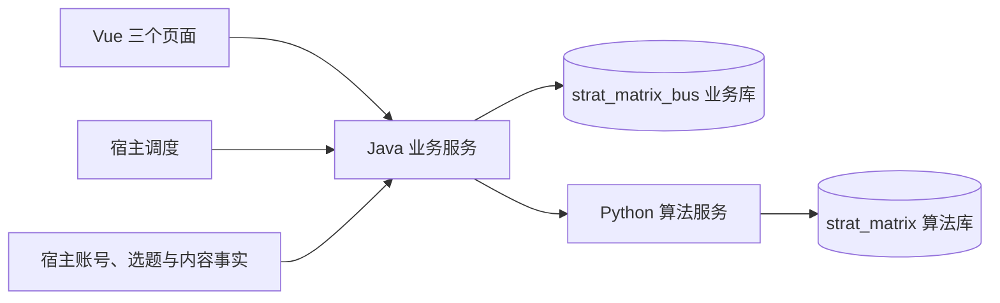

# 双库业务迁移与验收记录

日期：2026-11-03。本次在当前开发环境发布；不代表已接入行内真实账号、内容系统或调度平台。

## 当前边界



Java 管页面业务、业务配置、任务、正式结果、热点定题、营销引用、投放日期及报表。Python 管生命周期规则、标签树、画像、向量、匹配策略及计算任务。运行时两侧不跨库连接；本文迁移工具是一次性发布工具，不能作为运行时适配器。

## 本轮四项结果

| 工作 | 已完成实现 | 验证情况 |
| --- | --- | --- |
| Java 配置进入冻结输入 | 页面综合配置通过持久化发布命令分发；Java 业务快照带版本传入 Pipeline、准备任务和最终提案；重试不能换配置 | 配置丢响应重试、版本冲突及冻结后改旧配置的回归通过；真实自动任务使用业务配置版本 1 |
| 两库发布及普通自动验收 | 发布新增表、列、视图和索引；Java 原子写批次/明细/确认凭据，随后确认 Python | 真实 MySQL + Python 计算：1 个账号、3 条正式策划；模拟确认成功但响应丢失，恢复后没有重复落库 |
| 热点、营销与投放日期 | Java 提供 T-1 补题、普通兜底、当日有效营销引用、先过审优先引用、人工营销日期编排 | 使用明确的内容事实测试过日期边界、竞争占用、重复执行；真实行内内容接口待接入 |
| 退出历史联合查询 | 历史导入业务库；任务/账号/周期/明细/失败详情使用 MyBatis；导出按明细游标读取并批量获取最新操作 | 真实库 1464 条明细、89 个账号、19 个周期、53 个任务、18 条失败账号查询通过；Python 历史请求为 0 |

## 配置如何一致

页面仍用 `/api/plan/config` 保存一个完整配置对象。

1. Java 保存 `godp_planning_config_release` 待发布命令，固定期望版本与完整内容。
2. Java 将算法字段发送给 Python `/api/internal/algorithm-config/commands`；Python 在算法库原子更新配置并写命令回执。同一命令重复请求返回原回执。
3. Python 确认后，Java 在同一业务事务更新四项业务配置和已发布页面版本。
4. 网络故障保留待发布命令，支持原请求重试及调度恢复；待确认期间不允许新自动任务读取混合版本。
5. 启动自动任务时，把 Java 业务版本与业务字段保存到任务，传给 Python；准备阶段覆盖旧 Python 配置中的这五个物理字段，之后使用冻结值。

业务字段为 `planning_days`、`schedule_day`、`schedule_time`、`marketing_max`、`hotspot_ratio`。页面发布版本与业务配置版本是不同计数，验收时分别为 18 和 1。

综合发布启用后，旧业务配置独立写入口和旧配置模块写入口被拒绝，避免另一个入口修改实际规则却不更新页面版本。已有运行任务继续保留自己的冻结值，不追随页面的新版本。

## Java 内容衔接规则

### 热点

- 使用北京时间；22:00 前只处理当天及之前到期空槽，22:00 起可处理次日空槽。
- 只处理业务库中尚未定题且允许运行的热点槽；历史演示批次不参与推进。
- 校验热点可用性和投放日有效期，同日同热点选题只占用一次。
- 无合法热点时使用冻结普通兜底；兜底缺失报出异常，保留空槽供后续处理。
- 写入正式明细、结果版本、操作记录，并刷新批次统计。

### 自动营销

- Java 正式提交时，根据冻结营销上限为具备资格账号的转化策划预留营销检查状态。
- 先查账号当日已有效投放的营销内容：存在则引用，不再创建另一条营销内容。
- 否则查询账号过审内容，按审核通过时刻从早到晚引用，跳过已占用内容。
- 没有可引用内容时保留原普通选题，恢复普通策划类型。
- 过审营销内容已有内容 ID，直接标记内容完成，不再次请求生成。
- 待营销检查的记录不会提前送入内容生产状态扫描。

### 人工营销投放日期

- 继续保留“一个选题 + 生成内容数量”的营销任务；账号由内容侧分配。
- 内容侧提供任务对应的已过审内容、分配账号及账号快照后，Java 才创建正式策划明细。
- 从当前日期起，在配置的策划日中选择可投放日期，检查当日有效营销和每账号每周营销上限。
- 通过内容占用、账号日期占用、周额度占用防重复；重复扫描不重复产生策划明细。
- 当前单次查找未来 56 天；找不到合适日期时保持未衔接，不伪造投放日。

业务入口为 `SlotCompletionService.hotspots/marketing`、`MarketingPlacementService.reconcile`、`ManualContentStatusService.reconcile` 和 `MarketingTaskService.reconcile`。宿主 Job 可直接调用这些 Java 服务，不需要把业务调度交给 Python。

`PlanningContentPort` 集中保留热点、过审营销、有效投放和任务分配内容查询四个方法。行外 `LocalPlanningContentAdapter` 读取已有测试资料；`approvedDemandContents` 及两个内容状态来源当前返回空列表，表示尚未接入内容方，不代表任务成功。

## 查询与历史迁移

- `planning.history.mode=business_only` 选择 `SqlPlanningReadQueries`，不再联合 Python 历史数据。
- 账号列表按账号分页；周期列表按自然周分页；账号策划详情按投放周分页；周期/批次详情按账号分页。统计与十二类分布使用完整筛选范围，不随当前页缩减。
- `godp_planning_item_read`、`godp_planning_batch_read`、`godp_planning_task_read` 是同一业务库内的 SQL 投影视图，不是第二份基础资料。
- CSV/XLSX 最小单位为策划明细，包含选题 ID 和最新操作记录；记录读取使用 500 条游标批次，操作记录每批查询。导出文件仍由服务一次请求返回，超大文件异步下载暂未改造。
- 普通/热点使用选题 ID；引用营销内容可只有内容 ID，前端不会误显示为待定题。
- 旧 `/items`、`/planning-accounts`、`/planning-cycles`、`/auto-planning/cycles` 历史入口返回 410；现页面使用 `/query/*`。

实际迁入：55 个可见历史批次、1460 条可见历史明细、66 条操作记录、52 个归档任务、18 个失败账号、旧配置历史；原库不删除。旧库原始 7413 条明细包含已软删除数据，不能与可见历史 1460 条直接比较。

旧成功人工策划的账号日期占用也已补齐。历史任务以只读归档保留；其中 14 个旧营销任务的部分字段或选题结构与新流程不同，保留原状态和详情，不自动伪装成新任务继续执行。

## 数据库发布

业务库脚本位于 `java-backend/godp-planning-services/src/main/resources/db/`：

- `manual-business.sql`：人工任务、占用、正式结果、记录及历史任务归档。
- `business-planning-config.sql`：业务配置、版本及综合配置发布命令。
- `auto-planning-business.sql`：自动业务任务与确认凭据。
- `slot-completion.sql`：内容资源占用及失败账号。
- `planning-query-views.sql`：业务库分页/报表视图。
- `migrations/V3`、`V4`、`V5`：存量库槽位身份、确认凭据、周索引及营销投放字段。

算法库：`pipeline_schema.sql` 新增算法提案和配置命令回执，Pipeline/准备任务新增业务配置版本与 JSON 快照，均包含中文字段说明。`init_pipeline_db` 负责增量列检查。

本地发布命令（仓库根目录）：

```powershell
python python-backend/tools/migrate_business_boundary.py --apply
python python-backend/tools/migrate_planning_history.py --apply
```

第二个命令需在综合配置已首次导入之后运行，才能补齐旧配置历史。两条命令可重复执行；不覆盖已经存在的正式结果和归档。跨库迁移工具只用于当前行外数据发布，驻场应分别通过行内数据库发布流程执行各自库的脚本。

切换前备份在 `run/backups/boundary-20261103-before/`；最终增量发布备份及报告在 `run/backups/boundary-20261103-final/`。备份属于私有运行文件，不提交 Git。回退不能只改查询开关：切换后新写入的业务结果必须先对账，原 Python 库不会自动获得这些结果。

## 验收证据

- `run/dual-db-acceptance-20261103.json`：Pipeline 12 → Java 正式批次 `2000000000002`，1 账号、3 条策划；真实 Python 确认及丢响应恢复成功。
- 为避免覆盖现有周期，验收使用模拟宿主触发时刻 `2027-02-02T14:00:00Z`，对应 `2027-02-08` 周。数据库、HTTP、计算及正式写入均真实，不是伪造模型结果。
- `run/business-query-acceptance-20261103.json`：真实业务库 SQL 查询，无 Python 历史桥。
- `run/http-boundary-acceptance-20261103.json`：前端 930 → Java 6931 的分页请求、配置历史、失败详情、历史营销详情、CSV 导出和旧接口退出均通过。
- Python 全量回归：386 通过，148 个子测试通过；前端 16 项测试与生产构建通过。Java 覆盖原业务和本轮配置发布、SQL 查询、热点、营销及日期编排；真实库测试需显式设置验收属性，默认不会重复发起策划。
- 本轮涉及的算法表、业务表字段已实查中文注释，缺失数均为 0。

本地已重启 Java 与 Python，Java 本地脉冲模拟宿主任务，自动策划归属为 Java；Python 仅接受唤醒并运行计算队列。驻场不迁入 `standalone` 的本地脉冲，由客户现有调度器调用业务服务和算法执行客户端。真实行内资料、内容事实、登录权限及调度适配仍需提供并联调。
