# 多账号智能策划 PRD V1.1 近期口径同步稿

更新日期：2026-10-14。本文为同名 Word 文件的业务正文导出，便于检索及开发评审；未受影响的原版图片请在 Word 中查看。

多账号智能策划产品需求文档（PRD）

版本：V1.1（近期业务口径同步版） · 更新日期：2026-10-14

文档用途：客户 / 产品 / 设计 / 前端 / 后端 / 算法 / 测试联合评审

## 0. 文档说明

### 0.1 文档定位

本PRD回答四类问题：

页面：运营在哪里看、在哪里配、在哪里操作；

功能：每个区域具体做什么，业务规则是什么；

流程：用户动作、系统处理和上下游数据如何流转；

验收：什么结果算做对，什么场景必须阻断或降级。

本PRD描述双侧画像、向量嵌入及逐层收敛的业务流程与状态语义，但不展开向量模型/维度、相似度公式、Top-K、Hard Gate、Recall、Fit、Global Allocation、标签语义匹配等算法公式；也不展开数据库表、API协议、任务调度、幂等、缓存、重试、MQ等工程实现。算法细节进入《算法/策略说明文档》，工程实现进入《技术设计文档》。

运营前台不展示，不代表后台不做。 算法版本、配置模块版本、策划批次、槽位ID、结果版本、原始结果/最终结果关系、异常代码等仍须后台留痕。

### 0.2 文档结构

| 章节 | 核心内容 | 主要阅读角色 |
| --- | --- | --- |
| 第1章 产品总览 | 产品目标、页面架构、总体链路 | 全员 |
| 第2章 策划配置 | 配置页面、经营策略、标签、版本 | 产品/前后端/测试 |
| 第3章 AI自动策划 | 自动策划、营销、热点、失败查看 | 产品/后端/算法/测试 |
| 第4章 手动策划 | 账号筛选、随机抽取、选题、任务记录 | 产品/前端/测试 |
| 第5章 策划结果 | 周度结果、详情、单账号、人工替换 | 产品/前端/测试 |
| 第6章 跨页面全链路 | 调整窗口、发布状态、标签等 | 后端/算法/测试 |
| 第7章 全局状态与口径 | 全局状态、统计、术语 | 全员 |
| 第8章 接口与数据依赖 | 接口全景、8个正式接口用途/调用时机及核心请求/返回字段 | 后端/联调 |
| 第9章 权限与日志 | 页面操作权限、审计要求 | 产品/后端 |
| 第10章 全局核心验收 | 关键跨页面、跨系统E2E闭环 | 产品/研发/测试 |

### 0.3 V1.1修订说明与适用范围

本版在2026-09-30正式V1.0基础上同步已确认的经营规则和运营交互：生命周期可量化定义、周期业务状态、槽位统计、随机后人工改选、周度/账号历史查询及月内周次。原V1.0保留用于历史追溯；本版作为后续开发和验收的业务依据。

本版已更新受影响的页面与流程示意：页面结构用Word表格表达，FLOW流程图用Word原生矢量对象表达，并提供独立SVG图源；正文、规则表与验收标准为业务依据。页面图与外部HTML原型仍作为视觉参考，外部原型保留原版本。

本PRD定义目标行为，不代表功能已经全部完成。规则热度兜底、画像/向量准备和内部执行提案不等同于真实AI匹配完成；具体实现差距以开发对照及修订记录为准。

### 0.4 本轮待客户确认项

以下各项均为待确认，表中选择是讨论方案，尚未成为已确认需求。会上优先确认Q03～Q06的时序和业务语义，再确认Q01/Q02的初始化及筛选体验；记录最终口径、适用范围和对应章节后更新正文及验收。已明确的规则继续按正文执行。

| 编号 | 业务问题 | 会上需确认的选择 | 影响与当前约束 |
| --- | --- | --- | --- |
| PRD-Q01 | 2.5.1：PRD与现有T3/T4/T5词表的名称、项数不同。 | 以PRD词表初始化；或以现有运营词表为基线。需明确已有调整如何保留。 | 决定初始化词表；确认前不覆盖服务端已有字典。 |
| PRD-Q02 | 4.4：粉丝快捷档位偏大，未定义数值和边界。 | 细分小账号快捷档位；或自定义上下界。需给出实际区间及边界。 | 决定筛选体验；生命周期阈值不自动替代筛选档位。 |
| PRD-Q03 | 2.3.4：周日晚间调度可能晚于下周一热点T-1时点。 | 限制最晚调度；或允许迟调度并规定补触发顺序及范围。 | 影响周一槽位按时定题；未形成槽位不能视为已执行。 |
| PRD-Q04 | 3.12/6.3：新账号的未来槽位可能已过T-1，且“尚未到达”的截止不清楚。 | 仅规划未过业务截止的日期；或允许未来日期补触发。需明确按日期还是具体时间判断。 | 决定新增账号实际N和可规划日期；不得无限显示正常等待。 |
| PRD-Q05 | 2.5.2：T1/T2为二元语义，但治理入口允许新增、改名和停用。 | 核心语义固定，只治理展示名称/启停；或开放新项并明确其业务映射。 | 影响标签识别与经营目标解释；第三种语义尚未确认。 |
| PRD-Q06 | 2.4.4/3.5/5.5：营销、热点不走T1-T6，其经营作用及替换后作用来源未明确。 | 确认各类选题的可信作用来源；并选择替换后更新实际作用，或保留规划作用另行展示。 | 影响目标与实际对照；未知作用显示—，不默认营销=转化、热点=流量。 |

## 1. 产品总览

### 1.1 项目背景

多账号内容运营存在账号规模大、人工逐账号选题成本高、账号经营阶段不同、营销/热点/普通内容规则不同、临时定向投放频繁、策划结果需要人工纠偏等问题。系统目标是把“账号经营策略 + 选题匹配 + 周期排期 + 特殊内容处理 + 人工调整 + 发布状态”串成一个可追踪闭环。

### 1.2 本期产品目标

本期建设四个运营一级页面：

策划配置：配置每周策划日（周一～周日多选，默认周一、周三、周五；选中几天即每账号每周几个槽位）、单一自动策划调度时间（默认每周二22:00）、营销账号每周营销内容上限、热点槽位占比、账号生命周期定义、多维标签，并查看配置版本；

AI自动策划：查看当前/下周/历史周期、热点填充进度与完成情况，必要时查看异常原因；

手动策划：为临时定向业务批量筛选账号并追加内容；

策划结果：按周或账号查询最终策划结果，并在发布前执行人工替换选题。

同时后台提供选题离线标签计算与AI可匹配池、账号/选题画像构建、双侧向量嵌入、账号生命周期判断、Hard Gate、候选召回、适配评估、全局分配、组合编排、普通兜底、特殊槽位规划与执行、结果版本、发布状态和调整记录追溯等能力。

其中，普通选题必须先完成T1-T6离线标签计算、当前内容版本对应的选题画像与向量准备，并进入AI可匹配状态；自动策划批次基于本次账号数据形成账号画像与向量，之后进入Hard Gate / Recall / Fit / Global Allocation / 组合编排流程。

### 1.3 页面信息架构

| 一级页面 | 业务区域 |
| --- | --- |
| 策划配置 | 账号配置；经营目标与生命周期定义；多维标签；配置快照 |
| AI自动策划 | 当前周期；下周调度；历史周期；必要的异常只读明细 |
| 手动策划 | 数量/日期；筛选；随机与人工调整；选题；预览与原子提交 |
| 策划结果 | 周度批次；按账号分组的批次详情；账号历史详情；替换与调整记录 |

### 1.4 产品总体业务链路

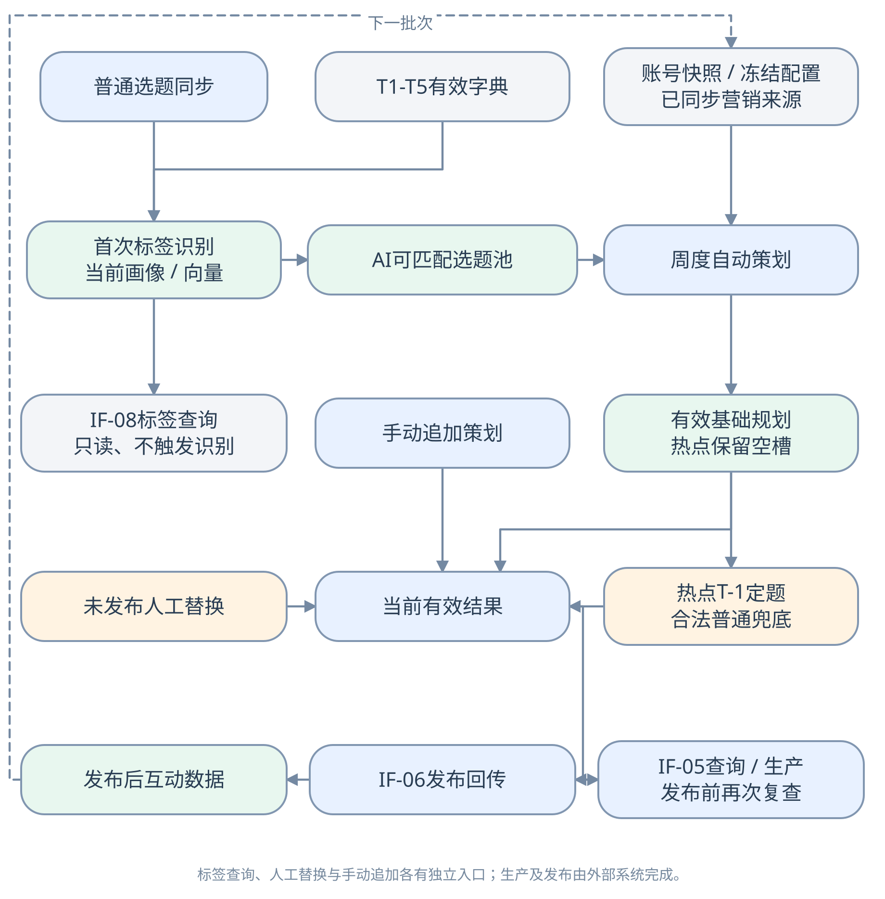

FLOW-01 产品总体业务链路（V1.1流程图）

核心原则：

新增普通选题后，先进入一次离线T1-T6标签计算；后续标题、大纲、内容类型及其他选题字段变化均不触发T1-T6标签重算；

普通选题须同时满足T1-T6标签有效、当前内容版本画像/向量有效及基础可用条件，才进入AI可匹配选题池；仅标签完成不代表已经可匹配；

普通选题基于当前有效内容和T1-T6标签形成选题画像与向量表示；向量未就绪或已失效时，不得进入新的AI匹配；

自动策划批次基于本次读取的账号基础信息、账号人设、互动数据、生命周期阶段和经营目标形成账号画像与账号向量；

策划系统保存标签结果并提供标签查询接口，选题方按选题ID按需获取T1-T6标签，不采用主动同步；

账号与选题进入同一匹配链路后，依次通过Hard Gate、Recall、Fit、Global Allocation和组合编排逐层收敛，最终产生完整的基础策划结果；

到达周度自动策划调度时间后（默认每周二22:00），系统读取“每周策划日”配置，为下一自然周（下周一至下周日）一次性生成全部槽位并提前规划普通/营销/热点槽位类型；普通选题与营销选题均需在自动策划执行前完成同步，任务执行时读取策划系统本地最新同步数据并确定普通/营销槽位具体选题；

热点槽位的具体热点选题在目标槽位前一天22:00确定：热点选题需在该时间点前完成同步，系统22:00读取本地最新有效热点并对合法热点与已规划热点槽位随机分配；无合法热点时使用该账号合法普通选题中热度最高者兜底；

内容生产方通过IF-05按账号ID查询当前可生产最新一期策划内容；查询行为本身不锁定策划结果，也不关闭人工替换。

内容发布状态变化后由内容生产方通过IF-06回传；策划侧仅维护“未发布 / 已发布”，已发布后关闭人工替换。选题正式使用次数由独立业务逻辑维护，并通过IF-09提供查询。

页面展示当前有效结果，后台保留完整版本链；

发布后的互动数据继续沉淀，并在下一批次重新参与生命周期判断，形成经营闭环。

### 1.5 核心业务对象

| 对象 | 定义 |
| --- | --- |
| 策划周期 | 固定周一00:00至周日23:59:59为一个完整周期；跨月不拆周，前台以周一所在月份/周序号和实际日期范围展示；系统统一按国内时间执行 |
| 自动策划槽位 | 由“每周策划日”展开生成；每个选中星期对应每账号1个槽位。槽位包含账号、目标星期/日期、周期、slot_id和槽位类型；默认周一/周三/周五共3个 |
| 选题类型 | 最终实际选题类型：普通 / 营销 / 热点。手动追加属于策划方式，不作为选题类型。特殊槽位兜底后，最终选题类型按实际使用选题记录。 |
| 生命周期 | 系统基于账号基础信息和互动数据计算得到的经营阶段 |
| 经营作用 | 当前内容偏流量型或转化型，用于验证生命周期经营目标 |
| 当前有效结果 | 当前槽位应进入后续生产的有效选题结果；热点槽位在热点未触发前可处于“待热点触发/待确定选题”状态 |
| 策划使用次数 | 选题在策划结果中被分配的次数 |
| 正式使用次数 | 由独立业务逻辑维护的选题实际正式使用次数；IF-09仅提供查询能力，支持普通/营销/热点三类选题。 |
| 标签计算状态 | 待识别 / 识别中 / 已完成 / 识别失败，用于描述新增选题首次离线T1-T6计算状态 |
| AI匹配准备状态 | 普通选题是否具备进入AI自动策划候选池的资格；需同时满足标签结果有效、当前选题版本画像/向量有效及其他基础可用条件 |
| 账号画像 | 基于本批次使用的账号基础信息、账号人设、互动数据、生命周期阶段及经营目标形成的匹配特征集合；同一批次保持数据快照一致 |
| 选题画像 | 基于选题当前有效内容、内容类型、业务属性及T1-T6有效标签形成的匹配特征集合 |
| 向量准备状态 | 描述账号/选题当前版本是否已生成可用于AI匹配的有效向量表示；选题向量未就绪或失效时不得进入新的AI自动匹配 |
| 槽位类型 | 基础策划阶段确定：普通 / 营销 / 热点。槽位类型表示规划意图；营销/热点属于两类特殊槽位 |
| 槽位选题状态 | 普通/营销在基础规划成功后已确定选题；热点在基础规划后待触发，仅在T-1任务成功确定热点或合法普通兜底并落库后更新为已确定选题，不能仅凭时间经过变更状态 |
| 热点触发时间 | 热点槽位目标调度日的前一天22:00（系统默认国内时间）；触发前客户热点接口需更新当前有效热点数据 |
| 自动策划调度时间 | 全局单一周度任务触发点，当前默认每周二22:00；默认生成下一自然周（下周一至下周日）的整批自动策划结果，不属于单个槽位属性 |

### 1.6 用户与系统角色

| 角色 | 主要职责 |
| --- | --- |
| 运营 | 配置每周策划日、单一自动策划调度时间、营销账号每周营销内容上限、热点槽位占比、账号生命周期定义和多维标签；查看运行、发起手动策划、查看结果、人工替换 |
| 策划系统 | 账号生命周期判断、账号/选题画像与向量准备、Hard Gate/Recall/Fit/全局分配/组合编排、全部槽位提前规划、特殊槽位按时机执行、发布状态维护、结果版本管理及接口查询能力。 |
| 平台账号/数据接口 | 由客户开发的平台接口每日夜间离线同步账号池、账号基础信息、账号别名、认证状态、账号人设及近3个月帖子互动数据；策划执行时读取策划系统最近一次成功同步的数据快照。流量趋势由策划系统基于互动数据计算。夜间同步完成后识别新增账号，并对当前周尚未到达的配置槽位执行后续策划。 |
| 选题方 / 选题库 | 自动策划前同步普通选题基础数据与热度；按需调用策划系统IF-08查询普通选题T1-T6标签。 |
| 平台营销/热点选题接口 | 营销选题在自动策划执行前同步至策划系统；热点选题在目标热点槽位前一天22:00前同步，供22:00热点选题确定任务读取。 |
| 内容生产方 | 通过IF-05按账号ID查询最新一期策划内容并完成内容生产与发布；发布状态变化后通过IF-06回传已发布状态。 |

### 1.7 运营页面通用交互规范

以下规则适用于四个一级页面，页面章节如有特殊说明则以页面规则为准。

| 规则ID | 通用规则 | 产品要求 |
| --- | --- | --- |
| GLOBAL-R01 | 查询条件保留 | 查询/接口失败后保留用户已填写的筛选条件，不因错误清空页面 |
| GLOBAL-R02 | 动态状态刷新 | AI批次、热点任务、手动任务处于运行中时页面应自动刷新状态，同时保留手动刷新入口 |
| GLOBAL-R03 | 更新时间 | 动态列表展示“最后更新时间”，避免运营将旧状态误认为实时状态 |
| GLOBAL-R04 | 状态禁用解释 | 按钮置灰时需通过文案/Tooltip说明不可操作原因 |
| GLOBAL-R05 | 长文本 | 选题大纲、异常原因等长文本默认摘要展示，并支持查看完整内容 |
| GLOBAL-R06 | 时间展示 | 系统统一按国内时间展示和计算周一～周日周期边界、自动策划调度时间及热点T-1日22:00；不提供运营时区配置 |
| GLOBAL-R07 | 数据异常安全 | 涉及替换、覆盖等不可逆修改时，若关键外部状态无法确认，默认禁止修改（Fail Closed） |
| GLOBAL-R08 | 未保存离开 | 存在未保存编辑内容时离开当前编辑页，需要提示“继续编辑 / 放弃修改” |

列表默认分页大小、具体自动刷新秒数等属于交互/技术参数，不在PRD写死，但必须满足“运行中状态可自动更新、用户可确认最后更新时间”的产品要求。

加载中、查询成功但无数据、读取失败应在所在列表/抽屉中分别提示，不能把请求未完成或失败当作空结果。分页或加载更多须能覆盖当前查询范围；若仍有未加载数据应明确提示，不能把固定上限内的数据称为“全部”。账号命中数N按完整有效候选范围计算，不按当前显示页数计算，随机池须覆盖相同范围。长期打开页面跨日/跨周后按国内时间更新周期；业务更新时间与最近成功读取时间分开说明。

## 2. 页面一：策划配置

### 2.1 页面定义卡

| 项目 | 定义 |
| --- | --- |
| 页面名称 | 策划配置 |
| 页面编号 | FE-01 |
| 使用角色 | 运营（宿主系统授权的业务使用者） |
| 页面入口 | 左侧导航 → 策划配置 |
| 成功出口 | 新配置版本成为当前有效配置；后续新批次引用该版本 |
| 页面目的 | 维护影响AI自动策划的业务规则，并保留版本、快照和操作日志 |
| 核心输出 | 当前有效每周策划日、自动策划调度时间、营销账号每周营销内容上限、热点槽位占比、账号生命周期定义、多维标签字典及各模块版本 |
| 非本页职责 | 不直接指定某账号某条具体选题；不在配置页提前指定具体热点选题；T6仍由模型识别，不开放普通运营直接编辑 |

本页核心业务规则ID

| 规则ID | 规则摘要 |
| --- | --- |
| CFG-R01 | “营销账号每周营销内容上限”仅对营销账号生效，表示单个营销账号单周期最多可使用的营销内容数，不是必须完成数量；非营销账号禁止规划和发布营销内容 |
| CFG-R02 | 周度自动策划任务执行时，若营销账号本地无有效营销选题则使用普通内容补齐；营销选题同步失败不能当作“无内容” |
| CFG-R03 | 配置采用模块级版本，恢复历史版本只恢复所选模块并创建新版本 |
| CFG-R04 | 已完成历史策划不随配置变更自动重算 |
| CFG-R05 | 存在未保存修改时离开页面必须提示 |
| CFG-R06 | 保存时如检测到配置基础版本已变化，必须阻止覆盖并提示刷新 |
| TAG-R01 | T1-T5历史已引用标签不物理删除，采用停用 |
| HOTCFG-R01 | 热点槽位占比按当前自动策划批次总槽位数计算热点槽位数量，支持0%～100%，结果四舍五入取整；只决定热点槽位规划规模，不提前锁定具体热点选题 |
| SLOT-R01 | 每周策划日支持周一～周日多选，默认周一/三/五；完整周主批次每选中1天对应单账号1个槽位；新账号只补当前周允许的剩余日期，不配置每槽位独立时间 |
| SLOT-R02 | 自动策划调度时间全局仅1个周度触发点，当前默认每周二22:00；策划周期固定周一00:00至周日23:59:59，跨月不拆周；系统统一按国内时间执行 |

### 2.2 页面原型总览

| 区域 | 字段与操作 |
| --- | --- |
| 账号配置 | 每周策划日：周一/三/五；调度：周二22:00；营销周上限：1；热点占比：20% |
| 经营目标 | 五个阶段分别配置流量/转化百分比，每阶段合计100% |
| 生命周期阶段定义 | 只编辑量化进入条件；高成熟度优先匹配，冷启兜底 |
| 多维标签配置 | T1–T5字典新增/改名/启停；T6只提示模型识别规则 |
| 配置快照 | 账号配置 / 经营策略两个入口；模块恢复创建新版本，服务端保留日志 |

图2-1 策划配置（V1.1结构示意）

策划配置包括账号配置、独立经营目标、生命周期阶段定义、多维标签字典及配置快照。每周策划日默认周一、周三、周五；周度调度默认每周二22:00，为下一自然周生成槽位。顶部不额外展示统一配置源、当前组合版本、标签体系概览卡片。

页面由四个业务区域组成：账号配置、经营策略（经营目标与生命周期定义独立维护）、多维标签配置、配置快照。

### 2.3 区域A：账号与自动策划配置

### 2.3.1 字段

| 字段 | 控件 | 必填 | 规则 |
| --- | --- | --- | --- |
| 营销账号每周营销内容上限 | 非负整数输入 | 是 | 仅营销账号生效；支持0；表示“最多”，不代表必须达到；非营销账号不参与营销槽位规划 |
| 单位 | 只读 | - | 条 / 营销账号 / 周 |
| 每周策划日 | 周一～周日多选 | 是 | 默认周一、周三、周五；至少选1天；选中几天即每账号每周期几个槽位 |
| 自动策划调度时间 | 星期选择 + 时间 | 是 | 全局仅1个周度触发点；当前默认周二22:00；用于统一执行整批AI自动策划 |

### 2.3.2 业务规则

仅营销账号参与营销槽位规划；非营销账号禁止规划和发布营销内容，营销选题在Hard Gate阶段直接过滤；

营销账号本周期营销槽位数 = min（该账号本地已同步营销候选数，营销账号每周营销内容上限，该账号非热点可用槽位数）；营销槽位只在该账号剩余非热点槽位中随机落位。实际最终营销内容数可能因审核/有效性不足而低于营销槽位数，不要求达到上限。

自动策划调度任务执行时，仅可使用该时点“已审核且有效”的营销内容；

多条营销内容均可用时按审核通过时间升序逐条使用，审核通过更早者优先；同一账号同周期内同一营销选题不重复占用多个营销槽位；相同审核通过时间由系统进行稳定排序；

已规划营销槽位在绑定具体内容时，如账号绑定且已审核有效的营销选题不足，则不足的营销槽位直接使用普通选题补齐，不留空位、不等待；

营销选题同步失败或本地同步数据不可用不等同“无营销选题”，必须进入系统异常。

### 2.3.3 热点槽位占比

| 字段 | 控件 | 必填 | 规则 |
| --- | --- | --- | --- |
| 热点槽位占比 | 百分比输入 | 是 | 0%～100%；热点槽位数 = 当前批次自动策划总槽位数 × 占比，按四舍五入取整；批次维度统一配置，不支持单账号单独设置 |
| 单位 | 只读 | - | % |

热点槽位占比用于基础策划阶段计算本批次需提前规划的热点槽位数量，不在基础策划阶段锁定具体热点选题。

热点槽位随基础策划提前生成；热点触发时只能在已规划热点槽位中确定具体热点选题，不临时新增或将普通/营销槽位改造成热点槽位。

热点槽位数 = 当前批次自动策划总槽位数 × 热点槽位占比，按四舍五入取整。槽位类型规划顺序统一为“先热点、后营销、剩余普通”：先从全批次可规划槽位中随机确定热点槽位；再对营销账号从其剩余非热点槽位中按营销槽位数随机确定营销槽位；其他槽位为普通槽位。热点与营销不得重复占用同一槽位。

每周策划日采用周一～周日多选配置，默认选中周一、周三、周五。每选中1天，即代表每个符合条件账号在目标策划周期生成1个该日槽位；因此单账号本周期N=当前有效“每周策划日”的选中天数。系统不单独配置槽位数量，也不为每个槽位配置独立调度时间。

自动策划调度时间为独立的周度任务触发配置，全局仅1个时间点，当前默认每周二22:00；该时间用于生成下一自然周（下周一至下周日）的整批AI自动策划结果，不等同于周一/周三/周五等槽位日期。系统统一按国内时间执行周一～周日周期边界、自动策划调度时间及热点T-1日22:00，不提供时区配置。

### 2.3.4 页面校验

营销账号每周营销内容上限：负数、非整数、空值均不允许保存，输入0合法；热点槽位占比：仅允许0%～100%；每周策划日：周一～周日至少选择1天，不允许重复或选择非法值；自动策划调度时间：仅允许配置1个“星期+HH:mm”周度触发时间点，当前默认周二22:00。

### 2.4 区域B：账号生命周期定义

| 字段 | 定义方式 |
| --- | --- |
| 可量化条件 | 粉丝数、有效内容数、滚动篇均互动 + 比较符 + 数值 + AND/OR |
| 匹配顺序 | 稳定→放大→试探→增长→冷启，首次命中即停止 |
| 冷启定义 | 唯一兜底，随其他阶段配置同步说明 |
| 编辑区 | 只展示进入条件；目标在独立经营策略区域编辑 |

图2-2 生命周期阶段定义（V1.1结构示意）

### 2.4.1 页面目标

运营只在生命周期阶段定义中维护五个固定阶段的进入条件；经营目标在独立经营策略区域维护。阶段定义不包含经营目标或回退目标，本期不新增/删除阶段，不执行旧版经营周期数、连续恶化和动态回退规则。

### 2.4.2 固定阶段

| 判定顺序 | 阶段 | 默认进入条件 |
| --- | --- | --- |
| 1 | 稳定经营期 | 粉丝数≥500，且滚动篇均互动数≥20次/篇，且有效内容数≥5篇 |
| 2 | 转化放大期 | 粉丝数≥200，且滚动篇均互动数≥10次/篇，且有效内容数≥5篇 |
| 3 | 转化试探期 | 粉丝数≥100，且滚动篇均互动数≥5次/篇，且有效内容数≥5篇 |
| 4 | 冷启动期 | 粉丝数<50人，或有效内容数<5篇；未命中其他阶段时也归入此阶段 |
| 5 | 流量增长期 | 粉丝数≥50人，或有效内容数≥5篇；仅在不满足冷启动条件时归入 |

以上为垂直细分账号的运营起始默认值，可版本化调整，尚未经过实际经营效果验证。匹配时先按稳定经营期、转化放大期、转化试探期的顺序判断，再判断冷启动条件，最后判断流量增长期；冷启动优先于流量增长。由于流量增长本身使用“或”，实际进入增长期须同时满足粉丝数≥50人、有效内容数≥5篇，且未命中三个更高阶段。冷启动期同时作为兜底阶段，保证每个账号有且只有一个阶段。经营目标独立默认值：冷启动80%/20%、增长70%/30%、试探50%/50%、放大30%/70%、稳定50%/50%，分别为流量/转化占比。

### 2.4.3 条件表达

生命周期进入条件采用：字段 + 运算符 + 阈值 + AND/OR。

本期支持粉丝数、有效内容数、滚动X篇篇均互动三个量化指标，比较符为<、≤、=、≥、>，条件按配置顺序从左到右进行AND/OR组合。粉丝数使用当前同步快照；有效内容数和篇均互动使用本次计算时点近三个月的帖子数据。

阶段阈值为非负整数，X为1～100的整数；前三个成熟阶段和流量增长期至少保留一个条件，冷启动期为不可删除的唯一兜底。冷启动边界随流量增长期的粉丝数和有效内容数阈值同步，条件以“或”连接。多个条件按从左到右折叠计算，不隐含AND优先级，例如A或B且C表示（A或B）且C；界面以说明或表达式预览明确含义。数据已确认无有效帖子时，可按零篇规则计算；数据读取失败或关键指标缺失不按0补齐，也不据此伪造冷启动归属，应按准入/异常规则处理。

当同一账号同时满足多个生命周期阶段条件时，依次判断：稳定经营期 > 转化放大期 > 转化试探期 > 冷启动期 > 流量增长期。若以上均未命中则兜底归入冷启动期，保证每次计算结果唯一且不为空。

### 2.4.4 X与N必须区分

X：历史互动窗口，默认10篇。从本次计算时点向前回溯三个月的有效已发布内容中取最近X篇；不足X篇按实际篇数计算。时间边界按同日同时间回溯，月末不存在同日时取目标月末日，不按完整三个自然月截断。单篇互动=红星/点赞+收藏+评论，滚动篇均互动=所取内容互动总量/实际篇数；零篇时均值按0处理，并保留数据不足事实。

有效内容数统计同一近三个月窗口内已发布的有效帖子总篇数，不限制为X篇，也不使用本周策划槽位数或正式选题使用次数。同一帖子重复同步不重复累加；待生成、待发布的策划结果不作为已发布帖子。红星/点赞是平台对应的同类互动口径，不把同一指标以两个名称重复相加。生命周期的滚动篇均互动只需最近X篇；手动流量趋势需最近X篇和前X篇共2X篇，少于2X篇为数据不足，两者不可互换。

N：本次为单账号实际规划的自动策划槽位数。周度主批次覆盖完整下一周时，N等于冻结配置的选中策划日数，默认周一/三/五为3；新账号当前周补充批次只计算本次允许规划的剩余槽位，不按完整周天数补足。

8/2、7/3、5/5、3/7表示流量/转化目标比例，不代表必有10个未来槽位。目标流量数量=四舍五入（本次实际N×流量比例），目标转化数量=N−目标流量数量，目标合计为N。这两项属于经营作用目标，不是普通/营销/热点槽位类型。实际结果的经营作用按可信业务属性展示；合法兜底或人工替换后不回写历史目标，目标数量不能冒充实际达成数量。营销/热点作用来源及跨类型替换后的更新口径见PRD-Q06。

首次初始化使用本版默认阈值；升级代码不会覆盖数据库里已经保存的经营策略。已有实例需通过带期望版本号的配置保存或明确迁移生效。新批次读取新版本，已启动批次、历史结果和画像继续保留原快照。

### 2.4.5 冷启数据不足

历史样本不足时按实际篇数计算互动均值；前三个成熟阶段默认同时要求至少5篇有效内容，避免单篇高互动直接进入成熟阶段。经营目标作为排序/组合约束，缺少某经营作用候选时不得伪造内容或默认为固定9/1回退，合法降级细则由算法说明明确。

### 2.5 区域C：多维标签配置

| 区域 | 展示与操作 |
| --- | --- |
| 维度切换 | T1业务属性 / T2经营作用 / T3主题域 / T4目标客群 / T5生活场景 / T6用户需求 |
| T1示例 | 非营销、营销；每条普通选题必填单选，标签名显示为文本 |
| 字典项治理 | 新增 / 改名 / 启用 / 停用；保留稳定ID和历史引用 |
| 保存 | 提交字典完整项及期望版本；无变化不创建版本，版本冲突保留草稿 |
| T6提示 | 模型单选识别，相似度>80%复用，否则新增；运营不在本页编辑 |

图2-3 多维标签管理（V1.1结构示意）

### 2.5.1 标签模型

| 维度 | 名称 | 字典与选择规则 |
| --- | --- | --- |
| T1 | 业务属性 | 非营销、营销；必填单选。仅表示普通选题内部语义属性，不等同于topic_type，不用于判断营销账号资格。 |
| T2 | 经营作用 | 流量、转化；必填单选 |
| T3 | 主题域 | 金融理财、信用卡权益、财富管理、本地生活、美食餐饮、消费优惠、出行旅游、数码科技、职场成长、健康生活、亲子家庭、泛生活；必填单选 |
| T4 | 目标客群 | 年轻客群、学生客群、职场人群、家庭客群、宝妈/亲子客群、中老年客群、高净值客群、泛客群；必填单选 |
| T5 | 生活场景 | 通勤、工作、周末休闲、家庭消费、餐饮、购物、出行、旅行、居家、亲子、理财投资、节假日；必填单选 |
| T6 | 用户需求 | 用户需求；模型识别，必填单选，不开放普通运营编辑；优先复用相似度>80%的已有T6，否则新增 |

### 2.5.2 T1-T5标签治理

支持新增、改名、启用、停用。历史已引用标签不物理删除，采用停用方式，避免历史结果失真。标签内部ID在改名时保持稳定。

T1-T6当前全部采用单选。T1-T5使用固定字典，每个维度只允许1个标签值；T6由模型单选识别，每条选题最终仅保留1个T6值。T1-T6仅对普通选题执行；其中T1“非营销/营销”是普通选题内部语义标签，不等同于普通/营销/热点三类topic_type，也不作为营销账号资格或营销槽位来源判断。

T1/T2目前承载二元业务语义，而本页又允许T1-T5新增/改名/启停，两者的治理边界需按PRD-Q05确认。已有治理入口不代表第三种业务属性或经营作用已获确认；改名保持稳定ID，不能仅凭显示名称变化改写历史选题类型、账号资格或经营目标。每个必填维度至少保留一个启用项，同维度重名禁止保存；上述最低校验不替代T1/T2业务枚举的确认。

本页面只负责维护标签字典，不在保存配置时同步执行全量选题打标。选题标签计算属于离线数据加工流程，详见3.4.5和6.5。保存提示只说明保存结果和字典版本；字典对接消息属于工程机制，不能称作“选题标签结果已同步”。选题标签结果仍由选题方按IF-08主动查询。

### 2.5.3 T6规则提示

T6由模型单选识别：生成用户需求候选 → 与已有T6标签比较 → 相似度>80%复用 → 否则自动新增并绑定。单条选题最终仅保留1个T6值；运营不在该页面维护T6。

T1-T6均按单选标签处理。T6识别与T1-T5识别均在新增选题的首次离线标签计算流程中执行；配置页仅提供T1-T5字典治理能力。

### 2.6 配置保存流程

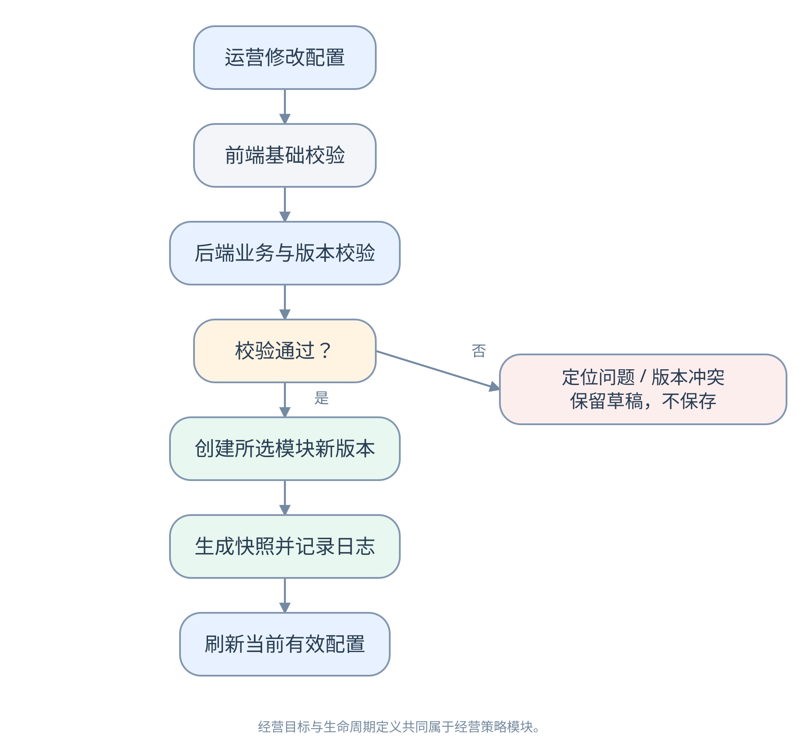

FLOW-02 配置保存流程（V1.1流程图）

配置采用模块级版本 + 全局引用快照：

页面保存单位统一为“账号配置”“经营策略”“标签字典”：账号配置包含策划日、调度时间、营销上限和热点占比；经营策略包含滚动窗口、五阶段经营目标及生命周期进入条件。经营目标与阶段定义在页面上分区编辑，但共同属于经营策略模块。标签字典独立保存版本，配置快照页只提供前两个模块的恢复入口；运营提示统一使用上述名称，不以内部字段名“营销配置”代指账号配置。保存一个模块时保留其他模块未保存的草稿。

运营修改某个配置模块；

前端进行格式校验；

后端进行完整业务校验；

校验通过后创建该模块新版本；

自动生成模块快照；

全局配置快照更新该模块版本引用；

写入操作日志；

保存成功后，新版本立即成为当前有效配置；保存后启动的新任务、新生命周期判断和新离线标签任务立即读取最新有效版本。已启动的自动策划批次继续使用批次启动时冻结的配置版本，不在运行中途切换。

历史已完成策划不因后续配置变化自动重算。本期不提供运营手工重算或重跑入口；如需重算能力，须另行确认业务范围。内部技术重试与合法补偿按原任务追溯，不由配置保存触发。

### 2.7 配置快照与历史恢复

| 入口/字段 | 展示与规则 |
| --- | --- |
| 模块切换 | 账号配置 / 经营策略 |
| 版本列表 | 版本、生成时间、摘要、动作、操作人、恢复入口 |
| 恢复 | 选择模块历史版本→版本校验→仅恢复该模块→创建新版本及快照 |
| 服务端留痕 | 修改前后版本、摘要、时间、操作人和来源保留 |

图2-4 配置快照（V1.1结构示意）

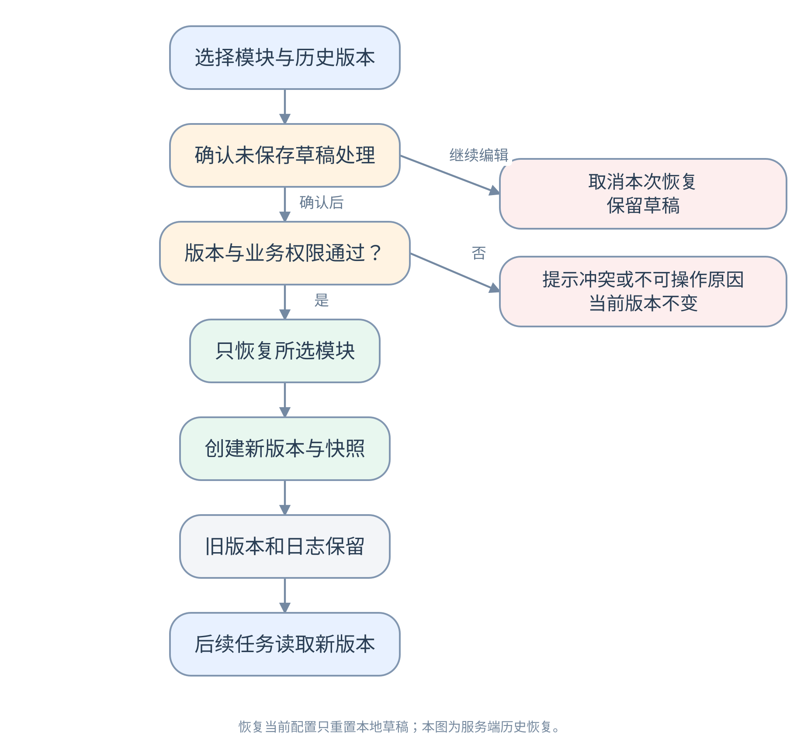

FLOW-03 模块级历史恢复（V1.1流程图）

### 2.7.1 回滚规则

配置快照提供账号配置、经营策略两个模块入口；恢复只作用于所选模块并创建新版本，例如经营策略V12恢复V10时创建V13，账号配置及标签字典不受影响。标签字典仍单独保存版本及稳定ID，历史已引用项不删除；标签历史恢复暂不作为本期页面入口。

回滚不会删除V11/V12，也不会把旧版本直接重新标记为当前。

### 2.7.2 日志字段

至少记录：操作人、配置模块、修改前版本、修改后版本、修改摘要、修改时间、操作类型。

### 2.8 未保存离开与配置并发

### 2.8.1 未保存离开

运营修改任意配置字段但尚未保存时，切换一级导航、关闭编辑区域或执行其他会丢失当前输入的操作，应提示：

当前存在未保存修改，离开后修改内容将丢失。

提供“继续编辑”“放弃修改”两个动作，不提供静默丢弃。

“恢复当前配置”、加载远端最新配置及恢复历史版本若会覆盖未保存输入，同样先说明受影响模块并征求放弃草稿确认。“恢复当前配置”只重置本地草稿，不创建服务端版本；历史恢复则只恢复所选模块并创建新版本。未被恢复模块及标签字典的草稿应保留。点击“完成编辑”若仅收起阶段定义编辑控件，不等同保存或离开，输入仍作为未保存草稿保留。

### 2.8.2 并发修改

配置保存必须携带用户打开页面时的模块版本。若保存前该模块已被其他用户更新，例如A/B均基于V12编辑，B先保存为V13，则A再次保存时不得直接覆盖V13。

产品表现：提示“当前配置已被其他用户更新，请刷新后重新确认修改内容”，保留A当前输入用于人工比对；刷新后由运营重新确认是否提交。该规则对应 CFG-R06。

页面重新激活及手动刷新时读取最新有效配置；没有本地修改时更新展示，有草稿时提示“配置已在其他位置更新”，保留草稿，待运营确认后加载新值。不用代码默认值、旧浏览器缓存或参考原型覆盖服务端已保存配置。

### 2.9 页面状态与异常

| 场景 | 页面表现 | 业务处理 |
| --- | --- | --- |
| 无修改 | 保存按钮置灰 | 不创建版本 |
| 字段格式非法 | 字段下方提示 | 禁止提交 |
| 跨字段业务冲突 | 定位具体阶段/字段 | 禁止创建版本 |
| 保存中 | 主按钮Loading | 防止重复提交 |
| 保存失败 | 保留当前输入 | 当前有效版本不变 |
| 回滚失败 | 提示失败 | 当前版本保持不变 |
| 页面存在未保存修改 | 离开前弹出确认 | 不静默丢弃用户输入 |
| 配置版本冲突 | 提示“配置已更新” | 阻止覆盖，要求刷新后重新确认 |
| 无权限 | 隐藏/禁用修改入口 | 不以前端角色名自行推断权限 |

### 2.10 本页依赖的数据/接口能力

| 能力 | 用途 |
| --- | --- |
| 查询当前有效配置 | 页面初始化 |
| 保存营销账号每周上限 | 创建账号配置模块新版本（营销账号每周营销内容上限） |
| 保存账号生命周期定义 | 随经营策略模块保存滚动窗口、五阶段目标及生命周期进入条件，创建经营策略模块版本 |
| 标签字典管理 | 多维标签治理：T1-T5新增/改名/启停；T6模型识别 |
| 查询配置历史 | 查看版本和操作日志 |
| 恢复历史版本 | 创建新的模块版本 |
| 保存热点槽位占比 | 创建账号配置模块新版本（热点槽位占比） |
| 保存自动策划配置 | 创建账号配置模块新版本（每周策划日、自动策划调度时间） |

### 2.11 页面验收标准

| ID | 关联规则 | 验收场景 | 预期结果 |
| --- | --- | --- | --- |
| CFG-UAT-01 | CFG-R01 | 营销账号每周营销内容上限设置为0 | 保存成功；营销账号后续不安排营销内容，非营销账号始终禁止营销内容 |
| CFG-UAT-02 | CFG-R01 | 营销账号每周营销内容上限输入负数 | 禁止保存并定位字段 |
| CFG-UAT-03 | - | 生命周期条件缺阈值 | 禁止保存 |
| CFG-UAT-04 | CFG-R03/CFG-R04 | 保存账号生命周期定义 | 生成经营策略模块新版本、快照和日志；生命周期定义不单独创建第三个配置模块 |
| CFG-UAT-05 | CFG-R03 | 恢复账号生命周期定义历史版本 | 只创建新的经营策略模块版本，恢复该版本内的滚动窗口、目标与阶段定义；账号配置和标签字典不回滚 |
| CFG-UAT-06 | TAG-R01 | 停用历史已引用标签 | 历史引用保留，新识别不再使用 |
| CFG-UAT-07 | - | 标签同维度重名 | 禁止保存 |
| CFG-UAT-08 | HOTCFG-R01 | 热点槽位占比设置为30%并保存，下一新批次共126个自动策划槽位 | 保存成功；新批次提前规划38个热点槽位（126×30%=37.8，四舍五入=38） |
| CFG-UAT-09 | CFG-R05 | 修改后直接切换页面 | 弹出未保存离开提示，不静默丢失 |
| CFG-UAT-10 | CFG-R06 | 两人同时基于同一版本编辑且一方先保存 | 后保存方被阻止覆盖，并提示刷新确认 |
| CFG-UAT-11 | HOTCFG-R01 | 热点槽位占比输入101%或负数 | 禁止保存并定位字段 |
| CFG-UAT-12 | CFG-R04 | 配置保存成功后立即发起一个新任务，同时已有批次仍在运行 | 新任务读取最新有效配置；已有批次继续使用启动时冻结版本，不被中途切换 |
| CFG-UAT-13 | CFG-R01 | 非营销账号进入自动策划 | 不规划营销槽位；营销选题不进入合法候选；只能形成普通/热点槽位及其合法内容 |
| CFG-UAT-14 | - | 账号N=7，生命周期目标70%流量/30%转化 | 流量槽位=5，转化槽位=2，总数始终等于7 |
| CFG-UAT-15 | TAG-R01 | T1-T6任一维度已有1个标签后再次选择其他标签 | 禁止多选；T1-T6每个维度均只能保留1个标签值，其中T6由模型单选识别 |
| CFG-UAT-16 | SLOT-R01 | 首次使用默认配置 | 每周策划日默认选中周一、周三、周五，系统显示每账号每周期N=3；自动策划调度时间默认周二22:00 |
| CFG-UAT-17 | SLOT-R01 | 运营在每周策划日中增加周日并保存 | 保存成功；后续新目标周期按周一/周三/周五/周日生成N=4个槽位；自动策划调度时间仍只有1个且不随槽位数变化 |
| CFG-UAT-18 | SLOT-R02 | 跨月周，例如周一在9月、周日在10月 | 仍作为一个完整周周期，不按月拆分；自动策划调度时间与热点T-1日22:00均按系统默认国内时间执行 |
| CFG-UAT-19 | 生命周期定义 | 多个阶段同时满足条件 | 按成熟度首次命中，且仅一个阶段；均不满足时冷启兜底 |
| CFG-UAT-20 | 生命周期定义 | 粉丝/互动/有效内容恰等于本版阈值 | ≥边界命中对应条件；默认50粉或5篇进入增长，更高阶段满足全部条件才优先 |
| CFG-UAT-21 | 生命周期定义 | 近三个月只有3篇且X=10 | 有效数3，均值按实际3篇；不凑10篇、不用周槽位数替代 |
| CFG-UAT-22 | 配置生效 | 升级代码但数据库已保存旧阈值 | 旧配置不自动覆盖；保存新版本后仅后续批次读取 |
| CFG-UAT-23 | 2.6/2.8 | 账号配置有草稿，保存经营策略或恢复其历史版本 | 仅经营策略创建版本；账号配置及标签草稿保留，覆盖所选模块草稿前明确确认 |
| CFG-UAT-24 | 2.8 | 有未保存修改时恢复当前配置或加载远端新值 | 先提示继续编辑/放弃修改；本地重置不创建版本，历史恢复才创建新版本 |
| CFG-UAT-25 | 2.4.3 | 条件A或B且C，或关键指标读取失败 | 按（A或B）且C判断并明确表达；读取失败不以0补齐或伪造冷启阶段 |
| CFG-UAT-26 | 2.4.4 | 近三个月25篇，X=10，当前周只有3个槽位 | 有效内容数=25；篇均互动取最近10篇；趋势取最近10与前10，不按3个槽位计算 |
| CFG-UAT-27 | 2.4.4/3.5 | 目标流量/转化数量与最终选题作用不同 | 目标合计N且历史目标保留；实际作用有可信来源才展示，不把目标填成实际达成 |

## 3. 页面二：AI自动策划

### 3.1 页面定义卡

| 项目 | 定义 |
| --- | --- |
| 页面名称 | AI自动策划 |
| 页面编号 | FE-02 |
| 使用角色 | 运营 |
| 页面入口 | 左侧导航 → AI自动策划 |
| 结果出口 | 形成普通/营销基础策划结果及预规划热点槽位；热点触发后具体热点选题同步到策划结果页 |
| 页面目的 | 查看当前/下周/历史周期的规划及热点填充情况，必要时查询异常原因 |
| 核心输出 | 自动策划账号数、三类槽位数量、热点填充进度、周期业务状态及更新时间 |
| 非本页职责 | 不展示Fit/Recall/中间候选集；不提供运营手工重跑算法；热点槽位触发属于后台自动流程，不在本页新增独立运营区域 |

本页核心业务规则ID

| 规则ID | 规则摘要 |
| --- | --- |
| AUTO-R01 | AI参与账号必须满足：上游账号有效/启用、本周期存在至少1个可执行配置槽位、关键账号数据可获取；不满足准入条件的账号不进入参与账号数 |
| AUTO-R02 | 周度主批次单账号N=冻结配置选中策划日数，默认周一/三/五为3；新账号补充批次N为本次允许规划的剩余槽位数，不由8/2、7/3决定，也不回补过去日期 |
| AUTO-R03 | 到达周度自动策划调度时间后，默认一次性生成下一自然周（下周一至下周日）的普通/营销/热点槽位类型；普通/营销具体选题在该批次同步确定，热点在目标槽位前一天22:00确定选题 |
| AUTO-R04 | 批次启动时确定本次有效配置版本，并读取最近一次成功同步的账号数据快照，保证结果可追溯 |
| AUTO-R05 | 周度归集无统一冻结时间；持续刷新周期状态及热点进度，异常与正常热点等待分开表达，合法补偿更新当前事实 |
| AUTO-R06 | 普通选题必须完成离线T1-T6标签计算且结果有效，方可进入AI可匹配候选池 |
| AUTO-R07 | 标签待识别、识别中或识别失败的普通选题不得进入AI自动匹配 |
| FALLBACK-R01 | 普通选题正常匹配无结果时，从满足基础可用条件的普通选题中选择热度最高的1条兜底 |
| MKT-R01 | 营销槽位随周度自动策划批次同步执行：先按“本账号已同步营销候选数、周上限、非热点可用槽位数”计算营销槽位数并随机落位；实际绑定仅使用账号绑定且已审核有效的营销选题，按审核通过时间升序逐条使用，不足部分普通兜底，同步失败按系统异常处理。 |
| HOT-R01 | 热点槽位周期内提前规划；热点选题在目标槽位前一天22:00前完成同步，策划系统22:00仅在尚未发布的已规划热点槽位中确定具体热点选题。 |
| HOT-R02 | 同一触发任务多个热点共享统一已规划热点槽位池；合法性过滤后随机分配，同一热点槽位不得重复分配 |
| HOT-R03 | 热点触发不新增周期槽位、不占用普通/营销槽位；动态变化的是热点槽位中的具体选题 |
| AUTO-R08 | 普通选题智能匹配采用“账号/选题画像构建 → 双侧向量嵌入 → Hard Gate → Recall → Fit → Global Allocation → 组合编排”的逐层收敛流程 |
| AUTO-R09 | 账号画像/向量必须基于本批次账号数据读取基准；选题画像/向量必须与当前有效选题版本一致。向量未就绪、失败或失效时不得使用旧向量参与新的AI匹配 |
| AUTO-R10 | 向量相似度、Recall候选集、Fit分值、Global Allocation中间结果等属于算法内部信息，运营前台不展示 |
| HOT-R04 | 热点槽位数按“周期自动策划总槽位数×热点槽位占比”四舍五入；具体账号/槽位随机选择，不另设单账号单日/单周期热点上限 |
| MKT-R02 | 非营销账号不得规划营销槽位，也不得使用IF-03营销选题；营销账号资格按is_marketing_account与营销选题来源类型判断。T1仅为普通选题语义标签，不作为营销资格Hard Gate。 |
| HOT-R05 | 热点槽位触发时无合法热点选题，使用该账号合法普通选题中热度最高的1条兜底；槽位类型不变，最终内容属性按实际普通内容记录 |

### 3.2 页面原型

| 区域 | 示例与操作 |
| --- | --- |
| 当前周期：2026-10-12～2026-10-18 | 热点空槽待填充；已确定4/20；查看详情 |
| 下周：2026-10-19～2026-10-25 | 2026-10-13周二22:00调度；此前无规划则待调度，规划成功后显示已规划 |
| 历史周期 | 按真实有效结果显示完成情况，不因日期经过自动标完成 |
| 异常 | 独立原因提示和更新时间，技术补偿内部处理 |

图3-1 AI自动策划周期展示（V1.1结构示意）

页面展示当前周期、下周策划调度及历史周期列表；展示账号数、槽位数、热点填充进度、周期业务状态、最后更新时间和查看详情。当前周期没有有效规划时仍显示本周真实日期范围，不以未来或历史周期替代；等待、空数据、读取失败和执行异常按3.13分别提示。不增加无意义的执行概览或接入范围说明；失败原因在必要的异常提示/只读明细中查看。

### 3.3 区域A：自动策划批次

### 3.3.1 批次字段

| 字段 | 定义 |
| --- | --- |
| 策划周期 | 周一至周日完整自然周；按周一所在月及该月第几个周一展示，并保留日期范围 |
| 自动策划账号数 | 进入本周期自动策划参与池的去重账号数；手动独有账号不计入 |
| 常规/营销槽位数 | 按基础规划时的槽位类型计数，不随普通兜底改变 |
| 热点填充进度 | 已确定选题的热点槽位 / 已规划热点槽位，例如4/20；合法普通兜底也计已确定 |
| 周期状态 | 仅已规划 / 热点空槽待填充 / 已完成；没有可信有效规划或异常导致状态待核对时显示“—”，原因放在独立提示中；等待/无数据/异常不是新增周期状态 |
| 最后更新时间 | 本周期有效结果或执行事实最近更新时间；无已落库事实时显示“—”。最后成功读取时间仅表示页面数据新鲜度，与业务更新时间分别说明 |
| 操作 | 查看详情，进入该周期的批次详情 |

基础规划完成账号数与全部选题确定账号数分别保留，不在本页增加成功/失败统计列。基础规划执行到终态时：参与账号数=基础规划完成账号数+基础规划失败账号数；运行中另有待处理账号，不强套终态等式。热点空槽已合法规划可计基础规划完成，但未计全部选题确定。

### 3.3.2 批次配置与账号数据读取基准、关闭与页面刷新

批次启动时确定本次实际使用的配置模块版本；批次启动后即使运营保存了新配置，本批次仍按启动时确定的配置执行，下一批次再读取新配置，对应 AUTO-R04；

批次启动时读取策划系统最近一次成功同步的账号数据快照；生命周期计算、账号画像及账号向量均使用同一份账号数据快照，保证同一批次的数据基础和匹配结果可解释；

自动策划槽位配置在周期槽位生成阶段读取并展开；发布状态、当前结果版本等执行安全状态不沿用账号数据快照，必须在热点槽位触发选题或人工替换最终提交前重新校验。

页面在调度执行、等待结果和热点逐步填充期间自动刷新，保留手动刷新入口及业务最后更新时间。下周未到调度点且无有效规划时显示“待调度”；调度时间已到但尚无有效规划、且没有已确认执行异常时显示“等待策划结果”，不据此推断任务已开始或已失败。有效基础规划形成后、未进入目标周期才显示“已规划”。接口读取失败与任务执行异常分别提示，已有可信结果保留并注明是否为最近一次成功读取的数据。

周度批次作为业务归集容器，不设置单独“业务关闭/最终统计冻结时间”；槽位执行、热点触发、发布状态及合法技术补偿可在周期内或周期后继续回写，页面与统计按最新有效状态更新。

### 3.4 自动策划主流程

到达自动策划调度时间（默认每周二22:00） → 确定下一自然周（下周一至下周日）为目标周期 → 读取账号数据/有效配置及策划前已同步的普通/营销选题 → 按“每周策划日”生成目标周期N个槽位并按“先热点、后营销、剩余普通”提前规划槽位类型 → 生命周期/经营目标与账号/选题匹配准备 → 当批确定普通/营销槽位具体选题 → 热点槽位等待T-1日22:00读取已同步热点并确定具体选题 → 内容生产方按需查询当前可生产策划结果 → 发布状态回写。

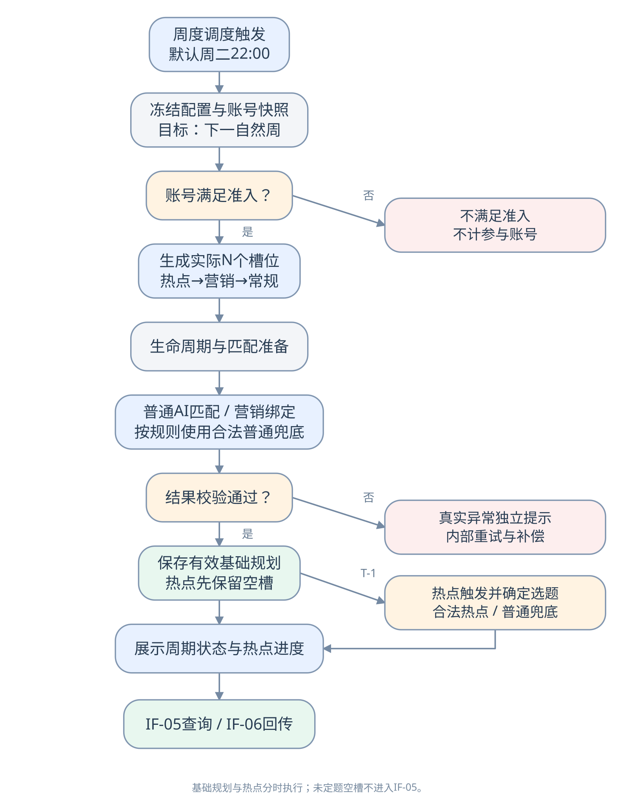

FLOW-04 AI自动策划主流程（V1.1流程图）

### 3.4.1 账号数据读取

自动策划启动后，先确定本批次有效配置，再读取当前已明确可用的账号数据：

账号基础信息：用于账号有效性、认证状态、粉丝量、流量趋势等业务判断；

互动数据：用于计算生命周期判断所需的互动类指标；

自动策划配置：①每周策划日，用于生成目标周期每个账号的槽位日期，默认周一/周三/周五；②自动策划调度时间，全局仅1个周度任务触发点，默认周二22:00。系统统一按国内时间执行，不提供时区配置。

本期不单独定义“账号经营数据”这一上游数据对象。生命周期阶段及经营判断指标由策划系统基于账号基础信息和互动数据计算得出；账号画像与账号向量同样基于本批次读取的数据及由此得到的生命周期/经营目标构建。

批次记录本次使用的账号数据快照，用于后续解释本批次使用的数据基础；热点槽位触发选题和人工替换涉及的发布状态、当前结果版本等仍以执行时策划系统最新可信数据为准。

### 3.4.2 参与账号池

任务启动后先形成参与账号池。账号至少满足：

当前有效；

本周期根据当前有效槽位配置可生成至少1个尚可执行的自动策划槽位；

可获取生成策划所需关键账号数据。

账号准入不新增独立业务状态字段：复用上游账号“有效/启用”状态，并叠加“本周期存在可执行槽位 + 关键数据读取成功”两项条件。未满足准入条件的账号不进入参与账号数；已进入后执行异常的账号才计入失败。

### 3.4.3 槽位生成

自动策划槽位由策划配置中的“每周策划日”在目标周展开生成。周度主任务默认每周二22:00执行时，目标周固定为下一自然周（下周一至下周日）。默认选中周一、周三、周五，因此每账号默认3个槽位；运营仅配置选中的星期，不为每个槽位单独配置调度时间。每个槽位至少包含：账号、目标星期/日期、策划周期、唯一slot_id、槽位类型。槽位类型规划顺序为先随机规划全局热点槽位，再对营销账号从剩余非热点槽位中规划营销槽位，其余为普通槽位。

单账号本次实际槽位数记为N。完整周主批次N等于冻结配置的选中策划日数；新账号补充批次N按当前周实际允许规划的剩余日期计算。营销上限与热点占比只影响槽位类型，不增加N。经营目标数量映射采用本次实际N；补充批次的热点占比也只作用于本批次可规划槽位，不回补过去日期。哪些剩余日期尚可执行及错过T-1的处理仍按PRD-Q04确认。

### 3.4.4 槽位提前规划、分时选题与生产窗口

自动策划调度任务完成后，全部普通/营销/热点槽位均已确定账号、目标日期和槽位类型；普通槽位与营销槽位的具体选题在本次自动策划任务中同步确定，热点槽位仅保留“待热点触发/待确定选题”，并在目标槽位前一天22:00确定具体热点选题。具体选题确定后策划侧核心状态为“未发布”；IF-05查询不改变状态、不锁定结果，只有IF-06成功更新为“已发布”后才关闭人工替换。

### 3.4.5 AI候选选题前置：离线标签计算与可匹配池

普通选题不是在自动策划任务运行时临时打标签，而是在新增普通选题首次入库后通过离线任务完成一次T1-T6标签加工。后续标题、大纲、内容类型等编辑不触发T1-T6重算，但会使当前选题画像/向量按语义变化规则失效并重新生成。标签计算是AI匹配的数据前置条件。

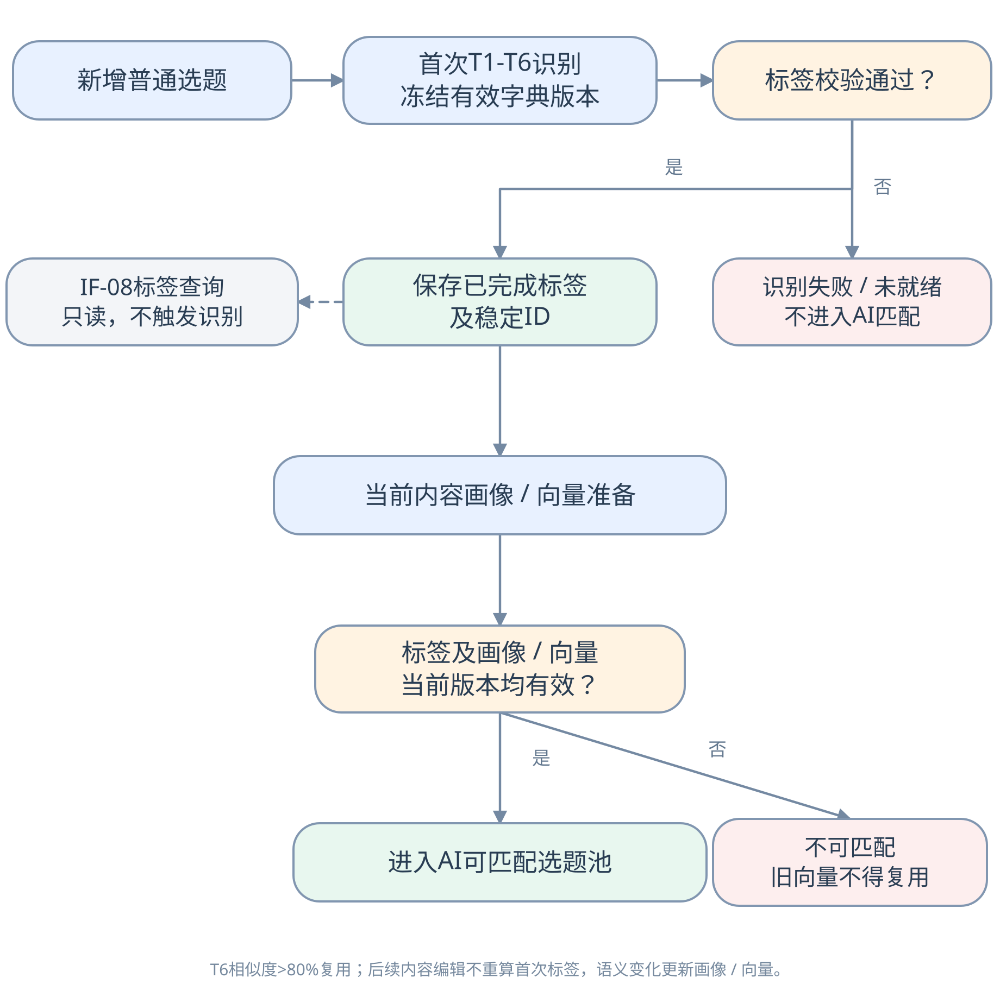

FLOW-12 选题标签、画像/向量与AI匹配准备（V1.1流程图）

触发场景

新增普通选题首次进入选题库；

本期不提供标签人工重算或自动重算入口；T1-T6仅在新增普通选题时首次识别。

后续选题标题、大纲、内容类型及其他字段变化均不触发T1-T6重算；如未来需要重算能力，另行立项。

标签计算规则

离线任务读取当前有效T1-T5固定标签字典；

模型从有效字典中识别T1-T5；

模型单选识别T6用户需求；

T6与已有T6标签库做语义相似度匹配，相似度>80%复用已有标签，否则创建新T6并绑定；每条选题最终仅绑定1个T6；

形成完整T1-T6标签结果并执行结果校验；

标签计算完成且结果有效后，进入选题画像/向量准备；当前选题版本的画像与向量均有效后，普通选题才进入“AI可匹配”状态；

AI自动策划只读取处于“AI可匹配”的普通选题，并结合本批次账号画像/向量进入Hard Gate / Recall / Fit / Global Allocation / 组合编排。

标签状态与AI匹配资格

| 标签/向量准备状态 | AI匹配资格 | 处理 |
| --- | --- | --- |
| 标签待识别 / 识别中 | 否 | 等待离线标签任务完成 |
| 标签识别失败 | 否 | 记录失败，可由内部失败重试机制处理；未成功前不进入新的AI匹配 |
| 标签已完成且有效，但画像/向量准备中 | 否 | 等待当前选题版本画像与向量完成 |
| 标签已完成且有效，但画像/向量失败或失效 | 否 | 重新生成当前版本画像/向量；不得使用旧向量 |
| 标签有效 + 当前选题版本画像/向量有效 | 是 | 进入AI可匹配选题池 |

标签计算成功后，策划系统保存普通选题有效标签结果并对外提供“选题标签查询接口”。选题方按普通选题ID主动调用接口获取对应T1-T6标签；不存在“标签主动同步到选题库”的业务步骤，也不维护待同步/已同步/同步失败状态。

标签查询接口与AI匹配资格相互独立：AI自动策划直接使用策划系统内部已生效的标签结果；选题方是否调用查询接口，不影响该选题的AI可匹配状态。

T1-T5字典发生变更时，不触发历史普通选题标签重算；仅新增普通选题使用最新有效字典进行首次识别。

手动策划不走AI匹配，因此当前基线下“标签完成”仅作为AI自动策划的前置条件，不作为运营手动选择选题的统一阻断条件。

### 3.4.6 账号与选题画像、向量匹配准备

普通选题完成离线T1-T6标签加工后，账号与选题还需转换为可用于智能匹配的统一特征表示。该过程属于AI自动策划的后台数据准备与算法处理，不新增运营操作页面。

账号侧

系统基于本批次读取的账号基础信息、账号人设、互动数据，以及由此计算得到的生命周期阶段和当前经营目标形成账号画像，并生成账号向量表示（Account Embedding）。

账号画像/向量必须与本批次使用的账号数据快照一致；同一批次不得在不同算法阶段混用不同账号数据快照。

选题侧

系统基于普通选题标题、大纲、内容类型及当前有效T1-T6标签形成选题画像，并生成选题向量表示（Topic Embedding）。其中T1只表示普通选题内部语义属性，不改变该选题来源类型。

选题发生影响语义判断的内容变更或当前有效版本变化后，原画像/向量视为失效；新画像/向量未准备完成前，不得使用历史失效向量参与新的AI匹配。本期仍保留首次有效T1-T6标签，不因后续内容编辑另行启动标签重算。

匹配准备与逐层收敛

账号向量与选题向量进入同一智能匹配链路，系统通过Hard Gate、Recall、Fit、Global Allocation和组合编排逐步缩小候选范围，并最终形成槽位级基础策划结果。

向量模型、Embedding维度、相似度算法、Recall Top-K、Fit特征/权重以及Global Allocation目标函数等进入《算法/策略说明文档》，本PRD不写死具体参数。

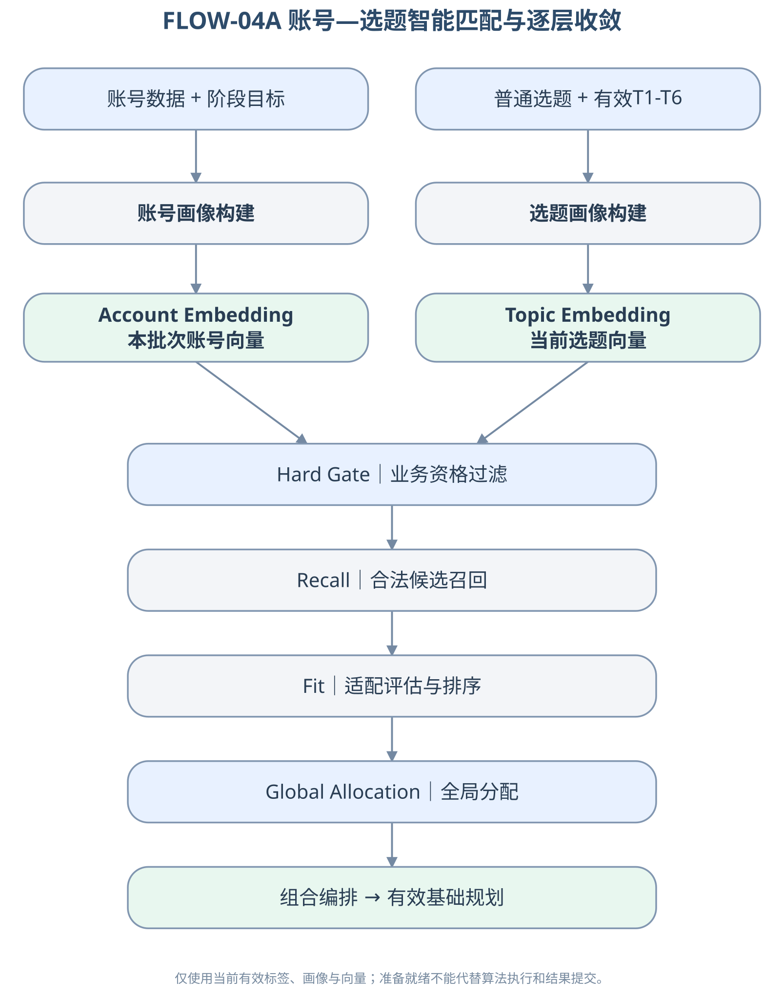

FLOW-04A 账号—选题智能匹配与逐层收敛（V1.1流程图）

### 3.5 生命周期策略如何真正作用于本周期

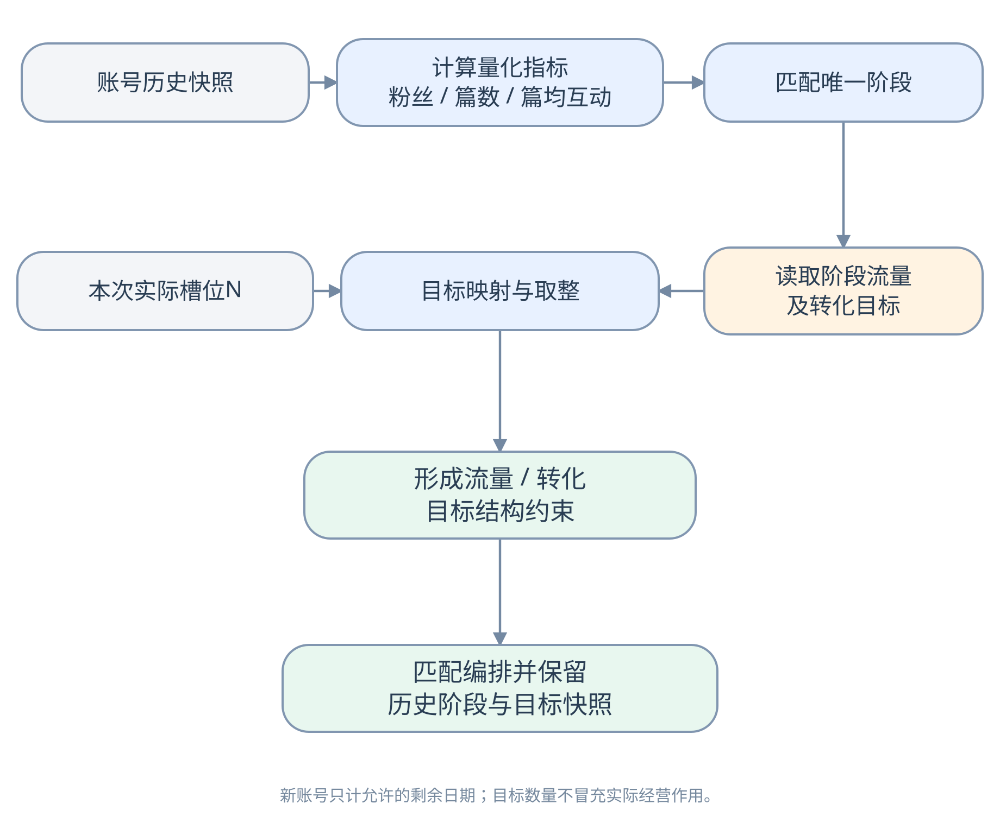

FLOW-05 生命周期到内容结构（V1.1流程图）

生命周期判断使用历史窗口X；本周期编排使用未来槽位N。系统根据账号阶段读取流量/转化经营目标，再映射到N个实际槽位中。

为了让运营能验证策略是否执行，最终“策划结果详情”必须展示：经营阶段、每条结果的经营作用（流量型/转化型）；不展示Fit/Recall数值。

经营阶段与目标引用本次生成结果时的配置和账号快照，不随账号当前阶段变动回填旧记录；人工替换保留原经营阶段。详情中的经营作用必须有可信来源，不用生命周期目标反推出每条选题作用。普通内容可引用有效T2语义；营销/热点及跨类型替换的作用来源尚待PRD-Q06确认，无可信值时显示“—”。

### 3.6 普通选题处理

普通内容采用逐层收敛的智能匹配流程。进入该流程的普通选题必须完成离线T1-T6标签计算，并具备与当前选题版本一致的有效选题画像和向量表示；账号侧使用本批次数据构建的账号画像与账号向量。

完整主干为：账号画像/向量 + 选题画像/向量 → Hard Gate → Recall → Fit → Global Allocation → 组合编排。

Hard Gate：先排除违反明确业务约束的账号×选题组合，解决“能不能匹配”。

Recall：基于双侧向量等召回信号，从较大的合法选题池中召回有限候选，解决“哪些值得继续计算”。

Fit：结合账号画像、选题画像、标签关系、经营目标等对召回候选进一步适配评估与排序，解决“哪个更适合当前账号”。

Global Allocation：综合全部账号、槽位、候选选题及全局约束统一分配，避免单账号局部最优直接等同全局最优。

组合编排：在全局分配结果基础上，结合生命周期经营目标与实际槽位N完成最终内容结构和槽位落位。

向量相似度、Recall候选数量、Fit分值、Global Allocation中间分配结果等仅用于后台算法处理，不在运营前台展示。

正常策略无结果时进入兜底：从满足基础可用条件的普通选题中，按选题热度从高到低排序，选择热度最高的1条作为兜底选题。

兜底仍无合法选题时，对应槽位失败。

### 3.7 营销槽位随自动策划批次同步执行

自动策划执行前完成营销选题同步 → 先完成全局热点槽位规划 → 对营销账号计算营销槽位数=min（本账号已同步营销候选数，周上限，剩余非热点槽位数）并随机落位 → 从该账号绑定且已审核有效的营销选题中按审核通过时间升序逐条绑定 → 合法营销选题不足：剩余营销槽位使用普通选题兜底 / 同步失败：系统异常

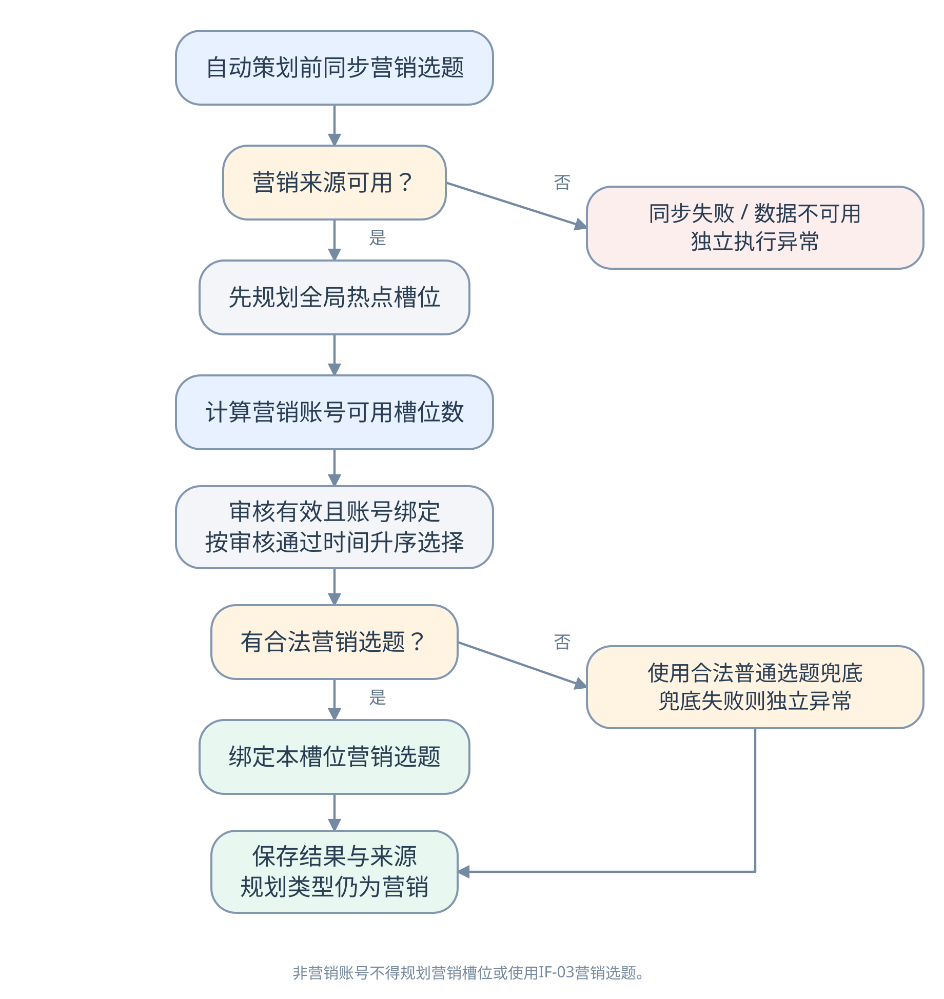

FLOW-06 营销内容处理（V1.1流程图）

### 3.7.1 触发时机与处理原则

营销槽位在自动策划调度任务中提前规划并同步确定具体选题。热点槽位先于营销槽位完成规划；营销账号仅在其剩余非热点槽位中规划营销槽位，数量为min（本账号已同步营销候选数，周上限，剩余非热点槽位数）。营销选题需在自动策划执行前完成同步；任务执行时读取策划系统本地最新同步结果。

先判断账号是否为营销账号；非营销账号不进入营销槽位规划/执行，也不得使用IF-03营销选题。该资格判断不依赖T1标签；

营销槽位绑定具体内容时，从策划系统本地已同步的该账号营销选题中筛选当前已审核且有效的候选，并按审核通过时间升序逐条使用；同一账号同周期内同一营销选题不重复占用多个营销槽位；

多条可用时按审核通过时间升序使用，审核通过更早者优先；

已规划营销槽位的合法营销选题不足 → 不足槽位使用普通选题兜底，槽位类型仍保留营销，最终选题类型按普通记录；

营销选题同步失败或数据不可用 → 系统异常，不得伪装成“无营销选题”。

### 3.8 热点槽位触发执行（后台业务流程）

### 3.8.1 前台边界

热点触发属于后台自动流程；AI自动策划页通过热点填充进度和周期状态展示结果，不新增独立热点算法执行区域。正常热点等待与真实执行异常分开表达，后台保留计划、可执行、实际确定、未满足和异常原因。

### 3.8.2 后台追溯字段

| 字段 | 定义 |
| --- | --- |
| 热点 | 热点名称/标识 |
| 来源 | 热点来源系统/业务来源 |
| 目标发布时间窗口 | 本次热点触发可使用的已规划热点槽位发布时间范围 |
| 计划热点槽位 | 本次触发窗口内提前规划、应参与热点选题确定的热点槽位数 |
| 可执行 | 当前满足时间、发布状态和基础约束的已规划热点槽位数 |
| 实际完成 | 实际成功确定具体热点选题的热点槽位数 |
| 未满足 | 计划热点槽位数 - 实际完成数 |
| 状态 | 待处理 / 匹配中 / 已完成 / 部分满足 / 处理失败 |
| 处理时间 | 本次热点触发任务完成/更新时间 |
| 追溯方式 | 后台查询 / 日志追溯（不作为 AI 自动策划页独立运营区域） |

### 3.8.3 追溯要求

后台至少保留：热点标识、热点数据更新时间、账号、槽位ID、热点选题、目标槽位时间、T-1日22:00触发时间、执行状态、兜底结果、未满足原因等。上述字段用于排障和审计，不要求在AI自动策划页单独展示Fit、热点匹配分或算法内部排序。

### 3.9 单热点槽位触发与选题确定流程

目标热点槽位前一天：热点侧先完成热点选题同步 → 22:00触发任务 → 读取策划系统本地最新有效热点及本周期已提前规划的对应热点槽位 → 过滤非法/已发布槽位 → 热点×账号×槽位合法性过滤 → 多热点随机分配 → 无合法热点则普通最热兜底 → 更新当前有效选题并留痕

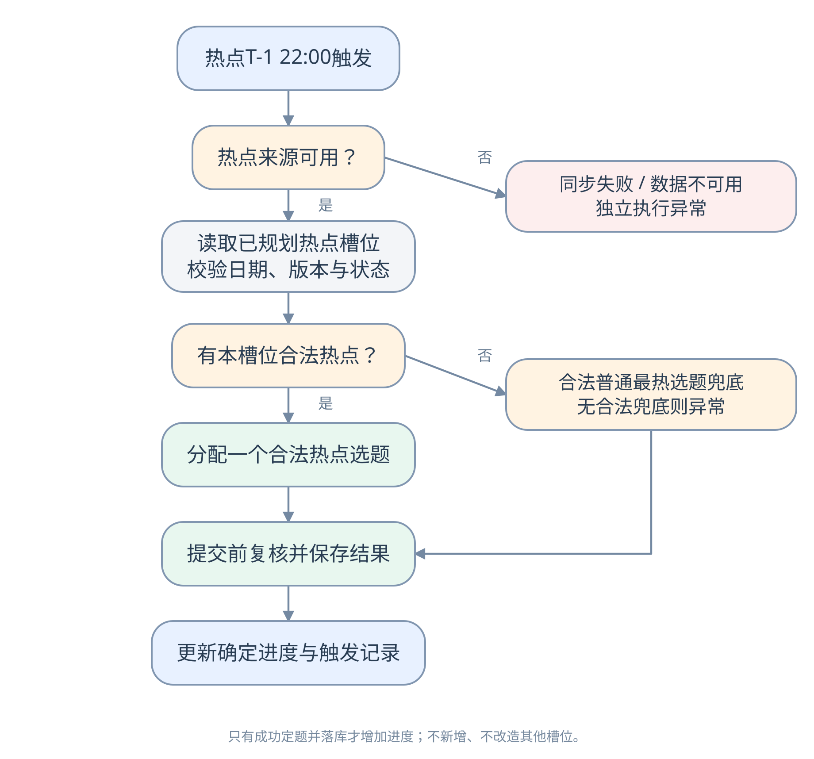

FLOW-07 单热点槽位触发与选题确定（V1.1流程图）

热点任务在目标热点槽位前一天22:00（系统默认国内时间）自动触发；热点选题须在该时间点前完成同步。任务只从周度自动策划任务中已经提前规划的目标热点槽位中构建可执行池。槽位至少满足：目标日期匹配、槽位规划有效、发布状态未发布、账号与候选热点满足基础业务约束。

热点触发后，系统先完成“热点 × 账号 × 已规划热点槽位”合法性过滤；若多个合法热点竞争同一批已规划热点槽位，不设热点优先级，按随机方式完成槽位分配，同一槽位只能分配1个热点。若某热点槽位无任何合法热点选题，则从该账号合法普通选题中选择热度最高的1条兜底；槽位类型仍保留“热点”，最终选题类型按实际兜底结果记为“普通”。

### 3.10 多热点统一热点槽位池分配流程

多个热点到达 → 读取统一已规划热点槽位池 → 按时间/状态过滤 → 多热点统一分配 → 槽位被占用后移出池 → 形成热点槽位具体选题结果 → 保存执行记录

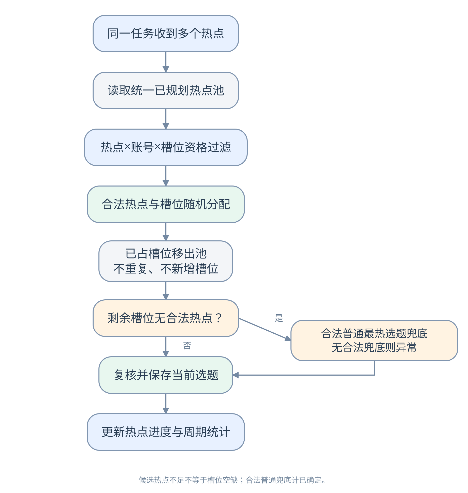

FLOW-08 多热点统一已规划热点槽位池分配（V1.1流程图）

同一触发任务中的多个热点共享统一“已规划热点槽位池”。系统先做合法性过滤，再对合法热点与合法热点槽位随机分配；同一热点槽位一旦被分配即移出本次池，不得重复占用。普通槽位和营销槽位不进入热点槽位池。

热点槽位总量由“热点槽位占比”四舍五入计算；具体哪些账号/槽位被规划为热点槽位采用随机方式，不额外设置单账号单日/单周期热点槽位上限，实际数量自然受该账号本周期总槽位数约束。多热点竞争时同样采用随机分配，PRD固定“不重复占用、只使用已规划热点槽位、不临时新增热点槽位”。

### 3.11 执行异常只读查看

| 字段/边界 | 说明 |
| --- | --- |
| 账号 | 异常涉及的账号名称/ID；整批依赖异常可标识影响范围 |
| 原因 | 来源数据不可用、无合法兜底、版本/发布状态不可信等真实原因 |
| 操作 | 只读查看；无运营重跑或算法参数编辑 |
| 状态 | 异常独立提示，不能显示成正常热点等待 |

图3-2 自动策划异常只读明细（V1.1结构示意）

异常提示可查看账号及业务原因的只读明细，不提供运营手工重跑、修改算法参数等入口，不以部分失败替代周期业务状态。若整批依赖不可用，需提示真实异常，不显示为正常热点等待。“执行异常”属于独立异常提示；当异常导致周期结果完整性或状态不可信时，周期业务状态显示“—（待核对）”，仍保留可查询的已落库结果。仅接口读取失败不能推断任务执行失败。

系统内部允许技术重试和补偿；本期不设置统一业务截止/冻结时间。失败与恢复结果按最新有效状态持续回写，页面展示最后更新时间；已经发生的合法状态跃迁和统计可被后续补偿更新。

### 3.12 新账号即时策划

每日夜间账号数据同步完成后，策划系统对比本地已有账号数据识别新增账号：

夜间同步识别到新增账号→ 本周是否仍存在尚未到达的已配置自动策划槽位？  ├─ 否：当前周期不回补已过去槽位，不计失败  └─ 是：按剩余配置生成未来槽位 → 执行对应自动策划 → 进入同一待生产链路

新增账号后续策划可使用独立技术批次，但其结果必须并入所属策划周期的周度统计，保证“周度结果”与该周期实际策划内容一致。

### 3.13 页面状态与异常

| 场景 | 页面/业务表现 |
| --- | --- |
| 下周尚未到周度调度点且无规划 | 显示待调度；不计已规划 |
| 基础规划完成、目标周期未开始 | 已规划；热点可为空槽 |
| 进入周期且热点已确定4/20 | 热点空槽待填充，进度4/20；其余合法槽位按T-1逐步确定 |
| 进入周期且全部选题确定 | 已完成；与未发布/已发布状态独立 |
| 进入周期且没有热点槽位 | 其余应规划槽位已确定时直接已完成 |
| 任务执行中或有账号异常 | 周期业务状态只在满足对应业务条件时展示。技术任务的待执行、执行中、执行失败等状态用于内部追溯；依赖异常独立提示原因与更新时间，不得映射为热点空槽待填充或伪装成已完成。 |
| 核心依赖整批不可用 | 显示异常原因及更新时间，内部记录执行失败并支持技术重试 |
| 普通兜底无合法选题 | 槽位未完成并记录账号异常，不伪装成热点待填 |
| 营销/热点正常同步但无合法候选 | 按对应规则使用合法普通选题兜底；同步失败须单独处理 |
| 发布状态无法确认 | 替换不可用；对应热点槽位不进入本次可执行池 |
| 周期结束后合法补偿 | 继续回写及刷新有效统计，不设置统一业务冻结点 |

#### 3.13.1 周期状态与辅助提示的分层

本页将周期业务状态、调度/数据展示提示和异常提示分开表达。周期业务状态固定为“已规划 / 热点空槽待填充 / 已完成”；“待调度”“等待策划结果”“暂无策划数据”“读取失败”“执行异常”等属于辅助展示提示，不新增周期业务状态枚举。提示文字本身不参与完成、失败、账号或槽位计数，统计仅依据可信的已落库业务事实。

热点规划数已明确为0时，进度显示“—（无热点槽位）”，不计算0/0或显示待填充。目标周期未开始仍按条件显示已规划；进入周期且全部普通/营销应规划槽位选题确定后才显示已完成。零热点不等于零槽位，也不能单独证明全周期完成。

“已规划”须有已形成的有效基础规划且目标周期未开始；“热点空槽待填充”须已进入周期并存在合法待确定热点槽位；“已完成”须已进入周期且全部应规划槽位已确定有效选题。时间经过、页面请求成功、准备就绪或仅存在任务记录都不能单独证明上述状态成立。

#### 3.13.2 等待与无数据展示规则

| 场景 | 判定条件 | 页面提示 | 字段与操作 |
| --- | --- | --- | --- |
| 下周尚未到调度时间 | 目标周期无有效基础规划，当前国内时间早于配置的周度调度点。 | 下周调度区显示“待调度”，展示目标周期和计划调度时间。 | 周期状态为“—”；没有可信计数时账号/槽位/进度显示“—”。不提供无结果详情或运营手工触发。 |
| 调度已到、有效结果未形成 | 调度时间已到但尚无有效基础规划，且未获知可信的执行失败或超时事实。 | 显示“等待策划结果”，说明“已到调度时间，尚未获取有效策划结果”。有可信排队/准备/运行事实时，可补充“任务处理中”。 | 不标记已规划，不自动判执行失败或已完成。持续刷新并保留手动刷新；不编造完成时间或预计耗时。 |
| 当前周期无有效规划 | 查询成功，当前自然周没有有效规划或可显示结果。 | 当前周期区显示“暂无策划数据”，说明“本周期暂无有效规划”；仍显示本周真实周一至周日。 | 不以未来或历史周期替代本周。下周及历史在各自区域展示；未明确返回的数量显示“—”，不能将缺失事实补成0。 |
| 历史查询无匹配记录 | 历史列表查询成功，但当前年/月等筛选下没有匹配记录。 | 显示“当前筛选条件下暂无策划记录”。 | 保留筛选条件，允许调整或刷新。空列表不表示任务失败，也不表示历史全部完成。 |

数量0仅用于接口已经明确确认的零值业务事实；无返回值、尚未形成结果或读取失败不能以0代替。当前周期、下周周期和历史列表分别判断，不用另一周期的数据补齐当前周期。

#### 3.13.3 读取失败、执行异常及恢复

| 场景 | 页面提示 | 结果/状态处理 | 操作与时间说明 |
| --- | --- | --- | --- |
| 首次读取失败，没有可信缓存 | 显示“策划数据读取失败，请稍后刷新”，展示可理解的读取失败原因。 | 不显示“暂无策划数据”或0条成功结果；周期业务状态及未知计数显示“—”。 | 保留筛选条件和手动刷新；业务更新时间无事实时为“—”。 |
| 刷新失败，已有可信结果 | 显示“数据刷新失败，以下为最近一次成功读取结果”。 | 保留原结果、筛选和已确认状态；明确旧数据，不能将读取失败改成任务执行失败。 | 分别展示业务更新时间和最近成功读取时间；再次读取成功后移除读取失败提示。 |
| 已确认的执行异常 | 依据后台可信执行事实显示“策划执行异常”，并提供影响账号/范围、业务原因和业务更新时间的只读查看。 | 若异常导致结果完整性或状态不可信，周期状态为“—（待核对）”；保留已落库结果。不能显示为正常热点等待或已完成，也不能伪造热点进度。 | 无运营重跑或算法编辑入口。技术重试和补偿由后台处理；恢复后按最新有效事实重新计算正常状态。 |
| 热点触发时间已到，结果未确认 | 没有可信失败事实时提示“热点触发时间已到，结果尚未确认”；若后台已确认超时、来源不可用或兜底失败，使用执行异常提示。 | 尚未到T-1触发点的合法热点空槽属于正常等待；触发点已过但无结果时不能仅凭空槽宣称执行正常，也不能只凭时间经过判执行失败。 | 触发/超时事实来自内部任务和监控；超时阈值、刷新间隔和重试参数由技术设计定义，不在PRD设置固定分钟数。 |

提示优先级：已确认的执行异常需要显著展示；读取失败需要单独说明数据新鲜度。页面不得使用“等待策划结果”遮盖已经确认的执行异常。再次查询成功只证明读取恢复；执行异常提示只有在可信执行事实恢复后才能解除。

### 3.14 本页依赖的数据/接口能力

| 接口ID | 页面用途 |
| --- | --- |
| IF-01 | 账号基础信息、账号别名、认证状态、账号人设及近3个月互动数据由IF-01每日夜间离线同步；流量趋势由策划系统基于互动数据计算；自动策划执行时读取最近一次成功同步的数据快照，用于账号准入、生命周期与账号画像。 |
| IF-02 | 普通选题在自动策划执行前完成同步；同步数据包含可排序热度，标签有效且当前版本画像/向量有效、AI可匹配的普通选题进入候选池。 |
| IF-03 | 营销选题在自动策划执行前完成同步；槽位规划读取本地候选数量，内容绑定只读取与账号绑定、已审核有效的营销选题。 |
| IF-04 | 热点选题在目标热点槽位前一天22:00前完成同步；22:00任务读取本地最新有效热点，用于已规划热点槽位具体选题确定。 |
| IF-06 | 内容生产方通过IF-06仅回传发布状态；用于结果页发布状态展示及已发布后的人工替换关闭。 |
| IF-05 | 内容生产方按账号ID查询最新一期当前有效策划内容；查询行为不改变发布状态、不锁定结果。 |

### 3.15 页面验收标准

| ID | 关联规则 | 场景 | 预期结果 |
| --- | --- | --- | --- |
| AUTO-UAT-01 | AUTO-R01/AUTO-R02 | 默认周度任务启动 | 每周二22:00生成下一自然周（下周一至下周日）的周期槽位，并按“先热点、后营销、剩余普通”提前规划槽位类型；具体选题按各类规则确定。 |
| AUTO-UAT-02 | AUTO-R02 | 账号已停用或本周期无可执行配置槽位 | 不进入AI参与账号池，不生成自动策划槽位 |
| AUTO-UAT-03 | AUTO-R03 | 周期槽位规划完成 | 普通/营销/热点槽位类型均已确定；普通/营销槽位具体选题已确定，热点槽位进入待热点触发；营销槽位与热点槽位不重复占用同一槽位。 |
| AUTO-UAT-04 | - | 普通策略无结果但兜底成功 | 槽位正常完成 |
| AUTO-UAT-05 | - | 兜底仍无合法选题 | 槽位失败，账号计失败 |
| AUTO-UAT-06 | MKT-R01 | 已规划营销槽位绑定内容时，合法营销选题数量不足 | 按审核通过时间升序逐条使用合法营销选题；不足槽位普通兜底，槽位类型仍保留营销，最终选题类型按普通记录。 |
| AUTO-UAT-07 | MKT-R01 | 自动策划前营销选题同步失败或本地同步数据不可用 | 进入系统异常，不得直接降级为“无营销选题” |
| AUTO-UAT-08 | HOT-R01/HOT-R03 | 本次触发窗口计划热点槽位10、合法可执行6 | 最多6个热点槽位成功确定具体热点选题，状态=部分满足；不新增其他槽位 |
| AUTO-UAT-09 | HOT-R02 | 同一批多个热点共享已规划热点槽位池 | 同一热点槽位不得重复分配；普通/营销槽位不进入该池 |
| AUTO-UAT-10 | HOT-R01 | 已规划热点槽位发布状态已为已发布 | 不进入热点触发可执行池 |
| AUTO-UAT-11 | AUTO-R05 | 失败账号数>0 | 可查看账号和业务异常原因 |
| AUTO-UAT-12 | - | 页面 | 不展示Fit/Recall/算法中间排序 |
| AUTO-UAT-13 | AUTO-R06 | 新选题尚未完成标签计算 | 不进入AI普通选题候选池 |
| AUTO-UAT-14 | AUTO-R06/AUTO-R07 | T1-T6标签计算完成且结果有效 | 进入AI可匹配选题池，可参与Hard Gate/Recall/Fit |
| AUTO-UAT-15 | AUTO-R07 | 标签识别失败 | 不参与新的AI自动匹配 |
| AUTO-UAT-16 | FALLBACK-R01 | 正常匹配无结果且存在多个合法普通选题 | 选择热度最高的1条兜底 |
| AUTO-UAT-17 | AUTO-R04 | 批次启动后配置发生变化 | 本批次继续使用启动时确定的配置版本，并可追溯本次使用的账号数据快照 |
| AUTO-UAT-18 | HOT-R01 | 已规划热点槽位发布状态无法可靠确认 | 不进入热点触发可执行池 |
| AUTO-UAT-19 | - | 后台追溯热点槽位触发结果 | 可追溯账号、热点槽位、热点选题、投放时间、触发时间和执行状态；AI自动策划页不新增独立热点执行区域 |
| AUTO-UAT-20 | AUTO-R05 | 周期结束后收到合法发布状态补偿 | 允许回写并更新最新周期统计，不因“已闭批”拒绝合法状态 |
| AUTO-UAT-21 | AUTO-R08/AUTO-R09 | 标签已完成但当前选题版本向量尚未准备完成 | 不进入新的AI自动匹配，等待当前版本画像/向量就绪 |
| AUTO-UAT-22 | AUTO-R09 | 选题标题/大纲发生影响语义的更新 | 旧画像/向量失效；新版本画像/向量完成前不得继续使用旧向量 |
| AUTO-UAT-23 | AUTO-R04/AUTO-R09 | 自动策划批次启动并生成账号向量 | 账号画像/向量基于本批次使用的同一份账号数据快照生成，并可追溯该快照 |
| AUTO-UAT-24 | AUTO-R10 | 查看AI自动策划/策划结果页面 | 不展示Embedding、向量相似度、Recall/Fit中间分数、候选排序或全局分配内部值 |
| AUTO-UAT-25 | HOTCFG-R01/HOT-R01 | 新批次读取热点槽位占比配置，批次自动策划总槽位数=126，占比=20% | 提前规划25个热点槽位（126×20%=25.2，四舍五入=25）；热点到达时不临时新增热点槽位 |
| AUTO-UAT-26 | MKT-R01 | 自动策划前普通/营销选题均已完成同步 | 普通/营销槽位在同一批次同步确定具体选题；营销槽位只读取本地最新同步的合法营销选题 |
| AUTO-UAT-27 | MKT-R02 | 非营销账号或普通选题T1=营销语义标签 | 非营销账号不得规划营销槽位/使用IF-03营销选题；普通选题T1标签不改变topic_type，也不作为营销账号资格判断。 |
| AUTO-UAT-28 | SLOT-R01 | 默认每周策划日 + 周度调度 | 每周二22:00为下一自然周按周一/周三/周五生成3个槽位；增减选中星期后N随选中天数变化。 |
| AUTO-UAT-29 | MKT-R01 | 自动策划调度时间到达（默认周二22:00） | 统一执行下一自然周整批AI自动策划；读取策划前已同步普通/营销选题，并按先热点、后营销、剩余普通完成槽位类型规划。 |
| AUTO-UAT-30 | HOT-R01 | 周三热点槽位 | 周二22:00读取已更新热点数据并确定周三该热点槽位具体选题 |
| AUTO-UAT-31 | HOT-R02 | 多个合法热点竞争多个已规划热点槽位 | 随机分配且同一槽位最多1个热点，不使用普通/营销槽位 |
| AUTO-UAT-32 | HOT-R05 | 热点槽位无合法热点 | 自动选取该账号合法普通选题中热度最高者兜底，槽位类型仍保留热点 |
| AUTO-UAT-33 | 周期状态 | 下一周已完成基础规划但未进入执行期 | 已规划；即使热点已提前确定也不提前显示周期已完成 |
| AUTO-UAT-34 | 周期状态 | 当前周热点已确定4/20且无异常 | 热点空槽待填充，展示4/20，正常等待不计基础规划失败 |
| AUTO-UAT-35 | 周期状态 | 当前周全部应规划槽位选题已确定 | 已完成，与内容是否发布独立 |
| AUTO-UAT-36 | 周期状态 | 当前周没有热点且普通/营销均已确定 | 直接已完成 |
| AUTO-UAT-37 | 执行安全 | 存在普通兜底失败或来源同步失败 | 内部记录并提示真实异常，不映射为正常热点待填或已完成 |
| AUTO-UAT-38 | 匹配准备 | 准备就绪或提案校验通过但尚未结果提交 | 不生成运营已规划/已完成事实；原子提交后才成为有效结果 |
| AUTO-UAT-39 | 3.13.1/3.13.2 | 下周未到调度时间且无有效规划 | 展示待调度及目标周期/调度时间；周期状态为“—”，不计已规划，不编造账号或槽位数量。 |
| AUTO-UAT-40 | 3.13.2 | 调度时间已到、尚无有效结果且无已确认异常 | 展示等待策划结果并持续刷新；不假定任务已开始，不仅凭时间经过标记失败或已完成。 |
| AUTO-UAT-41 | 3.13.2 | 本周无有效规划，但存在未来/历史周期 | 本周显示真实日期范围及暂无策划数据；未来/历史记录只在各自区域显示，不替代本周。 |
| AUTO-UAT-42 | GLOBAL-R01/3.13.2 | 历史筛选查询成功但没有匹配记录 | 保留条件并显示暂无匹配策划记录；空数据不被当作读取失败、执行失败或已完成。 |
| AUTO-UAT-43 | 3.13.3 | 首次读取失败且无可信缓存 | 显示读取失败及刷新入口；未知状态/数量为“—”，不显示暂无数据或虚假的0条完成结果。 |
| AUTO-UAT-44 | GLOBAL-R03/3.13.3 | 刷新失败但已有可信结果 | 保留结果和条件，提示为最近一次成功读取数据；业务更新时间与成功读取时间分别说明。 |
| AUTO-UAT-45 | AUTO-R05/3.13.3 | 后台确认依赖失败、无合法兜底或触发超时 | 显著展示只读异常原因/影响范围/更新时间；状态不可信时为“—（待核对）”，不使用等待提示掩盖异常，无运营重跑入口。 |
| AUTO-UAT-46 | 3.13.1/3.13.3 | 读取恢复或执行异常恢复 | 读取恢复清除读取失败提示；执行异常依可信事实解除。有效规划/进入周期/全部选题确定后分别按真实条件展示三种正常周期状态。 |
| AUTO-UAT-47 | AUTO-R02/3.12 | 新账号本次仅允许生成2个剩余日期槽位，完整周配置3天 | 本次N=2，比例数量映射基于2；不回补过去日期，不因少于完整周3天计失败 |
| AUTO-UAT-48 | 1.4/3.4.6 | 标签完成但当前画像/向量未就绪或失效 | 仍不得进入新的AI候选池；手动选题资格不因此被自动套用AI条件 |
| AUTO-UAT-49 | 1.5/3.13 | 已到T-1但尚未确认执行成功，或已规划0个热点 | 前者不按时间推断定题；后者进度显示无热点槽位，周期状态仍按全部应规划结果判断 |

## 4. 页面三：手动策划

### 4.1 页面定义卡

| 项目 | 定义 |
| --- | --- |
| 页面名称 | 手动策划 |
| 页面编号 | FE-03 |
| 使用角色 | 运营 |
| 页面入口 | 左侧导航 → 手动策划 |
| 成功出口 | 生成手动追加结果，并可跳转策划结果查看 |
| 页面目的 | 为临时、定向、批量需求额外追加内容，不改变AI自动策划槽位 |
| 核心输出 | 手动追加策划结果、手动策划任务记录 |
| 非本页职责 | 不按生命周期目标筛选/分配，不执行AI适配或全局分配；只追加，不在本页替换已有内容 |

本页核心业务规则ID

| 规则ID | 规则摘要 |
| --- | --- |
| MAN-R01 | 手动策划只新增内容，不占用/替换AI槽位 |
| MAN-R02 | 命中账号数N小于规划数M时必须阻断并提示差额 |
| MAN-R03 | 命中N=M时自动纳入全部账号，N>M时随机选择M个；之后允许逐账号取消/勾选调整，最终集合必须满足筛选条件、去重且数量恰为M |
| MAN-R04 | 单选题全部账号统一使用；多选题每账号随机分配1个 |
| MAN-R05 | 正式提交前必须二次校验账号和选题有效性 |
| MAN-R06 | 每次正式提交必须生成可追踪的手动任务记录 |
| MAN-R07 | 支持整体重新随机，替换上一轮选择；人工调整和重新随机均使旧分配预览失效，提交前须重新确认 |
| MAN-R08 | 正式提交前抽中账号失效时自动从剩余合法候选池补抽；补抽不足则整次提交阻断 |
| MAN-R09 | 多选题不设置单题最大分配量，不要求平均分配 |
| MAN-R10 | 手动策划不允许部分成功/部分完成；全部M条一次性成功落库或整次失败 |
| MAN-R11 | 手动策划结果在满足人工替换状态条件时允许后续替换选题 |

### 4.2 页面步骤总览

手动策划采用同一页面分步解锁，不要求多页向导：

Step 1 设置规划数量 → Step 2 筛选账号 → Step 3 随机抽取 → Step 4 选择选题 → Step 5 确认并发起。

| 区域 | 操作与约束 |
| --- | --- |
| 规划数量及日期 | 正整数M，单个自然日；手动追加不占自动槽位 |
| 筛选 | 认证、粉丝范围、互动代理的流量趋势 |
| 随机选取 | 从命中有效池抽M个，命中不足则提示差额并阻断 |
| 人工调整 | 取消/勾选或整体重新随机；最终恰为M，条件变化旧预览失效 |

图4-1 手动策划数量与账号选择（V1.1结构示意）

### 4.3 Step 1：设置规划数量与投放日期

| 字段 | 控件 | 必填 | 规则 |
| --- | --- | --- | --- |
| 本次策划规划数量M | 正整数 | 是 | >0 |
| 投放日期 | 单日期选择 | 是 | 一次仅选择一个自然日 |

手动策划是“新增内容”，不占自动策划槽位。即使账号同日已有AI内容，仍允许手动追加。

手动策划的经营阶段仅作结果追溯：提交时保留账号当时可信的经营阶段快照，不用阶段目标约束随机选题。无法确认的历史阶段显示“—”，不以账号当前阶段补写旧结果；经营作用有可信选题属性时按属性展示，否则显示“—”，不强制补成流量型或转化型。

### 4.4 Step 2：筛选账号

本期筛选条件只保留：认证状态（来自IF-01）；粉丝量（来自IF-01）；流量趋势（策划系统基于IF-01近3个月互动数据计算）；投放日期（已在Step 1选择）。粉丝范围的上下界须明确展示，重叠档位不能用模糊文案区分；快捷档位数值待客户确认，不直接以生命周期阶段阈值代替筛选范围。

流量趋势为基于互动的代理指标，本期不表示真实曝光流量：在近三个月有效内容中，比较最近X篇与前X篇的篇均互动，X沿用当前滚动窗口（默认10篇）。样本少于2X篇为数据不足；前窗口均值>0时，当前/前窗口−1≥20%为上升，≤−20%为下滑，介于二者为平稳。前窗口均值为0时，当前>0为上升，否则平稳。无需近4周日均流量字段，也不采用±10%阈值。

不增加“流量等级”等未确认条件。

查询后展示：当前命中N个 / 本次规划M个。

N < M：显示“还差M-N个”，禁止继续；

N = M：全部账号进入本次策划；

N > M：随机抽取M个账号。

随机抽取后允许查看并逐账号取消/勾选调整，也可整体重新随机。新增勾选必须来自当前筛选的有效账号池，账号不可重复；未满M或超过M均不能生成确认预览/正式提交。修改日期、数量或筛选条件后清空旧选择和旧预览，要求重新确认。

### 4.5 Step 3：随机抽取账号

随机是系统行为，不执行AI适配评分，不要求均匀分组。运营可在随机结果上人工调整账号或整体重新随机；最终确认以当前选中的合法M个账号为准，并记录实际集合。随机/改选后的分配预览不属于已提交任务。

### 4.6 Step 4：选择选题

| 步骤 | 规则 |
| --- | --- |
| 选题 | 按标题/内容类型搜索；单选统一，多选每账号随机1个 |
| 预览 | 展示当前账号、选题及统一投放日期，改选后须重新生成 |
| 正式提交 | 重新校验账号与选题；失效账号合法补抽；不足则整体阻断 |
| 任务记录 | 执行中/已完成/执行失败，成功M条或失败0条，不产生部分结果 |

图4-2 手动策划确认与任务记录（V1.1结构示意）

图4-3 手动策划选题搜索弹窗

选题搜索只支持：标题关键词、内容类型。不要求运营输入选题ID，不提供“主题”筛选。

搜索结果至少展示：选题标题、内容类型、选题大纲。

本期手动初次策划从IF-02已同步的有效普通选题中选择；不要求标签或画像/向量已就绪，不执行AI适配。营销/热点的跨类型选择是结果页人工替换能力，不据此扩展手动初次选题范围。手动提交生成当前有效追加结果，初始为未发布；本期没有策划待审核状态或策划审核页面，营销选题的上游审核资格与此无关。

分配规则：

只选择1个选题 → 所有抽中账号统一使用该选题；

选择多个选题 → 每个账号从本次已选集合中随机分配1个；

不要求多选题平均分配；

不执行AI Fit评分。

多选题不设置单题最大分配量；同一选题可以随机分配给任意数量账号，只要求每个账号最终获得1个本次手动策划选题。

### 4.7 Step 5：确认并发起

提交前展示摘要：投放日期、规划数量、实际抽中账号数、筛选条件、已选选题数、分配方式。

点击“确认并发起”后，系统再次校验全部已抽中账号和选题有效性。若抽中账号在提交前失效，系统从同一筛选条件下仍有效且未被本次抽中的账号池自动补抽，直到补足M个；若剩余有效账号不足以补齐，则整次提交阻断，不创建任何部分结果。全部校验通过后一次性创建M条手动追加结果。

### 4.8 手动策划主流程

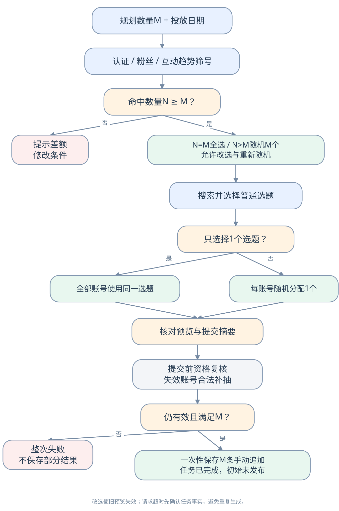

FLOW-09 手动策划（V1.1流程图）

### 4.9 最近手动策划任务

前端格式或未选账号/选题等校验未通过时不创建任务；正式提交被服务端受理后生成任务记录。受理后即使二次校验失败、补抽不足或执行失败且没有结果，仍须能通过任务记录查询原因。

| 字段 | 定义 |
| --- | --- |
| 发起时间 | 正式提交时间 |
| 操作人 | 发起人 |
| 投放日期 | 本次计划投放日期 |
| 规划账号数 | M |
| 成功结果数 | 仅按已落库事实计数：已完成时为M，执行失败时为0；执行中不得以未知数量伪装完成，不存在0<M的部分成功结果 |
| 失败结果数 | 执行失败时为本次未生成结果的规划账号数M，已完成时为0；执行中未确认时显示“—”。原因单独展示，该列不表示已落库失败内容或允许部分成功 |
| 选题数 | 本次已选选题数 |
| 状态 | 执行中 / 已完成 / 执行失败；不提供草稿或部分完成，也不包含待审核/发布状态 |
| 操作 | 查看结果 / 查看失败原因 |

本期不默认提供“手动重试”按钮。运行中的手动任务自动刷新状态并展示最后更新时间。手动策划不支持“部分成功/部分完成”：任务终态只能已完成或执行失败；任一账号无法补抽并导致无法满足M时，整次任务不落部分结果。

正式提交请求超时或断连只说明受理/完成结果尚未确认，页面提示“提交结果待确认”，保留输入并先查询任务事实；不能直接标执行失败或允许盲目再次生成M条。确认未受理后可重新提交，确认已受理则按该任务查询。具体幂等和查询关联方式进入技术设计。

### 4.10 页面状态与异常

| 场景 | 页面反馈 |
| --- | --- |
| 规划数量≤0 | 字段报错，禁止查询 |
| N<M | 明确提示差额，不进入随机抽取 |
| 未选选题 | 禁止正式提交 |
| 选题搜索失败 | 保留条件，允许重试 |
| 提交前选题失效 | 提示重新选择 |
| 提交失败 | 保留当前配置，不清空页面 |
| 任务执行失败 | 任务记录可查看失败原因 |

### 4.11 本页依赖的数据/接口能力

| 接口ID | 页面用途 |
| --- | --- |
| IF-01 | 账号数据由IF-01夜间离线同步；账号别名、认证状态、粉丝量直接使用同步数据，流量趋势由策划系统基于近3个月互动数据计算；手动筛号和提交校验均读取策划系统本地最新数据。 |
| IF-02 | 普通选题由IF-02在策划前同步至本地；手动策划搜索及有效性校验读取策划系统本地已同步选题，不实时调用平台选题接口。 |
| IF-05/IF-06 | 手动策划结果进入当前有效结果集；内容生产方通过IF-05查询最新一期结果，并通过IF-06回传发布状态。 |

### 4.12 页面验收标准

| ID | 关联规则 | 场景 | 预期结果 |
| --- | --- | --- | --- |
| MAN-UAT-01 | MAN-R02 | 规划100、命中83 | 提示差17，禁止发起 |
| MAN-UAT-02 | MAN-R02 | 规划100、命中100 | 100个全部进入本次策划 |
| MAN-UAT-03 | MAN-R03 | 规划100、命中126 | 随机抽取100 |
| MAN-UAT-04 | MAN-R04 | 只选1个选题 | 全部账号使用同一选题 |
| MAN-UAT-05 | MAN-R04 | 选择多个选题 | 每账号随机获得1个 |
| MAN-UAT-06 | MAN-R01 | 同账号同日已有AI内容 | 仍允许手动追加 |
| MAN-UAT-07 | MAN-R05/MAN-R06 | 正式提交成功 | 生成任务记录并进入策划结果 |
| MAN-UAT-08 | MAN-R06 | 任务失败且无结果 | 最近任务仍可查失败原因 |
| MAN-UAT-09 | - | 手动结果刚生成 | 不增加正式选题使用次数 |
| MAN-UAT-10 | - | 内容生产方通过IF-05查询手动策划结果 | 查询行为不改变发布状态，也不关闭人工替换权限 |
| MAN-UAT-11 | MAN-R03/MAN-R05 | 随机后取消一个账号并勾选另一个合法账号 | 允许调整；最终无重复且恰为M，旧预览失效，需重新生成确认 |
| MAN-UAT-12 | MAN-R06 | 任务执行中 | 页面自动刷新任务状态并展示最后更新时间 |
| MAN-UAT-13 | MAN-R07 | 人工调整后整体重新随机 | 新随机集合覆盖原选择，旧分配预览失效，账号仍满足筛选条件与M |
| MAN-UAT-14 | MAN-R08 | 提交前2个抽中账号失效且候选池充足 | 自动补抽2个有效账号，最终仍形成M条结果 |
| MAN-UAT-15 | MAN-R08/MAN-R10 | 提交前账号失效且剩余候选不足 | 整次提交阻断，不创建部分结果，不出现“部分完成” |
| MAN-UAT-16 | MAN-R09 | 多个选题随机分配 | 不限制单题最大分配量；允许某个选题随机获得多数账号 |
| MAN-UAT-17 | MAN-R11 | 手动策划结果尚未发布 | 策划结果页提供“替换选题”入口 |
| MAN-UAT-18 | MAN-R03 | 人工取消后剩余M−1个或选择重复/不合法账号 | 阻断预览/提交，提示数量或资格问题 |
| MAN-UAT-19 | 流量趋势 | X=10，近三个月少于20篇 | 数据不足；20篇时比较最近10与前10的篇均互动 |
| MAN-UAT-20 | 流量趋势 | 前窗口均值10，当前12、8、10 | 分别上升、下滑、平稳；边界采用±20% |
| MAN-UAT-21 | 流量趋势 | 前窗口均值0，当前均值>0或=0 | 分别上升、平稳，不发生除零 |
| MAN-UAT-22 | 4.6/4.9 | 手动策划正式提交成功 | 从有效普通选题生成M条当前结果，发布状态未发布；没有策划待审核环节 |
| MAN-UAT-23 | 4.9 | 提交请求超时且是否受理尚未确认 | 提示提交结果待确认并查询任务；不直接标失败，不盲目重复生成M条 |
| MAN-UAT-24 | 4.3/5.4 | 手动内容不按生命周期目标分配 | 可信阶段仅作提交时快照追溯；无可信阶段或经营作用显示—，不补写历史 |

## 5. 页面四：策划结果

### 5.1 页面定义卡

| 项目 | 定义 |
| --- | --- |
| 页面名称 | 策划结果 |
| 页面编号 | FE-04 |
| 使用角色 | 运营 |
| 页面入口 | 左侧导航 → 策划结果 |
| 结果出口 | 查看周期详情/单账号详情；满足条件时进入人工替换 |
| 页面目的 | 查询最终有效策划结果、验证经营策略，并在发布前人工纠偏 |
| 子页面 | 周度批次 / 批次详情 / 账号详情 / 替换选题弹窗 / 调整记录 |
| 核心原则 | 展示“当前结果”，后台保留历史版本；不展示算法中间分值 |

本页核心业务规则ID

| 规则ID | 规则摘要 |
| --- | --- |
| RES-R01 | 主列表展示当前有效结果/状态；热点槽位触发记录和人工替换历史后台保留完整链路 |
| RES-R02 | 经营阶段显示各条历史结果生成时的阶段快照；同一账号不同批次阶段可以不同，不以账号组头覆盖 |
| RES-R03 | 周期总槽位=自动槽位+手动追加；自动槽位=常规+营销+热点。账号按周期去重，基础规划完成与全部选题确定分别统计 |
| REP-R01 | 人工替换允许AI自动策划和手动策划结果；必须未发布、当前结果有效且有权限。IF-05查询行为不关闭替换。 |
| REP-R02 | 确认替换时必须二次校验发布状态、当前结果版本和新选题状态。 |
| REP-R03 | 热点槽位触发记录与人工调整历史可通过追溯记录查看，但不污染主列表 |
| REP-R04 | 人工替换候选不受原营销/热点槽位属性限制；槽位类型保持原值，最终选题类型按新选题更新 |
| PUB-R01 | 发布状态由内容生产方通过IF-06回传；已发布为终态，不存在撤回，已发布后禁止人工替换。 |

### 5.2 子页面A：周度批次

| 区域 | 展示 |
| --- | --- |
| 筛选 | 年/月/该月实际第1～4或5周，周一归属月份，跨月不拆周 |
| 汇总列 | 自动账号、自动槽位、手动追加槽位、总槽位、常规/营销/热点槽位、去重选题、更新时间 |
| 查看详情 | 选定周期→按账号分组展示该周期有效结果 |
| 示例 | 2026-09-28～10-04：9月第4周；10-05～10-11：10月第1周 |

图5-1 周度批次（V1.1结构示意）

### 5.2.1 周期筛选

按年、月、第几周筛选。完整自然周以cycle_start（周一）和cycle_end（周日）为边界，跨月不拆周；归属年月取周一所在月，周次取该月第几个周一，范围第1～4或第1～5周。只列该月实际存在的周次。示例：2026-09-28～10-04归2026年9月第4周，2026-10-05～10-11归10月第1周；2026-08-31归8月第5周，不能按月历行算作第6周。全部日期和星期按国内时间解释。

### 5.2.2 字段与统计口径

| 字段 | 定义 |
| --- | --- |
| 策划周期 | 周一归属年月 + 月内周一序号 + 实际周一至周日日期范围 |
| 自动策划账号数 | 参与本周期自动策划的去重账号数，手动独有账号不计入 |
| 自动策划槽位数 | 该周期各自动技术批次提前规划的有效槽位总数 |
| 手动追加槽位数 | 归属该周期的手动追加结果条数 |
| 总槽位数 | 自动策划槽位数 + 手动追加槽位数 |
| 常规槽位数 | 自动策划中规划类型=常规的槽位数 |
| 营销槽位数 | 规划类型=营销的槽位数，普通兜底不改变槽位类型 |
| 热点槽位数 | 规划类型=热点的槽位数；未填空槽也计数，后续确定选题不新增 |
| 去重选题数 | 当前有效且已确定选题的去重数；按选题类型及ID识别，待填空槽不计入 |
| 最后更新时间 | 周期内有效结果/状态的最新更新时间 |
| 操作 | 批次详情 |

必须满足：

总槽位数 = 自动策划槽位数 + 手动追加槽位数；

自动策划槽位数 = 常规槽位数 + 营销槽位数 + 热点槽位数；槽位类型按规划意图计数，不随兜底或人工替换改变。

最终普通/营销/热点选题数量另按实际结果统计；未确定选题的热点空槽不计最终选题类型。不能要求最终三类选题数量在热点未填时等于自动策划槽位总数。选题使用次数及自动策划完成账号数不在本表展示。

手动独有账号不计自动参与及完成账号统计；周度结果归集同周期所有技术批次和手动追加。基础规划完成账号数与全部选题确定账号数按独立口径留存，不因页面移除指标而删除后台事实。

手动追加按投放日期所在的周一至周日周期归集，不按任务发起日期或批次生成日期归集。周度归集只统计当前有效槽位和追加结果；同一结果的替换版本、热点触发记录及同任务技术重试不重复增加槽位数量。

### 5.3 子页面B：批次详情

| 层级/字段 | 规则 |
| --- | --- |
| 直接查询 | 选周期/技术批次、账号、策划类型、经营作用及选题类型 |
| 账号分组 | 展示账号名称/ID；阶段按历史技术批次或逐条展示 |
| 账号内槽位 | 投放日期+星期、大纲、经营作用、选题类型和发布状态 |
| 两个操作 | 替换选题 / 查看调整记录分别打开独立功能 |
| 账号详情 | 进入该账号所有历史批次，默认从新到旧 |

图5-2 批次详情按账号展示（V1.1结构示意）

### 5.3.1 页面目的

批次详情以所选周度周期为默认归集范围，展示该周期各技术批次的当前有效结果，按账号分组后查看投放日期、星期、经营作用和选题。它不等同单一数据库技术批次；如指定技术批次则仅查询该批次。允许直接选择周期/账号查询，不要求从周度批次点击进入。

自动策划页和周度汇总的“查看详情”传递周期范围，归集该周期全部有效自动技术批次及手动追加；手动任务的“查看结果”只查询该次提交批次。直接选择批次时展示可识别的批次号、生成时间、策划类型及周期，不要求运营输入数据库主键。切换周期/批次时同步更新筛选范围并清除上一范围的结果，不把旧结果留作新查询结果。

### 5.3.2 筛选条件

账号名称/ID/别名；

策划类型：AI自动 / 手动策划；

内容类型；

经营作用：流量型 / 转化型；

选题类型：普通 / 营销 / 热点；手动追加属于策划方式，不作为选题类型。

### 5.3.3 列表字段

| 字段 | 说明 |
| --- | --- |
| 账号 | 按账号名称/ID分组，支持进入该账号的全部历史批次 |
| 经营阶段 | 本条结果生成时的阶段快照；不同技术批次可以不同，逐记录或分批次展示 |
| 投放日期 / 星期 | 显示实际投放自然日及对应星期；自动批次按冻结配置展开周一/三/五等不同日期，手动追加使用所选日期。批次生成时间是同批次统一来源信息，不得代替各槽位投放日期 |
| 策划类型 | AI自动 / 手动策划 |
| 选题 | 当前最终有效选题 |
| 选题大纲 | 摘要，可查看完整 |
| 内容类型 | 标准内容类型 |
| 经营作用 | 流量型 / 转化型；手动内容有可信选题属性时按属性展示，否则显示—，不强制补齐 |
| 选题类型 | 普通 / 营销 / 热点；手动追加属于策划类型，不属于选题类型 |
| 发布状态 | 已确定选题显示未发布/已发布；热点空槽显示—（不适用），不新增发布状态 |
| 操作 | 替换选题 / 查看调整记录两个独立入口，同一行紧凑展示；禁用原因可见 |

不展示Fit、Recall、算法候选池、数据库技术批次主键和算法版本；批次号可用于查询、历史分组与业务追溯，不等同数据库主键。

### 5.4 子页面C：账号详情

| 区域 | 展示与操作 |
| --- | --- |
| 独立查询 | 账号名称/ID/别名，无需从批次页进入 |
| 时间范围 | 按投放日期起止过滤，可选周期/批次 |
| 历史批次 | 周期倒序，同周期按批次生成时间倒序；保留各历史阶段 |
| 结果列表 | 实际日期与星期、选题和经营作用；发布状态和两项独立操作 |

图5-3 账号历史详情（V1.1结构示意）

账号详情支持独立账号名称/ID/别名查询，不必先选周期。默认展示该账号历史各批次，按投放日期起止范围筛选，可进一步指定周期或批次；起始日期不得晚于截止日期。

历史按策划周期从新到旧，同周期按批次生成时间从新到旧分组，组内按投放日期排序。逐批次/逐结果展示经营阶段快照，禁止统一使用账号当前阶段。列表显示日期、星期、策划类型、选题、大纲、内容类型、经营作用、选题类型、发布状态及操作；替换选题与查看调整记录为同一行的两个独立入口。

人工替换权限只受发布状态等结果安全条件控制：当前结果未发布时可替换；IF-05被内容生产方查询过不代表锁定。

“刷新结果”重读当前周度汇总以及已展开的周期详情、指定批次或账号历史，保留查询条件；更新当前选题、发布状态和替换可用条件。查询失败保留上次同范围可信结果并标注数据未刷新；用户切换查询范围后不得把上一范围缓存当作新范围结果。

### 5.5 子页面D：人工替换选题

图5-4 人工替换选题弹窗

### 5.5.1 适用范围

人工替换同时适用于AI自动策划结果和手动策划结果。只替换当前有效选题，不改变账号、策划周期、投放日期、策划类型和承载槽位/手动追加属性。

### 5.5.2 允许替换条件

后台计算 allow_replace 时需同时满足：

策划类型为AI自动策划或手动策划；

当前结果有效且已确定具体选题；热点待触发空槽不允许通过人工替换提前填入选题；

发布状态=未发布；

当前结果版本仍为最新；

当前用户拥有人工替换权限。

已发布后禁止替换；IF-06仅负责发布状态回传。该规则对应REP-R01。

### 5.5.3 操作步骤

点击“替换选题”；

查看当前账号、投放日期及星期、规划槽位类型（自动结果）、当前选题类型与原选题；明确区分规划类型与实际类型，兜底或跨类型替换后不得混用；

通过标题关键词、内容类型搜索策划系统本地已同步的普通/营销/热点当前有效选题；不按原槽位类型限制候选，但候选仍必须满足自身基础可用条件，其中营销选题必须绑定当前账号且审核有效；

选择新选题；

填写替换原因（建议填写，非必填）；

点击确认；

系统再次校验发布状态、当前结果版本、新选题有效性；

校验通过后更新当前有效选题并保存替换版本链；槽位类型保持原规划值，最终选题类型按新选题重新确定。

### 5.5.4 替换原因

可提供快捷原因：原选题与账号不匹配、选题重复、内容方向不合适、业务临时调整、其他，并提供可选文本补充说明。快捷原因和补充说明均非必填，选“其他”也不强制填写；实际填写内容进入调整记录。

### 5.6 人工替换流程

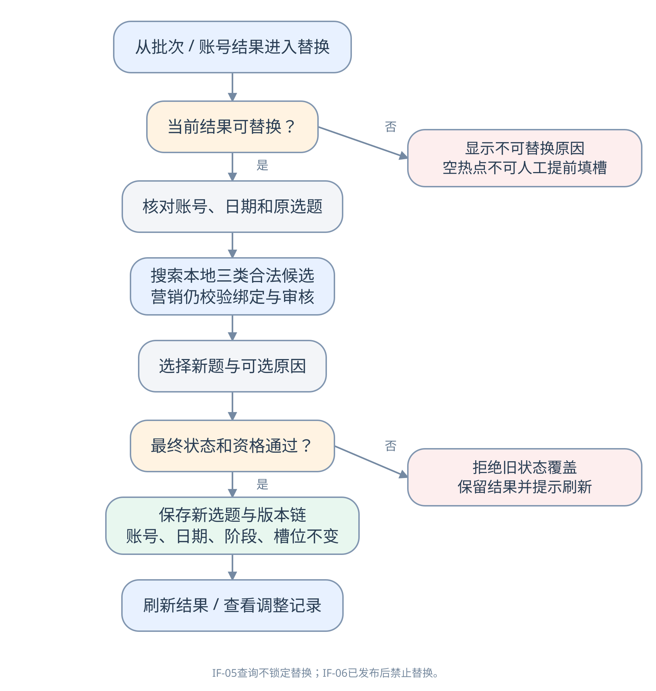

FLOW-10 人工替换选题（V1.1流程图）

发布前允许多次替换，形成A→B→C版本链；IF-05每次查询均返回该账号最新一期当前有效策划结果。正式使用次数由独立业务逻辑维护，不由人工替换或IF-06直接计数。

### 5.6.1 查看调整记录

在单账号结果中提供“查看调整/触发记录”轻量入口，默认不在主列表平铺历史。抽屉按时间倒序展示：时间、来源（热点槽位触发/人工替换）、操作人或热点来源、槽位ID、变更前状态/选题、变更后选题、替换原因（如有）。

示例：

示例记录1：09-27 22:00，系统热点槽位触发，目标投放日09-28（周一），待热点触发 → 热点H；示例记录2：09-28 11:05，运营人员人工替换，热点H → 选题C，原因：业务临时调整。

该入口只用于业务追溯，不展示技术结果版本ID。

替换和记录抽屉各自展示“加载中 / 读取失败 / 成功但为空”。请求尚未完成时不显示暂无候选或暂无记录；失败提示和重试入口位于抽屉内，旧账号/旧槽位候选不得沿用。候选读取失败或当前状态待确认时禁止确认替换；仅历史记录查询失败不改变已落库业务状态。

### 5.7 页面状态与异常

| 场景 | 页面表现 |
| --- | --- |
| 周度无数据 | 空状态，保留筛选条件 |
| 未发布（无论IF-05是否已被查询） | 状态显示“未发布”，人工替换入口可用（同时满足结果有效、版本最新、权限等条件） |
| 已发布 | 不允许替换 |
| 打开替换后发布状态变更为已发布 | 确认时重新校验并拒绝覆盖 |
| 新选题确认前失效 | 提示重新选择 |
| 替换保存失败 | 原当前有效选题保持不变 |
| IF-06发布状态回传异常 | 前台保持最近一次已落库发布状态；异常进入内部日志/告警，不新增前台业务状态 |

### 5.8 本页依赖的数据/接口能力

| 接口ID/能力 | 页面用途 |
| --- | --- |
| 策划系统内部统计 | 周度批次、当前有效结果、调整历史 |
| IF-05 | 内容生产方按账号ID查询最新一期当前有效策划结果；查询不锁定结果 |
| IF-06 | 内容生产方回传发布状态；用于发布状态展示和已发布后的替换关闭 |
| IF-02 / IF-03 / IF-04 | 人工替换候选统一读取策划系统本地已同步普通/营销/热点选题；不按原槽位类型过滤，但营销候选仍校验当前账号绑定与审核有效。 |
| 结果版本校验 | 防止并发覆盖 |

### 5.9 页面验收标准

| ID | 关联规则 | 场景 | 预期结果 |
| --- | --- | --- | --- |
| RES-UAT-01 | RES-R03 | 同周期有自动及手动追加 | 总槽位=自动槽位+手动追加，手动独有账号不计自动参与 |
| RES-UAT-02 | RES-R01 | 预规划热点槽位触发并确定热点选题 | AI自动策划总数不变；该槽位最终选题类型按实际热点结果统计 |
| RES-UAT-03 | RES-R03 | 基础规划完成但仍有热点空槽 | 空槽计规划数及基础规划完成；不计已确定选题和全部选题确定账号 |
| RES-UAT-04 | RES-R02 | 查看详情 | 展示经营阶段和经营作用，能够验证生命周期结构 |
| RES-UAT-05 | - | 单账号模糊搜索 | 名称/ID/别名均可匹配 |
| RES-UAT-06 | REP-R01 | 未发布 | 显示未发布，可替换（满足当前结果有效、版本最新、权限等条件） |
| RES-UAT-07 | REP-R01 | allow_replace=true | 可打开替换弹窗 |
| RES-UAT-08 | REP-R02 | IF-05已被内容生产方查询但仍未发布 | 仍允许替换；查询行为不等于锁定 |
| RES-UAT-09 | RES-R01/REP-R03 | 替换成功 | 当前列表刷新为新选题，原历史保留 |
| RES-UAT-10 | - | 查询某选题正式使用次数 | 通过IF-09返回独立计数结果；人工替换本身不直接改变计数 |
| RES-UAT-11 | - | 页面 | 不提供导出，不展示算法分值 |
| RES-UAT-12 | RES-R02 | 同一账号不同历史批次阶段变化 | 各批次/各条保留自身阶段，不以当前阶段或组头阶段覆盖 |
| RES-UAT-13 | REP-R01 | IF-06发布状态回传失败 | 前台保持最近一次已落库发布状态，不新增异常类前台状态；失败记录进入内部日志/告警 |
| RES-UAT-14 | REP-R03 | 热点槽位待触发→热点H→人工C | 追溯记录按时间展示热点触发与人工替换两次变化，主列表只展示C |
| RES-UAT-15 | REP-R01 | 手动策划结果未发布 | 可打开替换弹窗并替换选题，账号/日期/策划类型保持不变 |
| RES-UAT-16 | REP-R04 | 热点槽位结果人工替换为普通选题 | 允许提交；槽位类型仍为热点，最终选题类型更新为普通 |
| RES-UAT-17 | REP-R04 | 营销/热点槽位结果搜索替换候选 | 候选可跨普通/营销/热点类型，不按原槽位属性过滤；若候选为营销选题，仍必须绑定当前账号且审核有效。 |
| RES-UAT-18 | PUB-R01 | 内容生产方调用状态接口更新为已发布 | 策划结果展示已发布，人工替换关闭 |
| RES-UAT-19 | PUB-R01 | 已发布结果尝试回退为未发布/撤回 | 策划侧拒绝不合法回退；产品状态中不存在撤回 |
| RES-UAT-20 | 周次归属 | 查询2026-08-31及2026-09-28跨月周 | 分别为8月第5周、9月第4周；周界不拆分，筛选可命中 |
| RES-UAT-21 | RES-R03 | 营销/热点槽位使用普通兜底 | 槽位类型与数量保持，最终选题类型=普通；总槽位不增加 |
| RES-UAT-22 | 账号历史 | 直接输入账号并选择投放日期范围 | 无需进入上层，返回该账号范围内全部历史批次，周期/批次从新到旧 |
| RES-UAT-23 | RES-R02 | 同一账号同周期两个技术批次阶段不同 | 分别展示历史阶段，不由首条阶段覆盖 |
| RES-UAT-24 | 操作区分 | 点击替换选题或查看调整记录 | 分别打开替换编辑与只读记录，入口紧凑排列 |
| RES-UAT-25 | 5.3/7.5 | 热点槽位尚未确定具体选题 | 发布列—（不适用），选题位置提示待确定；不可人工提前填槽，确定后未发布 |
| RES-UAT-26 | 3.12/5.3.1 | 同周期有主批次、新账号批次和手动追加 | 周期入口归集全部有效结果；指定批次入口仅查询该次，业务批次号可识别 |
| RES-UAT-27 | 5.2.2/5.4 | 跨周发起手动策划、随后刷新当前详情 | 按投放日期归集；刷新重读当前范围和操作条件，保留筛选，不重复计替换版本 |
| RES-UAT-28 | 5.5/5.6.1 | 替换/记录抽屉加载中、失败或成功为空 | 三种反馈分别展示；失败可重试，旧候选不沿用，状态不可信禁止确认 |
| RES-UAT-29 | 7.7 | 常规槽位、营销/热点普通兜底及经营作用并存 | 常规即普通规划槽位；兜底保留原槽位类型；流量/转化独立，不以类型推断未知作用 |

## 6. 跨页面全链路流程

本章只描述会同时影响多个页面的公共流程，避免在各页面重复定义。

### 6.1 策划结果到内容生产的调整窗口

普通/营销槽位：自动策划批次确定具体选题 → 未发布期间可人工替换 → 内容生产方按账号ID通过IF-05获取当前可生产结果 → 发布前再次通过IF-05确认最新有效结果 → 发布完成后通过IF-06回传实际发布选题及已发布状态并关闭替换；热点槽位：自动策划提前规划槽位 → T-1日22:00读取已同步热点确定具体选题/普通最热兜底 → 选题确定后才进入IF-05可返回结果 → 未发布期间可替换 → 已发布后锁定；手动追加结果同样遵循该规则。

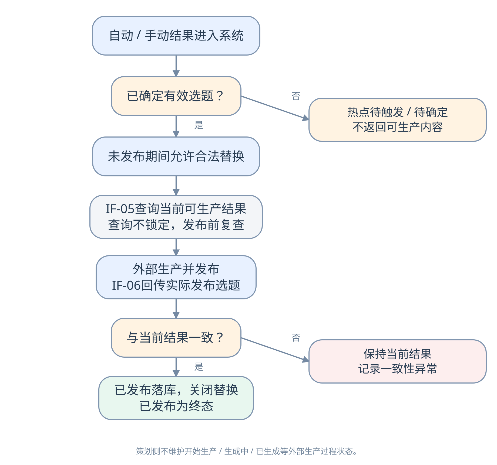

FLOW-11 内容状态与替换权限（V1.1流程图）

普通/营销/热点及手动策划结果均以“未发布 / 已发布”为策划侧核心发布状态。IF-05只返回已确定具体选题、当前有效且可进入内容生产的结果；热点待触发槽位不返回。IF-05查询不改变状态；内容生产方发布前需再次查询确认最新结果。IF-06回传实际发布topic_id/topic_type及发布状态，策划系统校验与当前有效结果一致后更新“已发布”。

IF-05查询不锁定策划结果；只有IF-06成功校验并更新为“已发布”后，人工替换关闭。若IF-06回传的实际发布选题与当前有效结果不一致，不覆盖当前结果，记录发布一致性异常并要求内容生产侧以最新IF-05结果为准。

### 6.2 正式选题使用次数

正式使用次数由独立业务逻辑维护，不在IF-05查询或IF-06发布状态回传中计算。普通选题、营销选题、热点选题均纳入正式使用次数体系。

外部系统通过IF-09按选题ID单个或批量查询当前正式使用次数；查询行为不改变计数。

### 6.3 新账号即时策划

每日夜间账号数据同步完成后识别新增账号；新增账号属于周度主任务之外的例外，仅生成当前周尚未到达的已配置自动策划槽位，已过去槽位不回补。若本周已无未来可执行槽位，则当前周期不生成内容且不计失败。

### 6.4 并发修改原则

热点槽位触发选题、人工替换和发布状态回传可能并发发生。内容生产方发布前必须再次通过IF-05确认该账号当前可生产的最新有效结果；IF-06回传已发布时还必须校验实际发布topic_id/topic_type与当前有效结果一致。所有会改变当前有效选题或发布状态的操作，在最终提交前必须重新校验：

当前结果版本；

发布状态；

新选题/热点有效状态。

任何操作不得基于旧版本覆盖已经产生的新结果。

### 6.5 选题离线标签计算、画像/向量准备、匹配资格与查询服务

FLOW-12 选题标签、画像/向量与AI匹配准备（V1.1流程图）

该流程是AI自动策划的上游数据准备链路，而不是策划任务中的实时步骤：

新增普通选题 → 首次离线T1-T6标签计算 → 标签结果校验 → 选题画像构建 → 选题向量生成 → AI可匹配 → AI自动策划读取；后续普通选题编辑不触发T1-T6重算，选题方可通过查询接口按需获取标签结果。

关键规则：

T1-T5只能从当前有效固定字典识别；

T6相似度>80%复用已有标签，否则新增；

正式AI匹配之前冻结账号、配置、投放日期及可匹配普通选题输入；各算法阶段使用同一份冻结输入。准备就绪只表示输入有效，内部提案通过契约校验只表示结构合法；需完成经确认策略的算法执行、完整槽位组合及原子结果提交，才形成有效基础规划。写入前复核来源资格、版本及发布安全状态；规则热度兜底不可标记为真实AI匹配成功。

新增选题标签计算未完成或识别失败时不进入AI候选池；

标签有效后还需完成当前选题版本的画像与向量准备；画像/向量未就绪、失败或失效时同样不得进入新的AI候选池；

选题内容或标签发生影响语义的变化时，原画像/向量必须失效并重新生成；不得使用历史失效向量继续参与新的AI匹配；

策划系统保存普通选题标签计算结果，并提供IF-08“普通选题标签查询接口”；

选题方按普通选题ID主动调用接口获取T1-T6标签，并负责自身场景中的展示与后续使用；策划系统不主动推送/同步标签，也不额外建设独立选题标签展示页面；

标签查询接口返回“标签已完成/标签暂未就绪/标签计算失败”等明确状态，不能用“成功返回空标签”混淆未就绪与无标签；

T1-T5字典变更不重算历史选题；仅新增选题使用最新字典首次识别，历史标签关系必须可追溯。

### 6.6 跨系统业务泳道

本节采用正式业务泳道图表达跨系统协同：横向为角色/系统泳道，纵向为业务阶段与时间推进；圆角矩形表示开始/结束，矩形表示处理动作，菱形表示业务判断，实线箭头表示控制流与跨系统调用，Y/N直接标注在判断分支线上。泳道图使用文档内原生矢量线框对象，不使用位图截图；图中只保留关键动作与接口方向，详细异常、重试及字段定义仍进入对应规则与《技术设计文档》。

SW-01 AI自动策划泳道

SW-01 AI自动策划跨系统泳道阶段周度调度器策划系统本地账号 / 选题数据营销选题数据源阶段一任务触发阶段二本地数据准备阶段三基础策划阶段四选题确定阶段五结果落库周二 22:00自动策划触发确定周期读取配置读取本地账号 / 普通选题读取最近同步数据标签 / 向量画像 / 生命周期槽位生成 + 匹配读取已同步营销候选普通 / 营销定题热点待决策保存基础策划结果

关键控制点：

周度自动策划仅有一个任务调度时间点，当前默认每周二22:00；“每周策划日”只决定目标周期槽位日期与单账号槽位数N。

普通/营销槽位在本次自动策划批次内直接确定选题；热点槽位只提前规划类型，等待T-1日22:00确定具体热点选题。

非营销账号在Hard Gate阶段直接过滤营销选题；营销选题在自动策划前完成同步，任务执行时读取本地已同步且审核有效的账号绑定营销选题；无可用营销时普通兜底，同步失败进入系统异常。

SW-02 热点槽位触发与选题确定泳道

SW-02 热点槽位触发与选题确定泳道阶段热点数据服务热点调度器策划系统本地普通选题阶段一数据更新阶段二任务触发阶段三候选匹配阶段四决策分配阶段五结果落库YNT-1 22:00 前同步热点选题保存本地热点T-1 22:00热点任务触发读取待决策槽位读取本地热点 / 普通合法热点 + 普通兜底+ 普通最热存在合法热点？随机分配合法热点普通最热选题兜底更新最终选题及内容属性

关键控制点：

热点选题须在目标槽位前一天22:00前完成同步；22:00热点任务只消费策划系统本地已成功同步的最新有效热点数据。

先做热点×账号×槽位合法性过滤，再在合法集合中随机分配；无合法热点时使用该账号合法普通选题中热度最高者兜底。

热点任务不新增槽位、不把普通/营销槽临时改为热点槽；兜底后槽位类型仍保留“热点槽”，最终选题类型按实际选题记录。

SW-03 手动策划泳道

SW-03 手动策划跨系统泳道阶段运营人员策划系统本地账号数据本地选题数据阶段一规划筛选阶段二随机抽取阶段三选题分配阶段四提交校验阶段五结果生成NY设置数量M日期 / 条件读取本地账号池返回账号池随机抽取M查看 / 改选 / 重新随机选择选题读取本地有效选题随机分配确认生成二次校验本地最新账号状态本地最新选题状态最新选题状态可生成 M 条？整次阻断创建全部 M 条

关键控制点：

随机后允许勾选调整和“重新随机”；提交前账号失效时，从相同筛选条件下的剩余有效候选池自动补抽。

若无法补足规划数量M，则整次任务阻断，不允许部分成功/部分完成。

多选题按账号随机分配，不设置单题最大分配量；手动策划结果在未发布期间允许后续人工替换。

SW-04 策划结果查询→内容生成→发布泳道

SW-04 策划结果查询 → 内容生产 → 发布状态闭环泳道阶段策划系统内容生产方阶段一结果查询阶段二内容生产阶段三发布回传阶段四状态更新NY接收IF-05查询返回最新一期结果按账号ID查询结果生产并完成发布IF-06回传发布状态更新发布状态已发布？保持可替换关闭人工替换发布完成进入发布终态

关键控制点：

内容生产方通过IF-05按账号ID查询当前“可生产最新一期”策划内容；查询不改变发布状态，也不锁定人工替换。热点待触发/待确定选题槽位不返回。发布前内容生产方需再次调用IF-05确认最新有效结果。

内容生产方完成发布后通过IF-06回传planning_result_id、实际发布topic_id/topic_type及发布状态；策划侧校验其与当前有效结果一致后更新为“已发布”并关闭人工替换。正式使用次数由独立业务逻辑维护，外部系统通过IF-09查询。

“已发布”为终态，不存在撤回业务状态；前台以策划系统最近一次成功落库的发布状态为准。

SW-05 选题标签加工与查询泳道

SW-05 选题标签加工与查询泳道阶段选题系统策划系统标签 / 向量模型服务阶段一新增选题阶段二标签计算阶段三向量准备阶段四就绪判定阶段五标签查询YN新增选题创建首次识别任务计算 T1-T6保存标签及状态生成画像 / 向量保存画像 / 向量状态全部就绪？进入 AI 候选池标签未就绪IF-08 查询标签返回 T1-T6 + 状态

关键控制点：

新增普通选题需先完成一次T1-T6标签计算、选题画像与向量准备，才可进入AI候选池。后续影响语义的内容变化不重算T1-T6，但可按现有AI准备机制重新生成选题画像/向量。

IF-08仅服务选题方按需查询标签；AI自动策划直接读取策划系统内部当前有效标签/画像/向量，不通过IF-08获取。

标签未就绪或失败必须返回明确状态，不得用“成功返回空标签”混淆未就绪与无标签。

### 6.7 发布后互动数据与下一周期闭环

内容发布不是策划链路终点。发布后的互动表现继续由上游数据链路沉淀为互动数据，并在下一次自动策划启动时重新被策划系统读取，用于计算下一周期生命周期指标。

内容发布→ 互动数据持续沉淀→ 下一批次读取账号基础信息 + 互动数据→ 重新计算生命周期→ 影响下一周期流量 / 转化内容结构

人工替换记录与热点槽位触发记录继续保留，作为后续策略/算法分析的数据资产；具体如何用于模型或规则优化进入《算法/策略说明文档》，PRD不定义训练方式。

## 7. 全局状态、术语与统计口径

### 7.1 AI自动策划状态

周期业务状态：基础规划成功且未进入目标周期→已规划；进入周期且存在合法热点空槽→热点空槽待填充；进入周期且全部应规划槽位均确定有效选题→已完成。无热点时可在进入周期后直接已完成。热点进度按已确定/总规划数展示；规划完成、选题全部确定和内容已发布是不同事实。

周期业务状态只在满足对应业务条件时展示。技术任务的待执行、执行中、执行失败等状态用于内部追溯；依赖异常独立提示原因与更新时间，不得映射为热点空槽待填充或伪装成已完成。热点空槽等待不计基础规划失败；准备就绪或提案已回写也不代表周期已规划。待调度、等待策划结果、暂无策划数据、读取失败、执行异常均为页面辅助提示，不扩展上述三种周期业务状态；具体判定、空值和缓存展示规则见3.13。

### 7.2 手动策划任务状态

执行中 / 已完成 / 执行失败。本期不保存服务端任务草稿，也不支持部分成功/部分完成；页面可保留未提交输入，但不形成任务。正式提交受理后若无法补足规划数量M，整次任务失败且不落部分结果；请求超时尚未确认任务事实时按4.9处理，不直接推断失败。

### 7.3 热点任务状态

待触发、匹配中、已完成、部分满足、处理失败。

上述为内部热点任务追溯状态，不在运营周期状态中新增“部分满足”。合法热点候选不足、剩余槽位已用合法普通选题兜底时，所有已确定槽位均计入热点填充进度；热点内容数量不足不等于槽位未填。若普通兜底也失败或关键依赖不可用，独立提示执行异常，不能仅以“部分满足”掩盖未完成槽位。

### 7.4 内容生产状态（本期不维护）

策划系统本期不维护“开始生产 / 生成中 / 已生成 / 生成失败”等生产过程状态。内容生产方通过IF-05查询结果后自行生产；发布前必须再次获取当前有效结果，发布完成后通过IF-06回传实际发布选题与发布状态。

### 7.5 发布状态

已确定选题的有效结果仅展示“未发布 / 已发布”两种发布业务状态；热点空槽尚无具体选题，发布列显示“—（不适用）”，待热点触发/待确定选题放在选题位置或槽位提示中，不作为第三种发布状态。热点确定或合法兜底后初始为未发布，发布状态由IF-06回传并成功落库。状态读取失败也不新增发布状态；已发布为终态，不存在撤回，不得回退为未发布。

### 7.6 状态可信与不可逆操作安全

对人工替换、热点槽位触发选题等会确定或覆盖当前有效结果的操作统一执行安全校验：

发布状态无法可靠确认 → 不允许人工替换，对应热点槽位不进入本次可执行池；

当前结果版本无法确认 → 不允许覆盖；

状态恢复可信后再重新计算操作权限。

本期不新增异常类前台业务状态；IF-06回传异常由内部日志、监控和补偿机制处理。

### 7.7 前台统一术语

前台结果统一使用“选题类型”：普通、营销、热点；“手动追加”属于策划类型。策划/后台另保留“槽位类型”：普通、营销、热点。

“槽位类型”表示周期级槽位规划阶段的提前规划意图，“选题类型”表示最终实际使用的选题类型，两者不得混用：例如营销槽位无可用营销选题时可使用普通选题；热点槽位在触发前可处于待确定选题状态。

“常规槽位”是自动策划中普通规划槽位的统计展示名称，与“普通槽位”指同一类，不新增第四种槽位类型。经营作用“流量型/转化型”是另一维度；不能把常规、营销、热点对应成流量或转化，也不能把普通兜底的实际选题类型用于改写原槽位统计。

### 7.8 统计口径

| 指标 | 口径 |
| --- | --- |
| 自动策划账号数 | 该周期自动参与账号去重数；不计手动独有账号 |
| 基础规划完成账号数 | 应规划槽位均已合法形成；普通/营销已确定选题，热点可为合法待触发空槽 |
| 全部选题确定账号数 | 该账号所有应规划槽位均已确定有效选题，包括热点或合法普通兜底 |
| 基础规划失败账号数 | 基础规划存在未完成要求的账号；仅在基础执行终态时参与完成/失败等式 |
| 自动策划槽位数 | 周期提前规划的常规+营销+热点槽位总数 |
| 手动追加槽位数 | 归属该周期的手动追加有效结果条数 |
| 总槽位数 | 自动策划槽位数+手动追加槽位数 |
| 热点填充进度 | 已确定选题热点槽位 / 规划热点槽位；合法普通兜底计入已确定 |
| 去重选题数 | 按当前有效且已确定的选题类型+ID去重，热点空槽不计入 |
| 策划使用次数 | 内部策划分配次数，不在周期汇总表显示，不等同正式使用计数 |
| 正式使用次数 | 独立业务逻辑维护，IF-09只读查询普通/营销/热点三类选题 |

### 7.9 批次配置与数据读取基准、闭合与周期归集

自动策划批次必须保存本次使用的配置版本引用与账号数据快照引用，保证结果可解释；

周度批次不设置统一业务关闭/统计冻结时间；槽位选题、当前有效结果及发布状态可持续更新；内容生产过程由外部系统维护，不进入本期策划状态体系；

合法技术补偿和后续状态回传允许更新周期业务统计，页面始终按最新有效状态展示；

新账号即时策划可使用独立技术批次，但结果归集到其所属策划周期的周度统计；

周度统计展示的是周期业务汇总，不等同单一技术批次。

### 7.10 标签计算、向量准备与AI匹配准备状态

标签计算、向量准备、AI匹配准备和“选题方查询标签”是四个不同概念，其中查询接口不是状态流转：

内部标签状态与IF-08约定的对外状态区分：待识别/识别中映射“处理中”，已完成映射“已完成”，识别失败映射“失败”；该映射不改变内部状态、不触发重新识别，也不扩展第8章接口字段。

| 状态域 | 状态 | 业务含义 |
| --- | --- | --- |
| 标签计算 | 待识别 / 识别中 / 已完成 / 识别失败 | 描述新增选题首次离线T1-T6计算过程 |
| AI匹配准备 | 可匹配 / 不可匹配 | 普通选题需同时满足标签结果有效、当前选题版本画像/向量有效及其他基础可用条件，方可成为“可匹配” |
| 向量准备 | 待生成 / 生成中 / 已完成 / 生成失败 / 已失效 | 描述当前账号/选题版本的画像与向量是否可用于新的AI匹配 |

AI自动策划以“AI匹配准备=可匹配”为普通选题候选前提；该状态要求标签结果有效且当前选题版本画像/向量有效。选题方通过IF-08按需查询标签，是否查询、查询是否成功均不改变AI匹配准备状态。

内部准备、向量任务、算法执行租约、失败重试及逐尝试记录用于执行基础和审计；不得把准备ready、提案validated或向量completed直接映射成运营周期已规划/已完成。算法模型、Hard Gate/Recall/Fit及全局分配具体规则仍由算法说明确认。

## 8. 接口与数据依赖

### 8.1 接口全景

本期正式接口共8个：IF-01、IF-02、IF-03、IF-04、IF-05、IF-06、IF-08、IF-09。IF-07不再单独建设；原新账号变化接口取消，由IF-01夜间离线同步后识别新增账号；IF-09为选题正式使用次数查询接口。

| ID | 接口能力 | 方向 | 当前用途 |
| --- | --- | --- | --- |
| IF-01 | 账号基础信息 + 账号人设 + 互动数据离线同步 | 平台账号接口 → 策划系统 | 每日夜间同步账号池、别名、认证状态、账号人设及近3个月互动数据；供AI策划、手动筛号、生命周期、账号画像及新增账号识别使用；流量趋势由策划系统计算 |
| IF-02 | 普通选题同步 | 平台选题接口 → 策划系统 | 自动策划执行前同步普通选题及热度；AI、手动选题、普通兜底和人工替换均读取本地数据 |
| IF-03 | 营销选题同步 | 平台营销选题接口 → 策划系统 | 自动策划执行前同步营销选题；用于营销槽位数量计算及账号绑定、审核有效内容选择 |
| IF-04 | 热点选题同步 | 平台热点选题接口 → 策划系统 | 目标热点槽位前一天22:00前同步热点选题，22:00读取本地数据确定具体选题 |
| IF-05 | 策划Agent结果查询 | 平台内容生产方 → 策划系统 | 根据账号ID查询当前可生产最新一期、已确定具体选题的当前有效策划内容；发布前需再次确认 |
| IF-06 | 发布状态回传 | 平台内容生产方 → 策划系统 | 回传实际发布选题及未发布/已发布状态；与当前有效结果一致后更新已发布并关闭人工替换 |
| IF-08 | 普通选题标签查询 | 平台选题方 → 策划系统 | 按普通选题ID查询T1-T6标签JSON |
| IF-09 | 选题正式使用次数查询 | 平台选题系统 → 策划系统 | 按topic_type + topic_ids单个/批量查询普通、营销、热点三类选题正式使用次数 |

### 8.2 核心接口定义

本节仅保留产品评审需要的核心字段。字段类型、必填规则、分页、鉴权、签名、幂等标识、技术错误码、物理字段名等由后续《技术设计/接口文档》补充，不在本PRD展开。

### 8.2.1 IF-01 账号基础信息 + 账号人设 + 互动数据离线同步接口

| 接口用途 | 每日夜间离线同步平台账号池、账号基础信息、账号人设及近3个月历史互动数据，供AI自动策划、手动筛号、生命周期判断、账号画像及新增账号识别使用。 |
| --- | --- |
| 调用时机 | 每日夜间离线任务执行时同步；自动策划和手动策划执行时不实时调用IF-01，直接读取策划系统最近一次成功同步的数据快照。 |

| 请求字段 | 字段含义 |
| --- | --- |
| 无核心业务请求字段 | 默认同步当前账号池；全量/增量、分页等技术参数由后续接口文档定义。 |

| 返回字段 | 字段含义 |
| --- | --- |
| account_id | 账号唯一标识 |
| account_name | 账号名称 |
| account_alias | 账号别名；用于运营搜索 |
| account_status | 账号当前是否有效/可参与策划 |
| certification_status | 账号认证状态；用于手动策划筛选 |
| account_persona | 账号人设；描述账号内容定位、身份设定和表达方向，是账号画像、向量生成及选题匹配的核心输入 |
| is_marketing_account | 是否营销账号；非营销账号不得规划营销槽位或使用营销选题 |
| account_tags | 平台已有账号标签，作为账号画像的辅助特征 |
| follower_count | 账号当前粉丝量 |
| interaction_data | 账号近3个月帖子级历史数据：发帖时间、帖子标题、红星数、收藏数、评论数；用于有效内容篇数、滚动互动、流量趋势、生命周期判断和账号画像。流量趋势由策划系统基于该数据计算，不作为IF-01独立字段。 |

### 8.2.2 IF-02 普通选题同步接口

| 接口用途 | 在自动策划执行前将平台普通选题基础数据同步至策划系统，供AI候选、手动选题和人工替换使用。 |
| --- | --- |
| 调用时机 | 每次自动策划执行前完成同步；策划任务运行时直接读取策划系统本地最新同步的普通选题数据。 |

| 请求字段 | 字段含义 |
| --- | --- |
| 无核心业务请求字段 | 同步当前普通选题数据；具体同步方式与技术参数由后续接口文档定义。 |

| 返回字段 | 字段含义 |
| --- | --- |
| topic_id | 普通选题唯一标识 |
| title | 选题标题 |
| outline | 选题大纲 / 核心内容 |
| content_type | 内容类型，直接继承源系统 |
| topic_heat | 普通选题当前可排序热度值；用于普通匹配无结果及热点无合法选题时选择“普通最热”兜底，具体源字段映射由接口文档确定 |
| status | 选题当前是否有效可用 |

### 8.2.3 IF-03 营销选题同步接口

| 接口用途 | 在自动策划执行前将平台营销选题同步至策划系统，供营销账号的营销槽位使用。 |
| --- | --- |
| 调用时机 | 每次自动策划执行前完成同步；自动策划运行时读取策划系统本地最新同步的营销选题数据。 |

| 请求字段 | 字段含义 |
| --- | --- |
| 无核心业务请求字段 | 同步当前营销选题数据；具体同步方式与技术参数由后续接口文档定义。 |

| 返回字段 | 字段含义 |
| --- | --- |
| topic_id | 营销选题唯一标识；策划侧统一按topic_id识别选题 |
| account_id | 该营销选题绑定的营销账号ID |
| title | 营销选题标题 |
| outline | 营销选题大纲 / 核心内容 |
| content_type | 内容类型，与普通选题一致，直接继承源系统 |
| status | 营销选题当前是否有效可用 |
| audit_status | 营销选题审核状态 |
| approved_at | 审核通过时间；多条可用营销选题按该时间升序逐条优先使用 |

### 8.2.4 IF-04 热点选题同步接口

| 接口用途 | 将平台热点选题同步至策划系统，供已提前规划的热点槽位在T-1日22:00确定具体热点选题。 |
| --- | --- |
| 调用时机 | 目标热点槽位前一天22:00前完成同步；22:00任务直接读取策划系统本地最新有效热点数据。 |

| 请求字段 | 字段含义 |
| --- | --- |
| 无核心业务请求字段 | 同步当前热点选题数据；策划系统事先不依赖热点ID发起查询。 |

| 返回字段 | 字段含义 |
| --- | --- |
| topic_id | 热点选题唯一标识；策划侧统一按topic_id识别选题 |
| title | 热点选题标题 |
| outline | 热点选题大纲 / 核心内容 |
| content_type | 内容类型，与普通选题一致，直接继承源系统 |
| status | 热点选题当前是否有效可用 |

### 8.2.5 IF-05 策划Agent结果查询接口

| 接口用途 | 供内容生产方根据账号ID查询该账号当前“可生产最新一期”的当前有效策划内容。 |
| --- | --- |
| 调用时机 | 内容生产方获取生产任务时主动调用，并在正式发布前再次调用确认最新结果；查询行为不改变发布状态，也不锁定人工替换。 |

| 请求字段 | 字段含义 |
| --- | --- |
| account_id | 需要查询最新一期策划内容的账号唯一标识 |

| 返回字段 | 字段含义 |
| --- | --- |
| account_id | 当前账号ID |
| planning_cycle | 本次返回结果所属策划周期。“可生产最新一期”定义：优先返回当前自然周仍存在的未发布且已确定选题结果；当前周无此类结果时，再返回最近未来周期。 |
| planning_contents | 当前周期中已确定具体选题、当前有效且可进入内容生产的结果列表；热点“待热点触发/待确定选题”槽位不返回。每条至少包含planning_result_id、publish_date、topic_id、topic_type（普通/营销/热点）、title、outline、content_type。手动追加结果如属于该周期且未发布，同样纳入。 |

### 8.2.6 IF-06 发布状态回传接口

| 接口用途 | 由内容生产方回传某条策划结果的实际发布选题及发布状态，用于发布状态展示、发布一致性校验及人工替换权限控制。 |
| --- | --- |
| 调用时机 | 内容发布状态发生变化时调用；内容生产方应在正式发布前再次通过IF-05确认最新有效结果。本接口不回传开始生产、生成中、已生成、生成失败等生产过程状态。 |

| 请求字段 | 字段含义 |
| --- | --- |
| planning_result_id | 对应IF-05返回的策划结果唯一标识 |
| topic_id | 本次实际发布的选题ID；用于与当前有效策划结果做一致性校验 |
| topic_type | 本次实际发布选题类型：普通 / 营销 / 热点 |
| publish_status | 当前发布状态：未发布 / 已发布 |

| 返回字段 | 字段含义 |
| --- | --- |
| current_publish_status | 策划系统校验并更新后的当前发布状态；实际发布topic_id/topic_type与当前有效结果不一致时，不更新为已发布并记录一致性异常 |

### 8.2.7 IF-08 普通选题标签查询接口

| 接口用途 | 供平台选题方按普通选题ID查询策划系统已识别的T1-T6标签结果。营销选题和热点选题不进入本期T1-T6识别链路。 |
| --- | --- |
| 调用时机 | 平台选题方需要展示或使用普通选题标签时主动查询；接口只查询结果，不触发标签计算。 |

| 请求字段 | 字段含义 |
| --- | --- |
| topic_id | 需要查询标签的选题唯一标识 |

| 返回字段 | 字段含义 |
| --- | --- |
| topic_id | 选题唯一标识 |
| label_status | 标签状态：处理中 / 已完成 / 失败 |
| labels | T1-T6标签JSON；当前T1-T6均为单选，例如 {"t1":"xxx","t2":"xxx","t3":"xxx","t4":"xxx","t5":"xxx","t6":"xxx"} |

### 8.2.8 IF-09 选题正式使用次数查询接口

| 接口用途 | 供平台选题系统查询选题当前正式使用次数；支持普通选题、营销选题、热点选题三种类型。单次批量查询按一个topic_type执行。 |
| --- | --- |
| 调用时机 | 平台选题系统需要展示、筛选或核对选题正式使用次数时调用。 |

| 请求字段 | 字段含义 |
| --- | --- |
| topic_type | 本次查询选题类型：普通 / 营销 / 热点；用于区分三类选题ID命名空间 |
| topic_ids | 该topic_type下需要查询的选题ID集合；支持单个或批量查询 |

| 返回字段 | 字段含义 |
| --- | --- |
| topic_type | 选题类型：普通 / 营销 / 热点 |
| topic_id | 选题唯一标识 |
| official_use_count | 该选题当前正式使用次数；由独立业务逻辑维护，IF-09仅提供查询 |

## 9. 权限与操作日志

### 9.1 权限说明（本期不细分矩阵）

四个页面作为整体嵌入客户系统；登录、用户账号和角色授权由宿主系统负责，本项目不建设独立登录、运营账号管理或角色权限后台。后端返回的可操作结果需同时考虑业务安全条件及宿主已提供的授权；前端按结果控制入口，不新增本项目权限矩阵。

当前人工操作以“运营人员”留痕，自动调度以system留痕，不把演示姓名当作真实身份。若客户要求具体操作人追溯，由宿主传递身份；具体传递与鉴权协议进入对接设计，不以增加本项目登录页面解决。

### 9.2 必须留痕的操作

配置保存；

配置历史恢复；

多维标签中T1-T5新增/改名/启停；

手动策划正式发起；

人工替换选题；

热点槽位触发属于系统自动行为；若未来增加人工热点触发/重选入口，同样必须记录。

后台至少保留操作人、时间、对象、修改前/后结果、结果版本和来源。

系统自动行为同样需要业务追溯，但与“人工操作日志”区分，包括：账号/选题同步、热点槽位触发选题、基础策划任务完成、IF-06发布状态回传、接口异常、正式使用次数独立计数等。

## 10. 全局核心验收

页面级验收已分别放在第2～5章。本章仅保留无法由单一页面覆盖的跨页面、跨系统关键闭环，作为正式上线前的E2E验收底线。

| ID | 跨链路验收场景 | 预期结果 |
| --- | --- | --- |
| E2E-UAT-01 | 配置 → 下一周期自动策划 | 每周二22:00按当前有效配置生成下一自然周结果；已启动批次继续使用启动时冻结版本，历史结果不自动重算。 |
| E2E-UAT-02 | 周度槽位规划 | 下一周期先按热点槽位占比规划热点槽位，再在营销账号剩余非热点槽位中规划营销槽位，普通槽位承接其余需求；三类槽位不得重复占用。 |
| E2E-UAT-03 | 营销选题链路 | 营销槽位只使用当前账号绑定且审核有效的IF-03营销选题；多条按approved_at升序使用；无合法营销选题时普通兜底，同步失败不得当作“无内容”。 |
| E2E-UAT-04 | 热点T-1触发 | 热点选题在目标热点槽位前一天22:00前完成同步；22:00仅在已规划热点槽位中确定具体选题；无合法热点时普通最热兜底，不新增或改造其他槽位。 |
| E2E-UAT-05 | 普通AI匹配准备 | 普通选题只有在T1-T6标签有效且当前版本画像/向量有效时进入AI匹配；正常匹配无结果时使用合法普通选题中topic_heat最高者兜底。 |
| E2E-UAT-06 | 手动策划原子提交 | 支持随机后人工调整和整体重新随机；旧预览失效；提交前失效账号合法补抽，不足或关键校验失败时无部分结果 |
| E2E-UAT-07 | 人工替换 → IF-05查询 | 未发布结果允许多次人工替换并保留版本链；IF-05始终返回当前可生产最新一期的当前有效结果，查询行为不锁定结果。 |
| E2E-UAT-08 | 热点待触发 → IF-05 | 热点槽位在具体选题未确定前不进入IF-05返回结果；热点确定或普通兜底完成后，才作为可生产结果返回。 |
| E2E-UAT-09 | IF-05 → IF-06发布闭环 | 内容生产方发布前再次查询IF-05；IF-06回传的planning_result_id、topic_id、topic_type与当前有效结果一致时才更新为已发布，并关闭人工替换。 |
| E2E-UAT-10 | 发布终态 | 已发布不得回退为未发布，不存在撤回业务状态；IF-05/IF-06均不维护开始生产、生成中、已生成、生成失败等生产过程状态。 |
| E2E-UAT-11 | 新账号夜间同步 | IF-01夜间同步识别到新增账号后，仅补当前周尚未到达的配置槽位；已过去槽位不回补，结果并入所属周度统计。 |
| E2E-UAT-12 | 发布后经营闭环 | 发布后的互动数据继续沉淀，并在下一批次作为生命周期与账号画像输入；历史策划仍展示经营阶段快照。 |
| E2E-UAT-13 | 同步空数据与同步失败 | IF-01/02/03/04正常同步但无合法数据，与同步失败/数据不可用必须区分处理；不得把系统异常伪装为“无内容”。 |
| E2E-UAT-14 | 周期槽位统计一致性 | 总槽位=自动槽位+手动追加；自动槽位=常规+营销+热点。兜底不改槽位类型，未填热点不计最终选题数量；基础规划完成与全部选题确定独立统计 |
| E2E-UAT-15 | 正式使用次数查询 | 正式使用次数由独立业务逻辑维护；IF-09按topic_type+topic_ids查询普通/营销/热点三类选题计数，查询及IF-06发布回传均不直接改变计数。 |
| E2E-UAT-16 | 生命周期唯一归属 | 本版默认阈值及兜底保证每次计算唯一非空；X与N独立，旧结果快照不变 |
| E2E-UAT-17 | 周期状态与热点进度 | 下周已规划→进入周期后逐步填热点→全部选题确定后已完成，完成策划不等于发布 |
| E2E-UAT-18 | 月内周次与历史 | 以周一归属年月及月内周一序号；跨月不拆周，账号历史按批次保留阶段 |
| E2E-UAT-19 | 执行异常 | 普通兜底失败及来源不可用真实留痕和提示，不计正常热点等待或已完成 |
| E2E-UAT-20 | 正式AI结果提交 | 冻结输入、向量准备和提案合法不能替代真实算法与原子提交，规则兜底不可冒充真实AI |
| E2E-UAT-21 | 整页嵌入与操作追溯 | 宿主负责登录/账号/角色，本项目四页直接进入业务；人工/自动操作以运营人员/system留痕，具体用户身份由宿主提供 |
| E2E-UAT-22 | 分页与完整范围 | 筛选命中数和随机池不按当前页截断；历史可继续获取，未加载完整时不得称全部结果 |
| E2E-UAT-23 | 1.5/7.9 | 生产方已查询，但未回传已发布 | 不新增生产中/已生成等策划状态；查询不锁定替换，已发布仍须按IF-06事实确认 |
