# 多账号智能策划产品需求文档

版本：V1.2 全量整合评审稿　更新日期：2026-10-28

适用人员：客户策划、运营、行内开发、产品、设计、前后端、算法与测试。

## 0. 文档说明

### 0.1 版本与范围

本稿沿用原 V1.0 的全局产品范围与章节主线，整合最新三页面图文需求，统一后台自动策划、内容生产、营销衔接、同库对接、状态统计及验收。当前一级页面为 AI策划配置、人工策划、策划结果；AI自动策划保留为后台业务流程，不再作为独立一级页面。

本稿为需求评审基线，不表示所有功能已完成开发。Q01—Q14 为页面待确认问题，GQ01—GQ07 为全局衔接待确认问题，集中于第 10 章；未决项不作为已批准结论。原 V1.0 及其它历史版本保持不变。

正文中的截图来自当前前端，紫色编号对应图后要点，测试数据不代表生产数据或推荐阈值。图片反映界面现状，已发现与需求不一致的位置在图后标出。所有页面规则以正文及会后确认结论为准。

### 0.2 章节结构

| 章节 | 内容 | 阅读重点 |
| --- | --- | --- |
| 1 | 产品总览 | 对象、角色、三页面架构与完整链路 |
| 2 | AI策划配置 | 只读、编辑、条件组、标签、保存与历史 |
| 3 | 自动策划与匹配 | 调度、画像向量、普通匹配、营销衔接、热点 T-1 |
| 4 | 人工策划 | 任务列表、非营销四步、营销三步 |
| 5 | 策划结果 | 账号／时间列表、三类详情、日历、换题、导出 |
| 6 | 跨系统业务闭环 | 生产、状态更新、正式计数、画像更新与泳道 |
| 7 | 全局交互与状态统计 | 筛选、分页、提示、状态和指标口径 |
| 8 | 接口与数据依赖 | IF-01—04、OP-01—04，同库与扩展表边界 |
| 9 | 权限与操作留痕 | 宿主身份、操作人、配置和生产追溯 |
| 10 | 评审与验收 | 待确认问题、演示顺序、页面及跨链路验收 |

算法公式、模型权重、向量维度及工程实现进入算法／技术专项文档。本 PRD 保留业务输入、触发条件、可见结果、限制和异常处理，不写数据库凭据或厂商密钥。

### 0.3 本次整合的主要变化

| 原 V1.0 口径 | 当前口径 | 涉及章节 |
| --- | --- | --- |
| 四个一级页面，独立 AI自动策划 | 三个一级页面，自动批次并入结果 | 1、3、5 |
| 账号配置／经营策略模块级保存恢复 | 页面一份总配置，标签覆盖范围待确认 | 2、7、10 |
| 流量趋势及旧阶段指标 | 生命周期条件组，组内且、组外或 | 2、3 |
| 人工五步、随机与预览 | 非营销四步；营销三步、单选题＋总量 | 4 |
| 周度批次与平铺匹配详情 | 账号列表／时间列表，三类详情和日历复用 | 5 |
| 未发布期间均可换题 | 生产中禁止；完成／失败后的边界待确认 | 5、6、7 |
| 本期不维护内容生产过程状态 | 维护待定题、待生产、生产中、已完成、生产失败 | 6、7 |
| HTTP 同步复制基础数据 | 同库查询行内基础表，策划侧维护扩展与结果 | 8 |
| IF-05／06／08／09 等旧编号 | IF-01—04、OP-01—04，按提供方分组 | 8 |

## 1. 产品总览

### 1.1 项目背景与目标

多账号运营存在逐账号选题成本高、账号经营阶段不同、普通／热点／营销处理方式不同、临时人工需求频繁等问题。本系统串联规则配置、账号与选题准备、匹配排期、人工纠偏、内容生产及结果追溯，形成可查看、可解释、可统计的业务链路。

本期目标包括：按账号经营阶段生成周期策划；支持普通匹配与营销、热点专项衔接；支持人工发起非营销定向策划与营销总量需求；以统一结果明细承接后台生产；按账号、周期及批次查询和导出；保留完整配置和操作依据。

项目整体嵌入数营平台，沿用宿主登录与权限。前端不建设独立登录后台，不显示算法中间分数、开发版本、演示说明或无意义运行概览。

### 1.2 页面信息架构

| 一级页面 | 主要功能 | 进入的复用页面 |
| --- | --- | --- |
| AI策划配置 | 生效总览、编辑配置、历史配置 | 历史详情、恢复确认 |
| 人工策划 | 策划任务列表、创建策划 | 非营销四步／营销三步；查看策划复用批次详情 |
| 策划结果 | 账号列表、时间列表 | 账号策划详情、周期策划详情、批次策划详情；单条计划、换题、内容流水 |

### 1.3 角色与职责

| 角色 | 职责 | 边界 |
| --- | --- | --- |
| 运营／策划 | 配置、发起人工需求、看结果、合法换题、导出 | 不直接配置底层算法中间分数，不手动发起后台生产 |
| 策划系统 | 生命周期、标签画像向量、匹配、排期、统一状态、结果查询及计数 | 不另造行内全量账号／选题主表，不替代内容 Agent 或行内审核 |
| 行内数据提供方 | 账号、人设、组织、历史互动、选题、营销内容及现有状态 | 提供真实字段、枚举和表结构，不要求其维护策划侧画像状态 |
| 行内内容处理方 | 扫描符合条件的明细、分配营销需求、调用内容 Agent、提供生产及审核事实 | 已过审营销库存不重复生产；分配营销需求的具体衔接待 GQ01 确认 |
| 宿主数营平台 | 登录、访问授权及当前用户身份 | 本项目保留业务校验、创建人及操作留痕 |

### 1.4 总体业务链路

同库读取账号／选题及内容 → 准备标签、画像和向量 → 周期调度或人工发起 → 策划与定题 → 正式结果落表 → 后台生产或营销库存衔接 → 更新内容状态 → 形成正式使用事实及报表 → 新互动与画像变化进入后续周期。

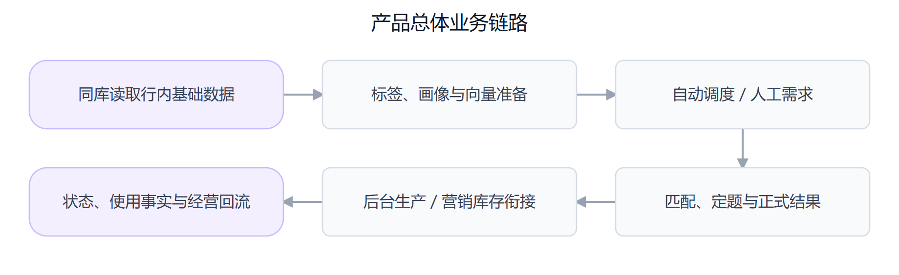

要点：基础数据属于行内，策划扩展与结果属于策划侧；结果查询不触发生产或计数。营销“选题生产需求”和“已过审库存排期”是不同入口，不共用一套前置条件。

### 1.5 核心业务对象与术语

| 对象或字段 | 业务含义 | 使用约定 |
| --- | --- | --- |
| 策划任务 | 一次人工创建行为 | 有名称、创建人及创建时间；营销待分配需求可尚无正式批次 |
| 批次 | 一次执行形成的结果集合 | 上名下号；一个周期可含多个批次，营销需求如何拆批见 GQ01 |
| 策划周期 | 周一至周日的自然周 | 跨月不拆周，页面显示实际起止日期，统一北京时间 |
| 单条策划／槽位 | 某账号某日的一次内容安排 | 槽位是内部业务对象；页面计数使用“X 条策划” |
| 选题类型 | 营销、非营销 | 一级业务分类，不等于账号类型、来源或槽位类型 |
| 选题二级分类 | 12 类内容 Agent 对应分类 | 页面目录见 1.6；行内原始枚举通过映射确认 |
| 选题来源 | 普通、热点 | IF-02 合并查询后区分来源 |
| 账号类型 | 认证、非认证 | 与营销内容使用资格的关系见 GQ02，不新增同名混淆字段 |
| 属主 UM 号 | 账号所属人员标识 | 不等于账号 ID，同一 UM 可有多个账号 |
| 策划方式 | AI自动策划、人工策划 | 自动与人工可同时出现在同账号同一天 |
| 槽位类型 | 普通、营销、热点 | 保留规划意图；兜底不篡改原规划类型，实际选题来源另存 |
| 经营阶段／作用 | 阶段及流量／转化方向 | 当前页面展示业务结果；后台保留策划当时快照 |
| 当前有效结果 | 本条策划最新有效的选题／内容与状态 | 调整保留历史，生产不得使用被替换的旧结果 |
| 正式使用次数 | 已形成有效生产使用事实的次数 | 不是被选中、被分配或被查询次数，完成边界见 GQ05 |
| 内容流水 | 后台生产任务及处理记录 | 看异步结果，不是人工再次点击生成的入口 |

普通／热点按选题 ID 识别选题，营销库存按内容 ID 识别已形成内容。人工营销选中的仍是“选题”，不能直接当作已经过审的内容。

### 1.6 选题二级分类目录

| 序号 | 名称 | 序号 | 名称 |
| --- | --- | --- | --- |
| 1 | 三公里好物种草 | 7 | 热点解读 |
| 2 | 产品权益种草 | 8 | 属地推荐 |
| 3 | 三公里活动营销 | 9 | 一句话讨论 |
| 4 | 产品营销 | 10 | 财商教育 |
| 5 | 通用活动 | 11 | 客群兴趣内容 |
| 6 | 金融科普 | 12 | 人设故事 |

12 类为页面现有目录；IF-02 的行内分类不擅自改名。两者映射、人工营销选题来源及缺失字段按 GQ03 核对。T1—T6 为另一套标签维度，不用二级分类名称代替标签路径。

## 2. AI策划配置

### 2.1 页面结构

**图 01　配置只读总览**

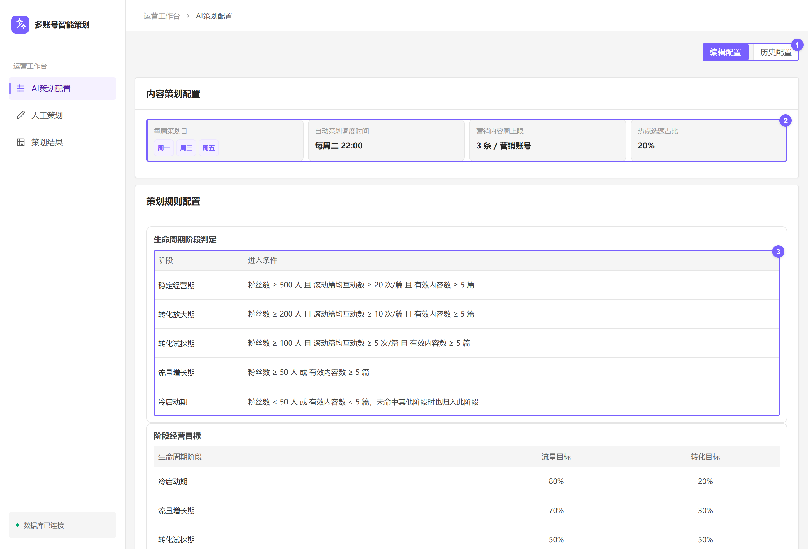

要点：从左侧“AI策划配置”进入。①右上角先编辑、后历史；②首屏查看内容策划配置；③下方查看生命周期规则。先让客户确认总览能否看全关键信息，再进入编辑。

进入页面先显示当前生效配置的只读总览，能够快速看清核心规则。顶部按钮依次为“编辑配置”“历史配置”；历史列表通过按钮进入，不占首屏主区域。

| 顺序 | 区域 | 内容 |
| --- | --- | --- |
| 1 | 内容策划配置 | 每周策划日、自动策划调度时间、营销内容周上限、热点选题占比 |
| 2 | 策划规则配置 | 生命周期阶段判定、阶段经营目标、滚动统计窗口 |
| 3 | 选题标签配置 | T1—T6 对应的分类与标签展示、维护 |

所有配置初始只读，点击“编辑配置”后统一进入编辑。生命周期各阶段条件直接展开，不再另设逐阶段“编辑／完成编辑”。标签等修改统一通过“保存配置”生效。

### 2.2 内容策划配置字段

**图 02　内容策划配置编辑**

要点：①多选每周策划日；②设置自动调度星期和时分。下方维护营销周上限和热点选题占比。图中数字来自当前本地配置，不是本稿要求新增的默认值。

| 字段 | 展示与输入 | 规则 |
| --- | --- | --- |
| 每周策划日 | 周一至周日多选胶囊 | 至少选择一天；显示顺序固定周一到周日 |
| 自动策划调度时间 | 星期＋时分 | 两项必填，按北京时间执行；新配置作用的调度边界见 Q03 |
| 营销内容周上限 | 非负整数 | 单位“条／营销账号／周”；为 0 是否禁用营销见 Q03 |
| 热点选题占比 | 百分比 | 0—100；名称不再使用“热点槽位占比” |

页面显示数据库当前生效值。连接失败不得把前端备用默认值表现为已生效配置。

### 2.3 生命周期阶段判定

**图 03　生命周期条件组**

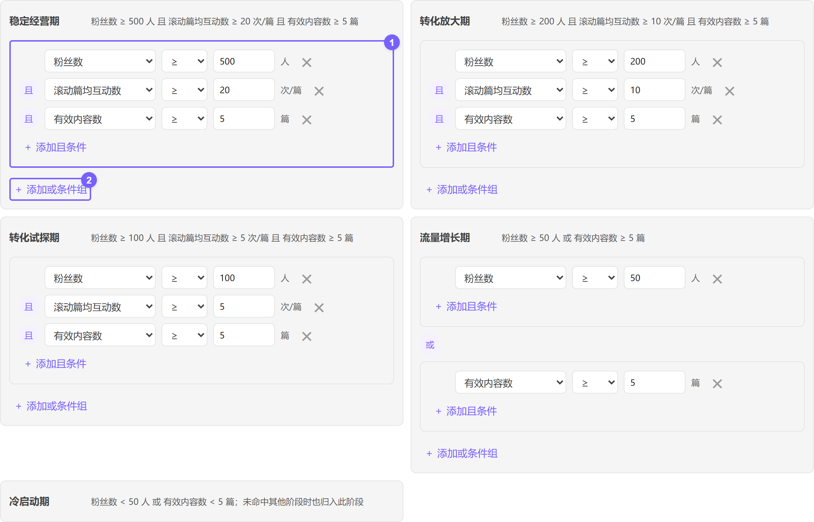

要点：①组框内条件为“且”；②新增独立“或”条件组，右下增长期已展示组间“或”。编辑界面用于讲解交互，保存后规则语义不丢失仍须验收；粉丝数与内容数交叉的归属见 Q01。

判定结果必须覆盖每个参与策划的账号，且同一时点只归属一个阶段。页面展示顺序为稳定经营期、转化放大期、转化试探期、流量增长期、冷启动期；未命中其它阶段时归入冷启动期。阶段条件交叉时的判定优先关系按 Q01 确认，不能把展示顺序直接当作已批准的判定规则。

条件以“组内且、组外或”展示和编辑。组框内每条条件之间明确显示“且”；两个组框之间显示“或”。例如“（粉丝数达到阈值 且 有效内容数达到阈值）或（滚动篇均互动数达到阈值）”。只读摘要与编辑结果必须表达同一逻辑。

| 操作 | 行为 | 边界 |
| --- | --- | --- |
| 添加且条件 | 在当前组新增一条指标条件 | 不改变其它组 |
| 添加或条件组 | 新增独立组，组间显示“或” | 新组至少有一条有效条件 |
| 删除条件／条件组 | 删除对应对象 | 非兜底阶段不能保存空规则；误删恢复能力见 Q02 |
| 设置指标 | 粉丝数、有效内容数、滚动篇均互动数 | 单位分别为人、篇、次／篇；不引入流量变化幅度、已完成周期数等旧指标 |
| 设置阈值 | 单边比较或起止范围 | 范围输入的端点和包含关系须按 Q02 确认；不能仅改展示而丢失原比较含义 |
| 冷启动期 | 显示阶段说明与兜底含义 | 不允许配置成排除部分账号的兜底条件 |

已沟通的阈值如下，条件冲突的最终处理见 Q01：

| 阶段 | 条件 |
| --- | --- |
| 稳定经营期 | 粉丝数 ≥ 500 人，且滚动篇均互动数 ≥ 20 次／篇，且有效内容数 ≥ 5 篇 |
| 转化放大期 | 粉丝数 ≥ 200 人，且滚动篇均互动数 ≥ 10 次／篇，且有效内容数 ≥ 5 篇 |
| 转化试探期 | 粉丝数 ≥ 100 人，且滚动篇均互动数 ≥ 5 次／篇，且有效内容数 ≥ 5 篇 |
| 流量增长期 | 粉丝数 ≥ 50 人，或有效内容数 ≥ 5 篇 |
| 冷启动期 | 曾约定“粉丝数 < 50 人，或有效内容数 < 5 篇”，并承担兜底；该表述与流量增长期有交叉，须按 Q01 明确优先关系 |

会议必须用边界账号验证：粉丝数 100、有效内容数 2、互动 0 的账号，同时符合上述冷启动描述和流量增长条件，最终应归哪一期。未确认前不能把两套表述同时写成无冲突规则。

### 2.4 阶段经营目标与滚动窗口

| 生命周期阶段 | 流量目标 | 转化目标 |
| --- | --- | --- |
| 冷启动期 | 80% | 20% |
| 流量增长期 | 70% | 30% |
| 转化试探期 | 50% | 50% |
| 转化放大期 | 30% | 70% |
| 稳定经营期 | 50% | 50% |

以上为已沟通的初始比例，页面以当前保存值为准。编辑时每阶段一行，两个目标分别输入，合计必须为 100%，不满足时在本行提示并禁止保存。

滚动统计窗口位于策划规则配置，当前采用“最近 N 篇”的口径，当前初始值为 10 篇。有效内容的定义、统计范围、无内容与互动缺失的处理须按 Q02 确认，不能将“篇”改成“天”而不调整业务含义。

### 2.5 选题标签配置

**图 04　选题标签分类展示**

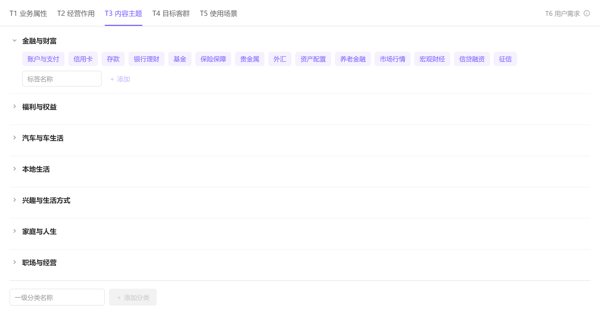

要点：先切换 T1—T5，再展开分类查看叶子标签。截图将其它分类收起，突出当前分类及新增入口；T6 使用悬浮说明。编辑态点叶子标签仅提供改名、停用，已停用区域只提供启用。

| 维度 | 展示与维护方式 |
| --- | --- |
| T1 业务属性 | 展示固定业务枚举；不提供普通标签的改名和停用 |
| T2 经营作用 | 展示固定经营作用；不与阶段流量／转化目标混用 |
| T3 内容主题 | 分类可展开、折叠；分类内展示紧凑彩色叶子标签 |
| T4 目标客群 | 同样使用“维度—分类—叶子标签”关系 |
| T5 使用场景 | 同上；避免平铺后丢失层级 |
| T6 用户需求 | 使用悬浮说明；具体需求文本在选题详情查看，不作为普通枚举手工维护 |

编辑态点击启用标签，浮层只显示“改名、停用”，不重复标签值，不增加无意义的“×”菜单项。停用节点移到末尾“已停用”折叠区；点击后只有“启用”。分类内保留新增标签输入，底部提供新增分类。

标签小巧紧凑，不使用装饰圆点；不显示“系统自动识别／运营可配置”等说明。待归类及其子项不在配置区展示。单选字典等属性标识紧跟维度标题。

重名、空名称及无法使用的分类结构应就地阻止。标签维护的变更、配置历史及历史结果中标签的表现方式见 Q04。

### 2.6 保存、生效与历史配置

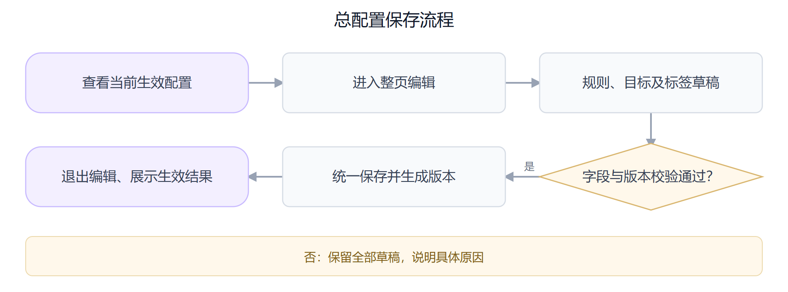

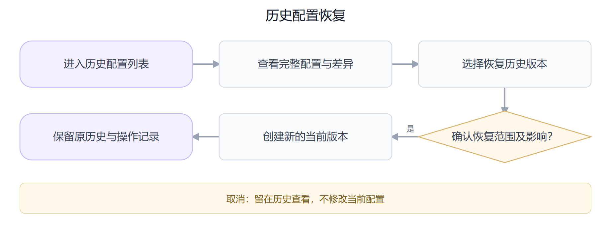

**图 05　历史配置列表**

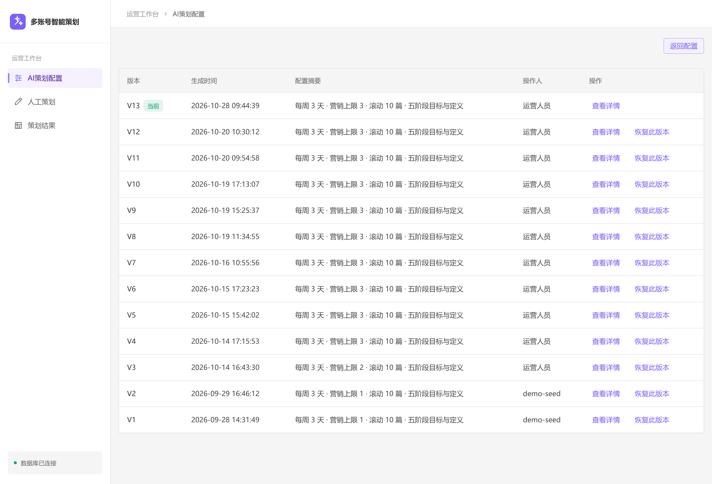

要点：点击“历史配置”进入，按版本、生成时间、摘要、操作人查看。查看详情与恢复是两个独立操作；当前版本不提供恢复。

**图 06　历史版本详情**

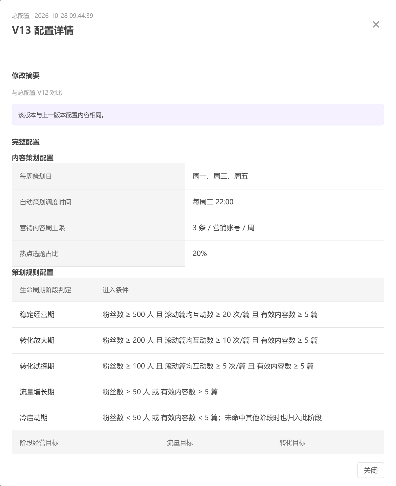

要点：右侧展开修改摘要和完整配置。讲解时核对是否能理解新旧差异；当前截图主要包含经营配置，标签是否随总配置恢复须按 Q04 确认，不能据此认定已经支持标签历史。

**图 07　取消编辑确认**

要点：左侧“确认取消”放弃草稿，右侧红色“继续编辑”保留草稿。该图用于确认按钮顺序、重点和文案；不使用浏览器原生确认框。

保存前检查必填、数值、条件组完整性及比例。未修改时不应提示脏数据或允许创建无意义版本。保存中禁用重复操作；成功退出编辑并显示保存结果，失败保留全部草稿及具体原因。

页面展示的是“一份总配置”。对用户呈现保存成功时，经营规则和标签必须都已按明确范围生效；禁止前半部分成功、后半部分失败却显示整页成功。其它人更新配置时，不覆盖正在编辑的内容，应提示版本变化并提供处理路径。

| 历史字段 | 展示规则 |
| --- | --- |
| 版本 | 连续编号，当前版本明确标识；按生成时间倒序，版本身份不随翻页或排序变化 |
| 生成时间 | 秒级业务时间 |
| 配置摘要 | 概括本次修改内容 |
| 操作人 | 来自宿主身份；未取到显示“—”，不得以固定测试人代替 |
| 操作 | 查看详情、恢复此版本；当前版不提供无效恢复 |

详情展示完整配置及相对上一版的修改摘要，经营目标每阶段一行。恢复二次确认后生成新的当前版本，保留原有历史。历史是否覆盖标签及标签停用影响范围按 Q04 明确。

## 3. 自动策划与智能匹配后台流程

### 3.1 职责与业务入口

本章承接原 V1.0 的 AI自动策划业务，前台入口统一位于策划结果的时间列表、周期详情及批次详情。自动策划由后台按配置触发，运营不在独立页面点击执行，不展示 Fit、Recall 或向量距离等内部数值。

每次执行保存实际使用的配置引用、账号及选题处理依据、策略版本、异常原因和结果版本。已启动批次不因运营保存配置而中途换规则，历史结果不自动重算。

### 3.2 周度调度与目标周期

| 项目 | 业务规则 |
| --- | --- |
| 触发时间 | 读取生效配置，原默认每周二 22:00；以用户实际保存值为准 |
| 目标周期 | 下一自然周，周一至周日，跨月不拆分 |
| 策划日 | 读取周一至周日的多选配置，原默认周一、周三、周五 |
| 账号准入 | 行内账号可参与、关键数据可用、本次存在合法可执行日期 |
| 数据读取 | 通过 IF-01／02／03 查询方法读行内表；本次计算过程保留必要输入依据，不复制另一套全量主数据 |
| 展示 | 正式批次和失败账号进入同一时间列表，显示真实更新时间 |

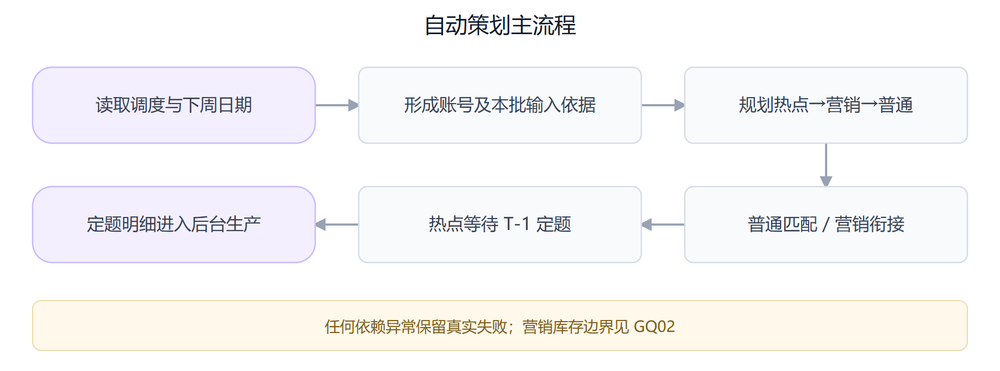

要点：基础策划完成与内容生产完成分开。热点空槽已规划但尚未定题时，不能被扫描器领取生产，也不能因为到达时间就自动显示已完成。

### 3.3 日期与三类槽位规划

完整周主任务每账号实际计划条数 N 等于所选策划日数，每个选中星期对应本账号一条策划。N 不由 80%／20% 等经营目标比例直接决定；营销上限和热点占比只分配类型，不额外增加总条数。

保留原业务顺序：先规划全批次热点，再在具备营销资格账号的剩余日期规划营销，其余为普通。热点数量按“本批次总规划条数 × 热点选题占比”四舍五入取整；相互不得占用同一条规划。热点在哪些账号和日期落位沿用合法范围内随机，不增加单账号热点上限。

原 V1.0 将营销数量写为“库存数、周上限、剩余数取最小值”；最新同库衔接允许预定日期先于内容填充，该库存限制与不足兜底时机按 GQ02 统一确认，不能同时作为两条无条件成立的规则。非营销账号是否等同非认证账号也须明确映射。

### 3.4 生命周期与经营目标

阶段判定、组内且／组外或、阈值及冷启动兜底以第 2 章为唯一配置来源。每个账号必须有且仅有一个阶段；条件交叉见 Q01，指标定义见 Q02，不继续使用流量恶化次数、已完成周期数等旧指标。

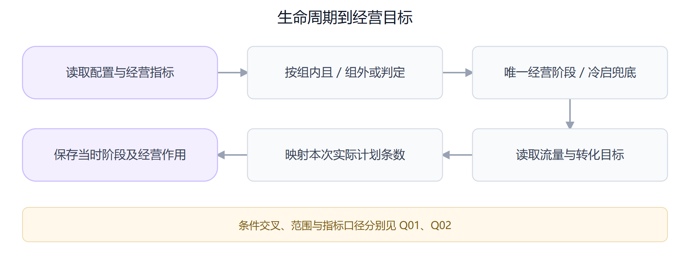

阶段经营目标映射到本次实际 N 条策划，保留目标方向及实际选题经营作用。有效内容与互动等为历史指标，N 为未来编排条数，不能混为一个窗口。阶段变更不倒改历史策划快照。

### 3.5 普通选题准备与 V2 匹配

普通选题先完成有效标签、当前画像及向量准备，账号形成当前画像及向量后，才能进入 V2 匹配主链。准备与执行属于后台能力，不增加运营必点步骤。

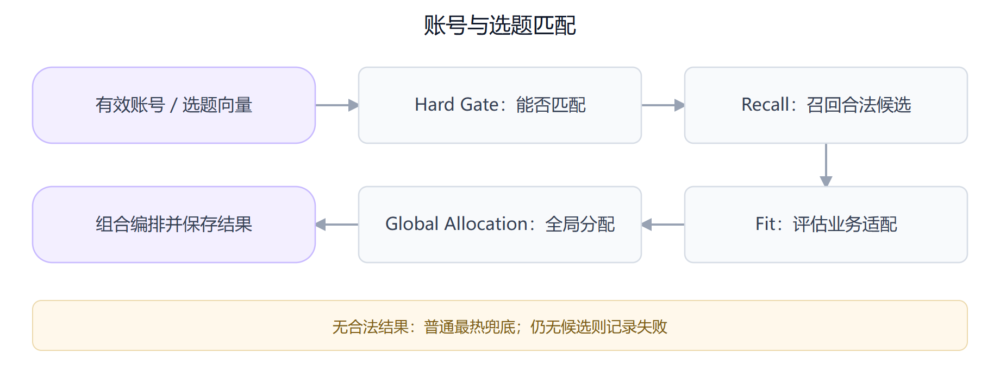

| 环节 | 产品要求 |
| --- | --- |
| Hard Gate | 先过滤账号资格、选题可用性、时间有效性及其它确定约束 |
| Recall | 从合法候选中召回可进一步评估的选题 |
| Fit | 结合人设、兴趣、标签、经营目标等评估适配 |
| Global Allocation | 跨账号、日期与候选分配，遵守复用和全局约束 |
| 组合编排 | 形成与经营阶段和实际计划条数一致的组合 |
| 兜底 | 正常匹配无结果时，从仍满足硬约束的普通候选中按热度选择；不借兜底绕开资格和有效期 |
| 失败 | 兜底仍无合法候选则记录该条及账号失败原因；无法读取数据不伪装成无候选 |

算法权重、覆盖／平衡／冗余计算、MMR、向量模型及批准策略进入算法专项契约。PRD 不将某次测试模型、样例权重或当前预取上限写成业务要求。

### 3.6 自动营销库存衔接

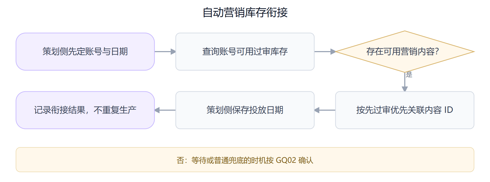

自动营销规划的账号、日期先由策划侧确定。通过 IF-03 取该账号下已审核通过、未分配日期的营销内容，按审核通过时间升序选择，先过审优先；同一内容不能被重复当成多条新生产结果。

行内扫描器关联内容 ID，策划侧维护投放日期及结果。已过审库存直接衔接排期，不再次调用内容 Agent 生成或重新审核。不存在库存与查询失败必须分开；何时等待、何时普通兜底、已过期日期如何处理按 GQ02 确认。

### 3.7 热点 T-1 与统一池

热点日期和规划类型提前确定，具体选题在目标投放日前一天 22:00 由后台确定。触发时通过 IF-02 的热点来源读取当前可用选题，并重新核查账号、有效期、结果版本及生产安全状态。

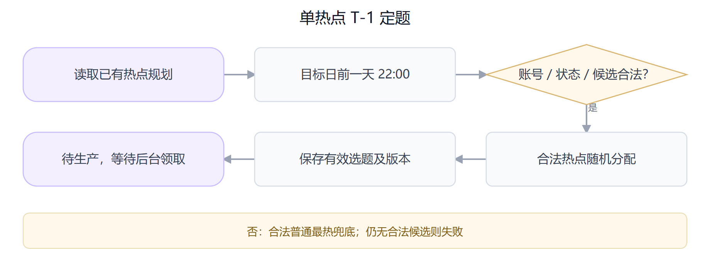

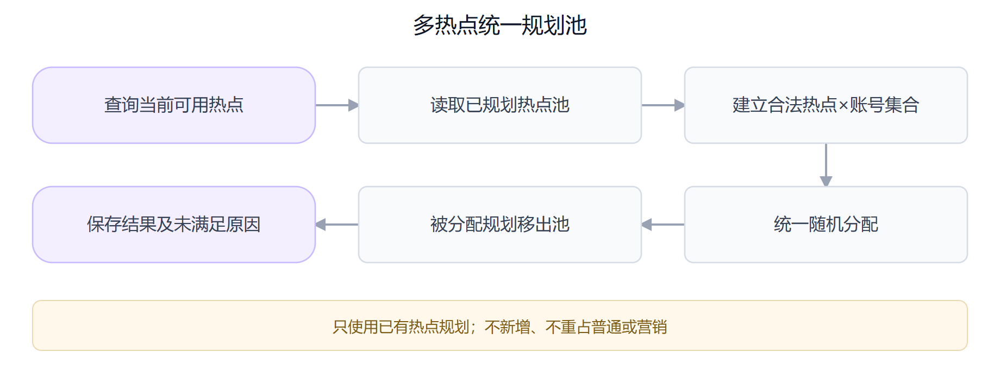

多热点共享已规划热点池，先合法性过滤、再随机分配，同一条规划只绑定一个有效选题。只消费已规划热点，不临时新增或占用普通／营销规划。无合法热点时用该账号合法普通选题中热度最高者兜底，仍保留原热点规划意图。

热点尚未定题显示待定题，定题或兜底成功后进入待生产。无候选兜底失败记录异常，不能凭 T-1 时间经过直接变更为完成。调度设置晚于某个热点 T-1、或新账号错过 T-1 的处理按 GQ04 确认。

后台保留热点标识、账号、目标日期、输入更新时间、执行时点、候选依据、最终选题、兜底原因和版本；运营通过详情与失败原因查看，不增加单独热点运行页。

### 3.8 新账号与补充执行

保留原“仅补未来合法策划日”的业务原则：识别到新账号后，当前周仍有可执行配置日期则创建补充执行；已过去日期不回补，本周无未来日期不计策划失败。补充批次归集到同一周期，账号计数是否去重按 Q09。

识别入口改为同库查询结果或行内约定的变化机制，不再把“每日夜间 HTTP 全量同步”写成确定方案。首次全量读取不能把历史所有账号误识别为新增。增量更新时间是否涵盖互动、人设变化及失去资格的发现方式按 GQ07 确认。

### 3.9 异常与验收边界

| 场景 | 处理 |
| --- | --- |
| 配置在批次启动后更新 | 保持本批规则，后续新执行读取新配置 |
| 部分账号无合法候选 | 记录对应账号失败和原因，保留其它实际结果；批次三态映射见 Q09 |
| 核心数据源读取失败 | 明确异常，不冒充空数据或全部完成 |
| 热点尚未触发 | 保留待定题，不计生产失败 |
| 周期结束收到合法生产结果 | 按实际事实更新，不设统一“闭批后禁止回写”规则 |
| 画像／向量失效 | 暂停该版本进入新匹配；历史结果不因此消失 |

## 4. 人工策划

### 4.1 策划任务列表

**图 08　人工策划任务列表**

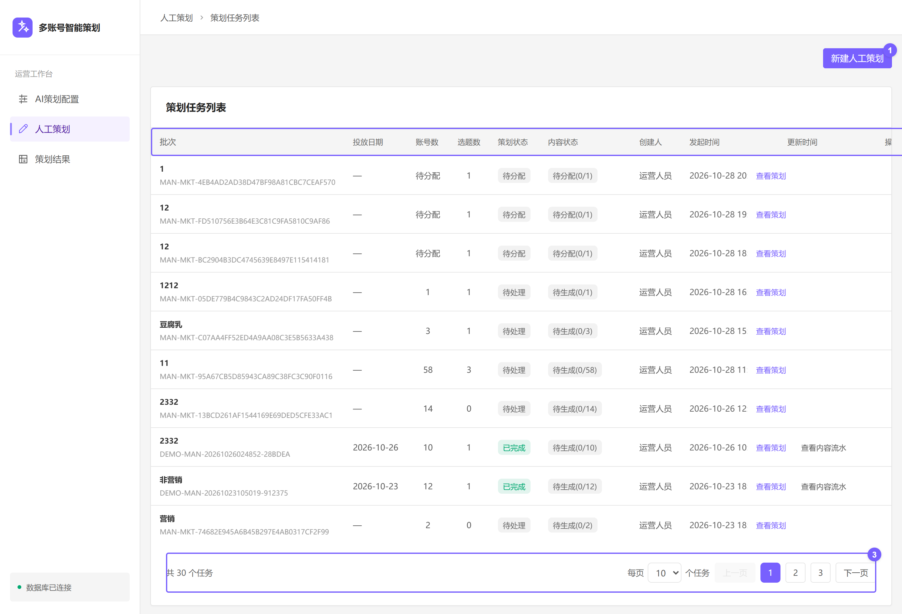

要点：①新建人工策划；②批次名称与批次号同列，上名下号；③列表支持分页。查看策划复用结果详情，内容生产由后台执行，不再保留生成内容按钮。

首次进入展示“策划任务列表”和“新建人工策划”，不重复显示第二个“人工策划”标题。当前保留无筛选区方案；分页覆盖全部历史任务。

| 列顺序 | 字段 | 展示与规则 |
| --- | --- | --- |
| 1 | 批次 | 上行名称，下行批次号；表头气泡解释含义 |
| 2 | 投放日期 | 非营销显示日期；未分配的营销需求显示“—” |
| 3 | 账号数 | 正式任务显示账号数量；新营销需求显示“待分配”，不得用分配数量冒充账号数 |
| 4 | 选题数 | 任务选择的选题数量；营销为 1 |
| 5 | 策划状态 | 按实际执行状态展示；营销待分配如何映射见 Q06 |
| 6 | 内容状态 | 紧凑展示状态与进度，如“生产中(0/2)”；营销分配前口径见 Q06 |
| 7 | 创建人 | 谁发起了本次策划，由宿主提供 |
| 8 | 发起时间 | 位于主要业务字段之后 |
| 9 | 更新时间 | 同上，反映任务最新变化 |
| 10 | 操作 | 查看策划、查看内容流水 |

默认按发起时间倒序，同时间以稳定标识排序。默认每页 10 条，可选 20、50 条；切页保留任务数据的完整范围。是否恢复“完成数、失败数”两列及列表是否允许筛选，集中按 Q05 确认，避免重复改变表头。

“查看策划”已有正式批次时复用“批次策划详情”，从任务进入后返回任务列表；尚未形成正式批次的营销需求，展示所选选题、分配数量及待分配状态。不得为相同批次再造一套内容不同的人工详情。

内容生产由后台执行，列表不再提供“生成内容”。“查看内容流水”在已有可查看流水时提供；尚无流水时是否显示空态入口见 Q06。生产中按钮若需要等待，应显示明确状态，不重复发起异步生产。

### 4.2 两类创建流程

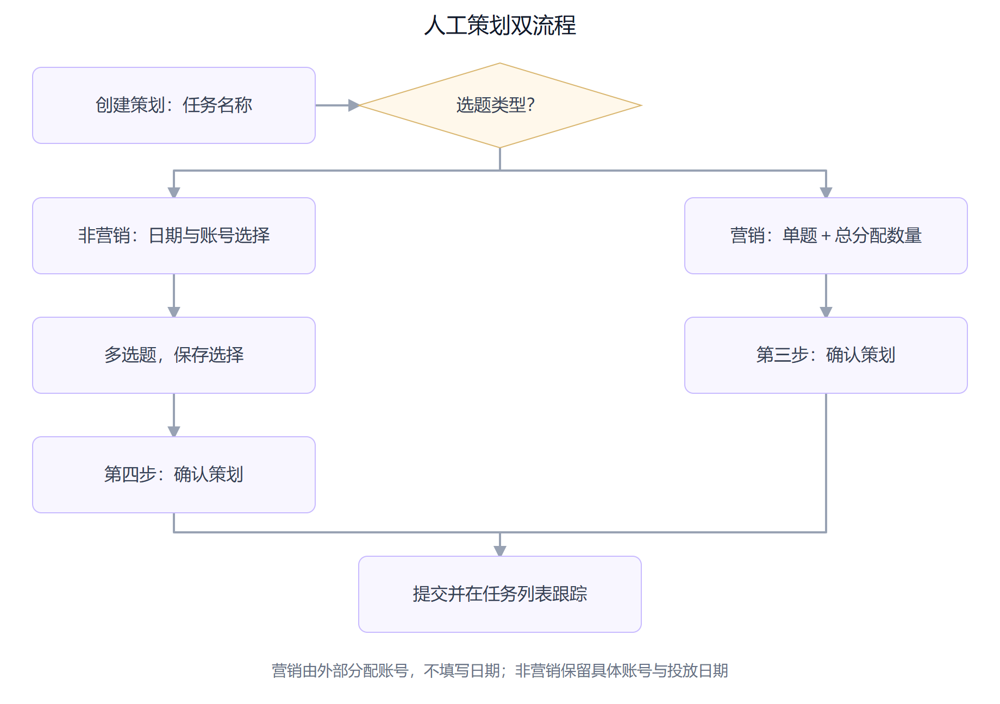

**图 09　非营销创建策划**

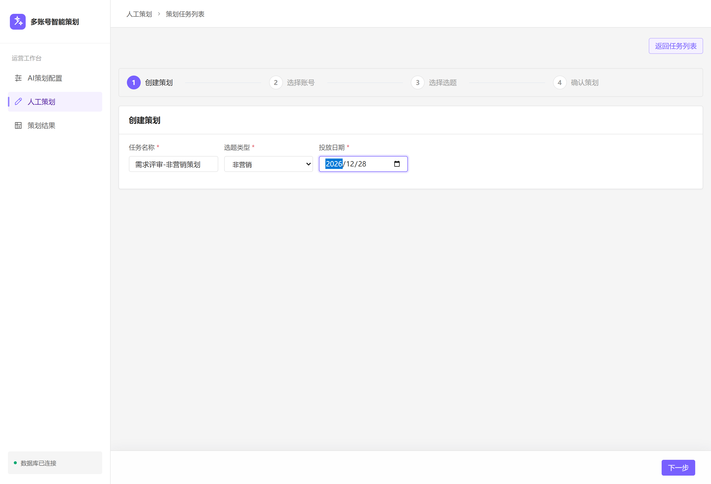

要点：四步流程的第一步，填写任务名称、类型、投放日期；点击下一步进入选择账号。图中任务名称和日期仅为未提交的讲解输入。

**图 10　营销创建策划**

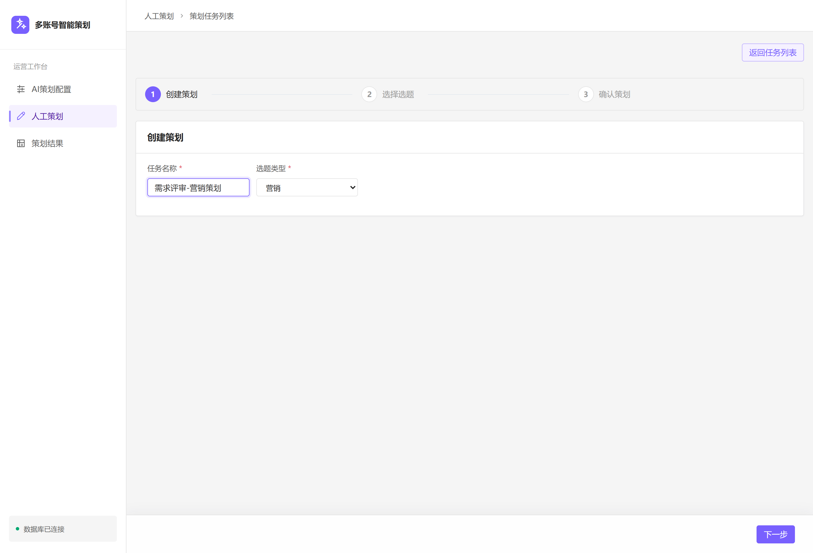

要点：切换营销后只有三步，不填投放日期、不选账号，也不填写每账号数量；下一步直接选择选题。与上一图对照确认两个流程的差别。

| 项目 | 非营销 | 营销 |
| --- | --- | --- |
| 步骤 | 创建策划 → 选择账号 → 选择选题 → 确认策划 | 创建策划 → 选择选题 → 确认策划 |
| 创建时填写 | 任务名称、选题类型、投放日期 | 任务名称、选题类型 |
| 账号 | 本系统选择具体账号 | 不选账号，由外部系统后续分配 |
| 选题 | 多选，累加选择 | 单选一个 |
| 数量 | 计划账号数量及实际选择数量 | 该选题的总分配数量 |
| 投放日期 | 必填 | 不填写，待后续策划衔接确定 |
| 确认方式 | 完整确认步骤 | 同样是完整“确认策划”步骤，不用抽屉替代 |

任务名称默认空且必填；投放日期在非营销模式默认空且必填。切换类型时若已有选择，应明确提示并清理不适用于新流程的数据，不能把营销数量或旧账号误带进另一流程。名称长度、允许补录历史日期等限制见 Q07。

### 4.3 非营销选择账号

**图 11　维度筛选选择账号**

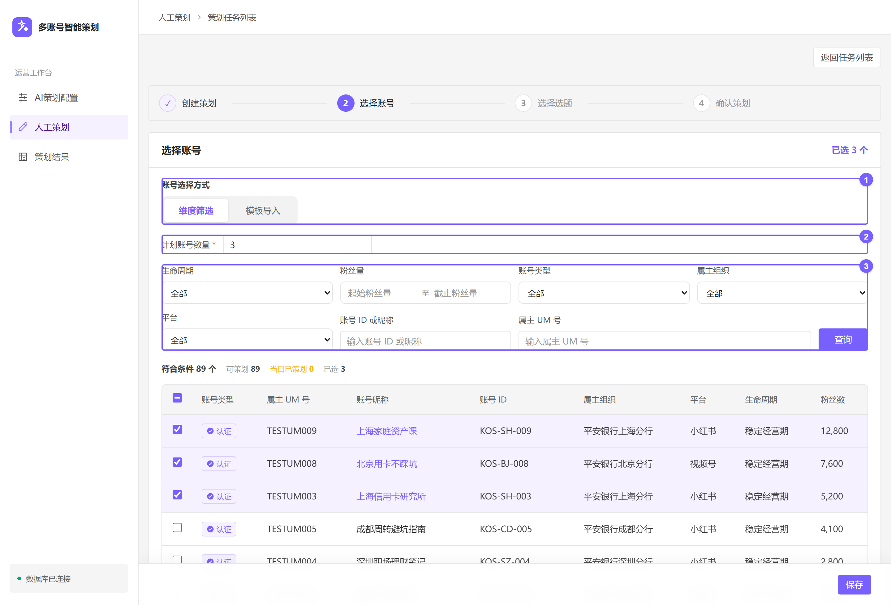

要点：①明确账号选择方式；②计划数量单独一行；③筛选条件末尾查询。输入不会立即筛选，点击查询后抽取并允许手工勾选；业务线、地域已从此处移除。

“账号选择方式”提供“维度筛选／模板导入”两种方式，默认维度筛选，条件展开。计划账号数量放在方式切换下方单独一行，左对齐，标题与输入框同行。

| 筛选顺序 | 字段 | 输入与查询 |
| --- | --- | --- |
| 1 | 生命周期 | 下拉选择阶段，可选全部 |
| 2 | 粉丝量 | 起始值—结束值；允许仅填一侧，上下界均含本值；下界大于上界时阻止查询 |
| 3 | 账号类型 | 认证／非认证／全部 |
| 4 | 属主组织 | 组织选择，至少展示至二级分行 |
| 5 | 平台 | 下拉选择平台 |
| 6 | 账号 ID 或昵称 | 文本；ID 与昵称的匹配口径使用气泡解释 |
| 7 | 属主 UM 号 | 独立文本，不与账号 ID 混用 |

不提供业务线、地域。查询按钮排在以上筛选项最后。仅输入条件或计划数量不改变结果，点击查询才筛选并抽取；符合条件的账号默认按粉丝数优先，用户仍可勾选调整。不增加“按粉丝数优先选择”的说明。

账号表顺序为：选择框、账号类型、属主 UM 号、账号昵称、账号 ID、属主组织、平台、生命周期、粉丝数。已选置顶，同组按粉丝数倒序，同数按昵称及账号 ID 稳定排序。默认每页 20，可选 50、100，跨页保留选择。

非营销可选认证与非认证账号。按所选投放日期限制同账号重复人工策划，自动策划不触发这一限制；已完成人工策划的账号置灰，悬浮一行提示日期及原因，不新增“策划状态”列。单纯选中或保存选择不得提前标为已策划；最终提交仍需校验并发占用。

候选不足时保留已找到的可用账号，明确计划数、实际数和差额，允许返回调整。是否要求二次确认后按实际数量继续，见 Q08；不能仅用“无法完成本次抽取”阻断用户。

### 4.4 模板导入与识别异常

**图 12　模板导入入口**

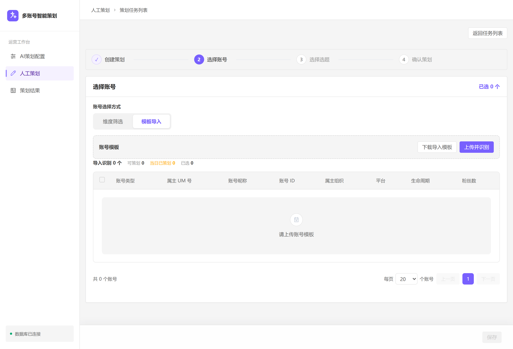

要点：切换模板导入后下载模板、上传并识别。模板支持属主 UM 与账号 ID；计划数量由数据行数确定，不再要求另填账号数量。

**图 13　部分账号识别异常**

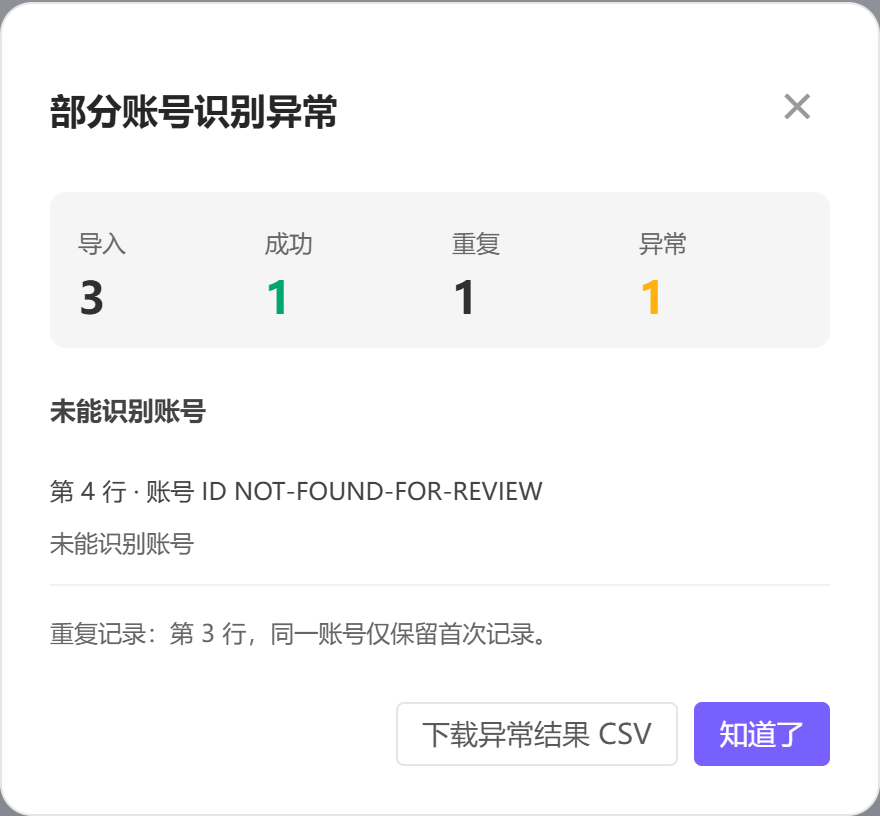

要点：上方先显示导入、成功、重复、异常统计，下方展示行号和原因。本图用已有账号、重复行及不存在的 ID 演练识别，未写入业务数据。关闭后成功识别的账号仍可继续使用。

模板包含“属主 UM 号、账号 ID”。支持用账号 ID 定位，或用属主 UM 号识别；UM 对应多个账号时要求补充账号 ID，不能任意取第一个账号。两项同时填写时必须指向同一账号。

计划数量等于导入文件非空数据行数，包含重复和异常行；不再额外要求用户填写导入计划数量。文件格式及行数上限见 Q07，页面下载模板与上传接受格式一致。

| 识别结果 | 展示与处理 |
| --- | --- |
| 成功 | 唯一识别且当日可策划，加入选择；可继续人工调整 |
| 重复 | 同一账号重复出现，仅保留一次；统计重复数据行并标明行号 |
| 未能识别账号 | 标识不存在、两项不对应或 UM 对应多个账号；展示行号、原值、原因 |
| 已投放账号 | 所选日期已完成人工策划，不勾选；说明该日期不能重复人工策划 |

有问题弹“部分账号识别异常”：上方显示导入、成功、重复、异常四项；下方列明原因，支持下载异常明细。导入行数＝成功行数＋重复行数＋异常行数，每行只归一个结果；动态“当前选中数”单列，不与导入成功数混淆。

弹窗可关闭，成功识别的账号保留并可继续策划；不得因少量异常清空所有成功结果。文件整体不能解析时说明格式问题，不伪装为业务识别失败。

### 4.5 保存账号选择

**图 14　保存后的账号选择**

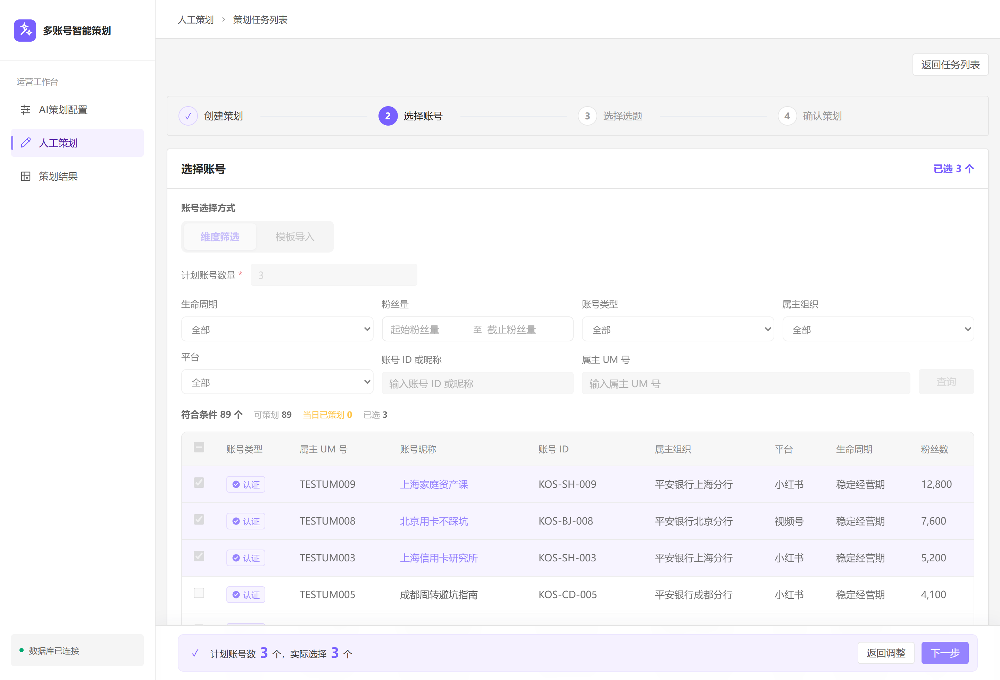

要点：保存后保留列表及选择，底部固定操作条突出实际账号数，并提供返回调整、下一步。现场核对计划与实际不同时如何提示；返回调整应立即解除冻结。

保存前核查数量与可用资格；保存后冻结条件、方式、计划数量、上传及勾选，保留可查看列表。列表回到第一页、滚动至顶部，已选在前。

固定操作条显示“本次选择 X 个账号进行策划”；计划与实际不同则同时显示计划 X、实际 Y 和差额。数字显著；保留“返回调整／下一步”。返回调整立即恢复该步保存前的编辑态；下一步带入结果，不能再要求重复保存。

### 4.6 选择选题

**图 15　非营销选题累加选择**

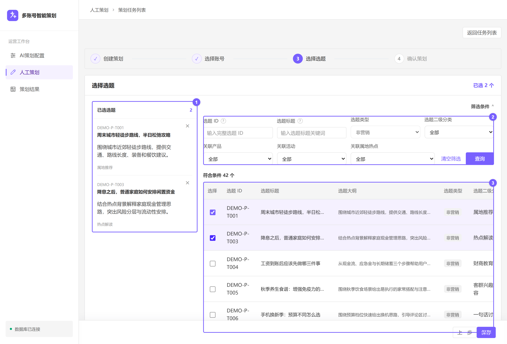

要点：①左侧已选；②右侧筛选；③右侧候选列表。通过复选框添加，换条件查询后继续累加，标题和大纲分列，长文本悬浮查看；不是双击选择。

**图 16　营销单选及总分配数量**

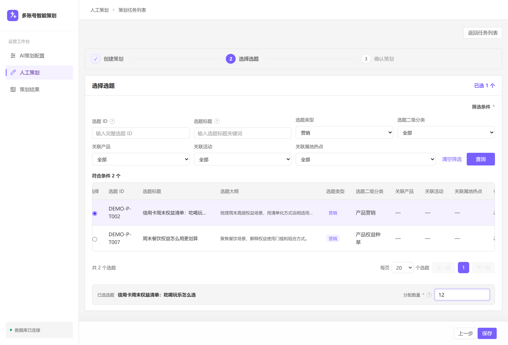

要点：营销没有左侧已选栏，只能单选一个。选题列表下方显示已选选题及分配数量，示例为 12 条；该数代表总内容需求，不代表 12 个账号或每账号 12 条。

| 项目 | 非营销 | 营销 |
| --- | --- | --- |
| 布局 | 左侧已选、右侧全量筛选列表 | 全宽候选列表，不保留左侧已选区 |
| 选择操作 | 行首复选框，勾选后进入左侧；取消即移除 | 行首单选框，选新项替换原选择 |
| 选择数量 | 展示已选 X，不显示上限分母 | 仅 1 个 |
| 选题类型 | 固定非营销 | 默认营销，可切换非营销的既有能力须按 Q06 最终确认 |
| 分配数量 | 无 | 选中选题后在其下方显示，标签、气泡与输入同行；含义为该选题的总内容需求数，不是每账号数量 |

筛选字段顺序：选题 ID、选题标题、选题类型、选题二级分类、关联产品、关联活动、关联属地热点、查询。默认展开。选题 ID 使用普通文本精确匹配，标题使用普通文本模糊匹配；解释放气泡，不能显示日期控件或任务名称占位词。不提供内容主题、目标客群、使用场景筛选。

候选列表字段：选择框、选题 ID、选题标题、选题大纲、选题类型、选题二级分类、关联产品、关联活动、关联属地热点、有效期。标题与大纲拆为独立列，标题无链接，长文本气泡查看。左侧已选只显示 ID、标题、大纲、二级分类及移除操作。

默认每页 20，可选 50、100；初始按选题 ID 稳定排序。非营销多次查询累加选择，筛选或翻页不能清空已选；保存后已选置前且列表回顶部。选题有效期必须展示，已知不在投放日期内的选题不能悄悄提交；是否完全隐藏不可用选题见 Q07。

保存后冻结所有条件、勾选及分配数量，底部显示已选 X 个选题和返回调整、下一步。未选题、分配数量非正整数或超出约定范围时就地提示，不进入确认步骤。

### 4.7 确认策划与提交

**图 17　非营销确认策划**

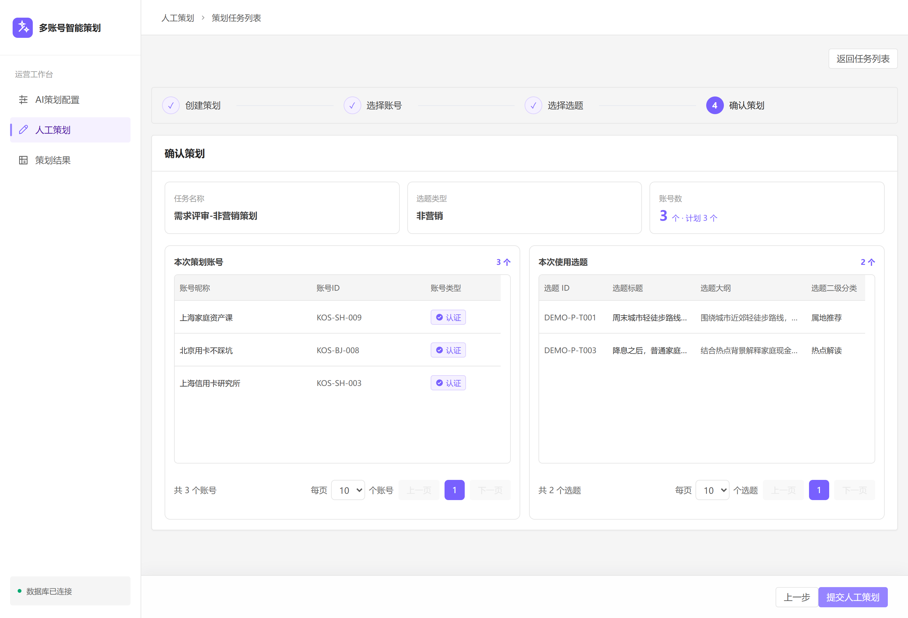

要点：左侧核对账号、右侧核对选题，再提交。现状待修正：截图账号列仍有脚本替换为账号 ID 的问题，应恢复属主 UM 号；摘要还应补投放日期。截图不代表这两项已经验收。

**图 18　营销确认策划**

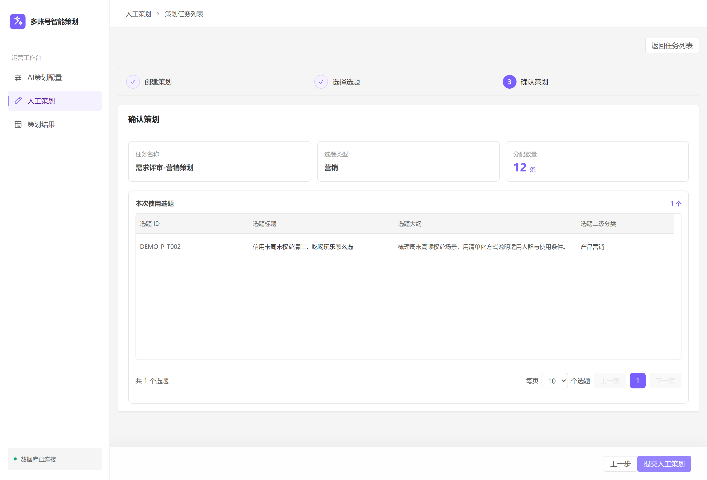

要点：独立第三步“确认策划”，展示任务名称、类型、分配数量及单个选题，不使用侧边栏，不出现空账号、空日期。提交后是待分配需求，外部流程按 Q06 确认。

| 区域 | 非营销 | 营销 |
| --- | --- | --- |
| 摘要 | 任务名称、选题类型、投放日期、计划账号数、实际账号数 | 任务名称、选题类型、分配数量；不显示空账号、空日期和每账号生产数量 |
| 账号 | 昵称、属主 UM 号、账号类型；分页及独立滚动 | 无 |
| 选题 | ID、标题、大纲、二级分类；分页及独立滚动 | 同样四项，单个选题 |
| 操作 | 上一步、提交人工策划 | 同左，页面标题统一“确认策划” |

确认页不得把属主 UM 号替换成账号 ID。标题和大纲过长用气泡展示。返回上一步保留已填内容，直接恢复可调整状态。

提交中禁用重复点击，保留正在提交的反馈；成功回任务列表并定位新任务。非营销再次校验账号日期占用、选题有效性及资格，进入异步策划；营销保存一个选题与总分配数量，进入待外部分配流程。营销后续仍需内容生产、审核及排期衔接，提交成功不等于已完成内容生产、审核通过或已确定正式排期，结果回填方式按 Q06 确认。

提交失败保留用户输入，准确指出失败原因。有账号或选题失效时，给出对象及返回调整的入口。网络超时等结果不确定时先核查任务是否已创建，避免用户反复提交形成重复任务。

## 5. 策划结果

### 5.1 账号列表

**图 19　策划结果账号列表**

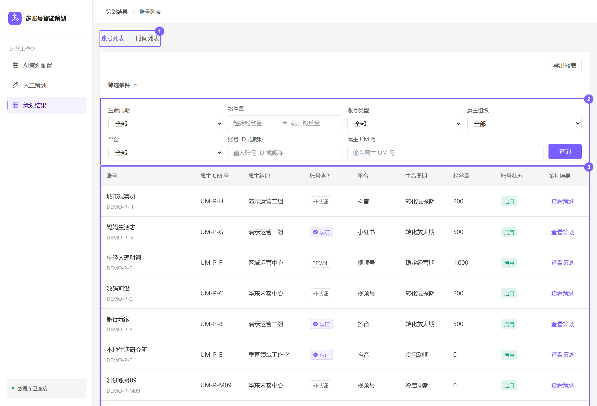

要点：①切换账号／时间列表；②默认展开的账号筛选；③基本信息表，末列查看策划。账号名称不另加重复链接；账号导出时再选择日期范围。

进入“策划结果”默认账号列表，另一个标签页为时间列表。账号列表显示参与过策划的账号基本信息，不直接显示每个周期的执行数据。

筛选顺序与人工选择账号一致：生命周期、粉丝量、账号类型、属主组织、平台、账号 ID 或昵称、属主 UM 号、查询。默认展开，不含批次周期、开始／截止日期、地域或业务线。

| 列顺序 | 字段 | 说明 |
| --- | --- | --- |
| 1 | 账号 | 昵称＋账号 ID，不额外加跳转链接 |
| 2 | 属主 UM 号 | 与账号 ID 明确区分 |
| 3 | 属主组织 | 至少到二级分行 |
| 4 | 账号类型 | 紧跟属主组织 |
| 5 | 平台 | 所属平台 |
| 6 | 生命周期 | 在平台之后 |
| 7 | 粉丝量 | 与生命周期相邻 |
| 8 | 账号状态 | 放在基本信息末尾；参与资格变化不抹去历史 |
| 9 | 策划结果 | 查看策划，进入账号策划详情 |

默认按最近发生策划的时间倒序，同时间按昵称及账号 ID；每页 20，可选 10、50。表格超宽可左右滚动，滚动入口固定在底部。

导出账号报表时单独选择实际投放起止日期，账号范围采用当前已经查询的筛选结果，包含所有分页，不只导出当前页。见 5.7。

### 5.2 时间列表与周期内批次

**图 20　策划结果时间列表**

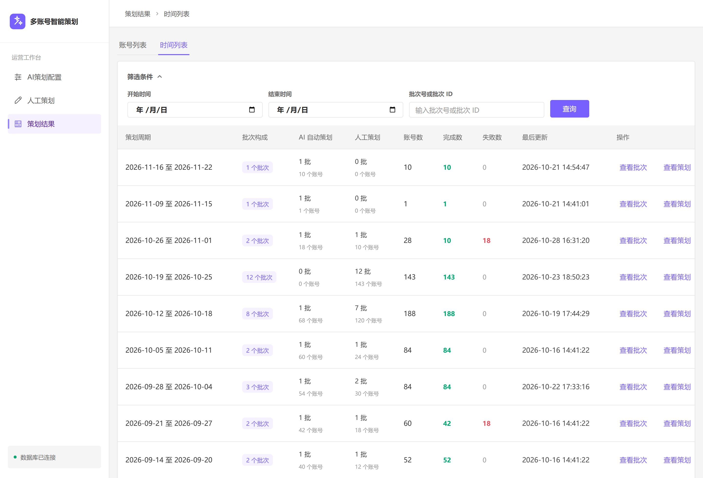

要点：使用起止时间筛选，周期显示实际日期范围；每行操作依次为查看批次、查看策划、导出，失败入口放最后。完成与失败大于 0 时区分颜色，0 不强调。

**图 21　时间列表展开批次**

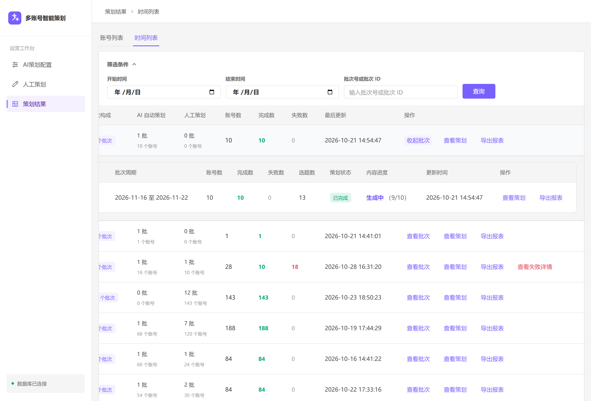

要点：点击周期行“查看批次”，在该行下展开具体批次，名称与批次号同列；单批次查看策划进入批次策划详情。现场确认周期与批次统计的账号口径。

筛选默认展开，使用起止日期控件，不使用年、月、第几周。是否保留现有批次号／ID辅助筛选及日期匹配边界按 Q09 确认。

| 列顺序 | 字段 | 统计含义 |
| --- | --- | --- |
| 1 | 策划周期 | 起止日期，如 2026-10-26 至 2026-11-01，不显示年月第几周 |
| 2 | 批次构成 | 当前周期命中的批次数 |
| 3 | AI自动策划 | 对应批次及账号情况 |
| 4 | 人工策划 | 对应批次及账号情况 |
| 5 | 账号数 | 采用账号维度统计，不用策划条数；同账号跨批次是否去重见 Q09 |
| 6 | 完成数 | 策划完成的账号数，不是已生产内容条数 |
| 7 | 失败数 | 策划失败的账号数；统计与失败明细必须可核对 |
| 8 | 更新时间 | 范围内最近一次业务更新时间 |
| 9 | 操作 | 查看批次、查看策划、导出报表；失败数 > 0 时最后追加查看失败详情 |

周期按开始日期倒序，每页 20，可选 10、50。“查看批次”行内展开，再点收起。周期内批次当前按自动优先、同方式更新时间倒序；是否改为全量按时间倒序见 Q09。

批次表字段顺序：批次、策划方式、批次周期、账号数、完成数、失败数、选题数、策划状态、内容状态、更新时间、操作。批次上名下号，内容状态带紧凑进度。自动名称使用 Auto-YYYYMMDD，人工默认名称日期使用紧凑格式；用户填写的任务名称保留，不强制改名。

批次操作包含查看策划、导出报表。批次较多时需分页，不一次无限展开。周期行查看策划进入周期策划详情；单批次查看策划进入批次策划详情。

### 5.3 三类策划详情的范围

**图 22　账号策划详情**

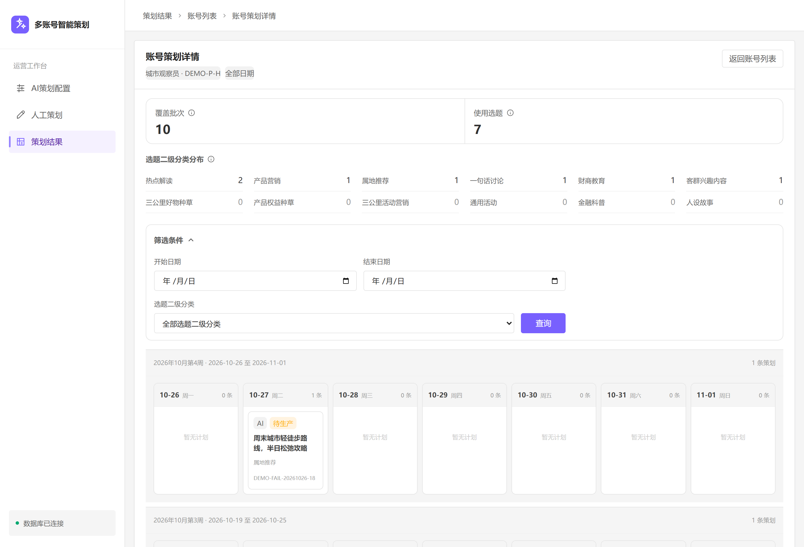

要点：固定单账号，上方为覆盖批次、使用选题及 12 类分布；实际起止日期筛选位于其下，下方为账号日历。账号自身不用再作为一个筛选条件。

**图 23　周期策划详情及所属批次**

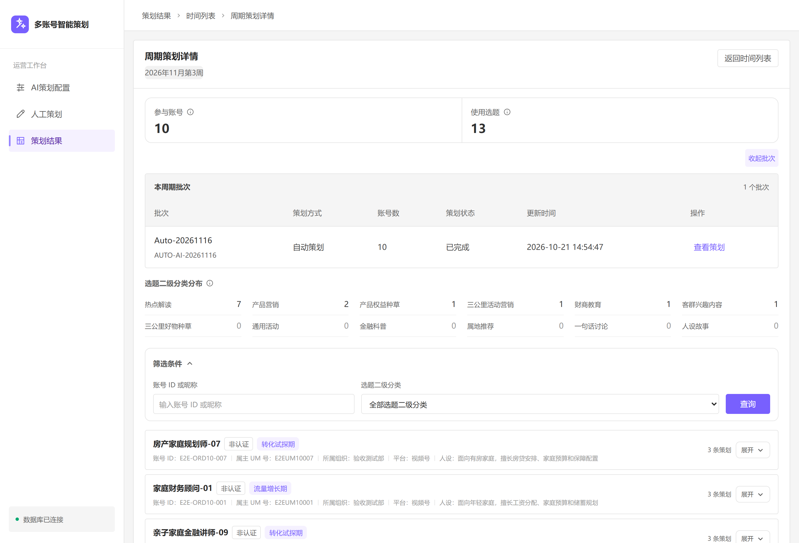

要点：查看某周期全部命中结果，可展开批次表，再进入单批次。统计与明细的筛选范围应一致，不能把已筛选批次重新扩大为整个周期。

**图 24　批次策划详情**

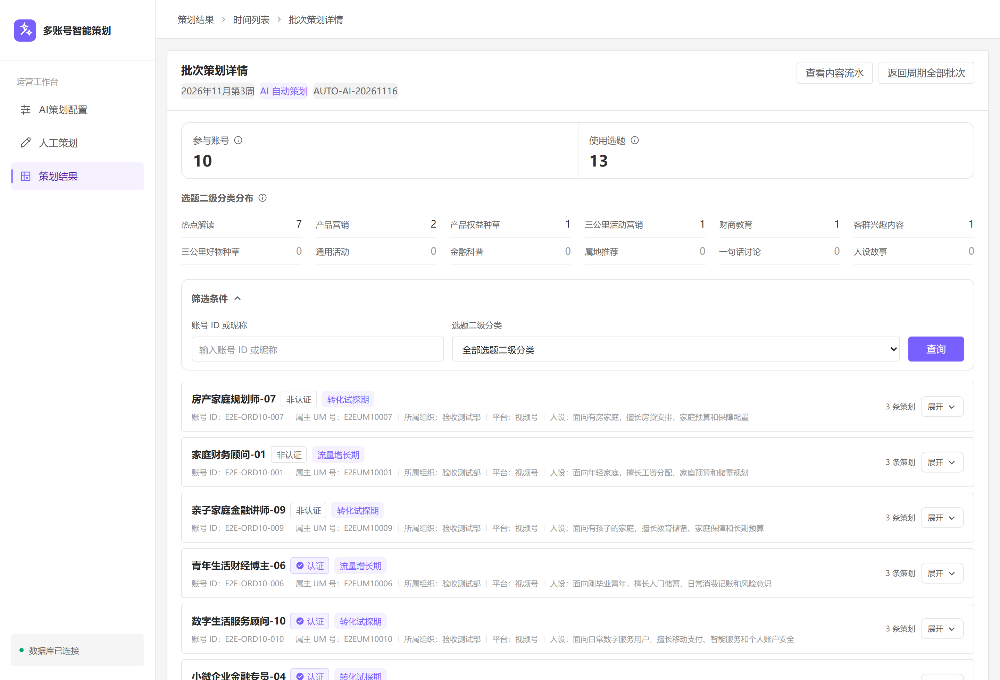

要点：顶部范围标签按周期、策划方式、批次号排列；右侧返回所属周期全部批次。下方账号初始折叠，概览不显示无意义的批次数 1。

**图 25　批次内账号展开**

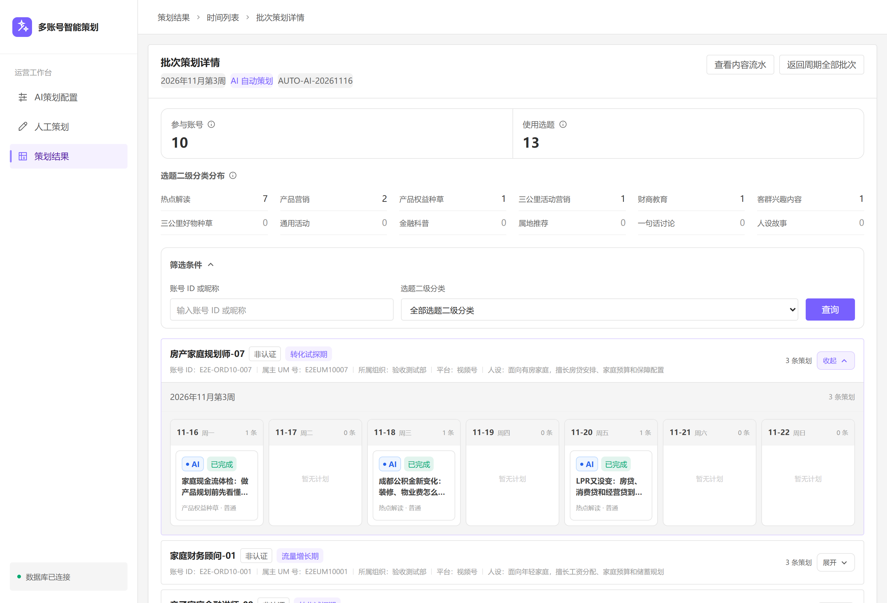

要点：每个账号独立大框，前缀区分账号 ID、属主 UM、组织、平台与人设；展开后复用周历。用折叠和分页避免一次展开所有账号。

| 项目 | 账号策划详情 | 周期／批次策划详情 |
| --- | --- | --- |
| 固定对象 | 一个账号，默认全部历史 | 一个周期的全部命中批次／指定单批次 |
| 顶部标签 | 账号及实际查询日期范围 | 周期；单批次再显示策划方式、批次号，按此顺序 |
| 筛选项 | 实际投放开始日期、结束日期、选题二级分类 | 账号 ID 或昵称、选题二级分类 |
| 不重复出现 | 账号选择、批次、策划方式 | 周期、批次、策划方式；已有范围放顶部标签 |
| 筛选展开 | 默认展开，点击查询生效 | 同左 |
| 主体 | 该账号按周排列的日历 | 按账号分隔的大框，初始折叠；展开后复用账号周历 |
| 返回 | 返回账号列表 | 周期返回时间列表；批次按来源返回，并可返回所属周期全部批次 |

从人工任务进入单批次时，仍复用同一批次详情，返回任务列表。顶部“查看内容流水”和返回类操作统一靠右。单批次返回所属周期后要能看到该周期全部批次，并明确这次操作已扩大范围；不能困在单批次。

账号信息展示明确前缀：账号 ID、属主 UM 号、所属组织、平台、人设；并展示昵称、账号类型、生命周期。所属组织至少到二级分行。每个账号独立边框及折叠控制，避免连续信息混在一起。账号分页默认 20，可选 10、50；账号历史以周分页，默认 20 周，可选 10、50。

### 5.4 详情概览与分类统计

| 页面 | 概览指标 | 气泡解释 |
| --- | --- | --- |
| 账号策划详情 | 覆盖批次 | 当前日期及分类范围内，该账号有记录的去重批次数 |
| 账号策划详情 | 使用选题 | 当前范围内已确定的去重选题数，热点未定题不计入 |
| 周期／批次策划详情 | 参与账号 | 当前范围内有策划记录的去重账号数 |
| 周期／批次策划详情 | 使用选题 | 当前范围内已确定的去重选题数 |

三个详情均展示 12 类选题二级分类的数量。使用紧凑非柱状布局，数量多的在前，同数按固定目录顺序；0 值弱化，不使用彩色徽标强调。指标名称旁提供统计口径气泡，不再添加“账号数 1”“总槽位数”等重复指标。

分类当前按去重选题统计，同一选题重复使用不累加；历史选题变更分类时应采用何时的分类、营销内容如何计入“使用选题”，按 Q10 确认，确认前不要求分类之和必然等于总数。

### 5.5 日历与单条计划详情

**图 26　账号周历**

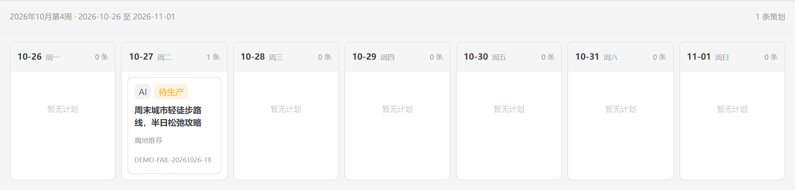

要点：日期固定周一至周日，按实际日期归位；卡片显示方式、内容状态、标题和二级分类，底部可横向滚动。同日多条不合并覆盖，点击每张卡片进入对应计划。

**图 27　单条计划详情**

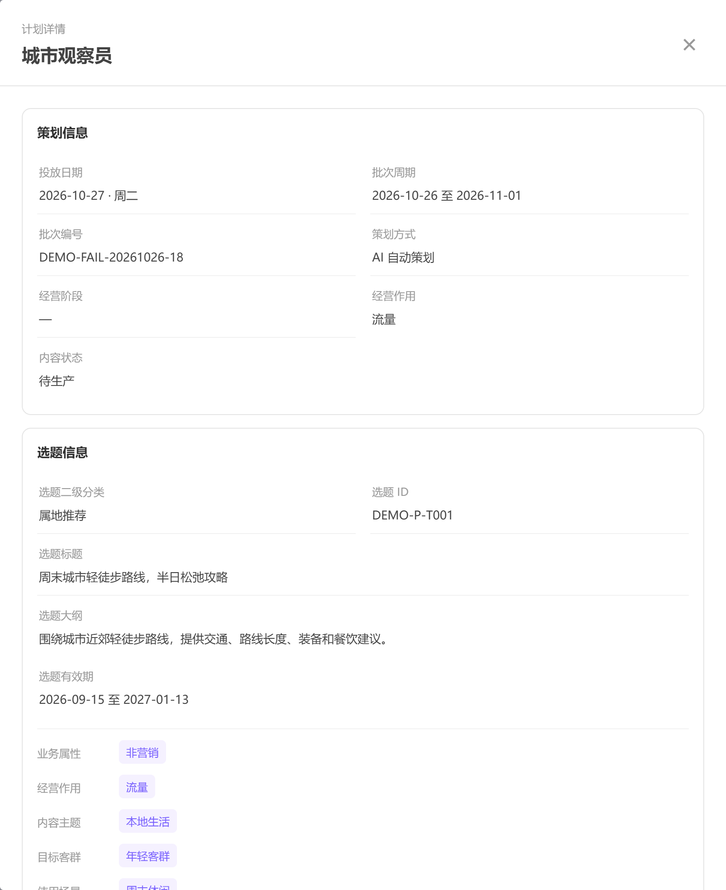

要点：日历卡片进入复用详情，查看策划信息、选题信息与操作记录。账号资料在上级账号区域展示；选题大纲与标签属于选题信息。替换选题放在此模块，生产中禁止替换。

每周日历固定周一至周日，刚好覆盖容器，窄屏或内容超宽可横向滑动，滑动条位于下方。同账号同一天有多条策划时全部独立展示，可同时包含自动及人工；不得按日期去重覆盖。

日历卡片只保留策划方式、内容状态、选题标题、二级分类等必要信息；跨批次聚合时要能识别所属批次。未定题显示“待定题”，无策划日期显示“暂无计划”。计数用“X 条策划”，不使用“X 个槽位”。点击任一有记录的卡片打开单条计划详情。

| 信息区域 | 字段与操作 |
| --- | --- |
| 策划信息 | 投放日期及星期、周期、批次名称及号、策划方式、经营阶段、经营作用、内容状态 |
| 账号信息 | 在上级账号区域完整展示昵称、账号 ID、属主 UM 号、类型、所属组织、平台、人设；选题模块不重复展示。脱离账号区域打开时的补齐方式见 Q11 |
| 选题信息 | 选题类型、二级分类、选题 ID、标题、大纲、有效期、T1—T6 标签；营销内容另明确内容 ID |
| 操作记录 | 最新在前，显示操作、时间、操作人及说明；策划创建、换题等记录可追溯 |

计划详情不另设“关闭／查看调整记录／重新生成本条策划”操作按钮；保留右上角关闭入口。替换选题按钮放在选题信息模块。历史选题快照与当前选题内容的选择见 Q11，禁止无提示地改变历史策划依据。

### 5.6 替换选题、失败详情与内容流水

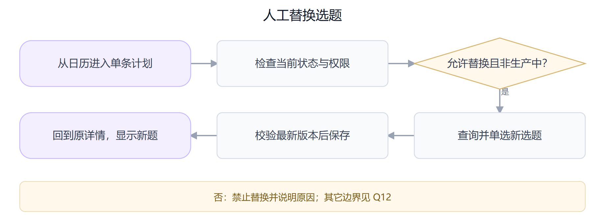

**图 28　替换选题候选**

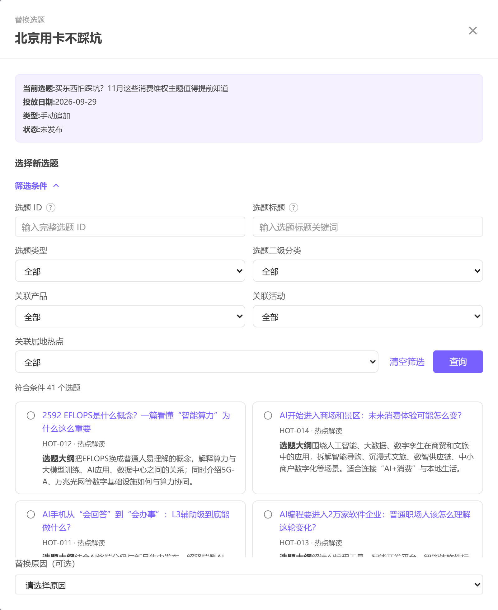

要点：入口默认收起筛选，本图为手动展开后的状态；按与选择选题一致的字段查询，单选新选题。确认成功回原详情并看到新题，失败保留选择。

**图 29　失败账号详情**

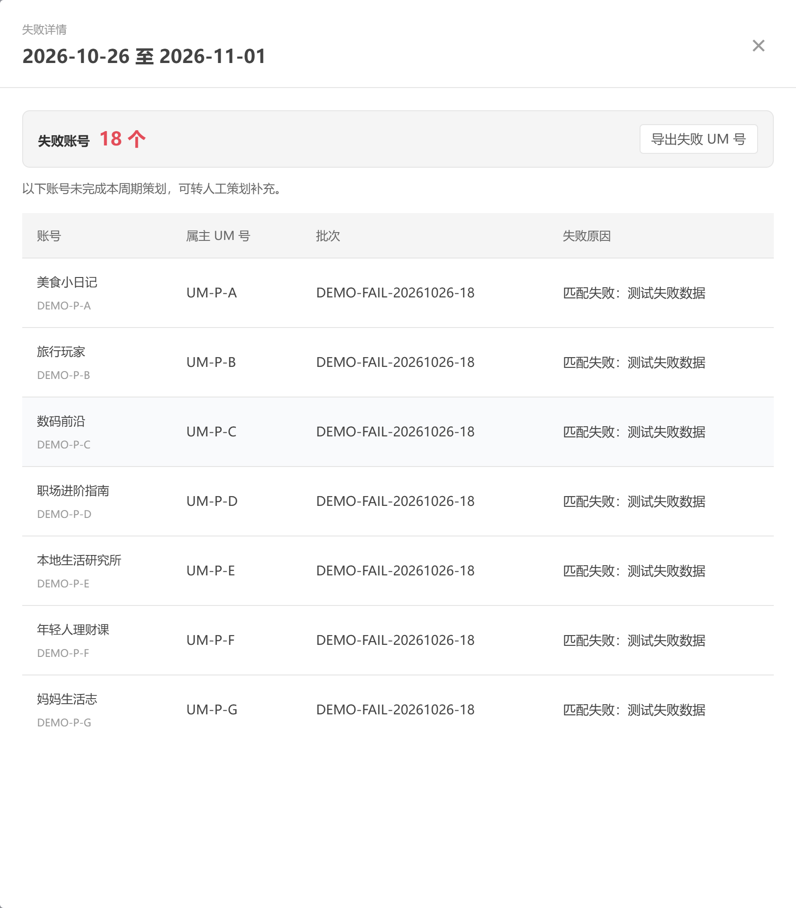

要点：由失败数大于 0 的周期进入，查看账号、属主 UM、批次及失败原因，可导出失败 UM。图中为既有失败测试数据，演示业务异常入口，不代表本次截图触发了策划失败。

**图 30　内容流水执行记录**

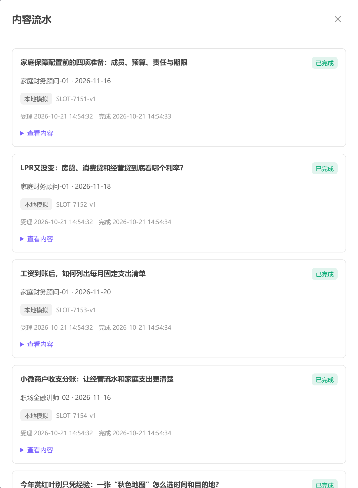

要点：展示现有生产任务的状态、受理／完成时间及内容结果；图中本地模拟标识属于当前测试记录。内容流水用于查看异步结果，不再增加生成按钮；没有记录时显示空态。

替换选题的筛选字段与人工选择选题一致，默认收起；候选单选。生产中不可替换选题，前后端同时校验。已完成及生产失败是否允许换题、换题后是否重置内容状态并重新发起生产，按 Q12 确认。

保存换题成功后回到点击前的计划详情，保持父页位置，立即显示新选题及操作记录；失败保留所选候选和原因，不让用户卡在无反馈页面。并发版本冲突提示结果已变化，避免覆盖他人修改。

失败数大于 0 的时间行提供“查看失败详情”，置于操作区最后。展示账号昵称及 ID、属主 UM 号、批次号、失败原因。可下载失败 UM 号及明细，并提醒这些失败账号可人工补充策划；必须区分去重失败账号数和失败记录数，缺 UM 不得默默丢弃而无说明。

内容流水按实际生产任务展示选题、账号、计划日期、状态、受理时间、完成时间、失败原因及可用内容。营销分配前尚无账号、日期时不伪造数据。默认最近记录在前；记录较多分页，持续执行时自动更新，关闭后返回原页。界面不要求用户二次点击生成内容。

### 5.7 导出报表

**图 31　账号报表导出日期**

要点：从账号列表导出时选择起止日期，账号范围沿用已查询条件；确定后导出全部命中明细，而非当前一页。本次仅打开弹窗，没有执行真实导出。

| 入口 | 导出范围 | 操作要求 |
| --- | --- | --- |
| 账号列表 | 当前筛选命中的全部账号＋导出时选择的投放日期范围 | 起止日期必填，含所有分页 |
| 时间列表周期行 | 当前周期及已应用的批次范围 | 行内导出，不导出其它周期 |
| 周期内批次行 | 当前单批次 | 不扩大为全部周期 |
| 失败详情 | 当前失败范围 | 提供 UM 号及能追溯的失败明细 |

正常报表最小粒度为一条策划及其选题使用记录，不能只导出汇总。至少包含：账号 ID、昵称、属主 UM 号、投放日期及星期、批次名称及号、策划方式、选题 ID、标题、大纲、二级分类、内容状态、最新操作、操作人、操作时间、操作说明。营销已形成内容时的内容 ID 列及 CSV／Excel 格式见 Q13。

导出反映全部命中数据，不受当前分页或页面预取上限影响。长文本保持完整，可正确处理逗号、换行及中文。无数据时说明没有可导出记录；导出失败保留原筛选，不生成看似成功的空文件。

## 6. 跨页面与跨系统业务闭环

### 6.1 结果到内容生产

普通／热点定题完成后落为待生产。行内扫描器只领取“已完成策划＋已确定有效选题＋待生产”记录，调用对应内容 Agent 并保留单条策划关联；受理或开始执行后状态为生产中，运营不能替换选题。

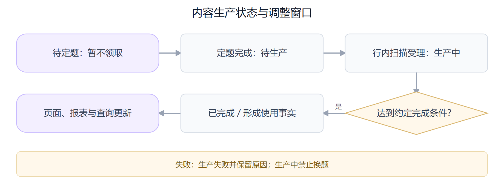

生产事实由行内提供，策划侧更新统一内容状态，前端自动反映变化。只提交请求不等于生产完成；接口读取错误不等于生产失败。热点待定题不领取，已有过审营销库存不重复生产。具体生成、质检／质控、审核如何映射为已完成按 GQ05 确认，不能把审核与发布悄悄折叠成生产成功。

本期不用“IF-05 查询最新一期再生产、IF-06 回传发布状态”作为唯一主链。OP-01 是结果查询，不能通过调用次数触发重复生产；IF-04 是同库生产衔接，不另要求业务调用方掌握内部槽位 ID。

### 6.2 人工营销需求、分配与排期

运营提交一个选题及总分配数量；起点不含具体账号或日期。外部系统完成实际账号分配与内容生产，内容审核通过后再衔接排期。分配账号、生成结果、审核与最终日期必须能追溯到原任务；一个需求形成多个内容结果，不将总分配数量冒充账号数。

策划侧负责确定与保存投放日期。营销需求何时生成账号级明细、是否复用 IF-04 扫描、如何通知分配完成、一次需求对应几批次，以及分配不足／重复／失败时如何展示，按 GQ01 明确。该未决边界不回退为“由运营重新选账号”。

自动营销与人工营销不可混淆：自动营销沿用预定日期填充过审库存；新人工营销从选题需求起步，不是直接领取已过审库存，也不是旧版每账号数量创建空明细。

### 6.3 正式使用次数

同一选题用于不同账号、不同有效生产记录，可以分别形成使用事实。以下行为不增加正式次数：查询结果、查询标签、批量打标测试、前端选中或保存选择、仅形成策划、生产未完成及失败。已过审库存被关联或排期不能重复计一次内容生产使用。

正式计数以可追溯的使用事实为准；相同事实重复通知不得重复累计。重试、换题、一个规划产生多条内容时保留对应关系。完成条件与计数时间字段见 GQ05；OP-02 只查询，不执行计数。营销若保留来源选题关联，可按该真实关联统计，不把内容 ID 填进选题 ID。

### 6.4 标签、画像与向量准备

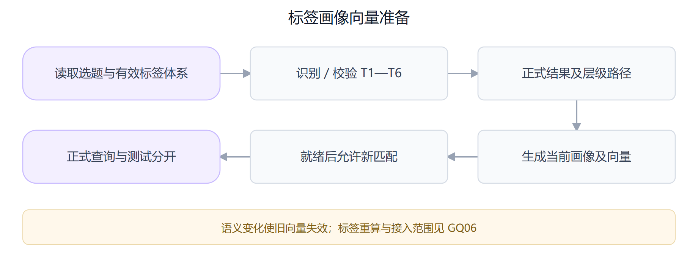

T1／T2 为固定业务语义；T3／T4／T5 保留分类与叶子标签完整路径；T6 为需求文本及语义归并结果，不继续使用旧的“所有 T1—T6 都是扁平单选字符串”。标签查询面向全部选题标识；不同来源的自动打标接入范围及加工触发按 GQ06 确认，不能把查询覆盖范围直接等同于每类都已接入后台任务。

普通选题首次进入加工后识别标签，校验通过再生成当前画像和向量。原 V1.0 的“历史编辑绝不重算标签”和 T6 80% 阈值不作为本轮重新批准的算法结论；重打标触发、字典版本变化及 T6 归并策略按 GQ06 统一，不以改页面为由自动重跑全部历史数据。

账号画像变化通过真正参与画像的字段摘要判断，例如账号人设、兴趣爱好、账号类型、性别、经营阶段及策略使用的其它语义字段。账号昵称、属主 UM、组织等管理字段变化不应一律触发向量重算；参与资格与经营指标变化分别维护。行内不必新增画像状态字段。

选题标题、大纲、有效标签等实际语义变化使旧画像／向量失效；当前准备未完成时不将旧向量混入新匹配。账号与选题共用项目配置的文本模型及向量模型两类能力，具体模型与密钥不在 PRD 写死。

OP-03 仅读正式标签；OP-04 对输入文本进行隔离的效果测试，不覆盖正式结果、不创建策划、不触发生产、不增加使用次数。

### 6.5 并发与历史依据

热点定题、人工换题、扫描领取、生产状态更新和配置发布均有并发可能。最后提交时检查当前有效结果与允许状态，不能用过期版本覆盖新选题，不能把生产中结果替换后仍沿用旧内容。

本次计算保留必要输入快照及版本引用，用于解释“当时为什么匹配”；这不等于复制行内全量账号／选题库。历史详情和导出采用统一快照策略，见 Q11。生产已完成、失败后换题及重试如何处理见 Q12，未决前不扩大换题权限。

已发布结果同样禁止换题。发布事实由行内真实记录提供，查询和生产状态更新不得把已发布回退为未发布；本版不增加撤回业务。前台不展示发布列，不代表后台取消发布后的保护；不继续要求调用原 IF-06 取得该事实。

### 6.6 跨系统职责泳道

以下泳道承接原 SW-01—05 的业务主题，按同库方案与最新营销流程更新；流程中的待确认支路不表示已接通。

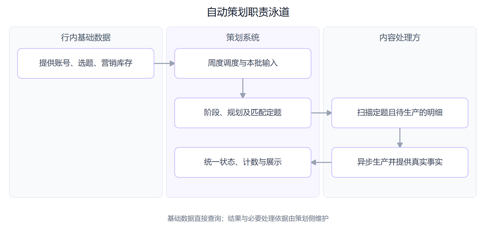

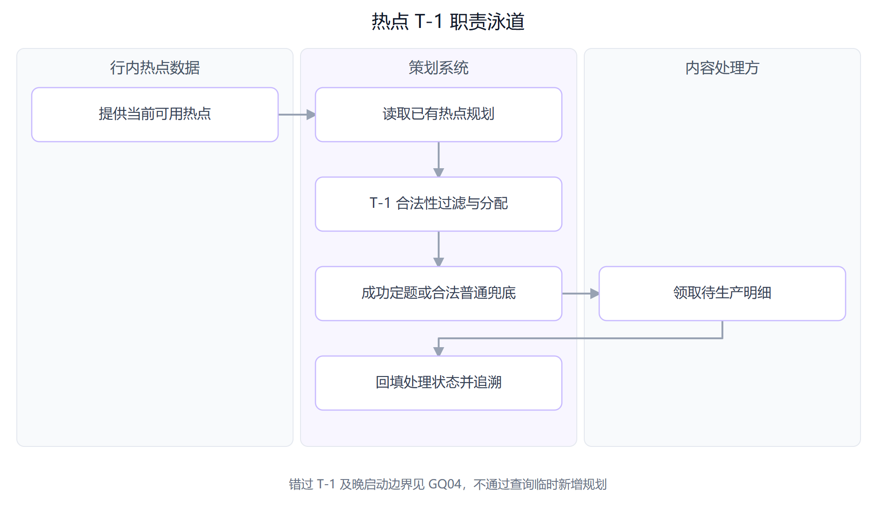

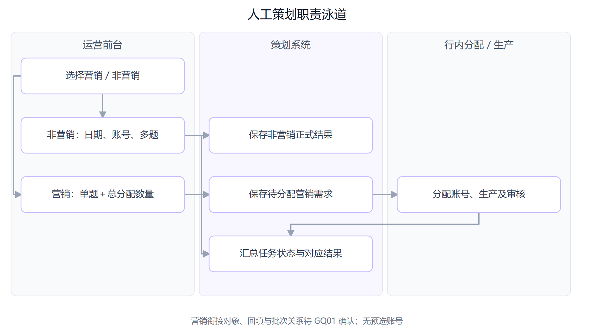

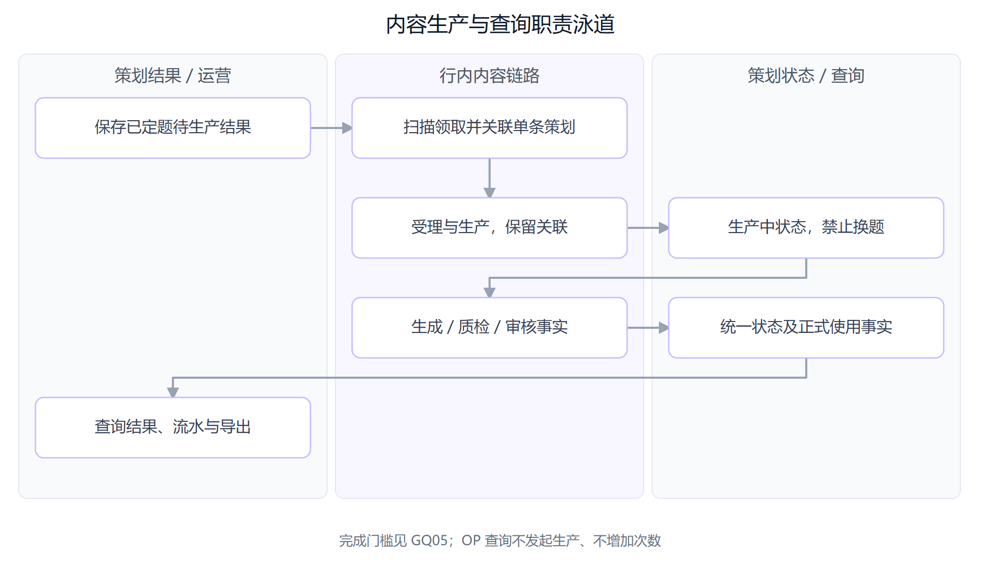

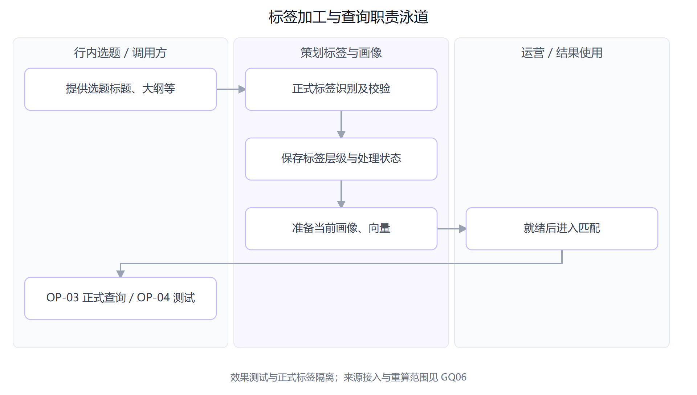

### 6.7 后续经营闭环

发布后的历史内容与互动事实由行内表持续沉淀，后续读取参与生命周期和画像更新，影响下一次策划。新阶段不覆盖历史阶段快照。标签、热点兜底、换题与生产失败记录可供后续策略分析，训练方式和调优不在本期页面流程定义。

## 7. 全局交互、状态与统计口径

### 7.1 列表、筛选与返回

- 筛选条件修改后不自动查询，点击“查询”才应用；查询按钮紧跟最后一个筛选项，随同一筛选网格排布，不独占一整行。换条件并查询后回到第一页。
- 账号列表、时间列表、三类策划详情、人工选择账号及选择选题的筛选默认展开。替换选题的筛选默认收起。
- 分页需覆盖全部命中数据，不能只对最近若干条或固定上限内的数据分页。已选账号、选题跨页保留，查询不会无提示清空已选。
- 长列表和宽表提供分页及横向滚动。主列表的横向滚动入口固定于可操作区域底部；周历滚动条位于本周下方。
- 从列表进入详情，带入已经应用的范围；返回保留原筛选、页码和展开状态。详情统计、明细、导出采用同一范围。
- 主操作名称保持“查看策划”。账号名称本身不再加重复链接。

### 7.2 文案与信息密度

表格中“批次”上行名称、下行批次号；“账号”上行昵称、下行账号 ID。长名称、大纲省略并提供悬浮气泡，完整内容不能截断后不可访问。账号详情等页面的范围标签，悬浮解释字段含义，而非重复标签本身。

时间统一为“2026-10-28 18:16:12”，日期统一为“2026-10-28”；业务时区为北京时间。禁止直接显示带 T 的原始时间。数量大于 0 的完成数用成功色、失败数用危险色；0 使用中性弱化色，无额外色块或警示。缺失普通字段显示“—”。

不增加开发版本、演示数据说明、无意义概览及重复页面标题；不设置“刷新配置”“刷新列表”按钮。正常数据变化由页面刷新机制更新，异常恢复通过明确的重试或重新查询处理。字段含义、精确／模糊匹配说明优先放悬浮气泡；影响用户决策的错误不得仅靠气泡。

### 7.3 必填、保存与确认

必填项标“*”，数字控件使用普通输入框，不带上下增减器；数量校验为整数且必须满足业务范围。范围上下界不合法时就地提示并阻止查询，不能悄悄改成 0。

人工创建步骤操作固定在底部，避免翻到列表底部。保存后原列表继续显示，底部操作条变成保存结果、返回调整、下一步；不是全屏异常弹框或空白提示页。进入下一步滚动到步骤条，使用户能看到当前步骤。

| 场景 | 弹窗标题与说明 | 按钮顺序和效果 |
| --- | --- | --- |
| 取消配置编辑 | 取消编辑；说明未保存内容将被放弃 | 左侧“确认取消”为普通按钮；右侧“继续编辑”为红色重点按钮，关闭弹窗并保留草稿 |
| 离开未保存配置 | 离开策划配置？；说明离开影响 | 左侧“放弃修改并离开”普通按钮；右侧“继续编辑”红色重点按钮 |
| 恢复历史配置 | 恢复此版本；明确恢复范围 | 二次确认后恢复，生成新版本；不得静默覆盖当前配置 |
| 不可逆或影响批量数据的动作 | 写明操作对象和影响 | 使用项目自有弹窗，避免浏览器原生 confirm；关闭后能继续原操作 |

浏览器刷新或关闭时的离开提示受浏览器限制，不要求与站内弹窗同样式。人工创建过程的离开保护及草稿保存方式见 Q14。

### 7.4 策划、内容与页面状态分开

| 对象 | 状态 | 含义 |
| --- | --- | --- |
| 正式策划执行 | 生成中、已完成、生成失败 | 表示策划结果的执行情况，不等于内容生产情况 |
| 营销待分配需求 | 待分配 | 需求已保存，尚待外部分配；是否作为独立策划状态见 Q06 |
| 单条内容 | 待定题 | 热点等尚未确定选题，不能提交内容生产 |
| 单条内容 | 待生产 | 已定题且尚未开始生产 |
| 单条内容 | 生产中 | 异步内容任务已受理或正在执行；不可换题 |
| 单条内容 | 已完成 | 内容生产成功；不直接等同于审核通过或已发布 |
| 单条内容 | 生产失败 | 异步生产失败，需有可理解原因 |

页面加载中、查询无结果、接口异常是页面反馈，不得作为业务状态写入策划或内容状态。不能把接口读失败标成“策划失败”，也不能把未定题标为“未知”。审核与发布不是这五种内容生产状态的替代值，后续是否展示独立字段按 Q06 确认。

### 7.5 批次内容状态与进度

正式有账号的批次，进度分子为“完成全部应生产内容的账号数”，分母为“本批次账号总数”。样式紧凑，如“生产中(0/20)”“已完成(20/20)”。账号如何在存在热点待定题时判为完成，按 Q10 确认。

| 状态判断 | 展示 | 说明 |
| --- | --- | --- |
| 尚未开始任何内容生产 | 待生产(0/X) | 不是因为完成数为 0 就一定待生产 |
| 已有任务受理或执行，尚未全部完成 | 生产中(Y/X) | 即便 Y＝0，只要已启动仍为生产中 |
| 所有账号应生产内容都完成 | 已完成(X/X) | 不含仅成功提交任务 |
| 有生产失败且尚未恢复 | 失败提示及 Y/X | 主状态是否增加“生产失败”，按 Q10 确认；不得伪装成待生产 |

待分配营销需求尚无账号分母，不能显示虚构的 0／0 或把总分配数量当账号数，按 Q06 另定展示。列表“生成中”与内容“生产中”的名称需按对象统一，避免同列混用。

### 7.6 加载、空态与异常反馈

**图 32　创建必填校验**

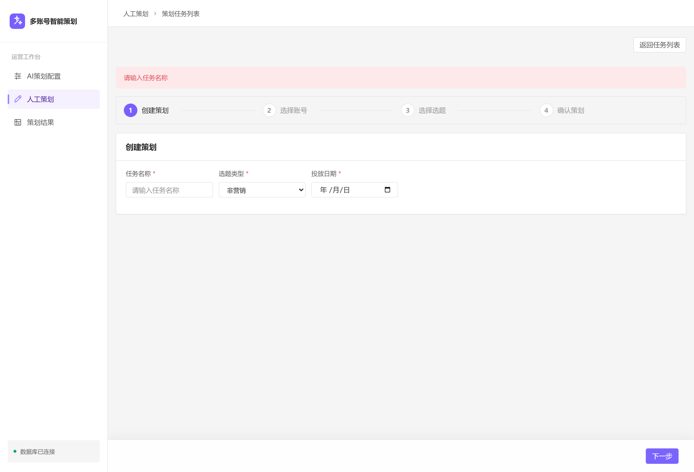

要点：未填写必填项点击下一步时停留原步骤，明确指出缺失信息。此图为真实前端校验；错误不应被后台轮询抹去，也不应跳转成数据库异常页。

以下为本轮建议统一的验收口径，具体提示文案可在会上微调。所有失败都应说明用户能采取的下一步，不直接显示数据库表名、SQL 或技术堆栈。

| 场景 | 页面反馈 | 用户可继续的操作 |
| --- | --- | --- |
| 首次加载较慢 | 对应区域骨架，保留表头与布局 | 不用“暂无数据”冒充加载 |
| 无历史策划 | 空态“暂无策划记录” | 可返回或新建人工策划 |
| 查询无结果 | 空态“暂无符合条件的数据” | 修改筛选后查询 |
| 后端／数据库不可用 | 页内持续错误；保存、提交、恢复等禁用 | 保留可见的上次数据并标识未更新，可重新查询；配置不冒充已生效 |
| 字段不合法 | 控件旁明确错误，必要时聚焦首个错误 | 修正该字段；保留其它输入 |
| 导入部分异常 | 统计＋异常弹窗，支持关闭与下载明细 | 成功账号继续策划 |
| 资格、日期占用或选题有效性冲突 | 指出具体账号／选题和原因，持续显示 | 返回对应步骤调整；不使用快速消失 Toast |
| 异步策划或生产失败 | 列表真实状态＋失败原因入口 | 查看详情或按已确认方式补充处理 |
| 提交超时／结果不确定 | 显示仍在核查处理结果 | 先查是否创建成功，避免立即重复提交 |
| 配置版本冲突 | 告知配置被更新，保留草稿 | 返回核对，不直接覆盖新版本 |
| 局部详情获取失败 | 该区域明确失败，保留其它可用信息 | 重试或关闭；不把未知有效期显示为“不限” |
| 保存／提交／换题成功 | 简短成功反馈，同时更新可见结果 | 无需用户再手动刷新 |

建议普通成功提示约 3 秒消失；校验错误随修正清除，重要业务错误在用户关闭或处理前保留。后台轮询不得清空用户当前步骤的错误、输入和选择。弹窗支持 Esc、焦点返回及键盘操作，打开后不把背景当作可点击区域。

## 8. 接口与数据依赖

### 8.1 同库方式与维护边界

账号、选题、营销内容读取行内现有表；标签、画像、向量、处理记录及策划结果由策划侧扩展维护，通过账号 ID、选题 ID、内容 ID 等关联。计算过程需要的快照只保存解释与重现所需内容，不维护另一套全量业务主数据。

策划侧先定义查询方法、返回对象及扩展／结果表说明；行内提供原表结构、实际枚举和关联；驻场共同完成 SQL，并明确最终维护方。行内原始字段沿用中文业务名称，策划侧自定义字段才标英文名。新增表及每个字段均需中文说明。

以下承接《同库对接能力定义 V1.16》，并纠正其人工营销旧流程。除明确变化外保留既有主要字段，不以页面改造任意删改行内已确认字段。

### 8.2 能力全景

| 编号 | 名称 | 提供与使用边界 |
| --- | --- | --- |
| IF-01 | 账号信息查询能力 | 行内提供，策划侧使用 |
| IF-02 | 选题信息查询能力 | 行内提供普通／热点，策划侧使用 |
| IF-03 | 可排期营销内容查询能力 | 行内提供已过审库存，策划侧使用 |
| IF-04 | 内容生产与营销内容衔接能力 | 双方共同约定：行内扫描与生产，策划侧结果与日期 |
| OP-01 | 账号策划详情查询能力 | 策划侧提供，行内按账号 ID 调用 |
| OP-02 | 选题使用次数查询能力 | 策划侧提供，行内按选题 ID 集合调用 |
| OP-03 | 选题标签查询能力 | 策划侧提供，行内按选题 ID 查询正式结果 |
| OP-04 | 选题批量打标效果测试能力 | 策划侧提供，行内／运营测试入口调用 |

本版为 4 个 IF 与 4 个 OP，共 8 项能力；IF-04 是同库衔接约定，不是主动提交生产 HTTP 接口。不再沿用原 V1.0 跳号的 IF-05／06／08／09 定义，也不额外创造 IF-05。

### 8.3 IF-01 账号信息查询能力

| 项目 | 字段与口径 |
| --- | --- |
| 查询输入 | 页码、每页账号数；可选更新开始时间、更新结束时间。时间采用开始包含、结束不包含 |
| 分页返回 | 账号总数、当前页码、每页账号数、账号列表；按账号 ID 稳定排序，一个账号一条 |
| 基础信息 | 账号 ID、昵称、属主 UM 号、属主组织、平台、账号类型、账号状态、粉丝量、账号信息更新时间 |
| 人设信息 | 账号人设、性别、兴趣爱好、表达风格 |
| 近三个月历史互动 | 内容 ID、账号 ID、实际发布时间、内容标题、点赞数、收藏数（平台支持时）、评论数、互动数据更新时间 |
| 过滤 | 仅返回可参与策划账号；不可参与直接过滤，分页总数同样过滤 |
| 不要求行内提供 | 生命周期、算法自定义字段、画像／向量处理状态；不包含业务线、地域、分享数及历史内容关联选题 |

组织最细按二级分行映射，支行账号取所属二级分行。账号更新时间是否覆盖人设关联表、互动变化和失去参与资格的发现方式见 GQ07；不能把增量未返回当成停用。

### 8.4 IF-02 选题信息查询能力

| 项目 | 字段与口径 |
| --- | --- |
| 查询输入 | 页码、每页选题数、更新开始及结束时间；可选选题来源（普通／热点） |
| 分页返回 | 选题总数、当前页码、每页选题数、选题列表；普通与热点合并分页，按选题 ID 稳定排序 |
| 主要字段 | 选题 ID、来源、标题、大纲、内容类型、热度、选题状态、有效开始时间、有效结束时间、选题更新时间 |
| 时间口径 | 时间条件是更新时间，不是有效期或投放日期；开始包含、结束不包含 |
| 空结果 | 无匹配或超出末页正常返回空列表；读取失败与空列表区分 |

“选题类型＝营销／非营销”、关联产品／活动／属地热点在前端已有使用，但不在该旧字段清单中完整定义，其实际来源及营销候选查询方式需按 GQ03 补齐。不得默认 IF-03 营销库存就是人工创建时可选的营销选题。

### 8.5 IF-03 可排期营销内容查询能力

| 项目 | 字段与口径 |
| --- | --- |
| 查询输入 | 账号 ID、页码、每页内容数；不设更新时间范围，也不限制生产月份 |
| 分页返回 | 内容总数、当前页码、每页内容数、内容列表 |
| 主要字段 | 内容 ID、绑定账号 ID、内容标题、正文、关联产品、关联活动、审核通过时间 |
| 可用范围 | 指定账号名下已审核通过、尚未分配投放日期的内容，包含历史库存 |
| 顺序 | 审核通过时间升序，先过审先使用；同时间稳定顺序由技术补充 |
| 排除 | 暂不包含图片列表，不照搬选题大纲／热度／标签字段；已形成内容不重新生产 |

### 8.6 IF-04 内容生产与营销内容衔接能力

| 项目 | 普通／热点 | 已过审营销库存 |
| --- | --- | --- |
| 前置 | 已完成策划、已定题、待生产 | 自动营销已有账号及日期，查询到可用过审内容 |
| 行内职责 | 扫描领取、关联账号选题、执行内容 Agent、提供真实记录 | 关联内容 ID，提供日期保存所需字段或方法 |
| 策划职责 | 保存结果、维护统一状态及前台展示 | 沿用既定日期，保存排期结果及关联状态 |
| 不做 | 未定题热点不生产 | 不对库存重新生成或审核 |

内部衔接主要字段包括：槽位 ID（slot_id）、结果版本（version）、批次 ID（batch_id）、账号 ID、策划方式（plan_type）、槽位类型（slot_type）、周期起止（cycle_start／cycle_end）、投放日期（publish_date）、选题 ID、来源、内容类型、内容 ID、策划状态（planning_status）、内容状态（content_status）。不要求投放时刻字段。

新人工营销从“单选题＋总分配数量”进入，尚无账号／日期，不套用上表库存领取前置；其分配方法、回填对象及进入本衔接的节点按 GQ01 补齐。普通／热点的生产任务与单条策划保持关联，不能仅按选题 ID 更新所有记录。

### 8.7 OP-01 账号策划详情查询能力

| 项目 | 字段与口径 |
| --- | --- |
| 查询输入 | 账号 ID、页码、每页条数；可选投放开始／结束日期，日期两端均包含 |
| 返回摘要 | queried_at、status、账号 ID、昵称、total_count、page_no、page_size、planning_results |
| 单条结果 | batch_name、batch_code、plan_type、slot_type、cycle_start、cycle_end、publish_date、weekday、planning_status、content_status、topic_info、marketing_content_info、updated_at |
| 选题信息 | 选题 ID、来源、标题、大纲、内容类型、有效期；已无选题的记录按实际为空 |
| 营销库存信息 | 内容 ID、标题、正文、关联产品、关联活动、审核通过时间；不混入选题 ID |
| 查询范围 | 自动、人工及历史批次合并，按投放日期从新到旧，同日多条分别返回 |

不传日期可包含已有账号关联但尚未排期的记录；新营销需求尚无账号时不强行出现在某账号结果中。查询不触发策划、生产、打标或计数，不要求调用方传内部槽位／版本／生产任务 ID。生产中的人工营销选题与内容关联返回结构，随 GQ01 确认后补充，不用库存结构掩盖真实选题来源。

### 8.8 OP-02 选题使用次数查询能力

| 项目 | 字段与口径 |
| --- | --- |
| 输入 | 选题 ID 集合；可选统计开始／结束时间，不传返回累计；使用事实时间开始含、结束不含 |
| 返回 | queried_at、status、topic_results；每条为选题 ID、official_use_count |
| 范围 | 同题不同有效生产事实分别计数；查询不改变计数；内容 ID 不能冒充选题 ID |
| 边界 | 未完成、失败、仅选中／规划、效果测试不计；库存排期不重复计，完成事实见 GQ05 |

### 8.9 OP-03 选题标签查询能力

| 项目 | 字段与口径 |
| --- | --- |
| 输入 | 选题 ID |
| 返回 | queried_at、status、topic_result；结果内包含选题 ID、label_status、labels |
| 标签状态 | 待打标、打标中、已完成、打标失败；未完成时标签为空但查询本身可成功 |
| 标签结构 | T1 业务属性、T2 经营作用、T3 主主题及关联主题、T4 目标客群、T5 使用场景、T6 需求文本与来源 |
| 层级 | 多层维度返回稳定标识、名称和完整路径；不是六个扁平字符串；保留父子关系 |
| 行为 | 仅读已保存正式结果，不触发重打标，不修改标签，不增加使用次数 |

### 8.10 OP-04 选题批量打标效果测试能力

| 项目 | 字段与口径 |
| --- | --- |
| 输入 | 选题详情数组；每条为选题 ID、标题、大纲 |
| 返回 | tested_at、status、topic_results；每条包含选题 ID、label_status、labels、label_error |
| 顺序 | 与输入对应，单条失败保留原因，不影响其它条目返回 |
| 隔离 | 测试不覆盖正式标签，不创建策划，不触发内容生产，不增加正式使用次数 |
| 标签结构 | 与 OP-03 同一层级结构；不能把测试成功解释为正式标签已保存 |

### 8.11 本期对接交付与缺口

| 策划侧交付 | 行内交付 |
| --- | --- |
| 方法签名、输入输出对象、OP 查询与状态口径 | 原始表结构、字段映射、枚举与状态来源 |
| 标签／画像／向量扩展、正式结果及关联说明 | IF 查询、扫描器、内容 Agent 与审核事实 |
| 生命周期与排期规则、统一状态及统计 | 宿主创建人、组织层级与账号资格信息 |
| 营销总量需求及回填所需对象建议 | 营销账号分配入口、结果回填及生产对应关系 |

页大小上限、同轮分页一致性、状态映射、营销需求扩展、行内缺失字段、SQL 维护方均须确认，不能以“同库”省略业务契约。前后端内部 API 不等于以上对行内能力编号。

## 9. 宿主权限与操作留痕

### 9.1 身份与可操作性

登录、用户、角色及菜单授权沿用数营平台，不新增独立登录页或管理员后台。本期不另造权限矩阵；由宿主提供当前身份，策划侧执行最终业务资格校验。人工创建人和修改人必须可追溯，不把固定测试账号当生产操作人。

按钮禁用需能理解原因；不以隐藏按钮替代后端校验。无法确认结果版本、生产状态或其它关键安全事实时，不允许覆盖当前结果；恢复可信后重新计算操作权限。

### 9.2 必须保留的记录

| 操作／事实 | 留痕内容 |
| --- | --- |
| 保存／恢复配置 | 操作人、时间、原版本、新版本、修改摘要及完整必要内容 |
| 标签治理 | 稳定节点 ID、路径、改名前后、启停及版本；恢复范围按 Q04 |
| 人工发起 | 创建人、任务名称、类型、账号或分配数量、所选题、输入与提交结果 |
| 自动执行／热点 | 调度时点、实际配置、数据依据、匹配策略、兜底与失败原因 |
| 人工换题 | 原题、新题、原因、操作者、时间及结果版本 |
| 分配／生产／审核 | 原任务、账号、选题、生产内容及当前有效记录关联、失败和重试 |
| 正式使用事实 | 可核对来源、时间与去重依据，不因查询或重复通知重复累计 |

页面“操作记录”展示可理解的业务事件，后台保留必要技术审计。报表的最新操作、操作人、时间和说明来自同一事实。无数据与日志读取失败分开，敏感凭据不得写入前台或评审文档。

## 10. 需求澄清与验收

### 10.1 页面待确认问题

| 编号 | 需客户决定的问题 | 建议口径与确认人 |
| --- | --- | --- |
| Q01 | 冷启动与增长条件交叉时优先归哪一期？低内容量是否阻止增长？ | 二选一：高阶段优先、冷启动仅兜底；或低粉／低内容强制冷启动并相应修改增长条件。由策划确认，不同时保留矛盾规则 |
| Q02 | 指标范围是否两端包含？有效内容、滚动窗口及缺失互动如何定义？ | 明确单边／双边范围、边界、最近 N 篇是否排除无效内容、无数据默认处理；组内且组外或不变。由策划与算法共同确认 |
| Q03 | 配置何时影响排期？营销周上限 0 的含义？ | 建议仅影响后续新执行，不自动改已生成结果；0 表示禁用营销需明确。由策划、运营确认 |
| Q04 | 总配置历史是否包含标签？改名／停用对历史和已有选题的影响？ | 建议总版本覆盖全部可编辑项，历史结果保留当时快照，停用只限制新使用。由运营与开发确认 |
| Q05 | 人工任务列表是否恢复完成数／失败数？是否继续无筛选？ | 目前采用无筛选及 10 列；不要混用之前被撤回的筛选设计。由运营确认最终列序 |
| Q06 | 新营销需求后续如何变成任务／批次？单选非营销是否保留？ | 外部分配接收、分配状态、一个需求对应几批次、账号回填、生产及审核衔接需联调确认；分配前建议待分配，不显示账号进度。由策划与行内开发确认 |
| Q07 | 数量／名称／文件上限、历史日期及不可用选题策略？ | 当前实现名称 120 字、营销数量 1—1000、非营销最多 100 题、导入 CSV 最多 1000 行；这些技术限制不直接当作业务批准。由运营与开发确认 |
| Q08 | 计划与实际账号数不同时，直接保留差异还是弹窗确认调整计划？ | 建议保留两数，保存时确认按实际继续，不静默改计划；与早期“确认修改计划数”要求二选一。由运营确认 |
| Q09 | 时间列表跨批次的账号数、完成数、失败数如何去重？日期范围查周还是实际投放日？ | 建议周期按账号去重，失败明细保留批次；跨批次一成一败的归类需明确。辅助批次筛选及批次排序同次确认。由策划与运营确认 |
| Q10 | 使用选题／12 类分布按什么快照？热点未定题是否阻止内容进度完成？失败主状态如何显示？ | 建议分类使用当时策划快照并按选题 ID 去重；营销内容独立标识计数方式、热点完成边界须给出例子。由策划确认 |
| Q11 | 单条计划展示当时快照还是最新选题？账号块是否仅放上级？ | 建议历史按快照，当前变化另标；独立打开仍可看必要账号信息，选题模块不重复。由运营确认 |
| Q12 | 生产失败或已完成未发布时可否换题？换题是否重启生产？ | 已确定生产中禁止替换；其它边界须说明旧内容如何处理，不能只改标题。由策划与内容方确认 |
| Q13 | 报表 CSV 还是 Excel？需保留哪些额外行内字段？ | 已明确最小粒度及最新操作；建议含属主 UM、批次名、星期，营销另列内容 ID。由运营确认 |
| Q14 | 创建过程离开保护、草稿恢复及生产刷新规则？ | 建议未提交离开确认、提交后可安全离开、进行中自动更新；是否跨刷新恢复草稿由运营与开发确认 |

### 10.2 全局衔接待确认问题

| 编号 | 待确认内容 | 建议与责任方 |
| --- | --- | --- |
| GQ01 | 新营销总量需求如何交给行内、分配回填、形成账号明细／批次并审核排期？ | 以任务、单选题及总量为入口；行内分配账号，策划侧保存日期。回填对象、数量不足、失败与重复处理，由行内与策划共同确认；不得退回预选账号流程 |
| GQ02 | 自动营销数量、资格与库存不足时机如何统一？ | 保留周上限、先过审优先；确认库存是否限制规划数量、等待至何时、何时普通兜底，以及认证／非认证与营销资格映射 |
| GQ03 | 前端选题字段与行内原始表如何对应？ | 明确营销选题的查询来源、营销／非营销、12 类映射、产品／活动／属地热点；不能把过审内容接口当选题接口 |
| GQ04 | 新账号、晚启动与错过热点 T-1 如何处理？ | 保留不补过去日期；触发已经过去时是否立即补做、最晚可执行条件由策划确认，不直接补造历史成功 |
| GQ05 | 生产完成、审核与正式计数事实如何对应？ | 行内提供真实生产／质检／审核记录，策划侧明确已完成门槛、失败、重试及统计时间；不在未确认时将单次模型生成成功等同全部完成 |
| GQ06 | 标签多层结构、重算与来源接入是否完整？ | 普通／热点／营销选题各自是否自动打标，首次后何时重算、T6 语义归并与历史字典如何处理由策划及算法确认；查询和测试覆盖不代表都已生产接入 |
| GQ07 | 同库增量更新如何感知停用及关联变化？ | 确认账号更新时间是否覆盖人设、互动；不可参与被过滤后的变化识别、首次全量与新增区分、SQL 维护和一致分页由行内与策划确认 |

### 10.3 页面核心验收

以下 20 项沿用图文评审稿；与待确认项关联的预期，在结论回填后执行，不把本表当作已通过报告。

| 编号 | 操作 | 预期结果 |
| --- | --- | --- |
| A01 | 进入配置且不改任何内容 | 默认只读；进入编辑不应自动形成未保存变化 |
| A02 | 设置“（A 且 B）或 C”，保存后重新进入 | 摘要、编辑、实际判定与历史详情逻辑一致，不丢条件组 |
| A03 | 同时修改目标与标签，其中一项保存失败 | 保留草稿，明确失败，不显示整页成功 |
| A04 | 取消／离开配置后点继续编辑 | 重点按钮在右，内容完整保留；关闭提示后不循环弹出 |
| A05 | 导入 10 行，其中成功 7、重复 1、异常 2 | 计划 10，识别统计相加为 10；实际选择 7，成功账号可继续 |
| A06 | 同一 UM 对应多个账号，仅填写 UM | 明确要求补账号 ID，不任意取账号；失败明细可下载 |
| A07 | 修改计划数量或条件而不点查询 | 结果与选择不自动变化；点击查询才应用 |
| A08 | 保存账号／选题后尝试修改 | 条件与选择均冻结；返回调整立即可编辑，下一步能看到步骤条 |
| A09 | 选营销并完成确认 | 无账号及日期步骤；单选题＋总分配数量；第三步为完整确认策划页 |
| A10 | 非营销跨页勾账号、跨查询勾题并进入确认 | 已选不丢；确认页含投放日期及正确属主 UM 号 |
| A11 | 多于一页的任务及账号查询 | 分页覆盖全部命中数据，不被最近 20 条或预取上限截断 |
| A12 | 详情换题，或生产中尝试换题 | 可换时成功回原处显示新题；生产中前后端均拒绝 |
| A13 | 同账号同日有自动与人工策划 | 两条日历卡片都可点击；周一至周日顺序正确 |
| A14 | 按筛选进入详情再导出 | 列表范围、详情、统计和导出一致；返回保留条件与页码 |
| A15 | 从单批次返回所属周期 | 显示该周期全部批次，范围扩大清楚，操作不回错页 |
| A16 | 时间列表失败数大于 0 | 查看失败详情位于最后，原因可见，UM 导出与失败范围一致 |
| A17 | 内容任务已开始但完成账号数为 0 | 显示生产中(0/X)，不误显示待生产；失败不表现为未知 |
| A18 | 历史选题改名后查看旧结果与导出 | 使用经 Q11 确认的快照口径，页面及报表一致 |
| A19 | 提交超时、接口校验失败或资格变化 | 保留输入及具体错误；不重复创建，不被轮询清除提示 |
| A20 | 1440、1280 及较窄窗口查看各页 | 主要操作可见，宽表可滚动，浮层不遮住必需操作；无横向内容截失 |

### 10.4 跨链路验收

| 编号 | 场景 | 验收结果 |
| --- | --- | --- |
| E2E-01 | 生效配置 → 周度策划 | 目标下一自然周，实际日期与配置星期一致；运行中不混用新旧配置 |
| E2E-02 | 同库数据 → 画像准备 | 使用行内原始标识和扩展；不依赖再次复制全量主数据，不伪造停用或新增 |
| E2E-03 | 普通选题 → V2 正式结果 | 标签、画像、向量有效后匹配，合法兜底，正式结果可在对应账号／周期／批次查到 |
| E2E-04 | 同批账号输入一致性 | 匹配各阶段使用可追溯的同份输入依据，管理字段不导致无意义全量重算 |
| E2E-05 | 三类规划 | 总条数由所选日期展开；热点、营销、普通不重占日期规划，原规划意图可追溯 |
| E2E-06 | 自动营销库存 | 使用账号绑定的过审内容，先过审先用；不重新生产，日期沿用策划规则；不足按 GQ02 |
| E2E-07 | 热点 T-1 | 只在已规划热点定题，成功或合法普通兜底后进入待生产，不临时占普通／营销 |
| E2E-08 | 非营销人工 | 四步完成，计划与实际清楚，同日人工限制按投放日，自动同日不误禁 |
| E2E-09 | 新营销需求 | 三步、单题＋总量、无预选账号及日期；分配／生产／审核／排期按 GQ01 可追溯 |
| E2E-10 | 结果 → 后台生产 | 仅定题待生产可领取，受理后生产中，不需前端生成按钮，不重复领取旧版本 |
| E2E-11 | 换题与领取并发 | 生产中不可替换，旧版本无法覆盖；换题成功前端返回原位置并更新 |
| E2E-12 | 生产事实 → 内容状态 | 真实状态驱动，0 完成但已启动为生产中；失败有原因，读取失败不冒充生产失败 |
| E2E-13 | 内容完成 → 正式计数 | 按 GQ05 形成一次使用事实，重复通知不重复计；查询／测试／库存排期不增加计数 |
| E2E-14 | 查询与导出 | 同范围、全分页、同一快照策略，保留选题 ID 和最新操作，营销内容 ID 不冒充选题 ID |
| E2E-15 | 失败及补充策划 | 失败数与明细可核对，UM 可导出，缺失关联有说明，能人工补充符合资格账号 |
| E2E-16 | 跨周期与补充执行 | 新账号仅补未来，归入所属周期；历史合法结果回写更新状态，不人为闭批阻断 |
| E2E-17 | 标签正式查询与测试 | OP-03 只查正式；OP-04 结果隔离；完整路径不退化为扁平值 |
| E2E-18 | 经营与历史 | 新互动影响下一次阶段及匹配，历史经营阶段、选题依据与操作仍可追溯 |

### 10.5 本期实现差异与交付边界

当前待修复包括：生命周期组语义保存、确认页属主 UM 显示、总配置与标签保存／历史、查询截断、筛选范围传递、真实内容进度及历史选题快照。详见《前端问题与验收清单_2026-10-28》。本稿不能被理解为这些问题已修复，也不等于新营销外部分配与所有行内 SQL 已联调。

会议结论须记录问题编号、确认人、是否本期、影响范围及答复时间；回填规则后形成已确认验收基线。旧文档与本稿冲突时，按最新明确结论处理，未决不以旧实现自动补成最终规则。

### 10.6 原章节与新章节对照

| 原 V1.0 | 本版承接位置 | 处理 |
| --- | --- | --- |
| 0—1 说明／总览 | 0—1 | 更新三页架构、对象与数据边界 |
| 2 策划配置 | 2 | 用最新截图与规则替换旧页面，保留版本与并发要求 |
| 3 AI自动策划 | 3、5、6 | 后台业务保留，运营展示并入结果；营销与生产按新方式修正 |
| 4 手动策划 | 4 | 删除旧五步、强制补抽／预览入口，改双流程 |
| 5 策划结果 | 5 | 账号／时间列表、三类详情、日历、失败与明细导出 |
| 6 跨页面链路 | 6 | 改为同库扫描、内容状态与最新营销分配边界 |
| 7 全局口径 | 7 | 统一五种单条内容状态、账号进度及页面异常 |
| 8 接口 | 8 | IF-01—04 与 OP-01—04，补新营销与字段缺口 |
| 9 权限日志 | 9 | 宿主登录／身份、业务校验与创建人、完整记录 |
| 10 核心验收 | 10 | 保留跨链路主题，更新为 20 项页面＋18 项跨链路验收 |
| FLOW-01—12、04A | 对应业务章节 | 全部重绘并更新旧流程，不携带旧接口编号 |
| SW-01—05 | 6.6 | 按最新职责及营销流程重绘 |

整合依据：原《多账号智能策划_PRD_V1.0》、三页面图文 PRD V1.1（2026-10-28）、《同库对接能力定义 V1.16》及截至 2026-10-28 的最新明确需求。保留原版本；本文为本次更新后的全局评审稿。

### 10.7 上会演示顺序

1. 配置只读总览 → 编辑条件组 → 取消继续编辑 → 保存 → 历史详情与恢复；用边界账号决策 Q01—Q04。
2. 非营销创建 → 条件查询抽取 → 模板部分识别异常 → 保存差额 → 跨页累加选题 → 确认提交；决策 Q07—Q08。
3. 营销创建 → 单选选题 → 分配数量 → 确认 → 待分配任务；决策 Q05—Q06。
4. 账号列表 → 账号日历 → 同日自动与人工两条 → 单条换题 → 实际日期查询及导出；决策 Q10—Q13。
5. 时间列表 → 展开批次 → 周期详情 → 单批次 → 返回周期全部批次 → 失败明细与 UM 导出；决策 Q09。
6. 演示加载、无结果、提交校验、接口失败及结果不确定，确认提示位置、关闭及恢复方式。

会议记录至少包括：问题编号、最终结论、确认人、是否本期、影响页面；未决项标记责任方与答复时间。结论回填对应章节后再形成开发验收基线。
