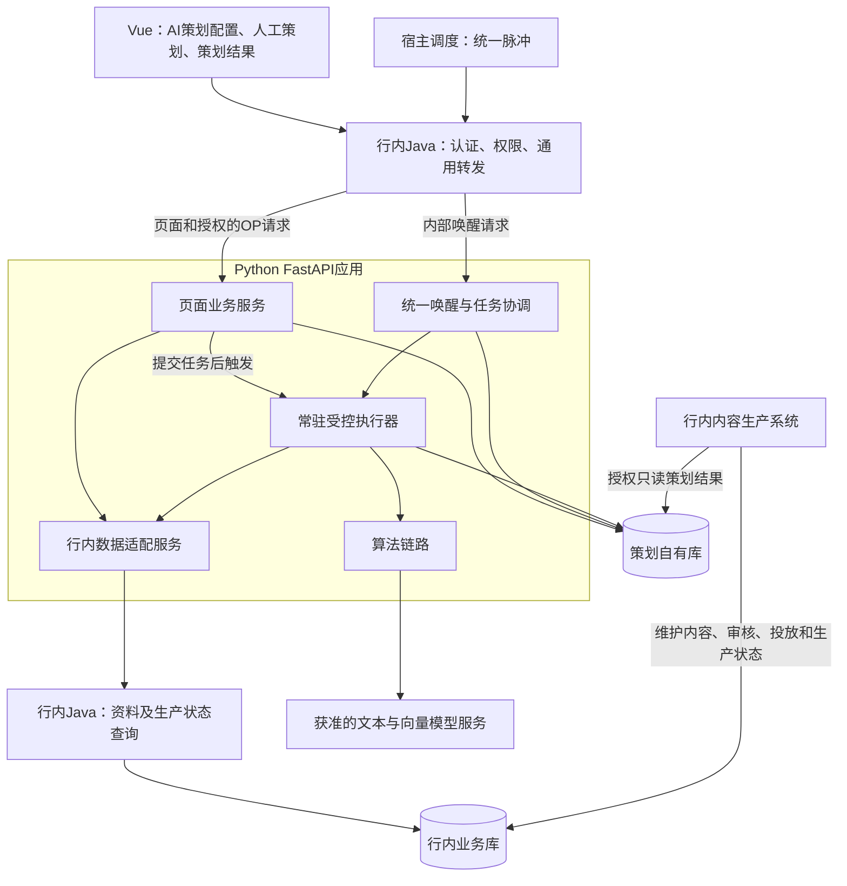

# 行内整合架构改造备忘 V0.1

| 项目 | 内容 |
| --- | --- |
| 版本 | V0.1 |
| 日期 | 2026-11-02（北京时间） |
| 定位 | 本次讨论确定的目标架构与改造计划备忘，作为后续修订起点 |
| 状态 | 方案基线；不代表所有改造已经完成、行内已批准或已经联调验收 |
| 本轮变更 | 新增本备忘及文档索引；不修改应用代码、数据库、运行进程或原有 PRD |

## 1. 改造目标与范围

本项目是行内宿主系统的业务子模块，最终整合到宿主的前端、身份权限、任务调度、部署和监控体系中。

保留现有 Vue 三个页面、Python 策划业务和算法核心代码。改造主要集中在 Java 接入、行内资料读取、Python 后台执行方式及运行保障，不重写一套 Java 策划后端。

PRD 作为业务功能参考；行内整合方式以本备忘及后续确认版本为准。尚未实现的完整营销衔接等业务功能另行补齐，不能因接入架构确定就视为已经完成。

## 2. 当前确定的架构

**Vue 三个页面 + 行内 Java 接入与查询 + 一个 Python FastAPI 应用 + 策划自有库。**

Java 接入层与 Java 查询层可以位于同一个宿主工程，但两类路由和职责应明确区分，避免请求循环转发。

### 2.1 Vue：三个业务页面

| 页面 | 保留的业务职责 | 接入改造 |
| --- | --- | --- |
| AI策划配置 | 配置查看、编辑、标签管理及历史配置 | 宿主布局与路由、Java请求入口、身份权限 |
| 人工策划 | 创建任务、选择输入、确认提交、任务查询 | 同上；提交后快速返回任务信息 |
| 策划结果 | 账号与时间列表、详情、替换选题、统计及导出 | 同上；文件响应和返回位置正确透传 |

行内运行时 Vue 只访问宿主 Java。页面的步骤切换、勾选、弹窗和滚动等交互继续在前端完成。

### 2.2 Java：三类职责

| 职责 | 本次约定 |
| --- | --- |
| 通用业务转发 | 复用一个通用转发组件承接页面及授权的 OP 请求，不逐个重写策划业务 Controller 与 DTO |
| 统一调度唤醒 | 宿主 Job 调用 Python 内部唤醒入口，不在 Java 判断周策划、热点或业务重试规则 |
| 行内资料及状态查询 | 根据行内表结构补查询 SQL、分页与字段映射，填充已约定的返回对象 |

转发应接入宿主认证、操作权限和数据访问范围，并注入可信操作人。当前 Python 使用 `X-Operator-Id`；具体名称随宿主约定统一，不能相信浏览器自报身份。

业务请求体、响应及文件尽量透传，身份和传输相关请求头按代理规则处理。固定 Python 目标地址，仅开放已确认业务路径；内部唤醒、任务控制和模型管理接口不向普通浏览器通配开放。OP 服务调用与页面会话使用相应的可信调用身份。

`/api/plan/**` 可作为宿主侧业务前缀方案，最终路径映射待接入时确认。通用转发仍需保留接口目录、契约和授权映射。

**当前只保留 Java 契约、DTO 和空实现。真实转发、SSO 和 SQL 在行内工程中补齐，不另建本地可运行 Java 宿主。**

### 2.3 Python：一个应用内的四块能力

| 模块 | 责任 |
| --- | --- |
| 页面业务服务 | 配置、人工策划受理、结果查询、替换、统计及导出 |
| 行内数据适配服务 | 统一调用 Java，转换并校验资料与生产状态 |
| 任务协调及后台执行 | 到期判断、任务登记、依赖检查、受控执行、进度、重试与恢复 |
| 算法链路 | 打标、画像、向量、召回、过滤、评分、组合与全局分配 |

上述是代码职责划分，不要求拆成多个微服务。现有同步 HTTP、PyMySQL 和算法函数可逐步复用，不要求为了异步受理而整体重写为 `async/await`。

## 3. 数据边界与六类读取能力

| 数据 | 权威维护方／存储 |
| --- | --- |
| 账号、人设、组织、互动事实、选题基础资料 | 行内业务库，由行内维护 |
| 营销内容、审核、有效投放和内容生产事实 | 行内业务库及内容系统 |
| 策划配置、标签、画像、向量及处理状态 | 策划自有库，由 Python 维护 |
| 任务、执行进度、重试、正式批次与策划明细 | 策划自有库 |
| 输入快照、操作记录、内容状态投影和正式使用次数 | 策划自有库 |

Python 只读写策划自有库，通过 Java 读取行内业务资料，不直接查询行内业务库。此前确认的内容侧授权只读策划结果是单独的数据访问边界，内容侧不负责写策划库状态。

六类 Java 读取能力继续保留：

1. 账号信息，包括人设、兴趣、表达风格、性别、粉丝量和互动事实等。
2. 选题信息，按来源区分普通／热点，按类型区分营销／非营销。
3. 绑定账号的已过审可用营销内容。
4. 账号目标日期已有的有效营销投放。
5. 普通／热点策划明细的内容生产状态及内容ID。
6. 人工营销任务生产结果；当前汇总对象还需补齐后续账号、内容及审核事实的衔接需求。

必要的本地只读查询字段或索引按筛选、分页和计算需求评审，属于拟补能力，不复制一套权威业务主表。当前查询数据、派生结果与历史任务快照分别管理；资料更新不能覆盖历史输入依据。

## 4. 统一唤醒与常驻执行器

### 4.1 唤醒入口

拟新增 `POST /api/internal/wakeup`，仅供可信宿主调用。

处理方式：校验调用来源，可靠记录受理及必要任务信息，安排后台协调，快速返回。重计算不占用原 HTTP 请求。受理不等于业务完成；优先采用 HTTP 202，或按宿主约定使用明确的受理响应。

Java 负责传输和调用结果，不维护策划状态机，也不解析业务状态来决定具体步骤的重试。业务任务结果仍须能够被查询和监控。

### 4.2 执行器生命周期

- 随 FastAPI 生命周期初始化一次受控执行器，服务停止时统一收尾；技术选项为进程内受控线程池，具体运行要求待宿主确认。
- 执行器空闲时不主动按时间扫描业务，不启动独立 `while True`、APScheduler 或 Cron 业务定时循环。
- 宿主唤醒或人工提交后，安排一次有限的协调与执行。本次任务完成可以继续其就绪的依赖步骤，不需要每一步都由 Java 调用。
- 并发、模型调用和待执行容量受控。`max_workers` 仅限制执行线程数，仍须限制内存排队；任务待办以数据库为准。
- 多进程／多实例各有自己的执行器，通过数据库领取规则协调，总并发须按部署规模核算。
- 长任务和状态查询等轻任务保留各自执行机会，避免一个全局忙碌标志阻塞所有工作。

### 4.3 触发频率

宿主可配置一个固定脉冲，**五分钟仅为初始讨论值，必须可调整**。Python 在被唤醒时根据业务配置判断到期事项。

人工策划提交入库后立即尝试触发同一执行器，周期脉冲作为漏启动、中断和重试的恢复入口。若内容状态仅按脉冲查询，页面也存在对应延迟；周策划、热点精度及漏跑补偿范围需确认。

## 5. 业务任务与重计算组织

| 工作 | 执行安排 |
| --- | --- |
| 周自动策划 | 合并周策划检查与自动策划协调：创建／复用主任务，准备输入，执行匹配，正式提交 |
| 数据准备、打标、画像、向量 | 作为持久化工作单元，按需处理并复用有效结果；无需 Java 逐步编排 |
| 非营销人工策划 | 复用既有人工分配与正式提交逻辑，不强制经过完整 AI 链路 |
| 热点定题 | 处理到期未定题记录，使用已有热点与兜底规则 |
| 营销内容衔接 | 读取有效投放和过审内容，完成引用、填充及必要的排期；完整能力待补齐 |
| 内容状态更新 | 经 Java 读取事实，更新本库状态与成功使用次数，独立于模型耗时 |

数据准备、打标、向量化、匹配有依赖关系，但不串在一个同步 HTTP 请求中等待。可以复用已有 Pipeline 记录主任务和阶段；真正的重工作由独立任务执行，逐步落库。

匹配内部的单账号评分、矩阵分配与组合目前属于同一匹配任务的步骤投影，不能假定每步都能独立恢复。全局分配不得为满足短请求时限而随意切成独立账号小批，改变算法语义。

普通／热点定题后可供内容侧处理，不要求整周期所有内容都就绪。行内内容系统负责扫描、领取、生产、审核及其内部重试；Python 查询状态，不恢复旧主动投递、领取或内容回调路径。

## 6. 状态、恢复与监控要求

1. 受理后先保存待执行事实，真正领取后再标记执行中；内存 Future 或线程集合不作为任务事实来源。
2. 通过业务标识和数据库约束避免重复创建；同一周期已有任务时继续或复用，显式重算采用明确规则与版本。
3. 执行采用令牌、租约与版本校验；外部 HTTP 和模型调用不长期持有业务行锁。长任务需续租，过期执行者不得覆盖有效结果。
4. 标签、画像和向量按输入指纹、字典及模型版本复用；正式匹配使用已冻结的输入依据。
5. 临时错误按退避和上限重试；结构性错误明确失败，等待修复。分批进度入库；时间预算不能简单用固定条数代替。
6. 服务中断后由后续宿主唤醒恢复；已保存产物复用。匹配若没有计算断点，则从冻结输入重算，不能承诺任意位置续跑。
7. 正式结果提交与任务完成保持一致，重复提交不产生重复批次或使用事实。生产成功次数随状态事实更新，不另设定时累加任务。
8. 提供任务状态、失败原因、积压时间、执行耗时、租约和最近进展等查询／指标。宿主调用成功与业务任务成功分别监控。
9. 状态查询为必要能力；完成回调按宿主需要增加。若启用回调，通知失败须可恢复，业务结果仍以本库记录为准。
10. 发布停止领取新工作，按停机预算收尾；未结束任务保持可恢复状态。凭据及敏感原文不直接写入日志。

## 7. 当前实现与目标差异

以下为本次代码核查口径，不代表行内验收结果。

| 能力 | 当前情况 | 后续动作 |
| --- | --- | --- |
| Vue及Python页面业务 | 三个页面及主要业务接口已有 | 宿主挂载、路径映射、可信身份与授权范围 |
| Java接入与读取 | 契约、DTO及空实现已有 | 驻场补转发、查询SQL与实际映射 |
| Python调用Java | 通用HTTP适配器及对象校验已有 | 实际地址、鉴权、字段枚举与真实数据联调 |
| 现有自动执行 | 默认统一Worker含周检查60秒、热点60秒、主流程10秒、人工2秒循环 | 改为宿主触发；行内模式关闭自主轮询及旧独立Worker |
| 统一唤醒与常驻执行器 | 尚未按本备忘完成 | 新增入口、生命周期管理、受控分发和恢复 |
| 任务持久化 | Pipeline、阶段、人工、打标和匹配已有相应记录与部分领取保障 | 复用并补齐一致的重试、续租及恢复规则 |
| 重计算范围 | 部分run_once仍会连续扫描多页和大量任务 | 明确单次预算、处理范围、进度与资源约束 |
| 周自动策划 | 当前自动入口使用ordinary_only V2 | 保留普通闭环，完整营销与热点组合单独补齐验收 |
| 人工营销 | 需求保存及生产汇总查询基础已有 | 账号／内容明细、审核事实及排期衔接待补 |
| 监控与权限 | 局部日志、服务令牌和操作人基础已有 | 补宿主授权、业务告警、追踪及运行验收 |

## 8. 分步改造计划

| 顺序 | 改造内容 | 验证结果 |
| --- | --- | --- |
| 1 | 固定边界和入口目录，复用页面契约与六类读取方法 | 页面转发、内部执行、资料查询职责和路径互不混淆 |
| 2 | 抽出任务协调逻辑，复用既有业务函数 | 不依赖自主时钟，指定任务可执行和查询 |
| 3 | 加入FastAPI执行器生命周期、统一唤醒和人工提交触发 | 快速受理，容量受控；重复唤醒不重复执行 |
| 4 | 补齐持久化领取、进度、续租、恢复和业务监控 | 重启、超时、过期结果与失败重试行为正确 |
| 5 | 调整行内启动方式，接宿主Java、资料和内容状态 | 不启动自主轮询；前端只经Java，Python不直查行内库 |
| 6 | 跑通一个账号一个周期，再扩大规模 | 数据读取、输入准备、匹配、正式结果、内容状态、计数和导出闭环通过 |

分步验收沿用现有普通选题闭环；完整营销、热点、权限范围和容量另做专项验收。方案讨论不自动触发数据库删除、接口重编号或历史结果重算。

## 9. 待确认事项

| 编号 | 待确认内容 | V0.1暂定方向 |
| --- | --- | --- |
| Q-01 | 进程内后台执行是否符合宿主要求，CPU/内存及实例规模 | FastAPI内受控执行器；不另启自主轮询服务 |
| Q-02 | Java接口前缀、转发范围、鉴权、操作人和数据范围 | 统一转发，身份可信注入，内部入口隔离 |
| Q-03 | 六类资料查询的实际字段、SQL、分页和变化识别 | 维持固定对象，由行内查询层映射；失效与删除处理需补齐 |
| Q-04 | 脉冲频率、定题精度、人工启动延迟及跨周补跑 | 五分钟可调；人工立即触发，周期唤醒恢复 |
| Q-05 | 调度日志与业务最终状态如何关联、告警由谁接收 | 唤醒与业务结果分别监控；查询必备，回调可选 |
| Q-06 | 模型服务、网络访问、额度及允许发送的数据 | 共用文本／向量模型适配；不预设公网豆包、DMZ和脱敏已获批准 |
| Q-07 | 内容侧只读授权、明细版本关联、替换与生产领取的并发协调 | 只读策划结果、状态由Java提供；跨系统并发规则单独确认 |
| Q-08 | 完整营销衔接及人工营销账号／内容／审核明细 | 保留现有需求对象，补齐真实结果与策划侧排期闭环 |

线程池、单进程或双库隔离本身不构成已通过ARB、InfoSec或DBA审查的证明；以实际行内规范、授权、实现和验收为准。

## 10. 修订方式与关联文档

V0.1保留作为讨论基线。后续在本版本基础上新增V0.2、V0.3等版本，记录修改原因、决策变化、影响范围和待确认项进展，并更新文档目录指向最新版本。

| 版本 | 日期 | 修订内容 |
| --- | --- | --- |
| V0.1 | 2026-11-02 | 首次记录统一Java转发、统一宿主唤醒、FastAPI内受控执行、双库及资料读取边界，以及改造顺序和未完成事项 |

关联资料：

- [Java预留契约及双库边界](JAVA_INTEGRATION_BOUNDARIES.md)：已有代码与驻场交接参考；执行方式发生差异时，目标设计以本备忘后续确认版为准。
- [功能、数据与行内适配完整对应表](账号策划系统_功能数据与行内适配对应表_V1.0_2026-10-31.md)：详细功能及验收跟踪参考，不将每项功能单独拆成调度服务。
- [普通选题正式闭环](ORDINARY_WORKFLOW.md)：复用现有业务闭环进行回归验收。
